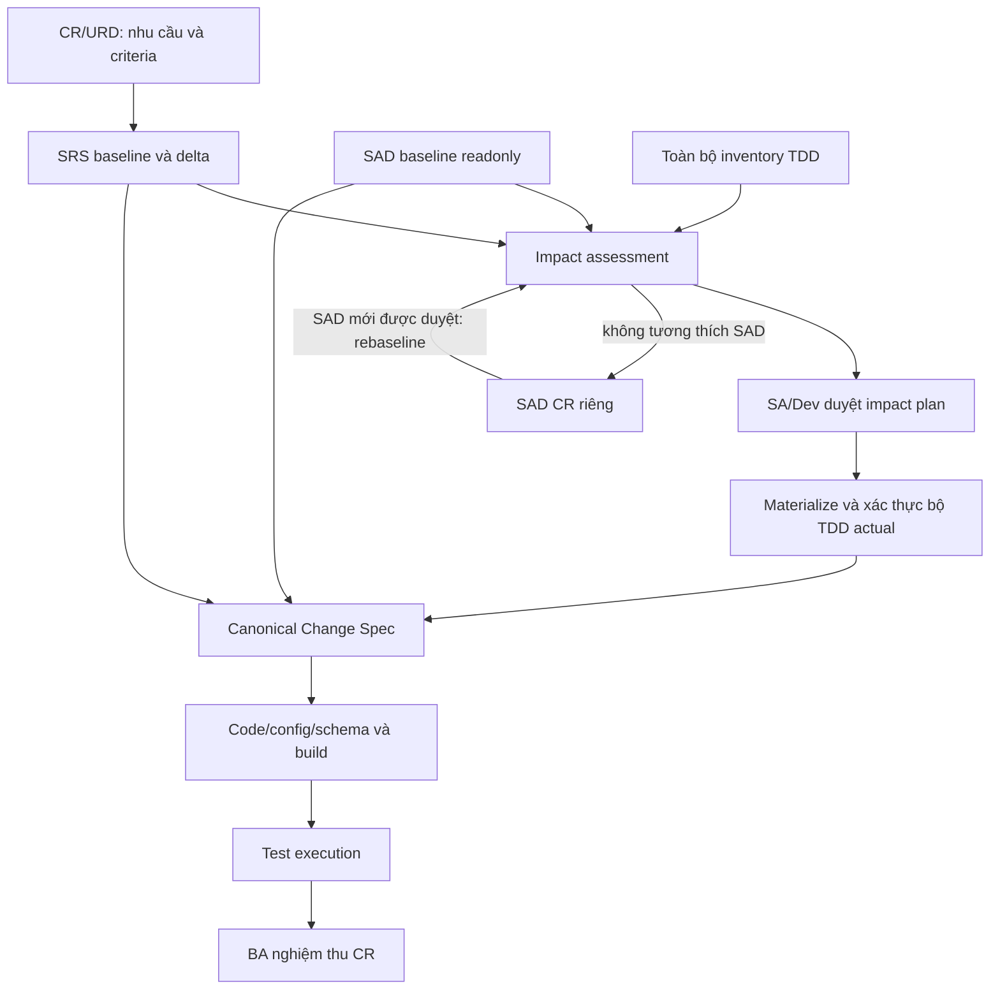

# Thiết kế các ontology domain và mapping trong quy trình phát triển phần mềm

Ngày: 2026-10-07. Trạng thái: **đề xuất thiết kế để review**, chưa phải schema/runtime đã triển khai hoặc quyết định đã phê duyệt.

Bản chi tiết ngày 2026-10-08: [Bộ đặc tả ontology, logic, mapping và validation xuyên dự án](ontology/README.md). Bộ này chi tiết hóa mô hình bên dưới; phần no-delta defect/refactor và architecture bootstrap được bổ sung như đề xuất contract, chưa thay runtime.

## 1. Quyết định nền tảng và phạm vi

Thiết kế năm ontology độc lập về ngữ nghĩa: **CR, SRS, SAD, TDD, Change Spec**. Mỗi ontology sở hữu khái niệm, quan hệ nội bộ, lifecycle và validation của domain đó. Các domain liên thông qua mapping có phiên bản và bằng chứng. Không lấy ontology TDD hiện tại làm lớp cha cho CR/SRS/SAD; không lấy cấu trúc thư mục OpenSpec làm mô hình nghiệp vụ.

Tài liệu này dựa trên [quy trình đã thống nhất](TDD_Document_Workflow_Consolidated_Proposal.md), [portfolio hiện hành](../openspec/README.md), [runtime hiện tại](../data/ontology_v0.5/o5/README.md) và đối chiếu cách phân chia nội dung trong [SRS PBOM](../data/test-pbom/SRS.md), [SAD PBOM](../data/test-pbom/SAD.md). Đây là thiết kế theo quy trình nội bộ, không tuyên bố tuân thủ một tiêu chuẩn bên ngoài.

Luồng đã chốt: **CR/URD → SRS delta → đánh giá tác động TDD được SA/Dev duyệt → bộ TDD thực tế → change spec → code/test/nghiệm thu CR**. SAD là baseline kiến trúc chỉ đọc trong luồng này; thay đổi kiến trúc cần SAD CR riêng.

Phần đề xuất mới: cấu trúc domain, vocabulary, mapping contract, lifecycle chi tiết và evidence model bên dưới. TDD ở đây luôn là Technical Design Document.

## 2. Phân lớp và quyền sở hữu

| Module / namespace logic | Sở hữu | Không sở hữu |
|---|---|---|
| `cr:` | Nhu cầu, mục tiêu, phạm vi thay đổi, tiêu chí nghiệm thu, quyết định về CR | Yêu cầu kỹ thuật chi tiết và giải pháp |
| `srs:` | Nghĩa vụ của hệ thống, hành vi quan sát được, quy tắc, dữ liệu/giao diện yêu cầu, requirement delta | Quyết định triển khai không được yêu cầu |
| `sad:` | Cấu trúc và ràng buộc kiến trúc, quyết định, phân bổ trách nhiệm và chiến lược chất lượng | Chi tiết triển khai từng operation |
| `tdd:` | Thiết kế cụ thể để đáp ứng yêu cầu trong kiến trúc đã duyệt | Thay đổi thẩm quyền của CR/SRS/SAD |
| `cs:` | Hợp đồng thay đổi cần thực hiện, target, dependency, verification và delivery scope | Tự phát minh requirement hoặc design còn thiếu |
| `foundation:` | Identity, revision, nguồn, reference, actor, evidence | Một superclass nghiệp vụ khổng lồ |
| `link:` | Mapping liên domain, justification, trạng thái đánh giá của mapping | Bản sao nội dung có thẩm quyền của domain khác |
| `flow:` | Baseline, impact, approval, realization, gate, trạng thái một lần chạy quy trình | Lifecycle nội bộ của mọi domain |
| `verification:` | Test specification, execution, kết quả và acceptance evidence | Tự thay BA quyết định nghiệm thu |
| `adapter:` | Nhập/xuất công cụ và tài liệu, ánh xạ ID, fidelity report | Vocabulary và điều kiện ready của domain |

Các namespace trên là tên logic, chưa ấn định URI hay công nghệ lưu trữ. Mỗi domain publish contract version riêng; một integration profile pin tổ hợp version tương thích. Domain chỉ phụ thuộc foundation; link module tham chiếu public types của các domain; flow dùng các contract này. Nhờ đó không có vòng import bắt buộc CR→SRS→TDD→CR.

Một file không tương đương một domain. SRS thực tế có thể chứa API hoặc thuật toán ở mức rất chi tiết. Phải phân loại theo **nghĩa và thẩm quyền phát biểu**, không theo tên file hay heading: thuật toán được SRS bắt buộc là requirement constraint; thuật toán do Dev lựa chọn là TDD design decision. Một section có thể là nguồn cho nhiều assertion thuộc các domain khác nhau, nhưng phải giữ rõ vai trò của từng assertion.

## 3. Foundation: identity, version và nguồn

| Entity | Thuộc tính tối thiểu | Quy tắc |
|---|---|---|
| `EntityIdentity` | namespace, entityId, kind, owningDomain | ID ổn định qua revision, không dùng số thứ tự section làm ID |
| `EntityRevision` | identityRef, revisionId, semanticHash, lifecycleState | Immutable; một revision thuộc đúng một identity |
| `DocumentRevision` | documentId, revisionId, role, contentHash, location | Artifact mang nội dung; role không tự quyết định type mọi nội dung |
| `SectionAnchor` | documentRevisionRef, sectionId, locator, excerptHash | Một anchor thuộc đúng một document revision; heading/line chỉ là locator |
| `SourceAssertion` | assertionId, subjectRevisionRef, anchors, authorityKind | Phân biệt normative, informative, assumption, proposed, derived |
| `Evidence` | evidenceId, kind, artifactRef/hash, producer, recordedAt, scope | Có phạm vi chứng minh cụ thể; confidence không phải approval |
| `Actor` / `RoleAssignment` | actorId, actorKind, role, scope, validity | Phân biệt người và agent; role phải hợp lệ trong project/domain |

Document revision và entity revision tách biệt: sửa trình bày có thể đổi document hash nhưng giữ semantic revision. Tuy nhiên các anchor và freshness phải được resolve/revalidate; không tự bỏ qua hash drift. Mapping có provenance bị đổi phải được đánh giá lại trước khi dùng ở gate.

Mọi endpoint của mapping sử dụng `EntityRevisionRef = {namespace, entityId, revisionId}`. Nguồn tài liệu dùng reference riêng có document revision/hash/section. Không dùng `latest` trong một baseline hoặc approval. Revision cũ, requirement bị bỏ và mapping cũ được giữ để audit.

## 4. CR ontology

CR diễn đạt **vì sao cần đổi, đổi trong phạm vi nào và khi nào được chấp nhận**. URD có thể là nguồn nhu cầu ban đầu; không bắt buộc biến toàn bộ URD thành một CR.

| Entity | Nội dung bắt buộc |
|---|---|
| `ChangeRequest` | ID, title, changeKind, requester, owner, scope, rationale |
| `BusinessNeed` / `ProblemStatement` | Nhu cầu/vấn đề, bối cảnh, đối tượng bị ảnh hưởng |
| `BusinessObjective` | Outcome mong muốn, phép đo thành công nếu áp dụng |
| `ScopeItem` | Đối tượng/phạm vi; disposition `in_scope` hoặc `out_of_scope` |
| `AcceptanceCriterion` | Điều kiện, kết quả quan sát được, verificationMethod, acceptanceOwner |
| `BusinessImpact` | Người/quy trình/tài sản bị ảnh hưởng, lợi ích, chi phí/rủi ro có nguồn |
| `ChangeDependency` | CR phụ thuộc hoặc xung đột, loại dependency, lý do |
| `DispositionDecision` | accept/reject/defer/cancel, người quyết định, rationale, payload revision |

Quan hệ nội bộ: `ChangeRequest addresses BusinessNeed (1..*)`, `pursues BusinessObjective (0..*)`, `hasScope ScopeItem (1..*)`, `hasAcceptanceCriterion AcceptanceCriterion (1..* trước khi vào delivery)`. Một criterion thuộc đúng một CR revision; criterion dùng chung được tham chiếu/reuse có provenance, không gộp identity của các CR.

Lifecycle đề xuất: `draft → submitted → in_review → authorized | rejected | deferred`; authorized có thể cancelled theo quyết định. **Authorization cho xử lý CR khác acceptance sau triển khai**. Trạng thái delivery được suy ra từ flow/evidence, không ép thành một enum chung. Sửa criterion sau authorization tạo revision và tái đánh giá downstream.

## 5. SRS ontology

SRS diễn đạt **hệ thống phải làm gì và phải bảo đảm điều gì**.

| Entity | Nội dung bắt buộc |
|---|---|
| `Requirement` / `RequirementRevision` | Statement có modality, requirementKind, priority, owner, verificationMethod |
| `FunctionalRequirement` | Actor/stimulus, điều kiện, hành vi và outcome |
| `QualityRequirement` | Measure, comparator, threshold/unit, workload/environment và measurement window |
| `BusinessRule` | Predicate, applicability, exception và kết quả/quyết định |
| `UseCase` / `Scenario` | Actor, precondition, trigger, steps/observable outcomes, alternative/negative paths |
| `LogicalDataConcept` / `DataConstraint` | Khái niệm dữ liệu, nghĩa, logical attributes và invariants |
| `ExternalInterfaceRequirement` | Consumer/provider, input/output/error/security nghĩa vụ quan sát được |
| `RequirementConstraint` | Ràng buộc solution được upstream bắt buộc, rationale và authority |
| `RequirementDeltaSet` / `RequirementDelta` | Before/after baseline, changes, reason và CR lineage |

Quan hệ: `Requirement refines Requirement`, `UseCase hasScenario Scenario (1..*)`, `Scenario specifies Requirement (1..*)`, `Requirement governedBy BusinessRule (0..*)`, `Requirement concerns LogicalDataConcept (0..*)`. Refinement không có cycle; requirement nguyên tử hoặc tổ hợp phải khai báo cách xác định coverage của các thành phần.

Delta có `add | modify | remove`; add: before=null, after có revision; remove: before có revision, after=null; modify: cả hai và khác revision. Rename giữ identity nếu nghĩa không đổi; split/merge dùng lineage nhiều-nhiều và identity mới khi thay đổi đơn vị nghĩa. Delta là sự khác nhau có chủ đích, không chỉ textual diff.

Lifecycle: `draft → in_review → approved → superseded | retired`; rejection trả về draft có review record. Baseline requirements có thể tồn tại trước CR hiện tại; **mọi delta trong delivery run phải có CR/URD authority**, không bắt buộc sửa lịch sử để mọi requirement cũ có CR mới.

## 6. SAD ontology

SAD diễn đạt **hệ thống được tổ chức như thế nào và các quyết định kiến trúc giới hạn giải pháp ra sao**.

| Entity | Nội dung bắt buộc |
|---|---|
| `ArchitectureDescription` | System scope, architecture revision, owners |
| `StakeholderConcern` / `ArchitectureDriver` | Concern hoặc động lực và ưu tiên có nguồn |
| `Viewpoint` / `ArchitectureView` | Concern được xem xét, notation/conventions và model elements |
| `ArchitectureElement` | Kind: system/subsystem/service/store/external-system; responsibility, owner |
| `Connector` | Endpoints, interaction style, contract boundary |
| `ArchitectureConstraint` / `Principle` | Predicate/rule, applicability và authority |
| `ArchitectureDecision` | Context, decision, alternatives, rationale, consequences, status |
| `QualityScenario` / `QualityStrategy` | Stimulus/environment/response/measure; tactic và trade-off |
| `DeploymentNode` / `TrustBoundary` | Placement/resource/environment hoặc security boundary |
| `ArchitectureRisk` / `Assumption` | Nội dung, owner, evidence, review trigger |

Quan hệ: `ArchitectureDescription hasView (1..*)`; `ArchitectureView conformsTo Viewpoint (1)`; view `shows ArchitectureElement (0..*)`; element `connectedBy Connector`; decision `constrains ArchitectureElement`; strategy `addresses QualityScenario`; view `addresses StakeholderConcern`. View cùng tham chiếu một element identity, không tạo service mới theo mỗi sơ đồ.

Lifecycle: model revision `draft → reviewed → approved → superseded`; decision `proposed → accepted | rejected`, accepted → superseded bằng decision mới. Một SAD revision được pin readonly trong product-change run. Phát hiện vi phạm kiến trúc tạo finding và dependency tới architecture CR; sau khi SAD mới được duyệt, rebaseline và đánh giá lại SRS/impact. Không tự sửa SAD để hợp thức hóa TDD.

## 7. TDD ontology

TDD diễn đạt **thiết kế đủ cụ thể để thực hiện**, theo capability/module hoặc scope có owner rõ ràng.

| Nhóm | Entity và nghĩa |
|---|---|
| Tổ chức | `DesignUnit`, `DesignRevision`, `DesignSection`, `DesignDecision`, `DesignDependency` |
| Hành vi | `Operation`, `InteractionFlow`, `Algorithm`, `DecisionTable`, `StateMachine`, `Transition`, `Invariant` |
| Hợp đồng | `InterfaceContract`, `Endpoint`, `EventContract`, `ErrorContract`, `ContractCompatibility` |
| Dữ liệu | `PhysicalDataModel`, `Table`, `Field`, `Index`, `Transaction`, `ConsistencyModel`, `Migration` |
| Resilience | `TimeoutBudget`, `RetryPolicy`, `IdempotencyPolicy`, `FailurePolicy`, `RecoveryPlan` |
| Chất lượng/vận hành | `LoadProfile`, `CapacityModel`, `SLOAllocation`, `ObservabilityDesign`, `RolloutPlan` |
| Bảo mật | `PermissionDesign`, `SecurityControl`, `SecretHandling`, `AuditDesign` |
| Độ đầy đủ | `DesignObligation`, `ObligationResolution`, `DesignAssumption`, `DesignGap` |

Quan hệ: design unit `contains DesignElement`; operation `uses InterfaceContract`, `reads/writes PhysicalDataModel`, `governedBy Policy`, `participatesIn Transaction`; obligation `resolvedBy DesignElement (0..* khi draft; 1..* khi resolved)` kèm evidence cho tính đủ. Không áp mọi entity lên mọi TDD: applicability/risk/profile quyết định nghĩa vụ bắt buộc; unknown và N/A có evidence được xử lý khác nhau.

`DesignRevision` có lifecycle `draft → reviewed → accepted → superseded`. Approval của impact plan cho phép materialize không đồng nghĩa mọi nội dung TDD tự động accepted. Realization kiểm actual design phù hợp plan và nguồn; content review theo policy phải có receipt riêng nếu bắt buộc.

## 8. Change Spec ontology

Change Spec diễn đạt **gói thay đổi kỹ thuật có thể thực hiện và kiểm chứng**; nó có ngữ nghĩa riêng, không phải bản rút gọn của TDD hay thư mục OpenSpec.

| Entity | Nội dung bắt buộc |
|---|---|
| `ChangeSpecification` | Identity/revision, scope, input baseline, items, readiness |
| `ChangeItem` | ID ổn định, action `add/modify/remove`, desiredEffect, rationale |
| `ChangeTarget` | Kind: code/config/schema/interface/infrastructure; locator/symbol/logical target và repo baseline |
| `BehaviorChange` | Before/after observable contract, retained behavior, compatibility |
| `VerificationCriterion` | Preconditions, stimulus/action, expected result, method, acceptance refs |
| `ImplementationTask` | Work breakdown, owner, dependencies, completion evidence |
| `DeliveryConstraint` | Ordering, rollout/migration/compatibility restrictions xuất phát từ design |
| `ProjectionRecord` | Canonical revision/hash, adapter version, artifact refs/hashes, mapping manifest và fidelity result |

`ChangeSpecification hasItem (1..* cho gói cần implementation)`; `ChangeItem affects ChangeTarget (1..*)`, `hasVerificationCriterion (1..*)`, `dependsOn ChangeItem (0..*)`; execution dependency phải acyclic hoặc được chuyển thành nhóm atomic có semantics rõ ràng. Tasks nhiều-nhiều với items; task hoàn thành không chứng minh criterion passed.

Lifecycle: `draft → validated → implementation_ready → implemented → verified → closed`, cùng finding/review events cho rework. `implementation_ready` được cấp bởi gate trên inputs hiện hành, không do đổi enum. Không tạo artifact/item change spec trước impact approval theo quy trình đã chốt. Phân tích và thiết kế preview trước approval vẫn thuộc impact/TDD, không gắn nhãn draft spec để bypass.

CR có thể kết thúc không cần implementation nếu là duplicate/no-op được quyết định có evidence. Khi đó ghi disposition và coverage outcome; không tạo item giả để thỏa cardinality.

## 9. Mapping liên domain: hợp đồng ngữ nghĩa

Mỗi mapping là `link:MappingAssertion`, không chỉ là một edge `traces_to`:

`{id, mappingType, sourceRefs[], targetRefs[], inputBaselineRef, rationale, evidenceRefs[], coverageScope, assessmentState, assessor, assessedAt, mappingContractVersion}`.

`assessmentState = proposed | validated | rejected | stale`. validated nghĩa mapping đã được kiểm theo rule tương ứng; **không tự suy ra requirement satisfied hoặc CR accepted**. Cardinality bên dưới áp dụng tại gate tương ứng, không ép graph draft phải đầy đủ. Ký hiệu `1..*` là số endpoint cho từng assertion trừ khi nêu toàn bộ coverage.

| ID / predicate và chiều | Source → target | Cardinality / điều kiện | Ý nghĩa và kiểm tra |
|---|---|---|---|
| M01 `operationalizedBy` | CR AcceptanceCriterion → SRS RequirementRevision | 1 → 1..* với criterion phần mềm được đưa vào delivery | Requirements cụ thể hóa criterion; so sánh scope, điều kiện và outcome, không chỉ trùng từ |
| M02 `authorizedBy` | SRS RequirementDelta → CR revision + criteria/scope | 1 → 1..* | Mọi delta phải nằm trong phạm vi được cho phép; technical enabler có derivation rationale tới criterion |
| M03 `motivates` | SRS RequirementRevision → SAD Driver/QualityScenario/Decision | 1..* → 1..* khi có significance kiến trúc | Giải thích quyết định kiến trúc từ requirement; không buộc mỗi FR có ADR riêng |
| M04 `constrains` | SAD Constraint/Decision → SRS requirement hoặc TDD design revision | 1 → 1..* trong applicability scope | Ràng buộc hợp lệ tại baseline; kiểm conformance bằng assertion/check cụ thể |
| M05 `addressedByDesign` | SRS RequirementRevision → TDD DesignElementRevision | 1..* → 1..* với requirement cần thiết kế | Design giải quyết obligation; coverage đầy đủ là kết quả assessment riêng |
| M06 `allocatedTo` | TDD DesignUnit/Element → SAD ArchitectureElement | 1..* → 1..* | Phân bổ thiết kế vào trách nhiệm kiến trúc; có thể nhiều service cho một flow |
| M07 `refinesContract` | TDD InterfaceContract/DataModel → SRS InterfaceRequirement/LogicalDataConcept | 1..* → 1..* khi applicable | Chi tiết hóa contract mà giữ nghĩa upstream; kiểm type, unit, nullability, error và constraints |
| M08 `implementsDelta` | CS ChangeItem → SRS RequirementDelta + revision endpoints | 1 → 1..* | Giải thích thay đổi cần code/config; removal giữ before ref và tombstone |
| M09 `realizesDesign` | CS ChangeItem → TDD actual DesignElementRevision | 1 → 1..* | Bắt buộc actual post-step-4, có anchor; không trỏ planned hoặc baseline đã lỗi thời |
| M10 `verifiedBy` | CS VerificationCriterion → verification TestSpecification | 1 → 1..* trước implementation acceptance | Test định nghĩa assertion tương ứng; không phải test execution |
| M11 `acceptanceDerivedFrom` | CS VerificationCriterion → CR AcceptanceCriterion | 1 → 1..* | Phải chứng minh liên hệ với outcome; test nội bộ/enabler có derivation path rõ ràng |
| M12 `implementsItem` | ImplementationArtifactRevision → CS ChangeItem | 1..* → 1..* | Commit/config/schema change nằm trong spec; pin repository revision |
| M13 `evaluates` | TestExecution → TestSpecification + artifact/build revision | 1 → 1 test revision + 1 build manifest | Result/log/environment/time/assertions thực thi, gồm fail/error/skipped |
| M14 `acceptsCriterion` | AcceptanceReceipt → CR AcceptanceCriterion | 1 → 1..* | BA/actor có thẩm quyền, evidence execution/review và CR revision đúng |

M01/M05 nhiều-nhiều không được dùng phép suy luận “có một cạnh là covered”. Với mapping tổ hợp phải ghi contributions và composition rule (`all_of`, `any_of`, hoặc predicate chuyên biệt). Nhiều test cùng pass vẫn chưa đủ nếu không kiểm toàn bộ nghĩa vụ bắt buộc. Criterion phi phần mềm có disposition/verification method riêng và vẫn nằm trong acceptance denominator.

Quan hệ mapping không mặc định transitive. CR→SRS và SRS→TDD chỉ cho phép tìm candidate trace path; không tự chứng minh CR được đáp ứng. `sameAs` không dùng cho SRS requirement và TDD operation, hoặc SAD service và TDD module. Chúng là các đối tượng khác nghĩa dù cùng tên.

## 10. Liên kết quy trình, baseline và gates

| Gate | Input và output | Điều kiện / người chịu trách nhiệm |
|---|---|---|
| G0 Intake | CR/URD, baseline refs → accepted intake | Scope/criteria/authority rõ; BA chịu nội dung, actor approval theo project policy |
| G1 Requirements | SRS before/after + delta → requirements-ready | M02 đủ, conflicts được giải quyết, acceptance đo được; BA + Dev/SA review |
| G2 Impact approval | SRS delta + SAD + complete TDD inventory → ImpactReport + Approval | Mỗi TDD có add/update/no_change và rationale; mỗi delta có coverage hoặc gap; SA/Dev duyệt, agent không tự duyệt |
| G3 Realization | Approved plan → actual TDD set + realization manifest | Add/update đủ; no_change reuse đúng revision; M04–M07 và obligations được kiểm; không có unplanned drift |
| G4 Spec readiness | SRS delta + actual TDD + SAD + lineage → canonical CS | M08/M09/M11 bắt buộc từng item; verification rõ; adapter không sửa nghĩa; missing/unknown/conflict chặn |
| G5 Implementation verification | CS + code/build + execution evidence → verification report | Trace M10/M12/M13, đúng version/env, assertion đúng và required checks pass; Dev/QA |
| G6 Acceptance | CR criteria + verification/demo/inspection evidence → AcceptanceReceipt | BA/người có thẩm quyền chấp nhận từng criterion; tồn tại test pass không tự cấp acceptance |

`flow:DeliveryRun` pin CR revisions, SRS before/after, SAD revision, TDD inventory, ontology/mapping/profile versions và repo snapshot. Một run có thể phục vụ nhiều CR; không gộp acceptance của chúng. Một CR có thể chia nhiều run, có scope partition và aggregate acceptance tránh đóng sớm.

`ImpactApproval` bind approver/role/time, immutable decision payload hash và baseline inputs. `TddSetRealization` bind approval, baseline→actual mappings, action, actual sections và conformance evidence. Cập nhật TDD đúng approved plan không làm approval stale; đổi SRS/SAD/plan hoặc baseline ngoài kiểm soát phải đánh giá lại. GateDecision lưu rule version, input digest, executed checks, outcome và findings.

TDD bị ngừng dùng được ghi `update` với design lifecycle retired và tombstone/decommission design; giữ nguyên ba action impact đã chốt. Không xóa lịch sử hoặc biến missing design thành no_change. Trường hợp whole-system bootstrap dùng empty TDD inventory tường minh và add entries có nguồn; không giả baseline tồn tại.

## 11. Invalidation, conflict và thay đổi song song

| Thay đổi | Đối tượng phải xem xét lại | Điểm quay về |
|---|---|---|
| CR scope/criterion đổi nghĩa | SRS mappings/delta, design coverage, CS verification, acceptance | G0/G1 |
| SRS requirement đổi | Impact, dependent design/CS và tests liên quan | G2 |
| SAD constraint/decision đổi | SRS feasibility, design conformance, impact approval | SAD CR hoàn tất rồi G1/G2 |
| TDD sửa đúng plan | Actual refs, mapping/conformance và realization | G3, giữ approval plan nếu vẫn hợp lệ |
| TDD sửa ngoài plan | Impact decision và dependent CS | G2 |
| CS behavior/target/criterion đổi | Fidelity, task/code mapping và execution coverage | G4 |
| Code/build đổi | Test execution applicability và acceptance evidence liên quan | G5 |
| Chỉ đổi trình bày | Source anchors, document refs và semantic-equivalence evidence | Rebind/revalidate; không tự yêu cầu lại toàn bộ business approval |

Invalidation đánh dấu evidence/mapping **stale**, không xóa kết luận lịch sử. Theo dependency closure và scope đã chứng minh; unresolved dependency làm incomplete assessment, không tự xem unaffected. Dùng expected baseline digest khi publish để phát hiện hai CR đồng thời sửa cùng requirement/design. Rebase/merge phải tạo revision và đánh giá impact mới; không dùng last-write-wins cho normative content.

Conflict giữ cả hai assertion và nguồn; phân loại scope/version/unit/behavior/authority. Authority xác định domain nào được sửa và ai duyệt; không phải cơ chế tự chọn một câu để bỏ câu kia. Prompt mâu thuẫn SRS đi upstream CR/SRS; prompt đổi kiến trúc đi SAD CR.

## 12. Kiểm chứng và coverage

Validation gồm bốn lớp độc lập:

1. Structural: domain/range, cardinality, required fields, reference resolution và unique identity.
2. Semantic: phù hợp requirement, design, architecture, đơn vị/threshold, positive/negative behavior; check tự động và human review theo profile.
3. Workflow: đúng baseline/approval/realization, actor authority, freshness và gates.
4. Evidence: kiểm tra đã chạy, result đúng artifact/version/environment và đủ để kết luận tương ứng.

Với mỗi obligation/criterion, lưu outcome `satisfied | violated | unknown | not_applicable` cùng evidence; `not_applicable` cần lý do được review. Không dùng thiếu node để suy ra N/A. Ontology inference có thể mở; gate validation dùng **closed, pinned scope** để kiểm completeness.

Báo cáo riêng: requirement→design coverage; delta→CS coverage; CS→executed verification coverage; CR→acceptance coverage. Denominator gồm toàn bộ mandatory units trong scope, kể cả missing/unknown/blocked. N/A chỉ được loại khi có quyết định hợp lệ. Không gộp thành một phần trăm “ready” che mất gate chưa pass; empty scope báo N/A/explicit no-op, không báo 100% tự động.

## 13. Adapter và tính độc lập với OpenSpec

Canonical CS được tạo và kiểm trước projection. Adapter không có quyền thêm design, sửa yêu cầu hay cấp approval.

| Artifact OpenSpec | Nguồn canonical | Thông tin cần giữ |
|---|---|---|
| `proposal.md` | CR context + CS scope/rationale | CR refs, exclusions, baseline |
| `design.md` | Actual TDD decisions và SAD constraints liên quan | TDD/SAD refs có version; không phát minh giải pháp |
| `specs/*/spec.md` | BehaviorChange + SRS delta + verification criteria | add/modify/remove, retained scenarios, acceptance trace |
| `tasks.md` | ImplementationTask + ChangeItem dependency | Stable item/task IDs và completion evidence links |
| Sidecar mapping manifest | ProjectionRecord + mappings | Canonical IDs/revisions, anchors/hashes, losses và adapter version |

Tương tự có thể tạo Markdown pack, JSON exchange, issue tracker hoặc tool khác. Một artifact có thể chứa nhiều items và một item nằm ở nhiều artifacts; mapping là nhiều-nhiều. Path/heading không trở thành business identity.

Import OpenSpec tạo **candidate** canonical assertions; phải resolve SRS/actual TDD/CR sources và qua gates mới ready. Nếu thiếu nguồn, giữ unresolved findings; không suy ra approval từ task checkbox, trạng thái archive hay thư mục main specs. Export→import phải giữ action, identity, trace, scenarios và constraints bắt buộc; loss phải báo rõ, critical loss chặn publication. Không yêu cầu tool nào round-trip được chi tiết nó không biểu diễn, nhưng phải có sidecar/loss report.

## 14. Ví dụ xuyên suốt: cấu hình timeout (giả định minh họa)

Ví dụ độc lập, **không phải yêu cầu PBOM đã được duyệt**. Giả định SAD cho phép cấu hình timeout; TDD hiện hành thiết kế miền 1–10 giây và đã có phân tích retry/deadline tương thích với 3 giây.

| Domain | Revision / nội dung | Mapping |
|---|---|---|
| CR | `CR-DEMO@1`, AC-1: timeout mặc định từ 5s thành 3s; lỗi timeout vẫn đúng contract | AC-1 M01→ FR-TIMEOUT@2 |
| SRS | FR-TIMEOUT@1=5s → @2=3s; DELTA-1 modify, giữ error semantics | DELTA-1 M02→ CR-DEMO@1 |
| SAD | ARCH-CONFIG@4: timeout cấu hình được trong service boundary | M04→ TDD timeout policy |
| TDD | TIMEOUT-POLICY@7: configurable [1,10]s, retry/deadline constraints; giữ revision nếu đã bao phủ toàn bộ nghĩa vụ | FR@2 M05→ POLICY@7; policy M06→ service |
| Flow | Impact no_change, SA/Dev approval; realization @7→@7 với actual anchor | Phân tích chứng minh 3s trong miền và toàn bộ guarantees vẫn đúng |
| CS | CS-DEMO-1 modify config default 5→3; criteria kiểm default, override hợp lệ, timeout error và deadline budget | M08→ DELTA-1; M09→ POLICY@7; M11→ AC-1 |
| Verification | Test execution trên build/config revision cụ thể, boundary/error assertions có log | M13→ test revision/build; criterion M10→ test |
| Acceptance | BA receipt xác nhận AC-1 trên CR-DEMO@1 | M14→ AC-1 |

Nếu 3s phá retry/deadline budget, không được no_change dù vẫn trong [1,10]: đổi sang update và duyệt lại impact. Nếu CR đổi thành 500ms ngoài miền, quay G2 để thiết kế; nếu còn trái SAD thì mở SAD CR. Nếu bỏ requirement: M08 trỏ delta removal và before SRS revision; M09 vẫn trỏ actual TDD giải thích decommission/compatibility, không dùng section đã xóa làm nguồn thiết kế hiện hành.

## 15. Đối chiếu runtime hiện tại và hướng hiện thực hóa

Runtime được đặt tại `data/ontology_v0.5/o5` nhưng README/manifest công bố v0.6.0. Các types hiện có là ứng viên tái sử dụng qua mapping; không xem chúng là schema đích đã hoàn tất.

| Hiện có | Domain/module đích | Hướng xử lý đề xuất |
|---|---|---|
| DocumentRef, SectionRef | foundation | Tách artifact refs khỏi semantic entity revision refs |
| RequirementVersion, RequirementDelta, SrsDelta | srs | Chuẩn hóa requirement identity, delta set và CR authorization mapping |
| ImpactReport, ImpactApproval, TddSetRealization | flow | Giữ contract ba action và actual realization; không đặt trong ontology TDD |
| DesignObligation, ObligationResolution và design types | tdd + link | TDD sở hữu obligation/resolution; nguồn CR/SRS qua mapping |
| ChangeSpecItem | cs | Phân rõ change item, target, verification criterion và task |
| TestReceipt, AcceptanceReceipt | verification + link tới cr | Tách test definition/execution/BA decision và pin version |
| `traces_to` và quan hệ tổng quát | link | Classify sang predicates có semantics; unknown không tự chuyển validated |
| CR/SAD dưới dạng document refs | cr / sad | Cần model nội dung domain; document role/ref không thay các entity nghiệp vụ |

Trình tự bàn giao đề xuất:

1. Chốt vocabulary, ownership, version/reference và mapping catalog trong thiết kế này.
2. Đặc tả schema riêng cho mỗi domain và mapping module; chọn JSON Schema/graph shapes/relational constraints theo runtime, không gắn ontology với một format bắt buộc.
3. Tạo fixtures CR→SRS→SAD/TDD→CS→evidence: positive, negative, removal, multi-CR, concurrency, no-op và architecture-change.
4. Ánh xạ/migrate dữ liệu hiện có bằng bảng nguồn→đích, loss report và compatibility reader; giữ snapshot lịch sử.
5. Implement validators/gates rồi adapter OpenSpec; bổ sung adapter thứ hai để kiểm tính độc lập khỏi công cụ.
6. Chạy end-to-end và human review: schema pass, trace pass, semantic pass, workflow pass, acceptance là những bằng chứng riêng.

Không đánh dấu bước nào đã triển khai bằng việc có tài liệu này. Cần reconcile ownership với portfolio hiện tại trước khi tạo implementation changes; không tự sửa change đã archive hoặc apply fixture PBOM bị từ chối.

## 16. Các trường hợp bắt buộc khi review/kiểm thử thiết kế

- ID/section đúng nhưng SRS và TDD mâu thuẫn nghĩa: block G3/G4.
- Đủ requirement refs nhưng thiếu actual TDD sau materialization: block G4.
- Approval cũ sau CR/SRS/SAD drift; agent tự ghi approved: block tương ứng.
- Một delta ảnh hưởng nhiều TDD, thiếu một realization hoặc consumer: incomplete coverage.
- Nhiều CR dùng chung requirement nhưng criteria khác nhau: acceptance riêng, không đóng cả hai từ một receipt thiếu scope.
- Remove/split/merge/rename: còn history, before/after và lineage đúng.
- SAD service và TDD module cùng tên: vẫn là identity riêng có allocation mapping.
- SRS chứa API/algorithm chi tiết: giữ authority requirement; không chuyển ownership chỉ vì nội dung kỹ thuật.
- no_change TDD nhưng đổi config: được phép khi guarantee được chứng minh, vẫn bắt buộc dual-source CS.
- Test pass trên build cũ, test skipped, thiếu assertion hoặc criteria thay đổi: không accepted.
- OpenSpec archive/task checked nhưng thiếu approval/evidence: không được ready/closed.
- Export qua adapter khác giữ semantics; loss bắt buộc phát hiện, không silently drop.
- Unknown/N/A/missing luôn phân biệt; incomplete inventory không được coi là không ảnh hưởng.
