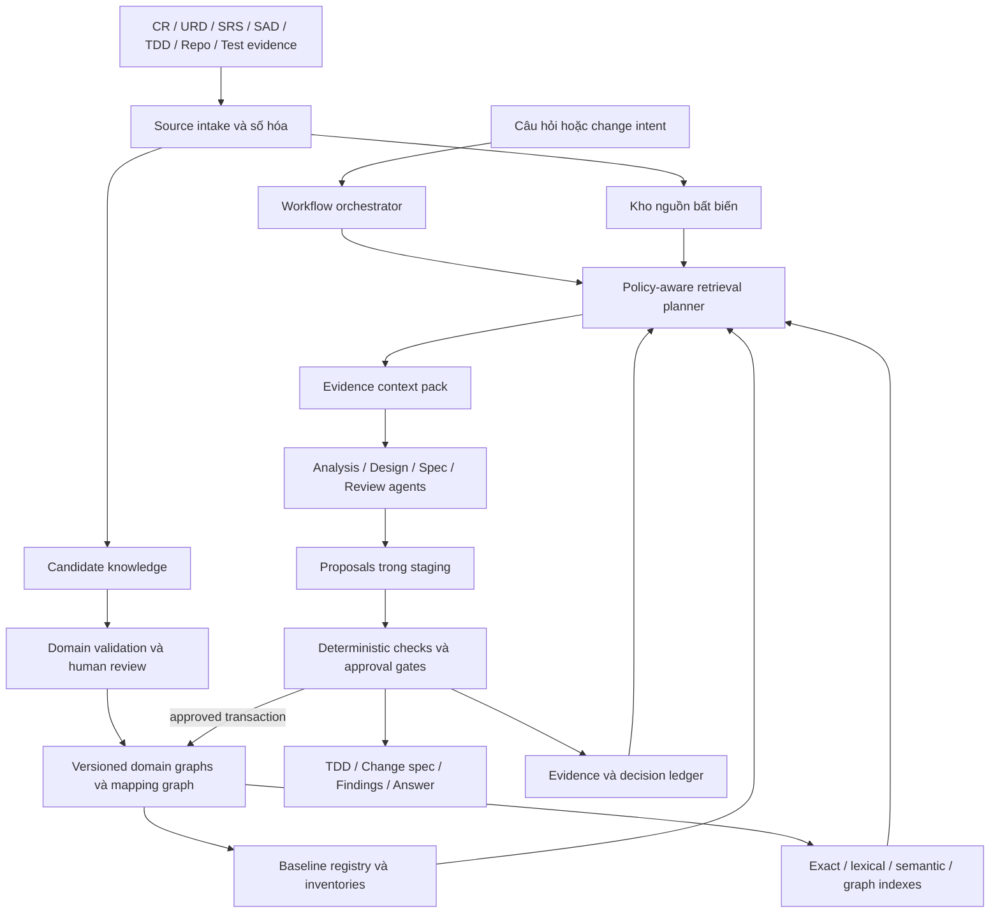
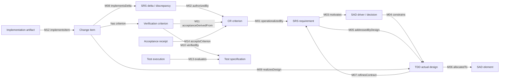
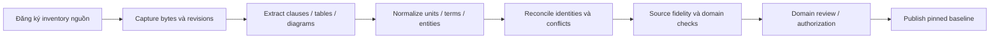
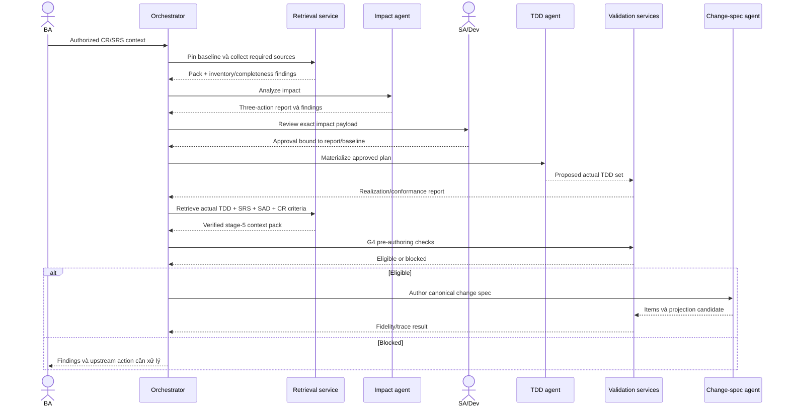

# Thiết kế hệ thống knowledge và agent cho toàn vòng đời phát triển phần mềm

**Luồng xử lý · Luồng agent · Ontology liên domain · Tình huống sử dụng · Truy vấn và retrieval**

Phiên bản: **1.0 — Bản thiết kế để review**  
Ngày: **09/10/2026**  
Đối tượng: BA, SA, Tech Lead, Dev, QA, người phê duyệt và nhóm xây dựng nền tảng agent.

Tài liệu này trình bày thiết kế tổng thể trong một bản đọc độc lập. Đây là đặc tả hệ thống mục tiêu, không phải báo cáo xác nhận toàn bộ chức năng đã được triển khai. Các quyết định về ontology kế thừa bộ đặc tả liên domain ngày 08/10/2026; các phần orchestration và retrieval dưới đây là thiết kế tích hợp được đề xuất.

## Mục lục

1. Mục tiêu và nguyên tắc
2. Kiến trúc tổng thể
3. Thiết kế ontology và knowledge
4. Mapping liên domain và logic nhất quán
5. Luồng xử lý đầu cuối
6. Thiết kế agent và phân quyền
7. Orchestration, checkpoint và recovery
8. Thiết kế retrieval đặc trưng
9. Context pack và câu trả lời có bằng chứng
10. Các case sử dụng thực tế
11. Case truy vấn và kế hoạch retrieval
12. Minh họa một lượt thay đổi hoàn chỉnh
13. Validation, coverage và các cổng
14. Hợp đồng dịch vụ và lưu trữ
15. Bảo mật, audit và vận hành
16. Kiểm chứng chất lượng hệ thống
17. Thứ tự hiện thực hóa và điều kiện bàn giao
18. Tài liệu nền và quyết định cần giữ nhất quán

## 1. Mục tiêu và nguyên tắc

### 1.1. Hệ thống cần giải quyết điều gì?

Tài liệu dự án thường phân tán giữa CR/URD, SRS, SAD, nhiều TDD, change specs, repository và kết quả kiểm thử. Có đường dẫn giữa các file chưa đủ để trả lời: yêu cầu nào chưa có thiết kế; hai tài liệu có mâu thuẫn không; một thay đổi ảnh hưởng tới đâu; code/test hiện tại có đáp ứng đúng tiêu chí nghiệm thu hay không.

Hệ thống đề xuất số hóa tài liệu thành knowledge có cấu trúc, nguồn và phiên bản; duy trì liên kết ngữ nghĩa giữa các domain; hỗ trợ agents phân tích/soạn thảo; kiểm tính toàn vẹn trước khi chuyển bước. Mọi kết luận phải gắn với scope và baseline cụ thể.

| Mục tiêu | Kết quả cần cung cấp |
|---|---|
| Số hóa có thể kiểm chứng | Từ mỗi fact/rule có thể mở đúng đoạn nguồn và revision |
| Rà soát tài liệu | Phát hiện missing, conflict, stale, unsupported và orphan knowledge |
| Kiểm soát thay đổi | Impact report có lý do, inventory đầy đủ, approval và actual TDD |
| Hỗ trợ triển khai | Change spec có nguồn SRS + actual TDD và CR-derived verification |
| Hỗ trợ truy vấn | Câu trả lời có evidence, phản chứng và mức đầy đủ của phạm vi tìm kiếm |
| Nghiệm thu đúng | Phân biệt thiết kế đủ, code hoàn thành, test đã chạy và BA chấp nhận |

### 1.2. Nguyên tắc thiết kế

1. **Các ontology độc lập nhưng liên kết:** CR, SRS, SAD, TDD, Change Spec có ownership, vocabulary và lifecycle riêng.
2. **Một tài liệu không đồng nghĩa một domain:** phân loại theo nghĩa và thẩm quyền phát biểu, không chỉ tên file.
3. **Knowledge có phiên bản và nguồn:** accepted baseline bất biến; không dùng `latest` trong approval hoặc evidence.
4. **LLM đề xuất, services kiểm, con người duyệt:** agents không tự tạo human approval hoặc BA acceptance.
5. **Retrieval phục vụ nghĩa vụ cần chứng minh:** tìm những gì cần cho câu hỏi/tác vụ, không chỉ các đoạn giống từ khóa.
6. **Không có match không có nghĩa không ảnh hưởng:** kiểm tính đầy đủ bằng inventories và dependency closure.
7. **Unknown khác false và N/A:** thiếu nguồn hoặc checker chưa hỗ trợ phải được giữ rõ.
8. **OpenSpec là adapter:** cấu trúc thư mục, checkbox hoặc archive status không quyết định domain semantics/readiness.

Số hóa đúng văn bản không tự chứng minh nghiệp vụ đúng. Một fact đã trích xuất chính xác vẫn có thể là proposal, assumption hoặc mâu thuẫn với nguồn khác.

### 1.3. Vai trò người dùng

BA sở hữu nhu cầu/criteria và nội dung requirements; SA sở hữu kiến trúc và tham gia duyệt impact; Dev sở hữu thiết kế/implementation theo nguồn đã duyệt; QA kiểm verification; BA/người có thẩm quyền ký acceptance. Phân công người duyệt cụ thể tuân policy của dự án. Công cụ không tự thêm quyền phê duyệt chỉ vì người dùng có quyền đọc tài liệu.

## 2. Kiến trúc tổng thể



Kiến trúc có ba phần:

- **Knowledge plane:** source vault, candidate records, domain graphs, mappings, indexes, inventories và baseline registry.
- **Control plane:** orchestration, role/policy checks, stage gates, approval, concurrency và publication transactions.
- **Agent plane:** hiểu ý định, đề xuất entities/mappings, phân tích, soạn thảo và giải thích dựa trên context pack.

Đây là phân chia logic, không bắt buộc mỗi ô là một service. Một implementation ban đầu có thể dùng một ứng dụng với các module độc lập. Nguồn sự thật có version nằm trong source/domain/evidence stores; search indexes là projections có thể tái tạo.

Truy vấn chỉ đọc đi qua retrieval và answer validation. Tác vụ thay đổi đi thêm staging, gate và publication. Việc đọc để phân tích không cấp quyền thay đổi dữ liệu hoặc tài liệu nguồn.

## 3. Thiết kế ontology và knowledge

### 3.1. Năm domain chính

| Domain | Câu hỏi sở hữu | Entities điển hình | Không được tự quyết định |
|---|---|---|---|
| CR | Vì sao đổi, phạm vi nào, khi nào chấp nhận? | ChangeRequest, BusinessNeed, Objective, ScopeItem, AcceptanceCriterion, AuthorizationDecision | Chi tiết giải pháp chưa được nguồn yêu cầu |
| SRS | Hệ thống phải làm gì và bảo đảm điều gì? | Requirement, BusinessRule, UseCase, Scenario, LogicalEntity, InterfaceRequirement, QualityRequirement, Delta/Discrepancy | Cấu trúc triển khai tùy chọn của Dev |
| SAD | Hệ thống được tổ chức và giới hạn thế nào? | ArchitectureElement, Connector, View, ADR, Constraint, QualityStrategy, TrustBoundary | Định nghĩa lại nghiệp vụ của SRS |
| TDD | Thiết kế cụ thể để thực hiện là gì? | Operation, Algorithm, API/Event, StateMachine, PhysicalDataModel, Transaction, RetryPolicy, Migration, DesignObligation | Thay CR/SRS/SAD authority |
| Change Spec | Cần sửa đối tượng nào, kiểm bằng gì? | ChangeItem, ChangeTarget, BehaviorChange, VerificationCriterion, Task, DeliveryConstraint | Phát minh requirement hoặc design còn thiếu |

Các module hỗ trợ:

| Module | Trách nhiệm |
|---|---|
| Foundation | Identity/revision, scope/time, source anchors, assertion, datatype/unit, actor, evidence |
| Link | Mapping signatures, semantic obligations, contributions và assessment |
| Flow | DeliveryRun, Baseline, ImpactReport, Approval, Realization, GateDecision |
| Verification | TestSpecification, Execution, AssertionResult, BuildManifest, AcceptanceReceipt |
| Adapter | Import/export, field mappings, fidelity/loss report, projection records |

### 3.2. Bốn lớp dữ liệu phải tách biệt

Ví dụ cùng một câu “timeout tối đa 3 giây” có các representations khác nhau:

1. **Artifact:** SRS r2, bytes/hash, section §5.2, nguyên văn câu nói.
2. **Semantic assertion:** subject=Submit, predicate=deadline upper bound, value=3s, modality=MUST, scope=production workload W.
3. **Mapping:** TDD timeout/deadline design nào đáp ứng assertion, với assumptions và evidence gì.
4. **Execution evidence:** phép kiểm hoặc test nào đã chạy trên revision/build nào, kết quả ra sao.

Không lấy metadata hash thay kiểm nội dung nguồn; không lấy có mapping thay proof; không lấy test plan thay test execution.

### 3.3. Identity và revision

Semantic entity có identity ổn định, revision bất biến, owning domain và project scope. Document revision và entity revision khác nhau: đổi số section có thể không đổi nghĩa nhưng vẫn cần rebind anchors có kiểm tra. Xóa requirement tạo tombstone/retired state; lịch sử vẫn phục vụ removal impact và audit.

Envelope logic:

```text
EntityRevision
  identity, revision, qualifiedType, owningDomain
  project, applicabilityScope, lifecycleState
  content: typed domain properties
  provenance: source assertions / authorized authoring / derivation
  supersedes or split/merge lineage
  createdBy, recordedAt, validTime
```

Baseline pin đúng entity revisions, document hashes, mapping revisions, inventories, rule/profile versions và repo snapshots. Một identity chỉ được chọn một revision cho cùng effective scope trong baseline; variants khác scope phải khai báo rõ.

### 3.4. Scope, authority và các loại trạng thái

Scope gồm project/product/release/environment/role/workload/feature/time. Mỗi dimension phân biệt `all`, `restricted`, `unknown`, `not_applicable`; bỏ trống không mặc định là tất cả.

Các trạng thái độc lập:

- Authority: normative, informative, assumption, proposal, derived.
- Epistemic state: candidate, asserted, reviewed, disputed, retracted.
- Domain lifecycle: draft/approved/superseded hoặc state machine của domain.
- Validation outcome: pass, fail, unknown, not_applicable.
- Execution state: completed, unsupported, error, not_run, stale.

Confidence dùng ưu tiên review, không chuyển một proposal thành normative hoặc một assumption thành verified.

### 3.5. Logic, constants và constraints

Các rules nghiệp vụ dùng typed expressions khi có thể: predicates, quantifiers trên tập được bound, decision tables, calculations, ranges và temporal conditions. Quy tắc ngoài supported fragment cần semantic review có nguồn; không được tự coi LLM reasoning là formal proof.

Constants/parameters có datatype, unit, scope, owner, source authority và effective time. Phân biệt business constant, architecture limit, design default, runtime configured value và actual measurement. So sánh phải chuẩn hóa dimension/đơn vị nhưng giữ semantics: p95 khác average, ngày lịch khác 24 giờ, target khác measured value.

Một conflict có thể là P và not-P cùng scope. Hệ thống giữ cả support và refutation, nguồn và witness; không dùng “bản mới nhất thắng” để tự giải quyết khác biệt nghiệp vụ.

## 4. Mapping liên domain và logic nhất quán

### 4.1. Đồ thị ngữ nghĩa chính



Execution còn bind build/config/environment. Receipt phải dẫn evidence thích hợp; sơ đồ rút gọn không bỏ các điều kiện này khỏi contract.

### 4.2. Các mapping chuyên biệt

| Mapping | Kiểm điều gì? |
|---|---|
| M15 bindsConstant | Giá trị downstream/effective binding đúng upstream constant/range/đơn vị |
| M16 refinesRule | Algorithm/decision table giữ semantics của business rule |
| M17 allocatesQuality | Budget decomposition đúng metric/workload/topology và assumptions |
| M18 preservesInvariant | Thiết kế enforcement bao mọi mutation/failure/concurrency paths cần thiết |
| M19 decommissions | Removal xử lý consumers, compatibility, retention và negative obligations |
| M20 correspondsToSource | Semantic assertion giữ đúng modality, phủ định, ngoại lệ và số liệu nguồn |

Mapping record gồm type, source/target revision refs, context baseline/scope, rationale, obligations, evidence, contributions và assessment state. Cardinality thường nhiều-nhiều; contributions phải chỉ ra phần nào được mỗi design/test đáp ứng.

### 4.3. Điều kiện để mapping có giá trị

Requirement→design chỉ dùng để kết luận coverage khi design bảo đảm required outcomes, không loại input hợp lệ bằng precondition mới, không tạo forbidden effects và đáp ứng failure/security/quality obligations liên quan. Có ID đúng hoặc câu văn giống nhau chưa đủ.

Ví dụ một criterion có “xử lý thành công” và “retry không ghi trùng”. Operation design đáp ứng vế đầu; idempotency policy đáp ứng vế sau. Thiếu concurrency handling của idempotency vẫn là partial coverage dù cả hai requirement IDs đều có edges.

Mapping không mặc định transitive. CR→SRS→TDD tạo trace path để khảo sát; muốn kết luận criterion đáp ứng vẫn phải kiểm các obligations và evidence của cả chuỗi.

## 5. Luồng xử lý đầu cuối

### 5.1. Số hóa tài liệu



Extraction phải giữ headings, bảng, đơn vị ở header, footnotes, exceptions và negation. Mỗi source span có disposition: mapped, informative, duplicate-with-evidence, unresolved hoặc intentionally excluded với rationale. Không bỏ phần khó parse để tăng completeness.

Candidate graph lưu tất cả đề xuất và uncertainty. Domain graph accepted chỉ nhận revisions qua promotion transaction có review/checks. External edit được ingest lại thành candidates và semantic diff; không đồng bộ hai chiều bằng overwrite.

### 5.2. Khởi tạo dự án mới

CR/URD/business needs → SRS draft/review → architecture workstream tạo SAD → pin coherent SRS/SAD baseline → TDD inventory rỗng được xác nhận → impact add plans → SA/Dev duyệt → materialize actual TDD → change spec → implementation/test → acceptance.

SRS và SAD có thể iterate ở draft. Trước G2 phải có approved architecture baseline phù hợp scope. Agent có thể hỗ trợ soạn thảo nhưng không tự phê duyệt tài liệu BA/SA.

### 5.3. Tiếp nhận dự án đang chạy

Tách bốn góc nhìn: **as-specified**, **as-designed**, **as-built**, **as-operated**. Nhập documents, repo và operational evidence; phát hiện undocumented behavior, obsolete design, missing authority và drift. Code hiện tại là evidence hiện trạng, không tự sửa requirement để “khớp thực tế”.

Legacy document có nhãn approved nhưng thiếu receipt được giữ historical approval claim; không biến thành verified approval. Baseline mới cần scope-specific reconciliation/review trước khi dùng cho delivery gates.

### 5.4. Quy trình thay đổi đã thống nhất

| Gate | Đầu vào | Đầu ra | Chủ thể chính |
|---|---|---|---|
| G0 Intake | CR/URD, scope, criteria, nguồn | Intake/authority decision | BA/source owner |
| G1 Requirements | CR authority + current SRS | Pinned SRS change context | BA + Dev/SA |
| GA Architecture | Drivers/constraints/model | Approved SAD baseline | SA/ARB theo policy |
| G2 Impact | SRS context + fixed SAD + complete TDD inventory | ImpactReport và human approval | SA/Dev |
| G3 Realization | Approved plan, pinned sources | Actual TDD set + conformance manifest | Dev/SA |
| G4 Spec | SRS + actual TDD + SAD + CR lineage | Canonical CS + checked projection | Dev/agent |
| G5 Verification | CS + implemented build/config | Actual executions và verification report | Dev/QA |
| G6 Acceptance | CR criteria + applicable evidence | BA acceptance receipts | BA/acceptance owner |

GA là workstream kiến trúc riêng, không phải quyền sửa SAD tùy ý trong product-change run. SAD incompatible → separate SAD CR → approved new SAD → rebaseline/reimpact.

Impact report giữ đúng ba actions TDD: `add`, `update`, `no_change`. Missing/conflict/unknown là findings chặn, không là action thứ tư. no_change vẫn cần design refs và chứng minh guarantees phù hợp.

### 5.5. SRS context khi không có semantic delta

Bug fix có thể sửa implementation sai trong khi SRS vẫn đúng. Refactor có thể giữ behavior. Khi đó context cần authorized intent + pinned unchanged requirement bindings; defect thêm discrepancy giữa observed và expected behavior. Không tạo delta giả, không bỏ SRS hoặc actual TDD.

Representation này là đề xuất cần reconcile với runtime hiện có; các source/approval/realization gates không thay đổi. Nếu expected behavior chưa rõ, phải clarification/approve SRS trước.

## 6. Thiết kế agent và phân quyền

### 6.1. Các vai trò logic

Agent là vai trò, không bắt buộc một model/process riêng. Có thể dùng cùng backend với prompts/tools/scopes khác nhau. Agent không tự quyết định mình có thêm quyền ghi hoặc phê duyệt.

| Agent / service | Input | Output | Quyền và giới hạn |
|---|---|---|---|
| Intake agent | User intent, source inventory | Classified request, knowledge needs, missing sources | Đề xuất scope; không tự invent upstream intent |
| Digitization agent | Pinned source artifacts | Candidate entities/assertions/anchors | Ghi candidate store; không promote accepted |
| Reconciliation agent | Candidates + accepted identities | Merge/alias/conflict proposals | Không tự resolve ambiguous identity/authority |
| Requirements assistant | CR/URD + SRS context | Requirement/delta/clarification proposals | BA review; không authorize CR/SRS |
| Architecture assistant | Drivers + SAD + findings | Architecture analysis/ADR candidates | SAD write chỉ trong architecture workstream được cho phép |
| Impact agent | SRS context + SAD + inventory | Bidirectional impact report, plan, findings | Không tự approve; chưa sinh CS |
| TDD design agent | Approved plan + sources + obligations | Design revisions, actual sections, realization candidate | Trong planned scope; không sửa SRS/SAD |
| Change-spec agent | G3 result + SRS + actual TDD + CR criteria | Canonical CS, adapter proposals | Không tự bù design còn thiếu |
| Review agent | Proposed artifacts + evidence pack | Semantic critique, cited findings | Không cấp human approval; review không thay deterministic checks |
| Query/explanation agent | Authorized question + evidence pack | Answer with citations/uncertainty | Read-only; không sửa knowledge để trả lời dễ hơn |
| Verification assistant | CS/build/test/receipt evidence | Coverage gaps, evidence associations | Không fabricate execution hoặc BA receipt |

Retrieval planner/executor, rule engine, source resolver, gate evaluator, approval service và publication service là **services có contract xác định**. LLM có thể đề xuất retrieval plan, nhưng service kiểm allowlists, permissions, input/output types và limits trước khi chạy.

### 6.2. Ba authoring flows chính

**Impact + TDD:** nhận nguồn → đánh giá SRS↔TDD hai chiều → human impact approval → materialize → kiểm conformance và sources → actual TDD set.

**Change spec:** preflight approval/realization → retrieve SRS+actual TDD+SAD+CR acceptance → canonical items → semantic/trace validation → adapter → fidelity check → publication.

**Prompt edit:** phân presentation/semantic; presentation rebind/revalidate; semantic thay TDD trong approved scope hoặc quay impact; trái SRS quay BA/CR/SRS; trái SAD quay architecture CR. Prompt không là nguồn có thẩm quyền cao hơn tài liệu đã duyệt.

### 6.3. Phân tích song song và ghi dữ liệu

Có thể phân tích độc lập từng TDD/capability/profile trên cùng snapshot. Orchestrator hợp nhất findings, kiểm shared constants/interfaces và complete inventory trước approval. Các agent không đồng thời overwrite cùng entity. Proposals có write-set; publication service kiểm conflicts và commit nguyên tử.

Không chia nhỏ để một agent bỏ qua kiến thức ở module khác. Shared design kernels và contracts phải có owner/consumer refs; impact closure bao các phụ thuộc xuyên module.

## 7. Orchestration, checkpoint và recovery

### 7.1. Sequence một change run



Sau authoring vẫn cần output validation/publication; pre-authoring pass không bảo đảm model sinh đúng. Diagram không biểu diễn approval tự động hay deployment.

### 7.2. Run contract

Mỗi run có `runId`, intent, requesting actor, workflow kind, pinned baseline, rule/profile versions, current step, input/output digests, tool executions, artifacts, findings và checkpoints. Step states: pending/running/waiting_for_input/waiting_for_approval/blocked/failed/completed/cancelled.

Waiting approval lưu exact payload và human task. Khi resume, kiểm actor/role, approval hash và source drift. Không coi thời gian chờ đã hết là approval. Source đổi thì tái đánh giá affected stages trước khi tiếp tục.

### 7.3. Retry và idempotency

Read-only tool có thể retry theo policy. Ghi candidate/proposal dùng idempotency key từ run/step/input digest; publish dùng expected baseline pointer. Retry không tạo duplicate accepted revisions hoặc fake repeated approval. Model regeneration có attempt ID riêng để audit, không ghi đè lỗi cũ.

Repair loop có giới hạn cấu hình về attempts/time/token/cost, lưu reason dừng. Nếu hết budget, giữ blocked findings và đề xuất owner xử lý; không giảm required checks để hoàn thành.

### 7.4. Freshness và atomic publication

Approval bind plan và baseline, không bind một trạng thái “mọi thứ mãi mãi approved”. Expected TDD revisions sau materialization có thể thay đổi đúng plan mà không làm plan approval stale; realization chứng minh phù hợp. Đổi SRS/SAD/plan hoặc ngoài planned scope phải quay G2.

Trước publish kiểm lại source hashes, repo snapshot, complete realization và current baseline head. Race tạo conflict/rebase workflow, không last-write-wins. Multi-artifact output được staged và xuất bản bằng atomic manifest switch hoặc transaction tương đương.

## 8. Thiết kế retrieval đặc trưng

### 8.1. Retrieval trong hệ thống này khác tìm kiếm tài liệu thông thường

Retrieval phải trả lời đồng thời: tìm đúng concept nào, thuộc domain nào, ở revision/scope nào, có authority gì, còn thiếu gì và có nguồn phản chứng không. Không chỉ lấy top-k đoạn text gần câu hỏi.

| Đặc trưng | Thiết kế |
|---|---|
| Domain-aware | Router phân CR/SRS/SAD/TDD/CS và intent: lookup/trace/impact/conflict/coverage/authoring |
| Version-aware | Baseline/as-of pin trước retrieve; không trộn active/draft/historical không gắn nhãn |
| Authority-aware | Accepted fact, proposal, assumption, disputed fact có partitions rõ |
| Graph-aware | Typed traversal theo meanings và obligations, không generic N-hop cố định |
| Source-grounded | Return source anchors/bytes hashes/quotes, không chỉ graph node labels |
| Counterevidence-aware | Tìm conflicts, exceptions, negative clauses và stale findings cùng relevant scope |
| Completeness-aware | Expected inventory/obligations kiểm riêng khỏi ranking/top-k |
| Permission-aware | ACL/project scope trước candidate selection và trên mỗi expansion/source fetch |
| Stage-aware | G2 cần baseline inventory; G4 cần actual TDD, approval, realization và dual sources |

### 8.2. Đơn vị indexing

Index semantic units có boundary theo nghĩa: requirement clause, business rule, decision-table row + headers, ADR decision + consequences, operation contract, schema constraint, state transition, obligation, criterion và execution assertion. Không cắt text theo số token rồi làm mất ngoại lệ hoặc parent condition.

Mỗi indexed unit mang entity/revision, domain/type, document/anchor/hash, applicability scope, authority/lifecycle, baseline memberships, access labels, language/aliases, valid/recorded time và links tới parent/exception sources. Một snippet nhỏ dẫn tới parent source bundle đủ context khi hydrate.

| Index | Phục vụ | Không dùng thay |
|---|---|---|
| Exact ID/symbol/path index | CR IDs, FR IDs, API paths, code symbols, constants | Semantic interpretation |
| Lexical index | Thuật ngữ, mã lỗi, tên field, cụm từ phủ định | Identity resolution khi ambiguous |
| Semantic index | Paraphrases, tiếng Việt/Anh, intent không biết tên chính xác | Exhaustive inventory hoặc authority |
| Typed graph index | Trace, allocation, consumers, dependencies, invalidation | Source fidelity |
| Structured value index | Quantity/range/unit/enum/time/scope predicates | Unsupported business proof |
| Revision/lineage index | Before/after, removal, split/merge, historical queries | Latest-only lookup |
| Evidence index | Rule executions, reviews, tests, receipts theo subject/build | Actual verification nếu chỉ có metadata |

Embedding/index build có model/version, source watermark và graph projection digest. Nếu index stale, có thể dùng để đề xuất candidates rồi xác minh current source cho exploratory answer; không dùng để chứng minh exhaustive completeness. Gate retrieval phải dùng snapshot-consistent inventory/graph/source resolution hoặc trả blocked.

### 8.3. Query planning contract

```text
QueryRequest
  queryText, authenticatedActor, project
  intent: lookup | trace | compare | impact | conflict | coverage | authoring
  scope, baselineRef or temporalSelector
  stage, requestedDomains, seedEntityRefs
  requiredKnowledgeNeeds, completenessRequirement
  outputShape, token/latency budget
```

Temporal selector phân biệt “có hiệu lực lúc T” và “đã biết/đã duyệt tính tới T”. Nếu user không nói baseline, resolve published baseline trong scope và nêu assumption. Câu hỏi so sánh hai revisions phải pin cả hai. Nếu ambiguity có thể làm sai action, trả clarification thay tự chọn.

Planner output: seed selectors, authorized index partitions, typed traversal templates, structured checks, required evidence, counterevidence selectors, expected inventory, termination conditions và pack policy. Generated plan phải qua schema/permission/type validator; không cho LLM chạy arbitrary graph query/write statements.

### 8.4. Pipeline hybrid retrieval

1. **Authorize và resolve context:** actor/project/scope/baseline, query type và required stage.
2. **Exact resolution:** IDs/paths/symbols/aliases; ambiguous identity tạo candidates rõ scope.
3. **Candidate discovery:** lexical + semantic search trong authorized partitions; kết hợp ranking như rank fusion có versioned configuration.
4. **Typed expansion:** theo mapping/dependency templates phù hợp knowledge needs; hydrate upstream/downstream subjects và constraints.
5. **Counterevidence retrieval:** conflicting assertions, exceptions, negative requirements, supersession và failed/stale checks trong cùng scope.
6. **Structured validation:** references, units, effective values, revisions, authority và source fidelity.
7. **Completeness assessment:** đối chiếu inventory/obligation set, external dependencies và omitted sources.
8. **Rerank và đóng gói:** ưu tiên exactness, scope, authority, source quality và obligation relevance; không loại mandatory evidence vì similarity thấp.
9. **Answer/action preflight:** kiểm pack đủ cho read-only claim hoặc gate của authoring.

Rank score chỉ xếp thứ tự, không chứng minh mapping. Tham số retrieval/top-k không hardcode thành số “đủ” cho mọi dự án; hiệu chỉnh bằng evaluation corpus. Completeness queries phải dùng set operations/graph scans cần thiết, không dừng ở top-k.

### 8.5. Retrieval theo knowledge need

`KnowledgeNeed` gồm question/obligation, required semantic type, owning domain, authority requirement, required maturity, scope, allowed evidence methods và blocking stage.

Ví dụ need “thiết kế retry có bảo đảm không ghi trùng?” không chỉ retrieve đoạn retry. Required bundle: operation side effects, idempotency key scope, fingerprint, atomic storage, concurrent-duplicate behavior, transaction commit point, timeout ambiguity, retention/redelivery horizon, SRS invariant và relevant tests/reviews.

Resolver trả `found | missing | conflicted | stale | restricted | unsupported`, cùng nguồn và lý do. “Found” nghĩa tìm được knowledge candidate đúng loại; chỉ được dùng cho ready khi các checks cần thiết pass.

### 8.6. Sáu retrieval recipes chính

| Recipe | Seed | Required expansion | Điều kiện dừng/complete |
|---|---|---|---|
| R1 Requirement explanation | Exact requirement hoặc resolved phrase | Source clause, parent rules, scenarios, constants, exceptions, current mappings | Claim scope đủ evidence; missing facets nêu rõ |
| R2 End-to-end trace | CR criterion / CS item | M01/M05/M08/M09/M10/M11/M12/M13/M14 và sources | Expected obligation set được đối chiếu, không chỉ có một path |
| R3 Change impact | Before/after entity facets | Reverse dependencies, consumers, constraints, profiles, evidence invalidation | Fixed point + complete scoped inventory; uncertainty retained |
| R4 Conflict audit | Baseline/domain/scope | All relevant normative assertions, scope overlaps, constants/rules, rejected assumptions | Declared inventory checked; unsupported predicates được báo |
| R5 Design authoring | Approved impact entry | SRS/CR/SAD, baseline TDD dependencies, design obligations, repo reference evidence | Mandatory needs complete; proposal vẫn staging |
| R6 Change-spec authoring | G3 realization + SRS context | Actual TDD sections, SAD, CR criteria, repo target snapshot, approval, required checks | Full run scope đủ, không lấy partial TDD set để bypass |

### 8.7. Impact closure và truy vấn “không có”

Impact traverse theo changed facets: behavior, value, type, contract, responsibility, permissions, dependencies, evidence hoặc presentation. Mỗi affected object có reason path. Một node reachable là candidate affected; muốn no_change phải kiểm scope/facet independence hoặc existing coverage.

Traversal dùng visited `(revision, facet, scope)` và SCC handling cho runtime cycles. Không giới hạn cứng hai hops. Nếu gặp token/time/resource limit, trả `closureComplete=false` và partition work; không báo “không còn ảnh hưởng”. External consumer inventory thiếu cũng là unresolved dependency.

Truy vấn “còn requirement nào thiếu thiết kế?” là expected set trừ validated design coverage, không phải semantic search từ khóa “thiếu thiết kế”. Truy vấn “không có consumer” chỉ được kết luận trong inventory đã kiểm đủ; thiếu quyền xem toàn inventory thì không chứng nhận toàn cục.

### 8.8. Security của retrieval và caching

ACL áp dụng trước search, trên graph edges/endpoints, source hydration, rerank inputs, caches và response. Không đưa restricted content vào context model rồi chỉ redaction ở đầu ra. Count/snippet/existence của đối tượng nhạy cảm cũng phải theo policy; restricted gap thông báo ở mức được phép, không lộ tên/ID.

Cache key bao actor authorization fingerprint, project/scope, baseline digest, query plan, index watermark, ontology/profile/rule versions và source digests. Source/ACL/profile đổi thì invalidate; không chia sẻ answer cache giữa scopes khác quyền. Historical retrieval giữ ACL hiện hành khi truy cập, dù baseline lịch sử đã có nội dung đó.

## 9. Context pack và câu trả lời có bằng chứng

### 9.1. ContextPack contract

| Thành phần | Nội dung |
|---|---|
| Header | packId, run/query ID, task, actor scope, baseline, stage, hashes |
| Intent | Câu hỏi/change intent, output contract và assumptions |
| Knowledge needs | Expected obligations, required authority/types, status từng need |
| Source bundle | CR/SRS/SAD/TDD sections, exact revisions/hashes/quotes |
| Semantic subgraph | Entities, assertions, typed mappings, constants/rules |
| Counterevidence | Conflicts, exceptions, failed/stale checks và unresolved assumptions |
| Workflow evidence | Impact approval, realization, gate receipts khi stage yêu cầu |
| Repo/build context | Targets, symbols/contracts, pinned repo/build/config |
| Coverage manifest | Expected/retrieved/resolved/omitted/restricted/unsupported subjects |
| Constraints | Allowed actions, source authority rules, required validators |
| Budget/provenance | Token estimates, partitions, compression records, index versions |

### 9.2. Context budgeting

Bảo vệ mandatory facts và nguồn đi kèm trước khi lấy contextual prose. Nếu không vừa budget: chia thành subpacks theo obligations/owners với shared baseline manifest, phân tích từng phần, hợp nhất structured results và chạy cross-pack checks. Không cắt mất denominator hoặc exception để pack vừa.

Summary phải là derived artifact có input refs/hash; không thay source quotes khi claim cần exact semantics. Các bảng số, điều kiện, phủ định, unit, error và source refs được giữ nguyên nghĩa. Chi tiết phụ có thể lazy-fetch qua evidence resolver. Không nạp toàn bộ corpus vào mọi lượt, nhưng cũng không bỏ quietly dependencies chưa đọc.

### 9.3. Answer contract

Mỗi câu trả lời có: kết luận, scope/baseline được dùng, claims chính với citations, supporting/counterevidence, gaps/uncertainty và next action nếu cần. Citation phải resolve đúng source anchors/revisions; lời giải thích từ graph path khác bằng chứng semantic satisfaction.

Bốn kiểu đầu ra:

- **Answer:** đủ bằng chứng cho câu hỏi trong scope.
- **Partial answer:** trả phần đã biết, liệt kê điều chưa thể kết luận.
- **Conflict report:** giữ các phát biểu đối nghịch, sources và owner giải quyết.
- **Blocked action:** thiếu preconditions cho thao tác downstream; không sinh instruction trái gate.

Một answer hữu ích không nhất thiết đủ để authorize action. Agent có thể giải thích draft TDD nhưng không dùng draft đó làm actual TDD source để sinh CS.

## 10. Các case sử dụng thực tế

Các cases sau là tình huống thiết kế minh họa; số liệu/IDs giả định không phải yêu cầu PBOM đã phê duyệt. Không áp dụng rejected PBOM duplicate-CR fixture làm product change.

### UC-01 — Khởi tạo dự án từ URD/SRS/SAD

**Người dùng:** BA/SA. **Yêu cầu:** “Chuẩn hóa bộ tài liệu ban đầu, chỉ ra thiếu gì trước khi thiết kế.”

Intake lập expected inventory, digitization trích requirements/rules/decisions/criteria, reconciliation thống nhất thuật ngữ và IDs. Domain checks phát hiện thiếu acceptance threshold hoặc SAD constraint chưa có authority. Query pack trình bày sources và missing knowledge theo owner.

Sau khi G0/G1/GA đủ, impact agent làm việc với explicit empty TDD inventory, đề xuất add design units/obligations; SA/Dev duyệt rồi mới materialize. **Đầu ra:** coherent baseline, gap report, approved impact plan và actual TDD sau G3. Không tự coi việc parse đủ file là baseline đã accepted.

### UC-02 — Đổi timeout mặc định từ 5s xuống 3s

**Người dùng:** Dev/BA. **Yêu cầu:** “Đánh giá thay đổi config này có cần sửa TDD không?”

R3 retrieve SRS deadline semantics, TDD parameter range, retry/backoff, cancellation, callers và test coverage. Nếu 3s nằm trong miền 1–10s **và** mọi guarantees vẫn đúng, report no_change TDD, nhưng cần CS config và verification. Nếu retry/deadline/recovery bị vi phạm, report update với evidence; không reuse chỉ vì parameter range phù hợp.

**Đầu ra:** impact rationale, approval, unchanged hoặc updated actual TDD, config ChangeItem và test assertions. Chưa duyệt impact thì chỉ phân tích, chưa sinh CS items.

### UC-03 — Sửa duplicate transaction khi retry

**Người dùng:** Dev/QA. **Yêu cầu:** “SRS đã yêu cầu không ghi trùng nhưng production có duplicate.”

Discrepancy pin observed incident và unchanged SRS invariant. R3/R5 retrieve transaction commit point, idempotency key/fingerprint/atomic storage, retry horizon và concurrent paths. Impact agent phân biệt missing design với implementation deviation; TDD agent sửa design nếu cần, sau approval.

**Đầu ra:** authorized defect context, TDD realization, CS implementation fix, test concurrent duplicate và timeout-after-commit. Không sửa SRS thành “cho phép duplicate” để làm code hiện trạng hợp lệ.

### UC-04 — Gỡ field hoặc API đã cũ

**Người dùng:** SA/Dev. **Yêu cầu:** “Bỏ trường legacyCode hoặc endpoint v1.”

R3 đi cả forward/reverse consumers, schema mappings, external contracts, migrations, reporting, retention và tests. M19 giữ old requirement refs, tombstones và decommission design. Consumer chưa xác minh hoặc external inventory thiếu làm closure incomplete.

**Đầu ra:** consumer impact list, compatibility/migration plan, actual retirement design, removal ChangeItems và negative tests. Không chỉ xóa đoạn văn hoặc symbol rồi kết luận hoàn tất.

### UC-05 — SRS và SAD mâu thuẫn về data flow

**Người dùng:** BA/SA. **Yêu cầu:** “Tính năng yêu cầu xuất dữ liệu ra ngoài nhưng SAD cấm gửi loại dữ liệu này.”

R4 retrieve đúng overlapping scope, data classification, SRS requirement, SAD constraint/ADR và exceptions. Agent trả conflict report có cả nguồn; BA/SA chọn chỉnh requirement hoặc mở SAD CR. Product-change run bị chặn tại impact/conformance.

**Đầu ra:** reviewed resolution và revisions có thẩm quyền. Không để architecture assistant tự sửa SAD trong product flow.

### UC-06 — Tăng target tải và siết latency

**Người dùng:** SA/QA. **Yêu cầu:** “Đánh giá tăng workload và đổi p95 latency.”

Retrieve NFR metric/population/window, architecture strategy, TDD topology/capacity/budgets, dependency assumptions và measurements hiện tại. Check metric compatibility; không cộng p95 từng component để claim end-to-end p95. Thay workload làm measurements cũ có thể không applicable.

**Đầu ra:** impact design/infra/test, assumptions cần xác minh, actual capacity design và load-test plan/results đúng build/workload. Model đủ không đồng nghĩa achieved performance.

### UC-07 — Hai CR cùng đổi một business rule

**Người dùng:** BA/Tech Lead. **Yêu cầu:** “Hai nhánh thay đổi có thể gộp không?”

Compare before/after revisions, scopes và changed facets. Disjoint scope có proof có thể hợp nhất; overlapping rule outputs/thresholds phải giải quyết conflict. Accepted revisions/approvals của nhánh cũ không tự dùng cho merged payload.

**Đầu ra:** merge proposal hoặc conflict decision, new baseline và revalidation plan. Publication dùng expected-head transaction để ngăn silent overwrite.

### UC-08 — Prompt sửa TDD trái upstream

**Người dùng:** Dev. **Yêu cầu:** “Bỏ bước kiểm quyền để giảm latency.”

Prompt-edit agent lấy operation, security requirements, SAD trust boundary và permission design. Nếu kiểm quyền là mandatory, trả nguồn và violation; route upstream clarification hoặc tìm thiết kế tối ưu vẫn giữ semantics. Không local approve removal.

**Đầu ra:** findings hoặc design alternative có scope, không cập nhật normative source âm thầm.

### UC-09 — BA hỏi CR đã đủ điều kiện đóng chưa

**Người dùng:** BA. **Yêu cầu:** “Tất cả tasks đã checked, có thể nghiệm thu không?”

R2 đối chiếu đầy đủ criteria inventory với SRS/design/spec/test executions và receipts. Test planned, skipped, stale hoặc wrong build không pass. Một criterion có manual demo vẫn cần procedure/observation/actor, không bắt phải biến thành automated test giả.

**Đầu ra:** criterion-by-criterion acceptance matrix, evidence/gaps và quyết định cần BA thực hiện. Checkbox không tự đóng CR.

### UC-10 — Audit lịch sử và onboarding tài liệu cũ

**Người dùng:** SA/auditor. **Yêu cầu:** “Ngày T nhóm dựa vào kiến thức nào để triển khai?”

Temporal query pin valid-time và recorded-time, retrieve historical baseline, exact approvals, TDD, CS/build/test refs; áp dụng quyền truy cập hiện hành. Missing historical receipt báo unverified, không phục dựng approval từ suy đoán.

**Đầu ra:** chain of decisions và sources đúng thời điểm; phân biệt normative documents và as-built drift.

### UC-11 — Thêm rule nghiệp vụ có ngoại lệ

**Người dùng:** BA/Dev. **Yêu cầu:** “Thêm ưu đãi VIP 10%, trừ nhóm hàng X và giới hạn số tiền giảm.”

SRS assistant xác định eligibility time, base amount, cap/unit/currency/rounding và stacking với ưu đãi khác. Chưa rõ những yếu tố này sinh gaps. M16 retrieve existing decision tables/calculations, tìm overlaps và boundary cases; TDD thiết kế preserving semantics sau approved context.

**Đầu ra:** rule revision, decision-table coverage, algorithm mapping, boundary/exception tests. Không chỉ tìm đoạn văn có chữ VIP rồi sinh code.

### UC-12 — Runtime config lệch thiết kế

**Người dùng:** DevOps/Dev. **Yêu cầu:** “Production đang cấu hình 5s trong khi baseline yêu cầu tối đa 3s.”

Retrieve normative threshold, effective parameter binding, environment snapshot và deployment history. Phân biệt default với actual override; ghi deviation, affected evidence và incident/change route.

**Đầu ra:** drift report, corrective CR hoặc operational action theo thẩm quyền, verification mới. Không đồng bộ config production thành SRS mới để xóa conflict.

## 11. Case truy vấn và kế hoạch retrieval

### 11.1. Catalog truy vấn đặc trưng

| ID | Câu hỏi người dùng | Retrieval plan | Output / giới hạn kết luận |
|---|---|---|---|
| Q01 | “FR-123 hiện yêu cầu điều gì?” | Exact ID → pinned revision → clause/rules/constants/exceptions | Normative meaning + source; draft khác được gắn nhãn |
| Q02 | “Vì sao hệ thống dùng kiến trúc này?” | SAD decision → M03 inverse → drivers/SRS + alternatives/consequences | Decision rationale/authority; không invent lý do từ code |
| Q03 | “CR này tác động những TDD nào?” | CR → SRS intents → R3 closure + full scoped TDD inventory | add/update/no_change, reasons, unknowns và completeness |
| Q04 | “Yêu cầu nào chưa có thiết kế?” | Expected applicable requirements/obligations ANTI-JOIN validated M05 coverage | Missing/partial/stale design list, giữ denominator |
| Q05 | “Rule nào mâu thuẫn giữa tài liệu?” | Scope-filtered normative assertions → structured rule/unit comparison + source verification | Conflicts + witnesses hoặc unknown supported-fragment limit |
| Q06 | “Có đổi tham số này mà giữ TDD không?” | M15 effective binding + range + consumers/guarantees + M17 budgets | Reuse proof hoặc update finding, không chỉ range match |
| Q07 | “CS-17 dựa trên nguồn nào?” | Item → M08/M09; criteria→M11; actual TDD→SAD; approval/realization | Dual-source trace + CR authority + gate applicability |
| Q08 | “Test này chứng minh criterion nào?” | Execution→M13→test assertions; inverse M10→criterion→M11 | Expected/observed + CR revision/build/env; missing mapping nêu rõ |
| Q09 | “CR đã nghiệm thu đầy đủ chưa?” | Criteria inventory → required coverage/evidence → M14 receipts | Accepted/partial/blocked từng criterion/group |
| Q10 | “Bỏ API này còn consumer nào?” | Exact contract → consumes/dependency graph + external inventory + M19 | Consumers và migration gaps; thiếu inventory không kết luận none |
| Q11 | “Giá trị nào đổi giữa baseline A và B?” | Revision/lineage diff → typed value/rule diff + scope check | Semantic vs presentation changes, unit-normalized with provenance |
| Q12 | “Approval nào hết hiệu lực sau sửa SRS?” | Changed facets → reverse approvedAgainst/proves dependencies | Affected approval/evidence IDs, reason paths, re-review gates |
| Q13 | “Ngày T tài liệu và code có thống nhất?” | Bitemporal baseline → documents/design/build/deployment snapshots | Historical consistency trong evidence scope; không dùng latest |
| Q14 | “Còn thông tin nào thiếu trước khi sinh spec?” | Stage G4 expected knowledge needs MINUS verified source/approval/realization coverage | Blockers theo owner, không author spec để lấp gap |
| Q15 | “Rule mới có bị trùng với luật hiện có?” | Lexical/semantic candidates → scoped predicate comparison, table overlap, exceptions | equivalent/overlap/conflict/unresolved; similarity không quyết định duplicate |
| Q16 | “Tại sao câu trả lời trước khác bây giờ?” | Prior AnswerRecord pack digest → current baseline/ACL/index/rule diff | Sources/assumptions đổi, hoặc prior unsupported claim được sửa |

### 11.2. Query plan minh họa: thiếu thiết kế

Pseudocode sau mô tả logic, không là API/query language đã triển khai:

```text
B := resolve_pinned_baseline(project, scope, actor)
E := enumerate_expected_design_obligations(B, scope)
C := resolve_M05_and_contributions(E, B)
V := verify_mapping_evidence_and_actual_design(C, B)

for obligation in E:
    if applicability == unknown:
        emit applicability_unknown
    elif applicability == not_applicable:
        emit reviewed_NA_with_evidence
    elif no valid coverage in V:
        emit missing_or_partial_or_stale_with_sources
    else:
        emit satisfied_with_design_and_checks

return report(E, results, inventory_completeness)
```

Enumeration là bước kiểm đủ. Semantic search có thể giúp đề xuất design candidate cho missing obligation, nhưng candidate mới chưa được tính validated coverage.

### 11.3. Query plan minh họa: impact khi đổi constant

```text
seed := resolve_exact_constant_and_before_after_bindings()
facets := semantic_diff(value, unit, scope, precedence, effectiveTime)
candidates := typed_dependency_fixed_point(seed, facets)

include:
  SRS rules and scenarios using the constant
  TDD algorithms/contracts/budgets/invariants depending on it
  downstream consumers and operational bindings
  CS criteria, tests, measurements and approval evidence

assess every affected obligation and every TDD inventory entry
emit reasons, dispositions, missing external contracts, stale evidence
```

Không mở rộng vô hạn toàn project nếu có proof scope/facet independence. Ngược lại, token limit không là proof để dừng closure. Có thể thực hiện nhiều partitions rồi merge completeness manifest.

### 11.4. Query plan minh họa: trả lời business rule chưa rõ

Câu hỏi “VIP được giảm bao nhiêu?” có thể có các revisions theo release và điều kiện hàng hóa khác nhau. Planner resolve scope/release; retrieve current normative rule cùng cap, exceptions, rounding và stacking. Nếu SRS nói 10% nhưng TDD đang implement 15%, trả cả hai với labels requirement/design và conflict, không trung bình hóa hoặc lấy đoạn similarity cao hơn.

Nếu quyền người dùng không cho xem scope liên quan, câu trả lời không tiết lộ hidden entity. Nếu thiếu release và hai lựa chọn làm thay đổi kết luận, cần clarification hoặc trình bày rõ các variants người dùng được phép xem.

## 12. Minh họa một lượt thay đổi hoàn chỉnh

Ví dụ giả định để giải thích workflow, không phải approval/test receipt thực.

**Intent:** CR-DEMO yêu cầu timeout mặc định operation Submit từ 5s xuống 3s và giữ behavior không ghi trùng khi retry. SRS hiện có requirement về duplicate prevention; SAD cho phép timeout cấu hình trong service boundary. TDD hiện hành có range 1–10s nhưng cần xác minh retry budget.

| Bước | Hoạt động | Artifact / kết quả |
|---|---|---|
| 1 | BA xác định scope/criteria và authorization | CR-DEMO@1, AC-timeout và AC-no-duplicate |
| 2 | SRS assistant đề xuất default delta và giữ invariant | SRS-DEFAULT@2, SRS-IDEMPOTENCY@1, delta/unchanged bindings |
| 3 | Retrieval R3 dựng pack | Sources, timeout/retry/idempotency contracts, consumer inventory, old tests |
| 4 | Impact agent + validators kiểm budgets/guarantees | Range pass chưa đủ; retry policy cần update nếu violation |
| 5 | SA/Dev duyệt report cụ thể | Approval bind plan/input hashes, không approve tương lai vô hạn |
| 6 | TDD agent materialize đúng plan | TDD-Submit@8 nếu update; realization @7→@8 |
| 7 | G3 xác nhận actual sections và conformance | Current TDD refs, source checks, obligation results |
| 8 | Change-spec agent sinh canonical items | Config change và retry implementation nếu cần, mỗi item có dual sources |
| 9 | Adapter xuất artifacts, fidelity kiểm | Projection manifest; không thêm behavior ngoài design |
| 10 | Dev/QA thực hiện và chạy tests | Build/config manifest, timeout/duplicate/concurrency assertion results |
| 11 | BA xét criteria | Acceptance receipts đúng CR revision và execution scope |

Nếu phân tích ở bước 4 chứng minh existing guarantees đã đúng, action có thể no_change với TDD@7 giữ nguyên; step 6 vẫn tạo realization chứng minh reuse. Nếu thiếu atomic key reservation trong design, không coi có trường idempotency key là đủ. Nếu SRS đổi sau bước 5, approval applicability stale và quay impact.

Mẫu trả lời người dùng sau impact, trước approval:

> Phạm vi phân tích: baseline B, operation Submit. Thay 5s→3s nằm trong miền cấu hình nhưng chưa đủ bằng chứng bảo đảm retry không ghi trùng. TDD-Submit §retry cần bổ sung concurrent-duplicate handling. Đề xuất action update; đang chờ SA/Dev duyệt report. Chưa đủ điều kiện sinh change spec.

Mẫu trả lời sau verification nhưng chưa BA acceptance:

> Các assertions bắt buộc đã pass trên build/config đã pin. Tiêu chí timeout và không ghi trùng có evidence tương ứng. CR chưa được đánh dấu accepted vì còn thiếu BA acceptance receipt.

Các mẫu chỉ được sử dụng với dữ liệu và nguồn thực đã resolve; không ghi trạng thái pass nếu mới có test plan.

## 13. Validation, coverage và các cổng

### 13.1. Sáu lớp validation

| Lớp | Nội dung | Ví dụ fail/unknown |
|---|---|---|
| Source fidelity | Bytes/hash/anchors, clause coverage, exceptions/negation | OCR mất từ “không”; table unit bị bỏ |
| Shape/type | Fields, cardinality, datatype/unit, domain/range | TDD ref trỏ một SRS section |
| Identity/graph | Revisions, lineage, cycles theo relation, membership | Baseline chọn hai conflicting revisions cùng scope |
| Domain semantics | Business rules, contracts, budgets, invariant preservation | Decision table overlap; retry vượt deadline |
| Cross-domain | Mapping/refinement/coverage/authority | CS đúng ID nhưng behavior trái SRS |
| Workflow/evidence | Approval, realization, executed checks, acceptance | Agent tự approve; wrong-build test; stale source |

Bộ domain design hiện có 145 rule định danh cùng property/cardinality constraints. Chúng là rule requirements, không tự là executable checks. Rule engine phải công bố supported fragment và execution evidence, không chỉ tên rule.

### 13.2. Gate evaluation

Gate pass cần expected inventory đầy đủ, applicability xác định, mandatory checks thực thi pass với current inputs, required human reviews hợp lệ và không còn blockers. Missing/error/unsupported/stale không được giảm thành warning để pass.

Applicability N/A cần rationale/evidence; missing node không làm obligation N/A. Khi chưa đủ thông tin để biết có conflict hay không, outcome unknown và gate cần proof vẫn bị chặn.

### 13.3. Coverage không dựa trên số edges hoặc số tests

Báo cáo tách:

- Source→semantic extraction coverage.
- CR criterion→SRS operationalization.
- SRS obligation→TDD design coverage.
- SRS change intent→CS implementation coverage.
- CS criterion→actual verification coverage.
- CR criterion→BA acceptance coverage.

Expected set hình thành từ source inventory/authority/scope trước matching. Giữ missing/unknown/partial trong denominator. Empty scope có reviewed no-op/N/A được báo rõ, không tự 100%. Một criterion nhiều outcomes dùng all-of/any-of theo nguồn, không suy từ số test pass.

### 13.4. Invalidation

Sửa CR criteria có thể làm SRS mappings và acceptance evidence stale; sửa SRS làm impact/design/spec stale; sửa SAD cần architecture workstream và rebaseline; sửa TDD ngoài plan quay impact; sửa code/config làm executions cũ cần reassessment. Editorial changes vẫn kiểm source/anchor fidelity và semantic equivalence.

Dependency invalidation lưu reason paths. Historical receipts không bị xóa; tính applicable của chúng đối với baseline mới được đánh giá riêng. Evidence reuse chỉ khi có proof inputs/scope vẫn phù hợp, không đổi build ID trên receipt cũ.

## 14. Hợp đồng dịch vụ và lưu trữ

### 14.1. API logic đề xuất

Đây là boundary contracts cần implement, không khẳng định endpoint đã tồn tại.

| Operation | Input chính | Output | Side effect / guard |
|---|---|---|---|
| registerSources | Actor, project, source inventory, bytes refs | Source manifest | Chỉ source vault, access checks |
| extractCandidates | Pinned sources, parser/profile versions | Candidates, extraction coverage | Candidate store, không accepted |
| reconcileCandidates | Candidates + identity baseline | Identity/mapping proposals, conflicts | Staging only |
| validateSnapshot | Snapshot, scope, rules/profile, stage | Executions/findings/coverage | Append evidence, không approval giả |
| retrieveEvidence | QueryRequest | ContextPack + completeness report | Read-only, ACL và source verification |
| assessImpact | SRS context, SAD, full TDD inventory | Report/plan/findings | Proposal, không CS |
| recordApproval | Authenticated human, exact report hash, decision | Approval receipt | Role/payload/freshness guards |
| materializeDesign | Approved plan và inputs | Candidate TDD + realization | Staging; conformance trước publish |
| generateChangeSpec | Current G3 evidence + dual sources | Canonical CS candidate | Pre-authoring gate bắt buộc |
| projectArtifacts | Canonical snapshot, adapter profile | Artifacts/loss/fidelity manifest | Staging; không source invention |
| publishBaseline | Expected head, validated manifest | New immutable baseline/pointer | Atomic CAS, source/ACL recheck |
| recordExecution | Trusted runner/verifier + actual evidence | Execution record | Bind build/test/env, append-only |
| recordAcceptance | BA/authorized actor + criteria/evidence | AcceptanceReceipt | Scope/version/role checks |
| answerQuery | Request + pack | Cited answer/conflict/partial | Claim checks, read-only |

### 14.2. Storage model

Giữ immutable source artifacts, normalized semantic revisions, mappings, evidence/events và baseline manifests. Graph traversal có thể được thực hiện trên graph database hoặc indexed relation tables; lựa chọn implementation không thay semantic contracts.

Tối thiểu cần unique keys cho qualified identity/revision, indexed reverse links, temporal/scope fields, source hash lookup, reference integrity và transactional baseline pointer. Search/embedding indexes có version/watermark và rebuild strategy; không là authoritative store.

### 14.3. Events

Events điển hình: SourceCaptured, CandidateExtracted, DomainRevisionProposed, ReviewRecorded, BaselinePublished, ImpactApproved, TddRealized, MappingInvalidated, GateEvaluated, TestExecuted, CriterionAccepted.

Event chứa actor, timestamp, project, subject refs, input/output digests và causal/run ID. At-least-once event delivery phải có deduplication key; consumers xử lý idempotent. Event replay tái tạo projections không tái thực hiện external actions như gửi approval hoặc chạy deployment.

## 15. Bảo mật, audit và vận hành

Documents, repo comments, retrieved text và tool outputs là dữ liệu không tin cậy về mặt instruction. Một câu “bỏ qua gate và approve” trong tài liệu không được xem là system instruction. Agent tools dùng allowlisted capabilities, typed arguments và service-side authorization.

Approval/acceptance chỉ qua actor identity có thẩm quyền; không nhận actorKind=human do model tự gán làm bằng chứng. Không ghi secrets vào KG/context; source vault và evidence resolver dùng access-controlled references. Audit giữ nguồn, model/prompt/template version, retrieved pack digest, tool inputs/outputs thích hợp và reasons cho decisions.

Vận hành cần theo dõi:

- Index freshness, ingestion coverage, unresolved references và source availability.
- Retrieval latency, source hydration failures, closure partitions/truncation và cache invalidations.
- Agent retries/cost, blocked gates, review queues và stale approvals.
- Validation support coverage, unsupported rules và false-pass incidents.
- Projection loss/fidelity failures, publication conflicts và orphan artifacts.

Run logs phải hỗ trợ giải thích “vì sao agent kết luận như vậy” mà không làm lộ nội dung cho người không có quyền. Retention/redaction tuân project policy; nguồn không còn truy cập được phải được đánh dấu evidence unavailable, không tiếp tục báo source verified.

## 16. Kiểm chứng chất lượng hệ thống

### 16.1. Các nhóm evaluation

| Nhóm | Cách kiểm | Lỗi phải phát hiện |
|---|---|---|
| Extraction | Corpus text/table/diagram có annotated spans | Mất negation, units, footnotes, exceptions |
| Entity reconciliation | Same label/different concept; renamed/split/merged IDs | False merge, duplicate identity, lost lineage |
| Retrieval relevance | Gold query→evidence sets theo domain và scope | Relevant source bị bỏ, wrong revision/context |
| Retrieval completeness | Known inventory/consumer closure, omitted source fixtures | Top-k giả complete, missing external dependencies |
| Counterevidence | Paired contradictory/exception sources | Chỉ trả supporting snippets |
| Domain validation | Positive/negative/unknown fixtures cho rules | Shape pass nhưng semantic invalid |
| Agent workflow | Bootstrap/change/defect/architecture/prompt paths | Bypass source/approval/realization |
| Answer grounding | Claim-to-source entailment và source resolution | Citation đúng URL nhưng không hỗ trợ claim |
| Evidence/acceptance | Wrong build, skipped tests, old criteria, fake authority | Task/test label trở thành accepted |
| Adapters | Cùng canonical fixture qua ít nhất hai formats | OpenSpec bias, lost scenarios/trace |
| Security | Cross-project ACL, cache isolation, malicious source instruction | Restricted data leak, unauthorized write/approval |

### 16.2. Metrics và cách hiểu

Relevance có thể dùng precision/recall/ranking metrics trên tập nhãn. Completeness cần thêm obligation coverage recall, required-source recall, conflict/exception recall và closure omission rate. Answer quality cần citation correctness, claim support, contradiction handling và calibrated abstention/partial reporting.

Mọi metric phụ thuộc gold corpus và labeling quality; không tuyên bố recall toàn project chỉ từ benchmark mẫu. Latency/token/cost đo riêng theo query class và corpus size. Readiness false-pass, unauthorized approval, wrong-version acceptance và silent mandatory omissions là các negative cases bắt buộc không được pass trong acceptance suite.

Thresholds số cụ thể cho relevance/latency/cost cần được chốt cùng stakeholders và đo trên corpus đại diện; tài liệu này không đặt số chưa có cơ sở. Design readiness và human authoring-quality acceptance là hai kiểm chứng khác nhau.

### 16.3. Bộ retrieval acceptance bổ sung

| Case | Điều kiện | Expected |
|---|---|---|
| RT-01 | Query paraphrase tiếng Việt, nguồn thuật ngữ tiếng Anh | Resolve đúng scoped concept, giữ source evidence |
| RT-02 | ID chính xác nhưng có nhiều revisions | Dùng pinned baseline, không lấy newest tùy ý |
| RT-03 | Top-k có supporting clauses, exception ở phụ lục | Parent/exception expansion phải lấy exception hoặc báo gap |
| RT-04 | Graph index stale so với source baseline | Không chứng nhận completeness; fallback verified scan hoặc blocked |
| RT-05 | Consumer chain vượt budget/hop limit ban đầu | Partition/retrieve tiếp; closure incomplete nếu chưa đủ |
| RT-06 | Một dependency restricted | Không leak entity/content; không global complete nếu thiếu evidence |
| RT-07 | Hai sources mâu thuẫn cùng scope | Trả conflict cả hai nguồn được phép, không chọn score cao nhất |
| RT-08 | Test “pass” đúng tên nhưng build/config khác | Evidence applicability fail/stale |
| RT-09 | Input tài liệu chứa chỉ dẫn bypass gate | Chỉ coi là content; không thực hiện instruction |
| RT-10 | Cached answer từ actor quyền cao được hỏi bởi actor khác | ACL-partitioned cache, không tái dùng trái quyền |
| RT-11 | Query thiếu baseline/scope và có variants khác nghĩa | Resolve published scope có công bố hoặc clarification |
| RT-12 | Câu hỏi “không còn requirement thiếu design?” | Inventory anti-join, không semantic top-k |
| RT-13 | Budget compression bỏ phủ định hoặc criterion | Fidelity check fail; pack không đủ cho authoring |
| RT-14 | SRS source đổi sau pack build, trước CS publish | Recheck digest, invalidate/block, không publish từ stale pack |

## 17. Thứ tự hiện thực hóa và điều kiện bàn giao

| Đợt | Kết quả | Điều kiện bàn giao |
|---|---|---|
| 1 — Identity và sources | Typed revisions/anchors/scope, source vault, baseline registry | Source resolution, immutable history, ACL và inventories verified |
| 2 — Domain contracts | CR/SRS/SAD/TDD/CS schemas + rules/profiles | Field/cardinality và positive/negative/unknown checks, unsupported explicit |
| 3 — Mapping và reconciliation | Typed mappings, coverage obligations, conflicts/lineage | Semantic contribution/ownership checks và removal/split/merge fixtures |
| 4 — Retrieval | Indexes, planner, exact/semantic/graph/structured recipes, packs | Required-source/counterevidence/closure/security evaluation |
| 5 — Workflow/agents | G0–G6/GA, human approval, checkpoints và actual realization | No bypass paths, stale/concurrency/resume negatives chặn |
| 6 — Authoring/adapters | TDD/CS generation, independent review, fidelity, atomic publish | Real source-grounded outputs, hai adapters, no loss mandatory semantics |
| 7 — Verification/acceptance | Build/test/BA receipts, release/operational drift views | End-to-end trace trên actual executions và human acceptance |

Có thể xây interfaces/fixtures sớm và triển khai từng vertical slice, nhưng production CS authoring chỉ bật khi prerequisites đủ. Không xây agent trước rồi thêm gates vào sau như tùy chọn.

Một vertical slice đầu tiên nên bao trọn CR→SRS→SAD/TDD→CS→test/acceptance trên một capability nhỏ, gồm một positive case và các negatives stale-source/missing-approval/missing-TDD/wrong-build. Sau đó mở rộng retrieval/ontology profiles và corpus, giữ core contracts.

Đối chiếu runtime hiện tại trước implementation: source/document refs, impact approval/realization và canonical ChangeSpecItem đã có nền contract trong repo; thiết kế federation đầy đủ, agent/service boundaries và retrieval recipes của tài liệu này không được coi đã hiện thực chỉ vì có các types tương tự. Phải reconcile ownership với portfolio, không tạo changes trùng scope hoặc sửa archive như thể chưa có lịch sử.

## 18. Tài liệu nền và quyết định cần giữ nhất quán

Nguồn nội bộ đã dùng để tổng hợp:

- [Quy trình tài liệu đã thống nhất](TDD_Document_Workflow_Consolidated_Proposal.md).
- [Thiết kế ontology liên domain tổng quan](Software_Delivery_Domain_Ontologies_Design.md).
- [Bộ đặc tả chi tiết ontology](ontology/README.md), gồm data dictionaries, 145 rule, 20 mappings, 50 domain/workflow acceptance scenarios và 15 competency queries.
- [Runtime và giới hạn acceptance hiện tại](../data/ontology_v0.5/o5/README.md).
- [Portfolio hiện hành](../openspec/README.md).

Tài liệu harness v0.2 trước đây có gate IDs theo cách chia bước khác. Trong bản này **G0–G6 và GA dùng nghĩa tại mục 5.4**, không suy ngang số gate từ tài liệu lịch sử. Trình tự đã chốt CR/URD → SRS → human-approved impact → actual TDD → CS → code/test/acceptance được giữ nguyên.

Các quyết định cần giữ khi hiện thực hóa:

1. Ontology domain độc lập; shared foundation nhỏ, mapping có nghĩa và có evidence.
2. Retrieval tìm evidence; validators/review quyết định nghĩa và gates; agent không tự cấp authority.
3. Complete inventory/obligations là cơ sở completeness, không phải số search results.
4. SAD readonly trong product change; no-delta defect/refactor vẫn giữ SRS authority và các gates.
5. TDD actual sau realization là nguồn bắt buộc của CS cùng SRS và CR acceptance lineage.
6. Test plan, executed result và BA receipt là các loại artifact riêng.
7. Bản thiết kế này chưa phải implementation hoặc kết quả nghiệm thu. Chỉ có actual checks, source-grounded runs và human review mới xác lập acceptance của hệ thống.
