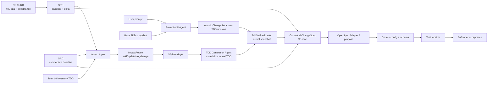

# Thiết kế hệ thống TDD Agent, Knowledge Graph và Tech Spec

**Phiên bản:** 0.6  
**Ngày:** 2026-10-09  
**Trạng thái:** thiết kế hệ thống và hướng dẫn vận hành  
**Phạm vi:** ba luồng agent tạo TDD, chỉnh sửa TDD và sinh change spec từ CR/URD + SRS + SAD + bộ TDD

Tài liệu này là bản trình bày thống nhất cho kiến trúc, luồng xử lý, ontology, retrieval và các ca sử dụng thực tế. Runtime tham chiếu nằm tại [`data/ontology_v0.5/o5`](../data/ontology_v0.5/o5/README.md); các contract chi tiết nằm trong [quy trình tài liệu đã chốt](TDD_Document_Workflow_Consolidated_Proposal.md) và [thiết kế ontology domain](Software_Delivery_Domain_Ontologies_Design.md).

## 1. Mục tiêu và nguyên tắc

Hệ thống phải trả lời được bốn câu hỏi trước khi sinh artefact để triển khai:

1. **Thay đổi là gì và có thẩm quyền từ đâu?** CR/URD quy định mục tiêu, phạm vi và tiêu chí nghiệm thu; SRS quy định hành vi hoặc ràng buộc phải đạt.
2. **Thiết kế nào bị ảnh hưởng?** Agent phải đánh giá SRS delta với toàn bộ inventory TDD, không chỉ với các node tìm thấy đầu tiên.
3. **Thực hiện thay đổi như thế nào?** TDD mô tả thiết kế đủ cụ thể trong ràng buộc của SAD. SAD là baseline kiến trúc chỉ đọc trong delivery run.
4. **Làm sao biết đã làm đúng?** Change spec, code, test và nghiệm thu phải nối được bằng chuỗi `CR → SRS → TDD section → CS → test → acceptance`.

Các nguyên tắc bắt buộc:

- Không sinh change spec từ KG TDD đơn độc. Nguồn production của stage 5 là **SRS delta + bộ TDD thực tế sau đánh giá tác động + SAD cố định**, có CR lineage.
- Không sửa SAD âm thầm. Nếu SRS không tương thích kiến trúc, tách CR cho SAD rồi rebaseline.
- Không dùng ID hoặc tên trùng để chứng minh coverage. Phải kiểm nội dung, revision, role, hash, section anchor và evidence.
- Thiếu, mâu thuẫn, stale hoặc unsupported đều là trạng thái cần xử lý; không tự suy đoán để đạt `implementation_ready`.
- Python trong prototype là harness/validator/CLI adapter. Product stack phải lấy từ SAD, repository snapshot hoặc technology catalogue được duyệt.
- Agent có thể phân tích và đề xuất; approval, D5 acceptance và BA nghiệm thu vẫn thuộc actor có thẩm quyền.

## 2. Mô hình tổng thể



Có ba agent, nhưng chúng dùng chung identity, source evidence, resolver, readiness và publication gates:

| Agent | Đầu vào chính | Đầu ra chính | Không được làm |
|---|---|---|---|
| **TDD generation agent** | URD/SRS/SAD, CR, nguồn động, TDD baseline | IntakeReport, KG/TDD revision, readiness | Không tự cấp approval hoặc tự sửa SAD |
| **Impact + change-spec agent** | SRS delta, CR, SAD, inventory TDD, TDD actual, repo context | ImpactReport, ChangeSpec table, OpenSpec proposal/design/tasks/spec | Không tạo item khi impact chưa được duyệt; không invent thiết kế |
| **Prompt-edit agent** | User prompt, base TDD snapshot, authorization, nguồn upstream | Intent/target plan, ChangeSet, impact, TDD revision/render | Không silent rewrite SRS/SAD; prompt mâu thuẫn phải quay upstream |

## 3. Chuỗi tài liệu và các cổng

```text
CR/URD
  → SRS trước/sau và SRS delta
  → đánh giá tác động trên toàn bộ TDD
  → SA/Dev approval
  → materialize TDD mới/cập nhật hoặc reuse TDD
  → TDD set realization
  → canonical ChangeSpec
  → OpenSpec change
  → code/test/BA acceptance
```

| Cổng | Input | Output | Owner và điều kiện |
|---|---|---|---|
| G0 Intake | CR/URD, SRS/SAD/TDD refs, nguồn động | `IntakeReport` từng `KnowledgeNeed` | BA xác nhận scope; nguồn phải có role/version/hash |
| G1 SRS | CR + SRS hiện hành + SAD | SRS revision và `SrsDelta` | BA + Dev/SA xác nhận before/after, acceptance, conflict |
| G2 Impact | SRS delta + SAD + **complete TDD inventory** | `ImpactReport` từng TDD: `add`, `update`, `no_change` | SA/Dev duyệt; agent chỉ đề xuất |
| G3 TDD realization | Impact đã duyệt + nguồn đã pin | TDD revisions + `TddSetRealization` | Add/update phải materialize; no-change phải chỉ rõ revision được reuse |
| G4 Spec readiness | SRS delta + TDD actual + SAD + CR criteria + repo snapshot | canonical `ChangeSpecItem` rows | Mỗi row có SRS refs, actual TDD refs, CR criteria, verification |
| G5 Authoring | Canonical rows + OpenSpec instructions/config | proposal/design/tasks/spec + trace manifest | OpenSpec runner chạy trong staging; semantic review riêng |
| G6 Implementation | Change spec | code/config/schema + test receipts | Dev/QA; test plan không thay test execution |
| G7 Acceptance | CR criteria + execution evidence | `AcceptanceReceipt` | BA/owner có thẩm quyền |

`draft`, `blocked`, `eligible`, `implementation_ready`, `implemented`, `verified` và `accepted` là các trạng thái có evidence khác nhau. Format hợp lệ hoặc CLI pass không tự biến một artefact thành design đã được duyệt.

## 4. Agent 1 — sinh TDD từ đầu vào động

### 4.1 Các chế độ

`TddGenerationRequest.mode` hỗ trợ:

- `initial`: xây TDD/KG từ URD, SRS, SAD hoặc bộ nguồn tương đương.
- `change-request`: CR đã có SRS delta, cần bổ sung/cập nhật TDD.
- `enhancement`: mở rộng capability hiện hữu.
- `defect`: sửa lỗi; bắt buộc có expected behavior, base snapshot và tiêu chí tái hiện.

### 4.2 Luồng xử lý

1. **Pin nguồn:** kiểm tra document role (`URD`, `SRS`, `SAD`, `TDD`, repo/code), revision và content hash. Cùng một ID nhưng sai role không được coi là nguồn hợp lệ.
2. **Resolve knowledge needs:** profile `tdd-generation` yêu cầu purpose, scope, requirements, contracts, data, behavior, decisions, quality, work, validation và provenance.
3. **Intake độc lập theo nguồn:** mỗi need ghi `searched_sources`, `matched_evidence`, `status = found | missing | conflict | not_applicable` và lý do. SRS có kết quả không có nghĩa SAD cũng đã có.
4. **Dựng context pack:** chọn scope, owned elements, upstream facts, dependencies, rules, gaps và budget. Nếu bị cắt phải ghi boundary/truncation.
5. **Propose KG trong staging:** validate canonical class, required properties, relation domain/range, maturity, conditional requirement, provenance và source anchors.
6. **Chạy specialist checks:** chọn package theo applicability/risk, không theo danh sách mười case cố định.
7. **Readiness:** mọi mandatory need phải có outcome source-bound; unknown, conflict, unsupported hoặc stale chặn ready.
8. **Render TDD:** tài liệu đọc được có section/anchor; canonical KG payload được giữ lossless để round-trip.
9. **Review và baseline:** review decisions/assumptions/gaps; commit atomic với input snapshot/hash, version và lineage.

### 4.3 TDD sinh ra gồm những gì

Một TDD có thể là một file hoặc một bộ file theo capability/module. Nó phải có ID, version, owner, scope, source refs và các section có identity ổn định. Nội dung tối thiểu:

| Phần TDD | Thông tin cần có |
|---|---|
| Phạm vi và nguồn | mục tiêu, boundary, capability/module, CR/SRS refs, SAD constraints, dependencies |
| Phân rã | component/module/layer, responsibility, interfaces, deployment allocation |
| Hành vi | main/alternate/error flows, business rules, algorithm, decision table, state machine, invariants |
| Hợp đồng | API/event/MQ contract, input/output/error, auth, versioning, compatibility, consumer |
| Dữ liệu | entity/attribute/index/view, integrity, data class, retention, ownership |
| Transaction và resilience | transaction boundary, isolation, consistency, saga/compensation, retry/backoff, timeout, idempotency, fallback, DLQ |
| Migration | from/to schema, expand/contract stages, backfill, lock, downtime, compatibility, rollback |
| Quality/operations | load average/peak/payload/growth, capacity, SLO/budget, concurrency, HA, RTO/RPO, observability, rollout |
| Security | trust boundary, threat/control, credential lifecycle, role/scope, data protection, audit |
| Quyết định | alternatives, rationale, trade-offs, assumptions, gaps, owner |
| Verification/trace | design obligations, scenarios, expected results, source evidence, CR/SRS→TDD mappings |

Không phải TDD nào cũng cần mọi section. Applicability và risk profile quyết định section bắt buộc; `not_applicable` phải có lý do và evidence. `unknown` không được biến thành `not_applicable` để vượt cổng.

## 5. Agent 2 — từ SRS + TDD + SAD sinh change spec

Đây là luồng production để tạo OpenSpec change. KG là nơi truy xuất facts và design evidence, nhưng **intent và scope lấy từ CR/SRS**, còn cách triển khai lấy từ TDD trong ràng buộc SAD.

### 5.1 Input cố định

```json
{
  "cr": "CR-xxxx@revision",
  "srs_delta": "SRS-DELTA-xxxx@revision",
  "sad": "SAD@revision+content_hash",
  "impact_report": "IMPACT-xxxx@decision_hash",
  "tdd_set_realization": "TDD-SET-xxxx@actual_snapshot",
  "repo_snapshot": "REPO@commit",
  "profile": "spec-change-generation",
  "kg_snapshot": "kg-hash"
}
```

Thiếu `impact approval`, `TddSetRealization`, actual TDD refs hoặc SRS/CR criteria thì agent chỉ được trả diagnostics/draft, không được tạo change spec eligible.

### 5.2 Các bước

1. Đọc `SrsDelta` add/modify/remove và các scenario/acceptance criteria liên quan.
2. Đối chiếu từng delta với toàn bộ TDD inventory; kiểm các TDD add/update/no-change và lý do.
3. Kiểm SAD readonly: nếu target hoặc design vi phạm architecture constraint, trả về SAD CR.
4. Dựng semantic closure: requirement → scenario/contract/data/behavior/quality/security → affected design → consumer/work/test.
5. Materialize canonical `ChangeSpecItem`.
6. Kiểm mỗi row:
   - hành động và code target rõ ràng;
   - SRS section/revision resolved;
   - TDD section **actual sau bước 4** resolved;
   - CR acceptance refs tồn tại;
   - verification có expected behavior/assertion;
   - migration, compatibility, rollback và ownership được lấy từ TDD nếu applicable.
7. Project canonical rows sang OpenSpec `proposal.md`, `design.md`, `tasks.md`, `specs/<capability>/spec.md` và `trace-manifest.json`.
8. Authoring runner chạy trong isolated staging; semantic assertion, strict CLI, source/hash và collision kiểm trước publication.

### 5.3 Canonical ChangeSpec row

| CS ID | Action | Code target | SRS refs | TDD refs | CR criteria | Verification |
|---|---|---|---|---|---|---|
| `CS-001` | `add/modify/remove` | module/function/schema/policy | `SRS-FR-xx@rev §x.y` | `TDD-xxx@rev §x.y` | `CR-xxx-AC-01` | precondition, stimulus và expected result |

Một dòng thiếu SRS hoặc TDD không được vào change spec. Một dòng mâu thuẫn SRS–TDD quay lại G2; agent không sửa TDD để làm cho row hợp lệ.

### 5.4 Projection sang OpenSpec

| OpenSpec artifact | Nguồn canonical | Nội dung cần giữ |
|---|---|---|
| `proposal.md` | CR + CS scope/rationale | why, goals, exclusions, baseline và CR refs |
| `design.md` | TDD decisions + SAD constraints | quyết định triển khai, KG facts được chọn theo CS refs, alternatives/risks |
| `spec.md` | SRS delta + behavior change | ADDED/MODIFIED/REMOVED requirements, scenarios, retained behavior |
| `tasks.md` | CS items + dependencies | task stable IDs, code target, test, migration, rollback, acceptance evidence |
| `trace-manifest.json` | tất cả mapping | CS→SRS→TDD→CR, KG fact IDs, artifact hashes, execution/review status |

OpenSpec là adapter xuất bản. Adapter không được thêm requirement, cấp approval hoặc invent design còn thiếu.

## 6. Agent 3 — chỉnh sửa TDD bằng prompt

### 6.1 Luồng

```text
User prompt + base TDD snapshot
  → classify intent
  → resolve target theo definition/identity
  → preview semantic/presentation ChangeSet
  → authorization + impact check
  → atomic commit với version check
  → validate KG/readiness
  → render TDD revision
  → publish hoặc rollback
```

Các intent chính:

- **Presentation-only:** đổi heading, thứ tự, format; semantic graph hash phải giữ nguyên và anchor phải được revalidate.
- **Semantic edit:** đổi property, relation, contract, behavior hoặc design element; phải tạo ChangeSet, impact và provenance.
- **CR clarification:** prompt diễn giải lại intent nhưng chưa đủ authority; tạo clarification request, không mutation.
- **Conflict:** prompt trái SRS/SAD hoặc base revision stale; trả conflict với cả hai nguồn.

Ví dụ `API-P-01` đổi timeout thành `30s` chỉ được commit nếu đây là property contract được target rõ, nằm trong authority cho phép và không mâu thuẫn SRS. Prompt “đổi timeout để bỏ qua SRS” phải bị chặn hoặc chuyển thành CR/SRS clarification.

### 6.2 An toàn mutation

- Base snapshot và current snapshot phải khớp; nếu không, trả version conflict.
- Commit graph và render là hai bước có audit. Render lỗi sau commit giữ trạng thái `committed_pending_render`, không mất graph và không thay tài liệu đang publish.
- Undo là compensating ChangeSet có version check, không phải xóa lịch sử.
- Thay đổi shared kernel phải tính consumer impact và đánh dấu downstream artefacts stale.

## 7. Thiết kế ontology v0.6

Ontology v0.6 có canonical workflow/evidence envelope và giữ lớp domain v0.5 làm compatibility target. Bảng dưới đây phân biệt theo **ngữ nghĩa**, không có nghĩa mọi class đều bắt buộc phải xuất hiện trong một snapshot: các lớp workflow/evidence là canonical v0.6; các lớp domain như `Operation`, `Entity`, `Flow` và `Migration` được đọc qua registry/compatibility của runtime. Không coi mọi class legacy là bắt buộc trong mọi scope.

### 7.1 Các lớp logic

| Lớp | Classes tiêu biểu | Vai trò |
|---|---|---|
| Documents/lineage | `DocumentRef`, `SectionRef`, `SrsDelta`, `RequirementDelta`, `Baseline` | role, revision, hash, section anchor, before/after |
| Workflow | `ImpactReport`, `ImpactApproval`, `TddSetRealization`, `SemanticResolution`, `RepoSnapshot` | các cổng G2–G4 và freshness |
| Generation | `GenerationProfile`, `GenerationRun`, `KnowledgeNeed`, `IntakeReport`, `ReadinessReport` | profile, run, intake, readiness |
| Design obligations | `DesignObligation`, `ObligationResolution`, `Capability`, `RequirementVersion`, `Scenario` | nghĩa vụ thiết kế và coverage |
| Change delivery | `ChangeSpecItem`, `WorkItem`, `TestReceipt`, `AcceptanceReceipt` | CS, work, test và BA acceptance |
| Behavioral | `Flow`, `Operation`, `Algorithm`, `Decision`, `StateMachine`, `Transition`, `BusinessRule` | hành vi và trạng thái |
| Integration | `Interface`, `Event`, `ExternalSystem`, `ContractCompatibility`, `FailurePolicy` | API/MQ/DB/third-party và compatibility |
| Transaction | `Transaction`, `Saga`, `RetryPolicy`, `TimeoutBudget`, `IdempotencyPolicy`, `ConsistencyModel` | giao dịch, retry, deadline, consistency |
| Data | `Entity`, `Attribute`, `Index`, `DataStore`, `Migration`, `MigrationStage`, `RetentionPolicy` | schema và tiến hóa dữ liệu |
| Operations | `LoadProfile`, `CapacityModel`, `HighAvailabilityTopology`, `RecoveryObjective`, `Measurement`, `QualityTarget` | tải, capacity, HA, RTO/RPO, đo lường |
| Security/finance | `Threat`, `Control`, `Credential`, `Role`, `Scope`, `AuditTrail`, `LedgerInvariant`, `ReconciliationPolicy` | security, audit và domain high-risk |

### 7.2 Quan hệ quan trọng

- `DocumentRef -has_section→ SectionRef`
- `ChangeRequest -has_srs_delta→ SrsDelta`
- `SrsDelta -has_impact_report→ ImpactReport`
- `ImpactReport -has_impact_approval→ ImpactApproval`
- `ImpactReport -realizes_tdd_set→ TddSetRealization`
- `TddSetRealization -has_change_spec_item→ ChangeSpecItem`
- `GenerationProfile -requires_knowledge→ KnowledgeNeed`
- `GenerationRun -has_readiness_report→ ReadinessReport`
- `RequirementVersion -has_scenario→ Scenario`
- `DesignObligation -has_obligation_resolution→ ObligationResolution`
- `WorkItem -depends_on_work→ WorkItem` (acyclic)
- `ANY -traces_to→ ANY` chỉ là reference; không tự có nghĩa `satisfies`.

### 7.3 Conditional semantics

Canonical registry có các rule điều kiện quan trọng:

- Operation write (`POST/PUT/PATCH/DELETE`) cần idempotency và concurrency semantics.
- Operation transactional cần timeout, retry và failure policy.
- Measurement ở stage `observed/measured` cần `observed_at` và `source_ref`.
- Algorithm specified cần inputs, outputs và pre/postconditions; chỉ có tên class không đủ.
- Migration phải có from/to schema, stages, backfill, lock, compatibility và rollback.

Các profile chuyên biệt hiện có:

| Profile | Rules |
|---|---|
| behavior | FSM coverage, decision coverage |
| integration | contract compatibility, failure policy |
| transaction | boundary, retry/deadline, idempotency |
| data | schema migration, retention/integrity |
| operations | load/capacity, HA/recovery |
| security | threat/control, authorization coverage |

Profile là tập rule có version và applicability. Không hard-code “mười trường hợp”; profile có thể mở rộng cho domain mới như AI safety, privacy, ML model lifecycle hoặc regulated reporting.

## 8. Retrieval và context engineering

### 8.1 Retrieval contract

Retrieval phải trả về **evidence closure**, không chỉ danh sách node gần nhất. Mỗi kết quả gồm:

```json
{
  "snapshot": "kg-or-document-hash",
  "seeds": ["SRS-DELTA-001", "CAP-PBOM"],
  "selected_ids": ["..."],
  "edges": ["..."],
  "source_refs": [{"document_id":"SRS","revision":"1.2","section_id":"FR-01","content_hash":"..."}],
  "obligations": [{"id":"OBL-...","status":"unresolved"}],
  "gaps": [],
  "conflicts": [],
  "boundary": [],
  "truncated": false,
  "resolution_hash": "..."
}
```

### 8.2 Các bước retrieval

1. **Seed theo intent:** CR/SRS delta cho spec change; capability/knowledge needs cho TDD; prompt target cho edit.
2. **Lọc theo authority:** chỉ lấy đúng role, revision, baseline, scope và profile; loại repo path giả làm SRS section.
3. **Structural expansion:** đi theo relations đã khai báo; mở scenario, contract, data, behavior, quality, security, work/test và consumer liên quan.
4. **Fixed-point closure:** tiếp tục mở dependency/obligation/consumer đến khi không còn node mới hoặc đạt budget. Không giới hạn cứng hai hops.
5. **Specialist expansion:** nếu target là write API, transaction, migration, high-load hoặc credential thì mở profile tương ứng.
6. **Evidence join:** lấy quote/anchor/hash/source role và derivation lineage cho từng fact. Metadata-only không đủ.
7. **Negative evidence:** giữ missing, unknown, conflict, stale và unresolved trong context. Không ẩn để prompt ngắn hơn.
8. **Budgeting:** nếu vượt budget, chia pack có boundary và shared manifest; `truncated=true` là blocker cho mandatory need.
9. **Deterministic ordering:** sort theo identity/relation/revision để cùng snapshot cho cùng context hash.

Runtime hiện thực các đặc tính này qua `resolve_needs`, `context_pack`, `impact_closure`, semantic resolver và `build_pack` của spec generator. Chưa có vector database bắt buộc; lexical/embedding search nếu thêm vào chỉ được dùng để tìm candidate. Candidate phải được graph traversal và source resolver xác nhận trước khi vào design hoặc spec.

### 8.3 Đặc trưng retrieval

| Đặc trưng | Ý nghĩa |
|---|---|
| Graph-first | relation và typed contract quyết định closure; similarity không thay authority |
| Source-bound | mỗi fact có document/section/revision/hash hoặc derivation |
| Scope-aware | chỉ lấy phần trong capability/TDD/CR; external consumer vẫn được mở khi ảnh hưởng |
| Bidirectional | từ SRS tìm design và từ TDD inventory tìm delta bị tác động |
| Profile-aware | mở rule theo applicability/risk, không bias theo vài use case mẫu |
| Temporal | baseline/actual revision, stale detection và invalidation theo snapshot |
| Negative-preserving | missing/conflict/unknown/N/A có lý do được giữ trong kết quả |
| Fixed-point | closure lặp đến khi ổn định; order của edge không làm đổi kết quả |
| Bounded | budget/truncation được ghi rõ, không drop dependency im lặng |
| Reproducible | context hash, resolution hash và source snapshots cho phép rerun |

### 8.4 Các truy vấn đặc trưng

Các truy vấn dưới đây là pseudo-Cypher để minh họa contract; adapter lưu trữ cụ thể có thể dùng Cypher, SQL, RDF/SPARQL hoặc API typed.

**A. Tìm TDD bị SRS delta tác động**

```cypher
MATCH (d:SrsDelta {id: $delta})-[:after_requirement|:before_requirement]->(r:RequirementVersion)
MATCH (r)-[:traces_to|:satisfies|:has_scenario*1..3]->(t)
WHERE t.class IN ['DesignUnit','Operation','Interface','Entity','Flow','QualityTarget']
RETURN DISTINCT t.id, t.class, t.revision, t.source_refs
ORDER BY t.class, t.id;
```

Kết quả này chỉ tạo candidate. Impact agent phải đối chiếu toàn bộ inventory để bổ sung các TDD `no_change` và ghi evidence cho quyết định.

**B. Tìm obligation chưa được giải quyết trong một TDD**

```cypher
MATCH (o:DesignObligation)-[:has_obligation_resolution]->(r:ObligationResolution)
WHERE o.tdd_id = $tdd AND r.status IN ['unresolved','unknown','conflict']
RETURN o.id, o.question, o.applicability, r.status, r.evidence_refs;
```

**C. Đóng gói context cho một CS row**

```cypher
MATCH (cs:ChangeSpecItem {id: $cs})
MATCH (cs)-[:traces_to]->(srs:SectionRef)
MATCH (cs)-[:traces_to]->(tdd:SectionRef)
MATCH (cs)-[:traces_to]->(cr:AcceptanceReceipt)
OPTIONAL MATCH (tdd)-[:traces_to|:depends_on*1..4]->(dep)
RETURN cs, srs, tdd, cr, collect(DISTINCT dep) AS dependencies;
```

Context builder phải kiểm role của `srs`/`tdd`; một string tồn tại nhưng sai document role là lỗi source-role.

**D. Tìm contract integration còn thiếu failure policy**

```cypher
MATCH (op:Operation)-[:uses|:exposes]->(c:Interface)
WHERE c.external = true OR op.integration = true
OPTIONAL MATCH (op)-[:governed_by]->(f:FailurePolicy)
RETURN op.id, c.id,
       CASE WHEN f IS NULL THEN 'missing' ELSE 'found' END AS failure_policy;
```

**E. Tìm migration thiếu rollback hoặc backfill**

```cypher
MATCH (m:Migration)
WHERE m.rollback IS NULL OR m.backfill IS NULL OR size(m.stages) = 0
RETURN m.id, m.from_schema, m.to_schema, m.lock, m.compatibility;
```

**F. Tìm source/ref stale trước khi sinh spec**

```cypher
MATCH (ref:SectionRef)
MATCH (src:DocumentRef {id: ref.document_id})
WHERE ref.content_hash <> src.content_hash
   OR ref.revision <> src.revision
RETURN ref.id, ref.document_id, ref.revision, src.revision, 'stale' AS status;
```

**G. Tìm no-change reuse hợp lệ**

```cypher
MATCH (e:ImpactEntry {action:'no_change'})
MATCH (e)-[:reuses]->(tdd:DesignRevision)
WHERE e.reason IS NOT NULL
  AND e.baseline_revision = tdd.revision
  AND e.srs_refs IS NOT NULL
RETURN e.tdd_id, tdd.revision, e.reason, e.srs_refs;
```

No-change chỉ hợp lệ khi thiết kế hiện tại bao phủ SRS delta, giá trị mới nằm trong miền đã thiết kế và mapping có reason/evidence.

## 9. Case sử dụng thực tế

### Case 1 — PBOM feature mới từ URD/SRS/SAD

**Đầu vào:** URD feature, SRS functional/quality requirements, SAD architecture, TDD inventory rỗng hoặc hiện hữu.  
**Xử lý:** TDD generation agent intake từng nguồn, tạo capability/requirements/scenarios, component/operation/data/flow/quality/security, chạy profile áp dụng và render TDD.  
**Đầu ra:** TDD/KG draft hoặc ready tùy evidence; không có SRS/SAD/contract thì giữ draft.  
**Kiểm:** source role, requirements, API/event, state machine, migration, load/HA và trace.

### Case 2 — CR bổ sung entitlement evidence

**Đầu vào:** `CR-0001`, SRS delta thêm evidence cho design asset, SAD không đổi, TDD capability PBOM hiện hữu.  
**Impact:** capability PBOM `update`; TDD chứa design asset/evidence `update`; TDD khác `no_change`; nếu thiếu design model thì `add`.  
**TDD update:** thêm requirement, scenario, provenance, evidence retention và authorization.  
**Spec:** mỗi `CS-*` trỏ SRS section, actual TDD section và CR acceptance. Không được sinh spec từ việc thấy thêm node trong KG mà không có SRS delta.

### Case 3 — Defect sửa timeout API

**Đầu vào:** defect report, expected behavior, base TDD snapshot, SRS clarification nếu cần.  
**Xử lý:** prompt/defect agent xác định `Operation`, timeout budget, retry/failure policy và test scenario; nếu behavior chưa được SRS cho phép thì tạo SRS clarification.  
**Đầu ra:** TDD revision ghi timeout 30s, retry/deadline semantics, test evidence; hoặc blocked nếu source conflict.

### Case 4 — Enhancement chỉ đổi tham số trong miền thiết kế

**Đầu vào:** đổi batch size từ 100 lên 200, TDD đã định nghĩa range và capacity.  
**Quyết định:** TDD `no_change` chỉ khi SRS delta nằm trong range, load/capacity vẫn pass và có TDD refs. Change spec vẫn có thể chứa code/config row.  
**Nếu vượt range:** TDD `update`, mở capacity/quality obligation và revalidate.

### Case 5 — Schema migration

**Đầu vào:** SRS đổi field, SAD data-store constraint, TDD entity/index/migration.  
**Retrieval:** schema, consumers, transaction, backfill, lock, compatibility, rollout/rollback, data volume.  
**Blocker:** thiếu expand/contract stage, physical type, backfill hoặc rollback. Không dùng `Migration.path`/`reversible` đơn lẻ làm đủ.

### Case 6 — Integration API/MQ/third-party

**Đầu vào:** SRS external contract, SAD trust boundary, TDD interface/event/external system.  
**Retrieval:** consumer/provider, version compatibility, timeout, retry, circuit breaker/fallback, DLQ, idempotency, auth/credential, audit.  
**Blocker:** contract có nhưng failure policy hoặc consumer compatibility chưa có evidence.

### Case 7 — High-load/HA hoặc regulated transaction

**Đầu vào:** TPS/latency/HA/financial control requirements.  
**Retrieval:** `LoadProfile`, `CapacityModel`, `Measurement`, `HighAvailabilityTopology`, `RecoveryObjective`, `Transaction`, `ConsistencyModel`, `LedgerInvariant`, `ReconciliationPolicy`.  
**Blocker:** workload chỉ là chuỗi text, thiếu peak/payload/growth, thiếu RTO/RPO/replica/failover hoặc thiếu invariant/reconciliation/audit.

### Case 8 — User prompt chỉnh TDD

**Đầu vào:** “Đổi API-P-01 thành Submit SBOM, timeout 30s”.  
**Xử lý:** target resolver tìm đúng definition; planner tạo preview; authorization/impact check; commit atomic; render và semantic diff.  
**Kết quả:** graph revision mới nếu semantic edit; presentation overlay nếu chỉ format; conflict nếu prompt trái SRS/SAD.

### Case 9 — Architecture change

**Đầu vào:** SRS yêu cầu thay message broker hoặc topology.  
**Xử lý:** impact agent không sửa SAD. Tạo/điều phối CR cho SAD, chờ SAD revision mới, sau đó rebaseline SRS/TDD và chạy impact lại.  
**Kết quả:** change spec không chứa kiến trúc chưa được phê duyệt.

### Case 10 — Stale/concurrent change

**Đầu vào:** hai CR cùng sửa shared contract hoặc source đổi sau impact approval.  
**Xử lý:** snapshot/hash mismatch, semantic resolver phát hiện consumer closure và đánh dấu mappings stale; rebase tạo revision mới.  
**Kết quả:** không last-write-wins, không overwrite OpenSpec change đang tồn tại.

## 10. Readiness, evidence và chất lượng

### 10.1 Lớp kiểm tra

1. **Structural:** class/property/relation/cardinality, required fields, reference resolution.
2. **Semantic:** behavior, contract, unit, threshold, negative path, compatibility, design obligation.
3. **Workflow:** đúng baseline, approval, realization, actor authority, SAD readonly, freshness.
4. **Evidence:** check đã thực thi trên đúng artifact/version/environment; quote/hash/anchor hoặc derivation có thể kiểm lại.

`QG-01..QG-10` kiểm graph/readiness; `TS-01..TS-10` kiểm tech-spec context và dual-source; specialist profiles kiểm behavior, integration, transaction, data, operations và security.

Các trạng thái per need/obligation là `found`, `missing`, `conflict`, `not_applicable` và `satisfied`, `violated`, `unknown`, `unresolved`. `not_applicable` phải có rationale; `unknown` là blocker nếu mandatory.

### 10.2 D5 authoring benchmark

Benchmark authoring direct-propose và KG-propose phải giữ output hash, config/input hash, artifacts, semantic review và strict CLI evidence. D5 có hai tầng:

- **L1:** diagnostic/provisional, có thể là suggestion nội bộ, không đóng acceptance.
- **L2:** independent human review, có review ID mới và `supersedes_review_id`; chỉ L2 được pass/archive.

Tình trạng hiện tại của PBOM v0.6: runtime regression **105 passed**, sáu authoring artifacts đã lưu, nhưng D5 vẫn chờ L1/L2 review độc lập; không claim `implementation_ready` từ model critique hoặc historical corrected review.

## 11. Ví dụ trace đầy đủ

```text
CR-0001@3
  └─ SRS-DELTA-0001@2
      ├─ SRS-FR-PBOM-13 §4.2
      ├─ SRS-AC-0001
      └─ IMPACT-0001@decision-hash
          ├─ TDD-PBOM@12 §6.3 (update)
          ├─ TDD-ENTITLEMENT@7 §4.1 (update)
          └─ TDD-AUDIT@5 §8.2 (no_change, reuse reason)
              └─ TDD-SET-0001@actual-snapshot
                  ├─ CS-001 modify pbom.entitlement_evidence()
                  ├─ CS-002 add audit event schema
                  └─ CS-003 update test fixture
                      └─ OpenSpec change: add-entitlement-evidence
                          ├─ proposal.md
                          ├─ design.md
                          ├─ tasks.md
                          ├─ specs/pbom/spec.md
                          └─ trace-manifest.json
```

Trace này cho phép trả lời: requirement nào tạo ra task, task dựa vào design nào, design lấy từ nguồn nào, test nào kiểm acceptance và phần nào không bị thay đổi.

## 12. Mapping tới runtime

| Thành phần | Runtime tham chiếu |
|---|---|
| Dynamic intake/TDD generation | `harness/dynamic.py`, `harness/render.py`, `tools/semantic_intake.py` |
| Prompt edit/CR | `edit/prompt_edit.py`, `edit/change_request.py` |
| Impact/realization/CS | `workflow.py`, `tools/document_workflow.py` |
| Scope closure/context | `tools/semantic_resolver.py`, `specgen/spec_change.py` |
| Readiness/rules | `tools/readiness5.py`, `tools/quality5.py`, `tools/techspec_rules.py` |
| Specialist profiles | `profiles.v0.6.json`, `specialist_profiles.v0.5.json`, `tools/specialized_checks.py` |
| OpenSpec projection | `specgen/spec_change.py` |
| Model authoring/evaluation | `specgen/authoring.py`, `tools/prepare_d5_review.py`, `tools/quality_eval.py` |
| Canonical schemas/registry | `schemas/*.schema.json`, `classes.v0.6.json`, `relations.v0.6.json`, `inventory.v0.6.json` |

## 13. Giới hạn và kế hoạch hoàn thiện

- Main-spec baseline của OpenSpec chưa được chấp nhận; change tooling đã archive với `--skip-specs` và không được hiểu là toàn portfolio đã nghiệm thu.
- D5 L2 vẫn cần reviewer độc lập; không dùng model suggestion để tự đóng hardening hoặc coverage change.
- Product tech stack chưa được suy ra từ Python harness. Khi SAD/repository catalogue pin ngôn ngữ/framework/runtime theo component, resolver phải đưa thông tin đó vào TDD và CS.
- Vector retrieval có thể bổ sung để tìm candidate trong tài liệu lớn, nhưng phải giữ graph/source verification làm cổng cuối.
- Các ontology domain mới được thêm qua profile và change riêng; không mở rộng một class “TDD” thành superclass của CR/SRS/SAD.

Khi các gate trên đạt, hệ thống có thể vận hành ba luồng thống nhất: sinh TDD từ nguồn động, chỉnh TDD theo prompt có kiểm soát, và sinh change spec chất lượng production từ SRS + TDD + SAD với truy vết đến test và nghiệm thu.
