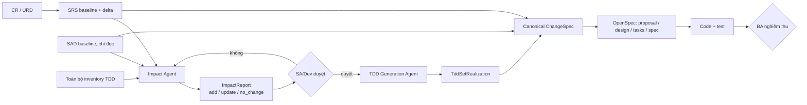
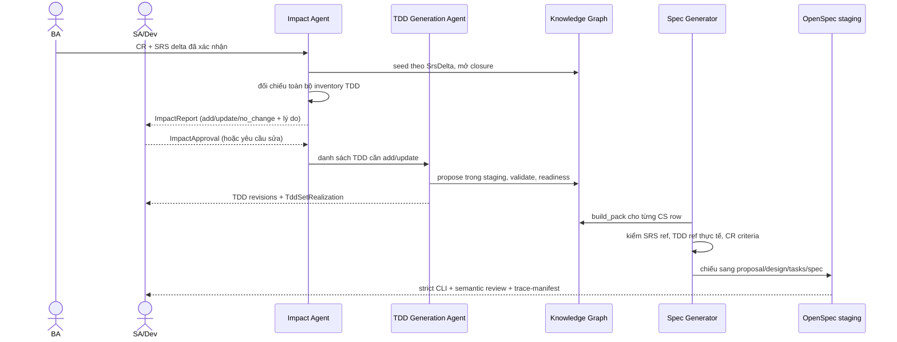
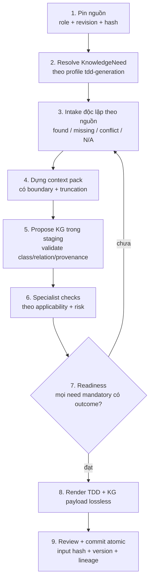
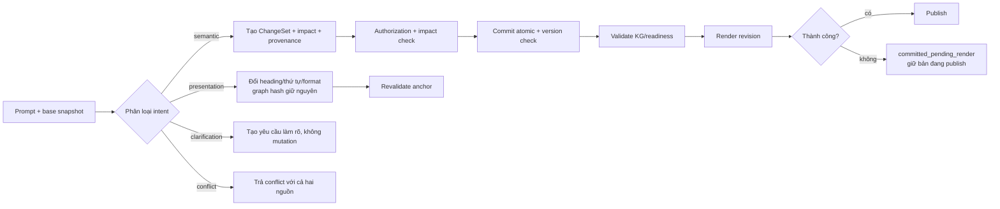
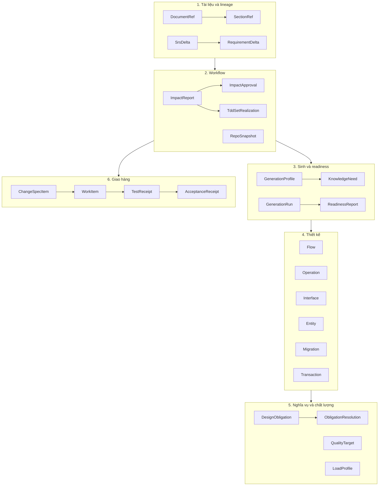
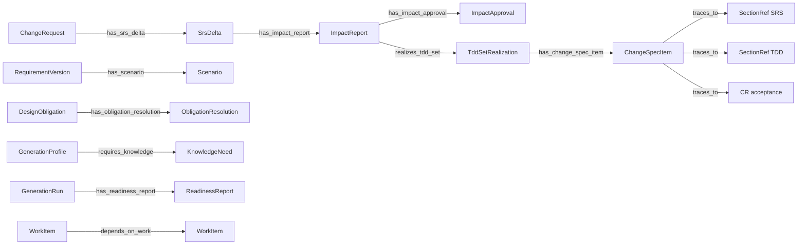

# Tài liệu trình bày: TDD Agent, Knowledge Graph và Change Spec

**Căn cứ:** [TDD_Agent_And_KG_Design_v0.6.md](TDD_Agent_And_KG_Design_v0.6.md)
**Ngày:** 2026-10-09
**Đối tượng:** BA, SA, Dev/QA, reviewer và người ra quyết định cần nắm cách hệ thống vận hành từ CR đến nghiệm thu.
**Quy ước:** các ví dụ có ID `CR-0001`, `TDD-PBOM`, `CS-001`… là **minh họa** để giải thích contract. Chúng không phải kết quả chạy thật. Trạng thái thật của benchmark nằm ở mục 10.

---

## 1. Tóm tắt một trang

| Câu hỏi | Trả lời |
|---|---|
| Hệ thống làm gì? | Biến CR/URD + SRS + SAD thành TDD có truy vết, rồi thành change spec (OpenSpec) có thể triển khai và nghiệm thu. |
| Có mấy agent? | Ba: **sinh TDD**, **impact + change-spec**, **chỉnh TDD bằng prompt**. |
| Tri thức nằm ở đâu? | Knowledge Graph (KG) có ontology, mọi fact gắn nguồn (tài liệu, section, revision, hash). |
| Ai có quyền cuối? | Con người: BA xác nhận scope và nghiệm thu, SA/Dev duyệt impact. Agent chỉ phân tích và đề xuất. |
| Nguyên tắc cốt lõi? | Intent và scope lấy từ CR/SRS, cách làm lấy từ TDD trong ràng buộc SAD. KG chỉ là nơi truy xuất facts, không phải nguồn quyền lực. |
| Khác biệt của retrieval? | Graph-first, source-bound, giữ cả bằng chứng âm (thiếu, mâu thuẫn, stale), có budget và hash để chạy lại được. |

Ba quy tắc không được vi phạm:

1. Không sinh change spec từ KG TDD đơn độc. Cần đủ **SRS delta + TDD thực tế sau impact + SAD cố định**.
2. Không sửa SAD âm thầm. SRS xung đột kiến trúc thì tách CR cho SAD rồi rebaseline.
3. Không tự suy đoán để đạt `implementation_ready`. Thiếu, mâu thuẫn, stale đều là trạng thái phải xử lý.

---

## 2. Luồng xử lý end-to-end

### 2.1 Bức tranh tổng thể



### 2.2 Các cổng (gate) và người chịu trách nhiệm

| Cổng | Câu hỏi cổng trả lời | Output | Người quyết định |
|---|---|---|---|
| G0 Intake | Nguồn nào có, thiếu gì? | `IntakeReport` | BA |
| G1 SRS | Before/after là gì, acceptance ra sao? | `SrsDelta` | BA + Dev/SA |
| G2 Impact | TDD nào phải add/update, TDD nào giữ nguyên và vì sao? | `ImpactReport` | SA/Dev |
| G3 Realization | TDD thực tế đã được tạo/cập nhật chưa? | `TddSetRealization` | Agent sinh, SA/Dev rà |
| G4 Spec readiness | Mỗi dòng spec có đủ SRS, TDD, CR criteria, verification? | `ChangeSpecItem` | Agent kiểm, SA duyệt |
| G5 Authoring | Bộ OpenSpec có đúng nguồn, không phát sinh requirement? | proposal/design/tasks/spec + trace | Reviewer độc lập |
| G6 Implementation | Code, test đã chạy chưa? | `TestReceipt` | Dev/QA |
| G7 Acceptance | Tiêu chí CR đã đạt chưa? | `AcceptanceReceipt` | BA/owner |

Trạng thái đi theo thứ tự `draft → blocked/eligible → implementation_ready → implemented → verified → accepted`. Mỗi bước cần evidence riêng. CLI pass hay format hợp lệ không tự nâng trạng thái.

### 2.3 Sơ đồ tuần tự (CR đến change spec)



---

## 3. Luồng agent

### 3.1 Agent 1 — Sinh TDD từ nguồn động

**Chế độ:** `initial`, `change-request`, `enhancement`, `defect` (defect bắt buộc có expected behavior, base snapshot và tiêu chí tái hiện).



Điểm cần nhớ:

- Mỗi `KnowledgeNeed` ghi `searched_sources`, `matched_evidence`, `status` và lý do. Tìm thấy ở SRS không có nghĩa SAD cũng đã có.
- `unknown` không được chuyển thành `not_applicable` để vượt cổng. `not_applicable` phải có lý do và evidence.
- Agent không tự cấp approval và không tự sửa SAD.

**Nội dung một TDD** (section nào bắt buộc do applicability và risk quyết định):

| Nhóm | Ví dụ nội dung |
|---|---|
| Phạm vi, nguồn | mục tiêu, boundary, CR/SRS refs, ràng buộc SAD |
| Phân rã | component, responsibility, interface, deployment |
| Hành vi | flow chính/phụ/lỗi, business rule, state machine, invariant |
| Hợp đồng | API/event/MQ, lỗi, auth, versioning, compatibility |
| Dữ liệu | entity, index, integrity, retention, ownership |
| Transaction, resilience | boundary, idempotency, retry, timeout, saga, DLQ |
| Migration | from/to, stage expand/contract, backfill, lock, rollback |
| Quality, vận hành | load, capacity, SLO, HA, RTO/RPO, observability |
| Security | trust boundary, threat/control, role/scope, audit |
| Quyết định, trace | alternatives, rationale, assumptions, gaps, mapping CR/SRS→TDD |

### 3.2 Agent 2 — Impact + Change-spec

Hai pha, ngăn cách bởi cổng phê duyệt của người.

**Pha A — Impact (G2).** Đầu vào: SRS delta, SAD, toàn bộ inventory TDD.

1. Với từng `RequirementDelta` (add/modify/remove), lấy candidate từ KG.
2. **Không dừng ở candidate.** Quét hết inventory để gán mỗi TDD một trong ba kết luận:
   - `add`: chưa có thiết kế bao phủ.
   - `update`: có nhưng phải đổi.
   - `no_change`: bắt buộc kèm `reason`, `srs_refs` và revision được reuse.
3. Kiểm SAD: nếu delta vi phạm ràng buộc kiến trúc, dừng và đề xuất CR cho SAD.
4. Trả `ImpactReport` cho SA/Dev duyệt.

**Pha B — Change spec (G4–G5).** Chỉ chạy khi có `ImpactApproval` và `TddSetRealization`.

```json
{
  "cr": "CR-xxxx@revision",
  "srs_delta": "SRS-DELTA-xxxx@revision",
  "sad": "SAD@revision+content_hash",
  "impact_report": "IMPACT-xxxx@decision_hash",
  "tdd_set_realization": "TDD-SET-xxxx@actual_snapshot",
  "repo_snapshot": "REPO@commit",
  "profile": "spec-change-generation",
  "kg_snapshot": "kg-hash"
}
```

Thiếu bất kỳ khóa nào thì chỉ được trả diagnostics hoặc draft, không tạo spec `eligible`.

Quy trình: đọc delta → dựng closure (requirement → scenario/contract/data/behavior/quality/security → design → consumer/work/test) → tạo `ChangeSpecItem` → kiểm từng dòng → chiếu sang OpenSpec trong staging.

**Điều kiện một dòng CS hợp lệ:**

| Kiểm | Lỗi nếu không đạt |
|---|---|
| Action và code target rõ | `target_unclear` |
| SRS section + revision resolve được | `srs_ref_unresolved` |
| TDD section là bản thực tế sau G3 | `tdd_ref_not_actual` |
| CR acceptance tồn tại | `criteria_missing` |
| Verification có precondition, stimulus, expected result | `verification_weak` |
| Migration, rollback, ownership lấy từ TDD nếu áp dụng | `design_gap` |

(Tên mã lỗi ở bảng này là cách gọi minh họa. Tên diagnostic thật xem trong `specgen/spec_change.py`.)

Dòng mâu thuẫn SRS–TDD quay lại G2. Agent không sửa TDD cho dòng hợp lệ.

**Chiếu sang OpenSpec** (adapter chỉ xuất bản, không thêm requirement, không cấp approval):

| File | Nguồn | Nội dung |
|---|---|---|
| `proposal.md` | CR + phạm vi CS | why, goals, exclusions |
| `design.md` | quyết định TDD + ràng buộc SAD | cách làm, alternatives, risks |
| `specs/<cap>/spec.md` | SRS delta | ADDED/MODIFIED/REMOVED + scenario |
| `tasks.md` | CS items | task ID ổn định, target, test, rollback |
| `trace-manifest.json` | toàn bộ mapping | CS→SRS→TDD→CR, hash, trạng thái |

### 3.3 Agent 3 — Chỉnh TDD bằng prompt



An toàn mutation:

- Base snapshot khác current snapshot thì trả version conflict.
- Undo là ChangeSet bù trừ có version check, không xóa lịch sử.
- Đổi shared kernel phải tính consumer impact và đánh dấu artefact downstream là stale.
- Prompt mâu thuẫn SRS/SAD (ví dụ "đổi timeout để bỏ qua SRS") bị chặn hoặc chuyển thành clarification.

### 3.4 Ranh giới trách nhiệm giữa ba agent

| | Sinh TDD | Impact + Change-spec | Prompt-edit |
|---|---|---|---|
| Ghi KG | Có (staging, rồi commit) | Không ghi TDD; ghi ImpactReport và CS | Có (ChangeSet) |
| Sửa SRS | Không | Không | Không |
| Sửa SAD | Không | Không | Không |
| Cần người duyệt | Review baseline | ImpactApproval | Authorization theo phạm vi |
| Dùng chung | identity, resolver, readiness, publication gates | | |

---

## 4. Các case sử dụng thực tế

Mỗi case ghi: tình huống → agent nào → điều agent làm → kết quả đúng → khi nào bị chặn.

| # | Tình huống | Agent | Kết quả đúng | Bị chặn khi |
|---|---|---|---|---|
| 1 | Feature mới PBOM từ URD/SRS/SAD | Sinh TDD (`initial`) | TDD/KG `draft` hoặc `ready` theo evidence | thiếu SRS/SAD/contract thì giữ `draft` |
| 2 | CR bổ sung entitlement evidence | Impact → Sinh TDD → Change-spec | PBOM `update`, audit `no_change`, mỗi CS có SRS+TDD+CR | spec không có SRS delta tương ứng |
| 3 | Defect timeout API | Prompt-edit hoặc Sinh TDD (`defect`) | TDD ghi timeout 30s kèm retry/deadline và test | SRS không cho phép hành vi đó → SRS clarification |
| 4 | Đổi batch size 100→200 | Impact | `no_change` nếu trong range đã thiết kế và capacity pass; code/config row vẫn có | vượt range → `update`, mở obligation capacity |
| 5 | Schema migration | Sinh TDD + Change-spec | đủ expand/contract, backfill, lock, rollback, compatibility | thiếu physical type, backfill hoặc rollback |
| 6 | Tích hợp API/MQ/bên thứ ba | Sinh TDD + Change-spec | contract + failure policy + consumer compatibility | có contract nhưng chưa có failure policy |
| 7 | High-load/HA/giao dịch tài chính | Sinh TDD | LoadProfile, CapacityModel, HA, RTO/RPO, ledger invariant | workload chỉ là text; thiếu invariant hoặc reconciliation |
| 8 | User prompt "Đổi API-P-01 thành Submit SBOM, timeout 30s" | Prompt-edit | revision mới (semantic) hoặc overlay (presentation) | prompt trái SRS/SAD |
| 9 | SRS đòi đổi message broker | Impact | tách CR cho SAD, chờ SAD mới, rebaseline | luôn chặn tới khi SAD đổi |
| 10 | Hai CR cùng sửa shared contract | Impact + resolver | hash mismatch → mapping stale → rebase thành revision mới | không cho last-write-wins |

### 4.1 Diễn giải chi tiết case 2: CR bổ sung entitlement evidence

1. **G1.** BA xác nhận `SrsDelta` thêm `SRS-FR-PBOM-13` (lưu bằng chứng entitlement cho design asset) và `SRS-AC-0001`.
2. **G2.** Impact agent lấy candidate từ KG, rồi quét toàn bộ inventory:

   | TDD | Kết luận | Lý do |
   |---|---|---|
   | TDD-PBOM@12 §6.3 | `update` | thêm requirement, scenario, retention |
   | TDD-ENTITLEMENT@7 §4.1 | `update` | thêm authorization cho evidence |
   | TDD-AUDIT@5 §8.2 | `no_change` | schema audit hiện tại đã bao phủ loại event này; ghi `srs_refs` và revision reuse |

3. **G2 approval.** SA duyệt, sinh `decision_hash`.
4. **G3.** Agent sinh TDD@13 và @8 cho hai mục `update`, tạo `TDD-SET-0001` ghi cả revision reuse của audit.
5. **G4.** Sinh ba dòng CS:
   - `CS-001` modify `pbom.entitlement_evidence()`
   - `CS-002` add audit event schema
   - `CS-003` update test fixture

   Mỗi dòng trỏ SRS section, **TDD revision thực tế sau G3** và `CR-0001-AC-xx`.
6. **G5.** Xuất bộ OpenSpec `add-entitlement-evidence` cùng `trace-manifest.json`.

Điểm then chốt: nếu KG có thêm node nhưng SRS không có delta tương ứng thì không được sinh CS cho node đó.

### 4.2 Diễn giải chi tiết case 4: no_change có điều kiện

```text
SRS delta: batch_size 100 → 200
TDD hiện tại: batch_size ∈ [50, 500], capacity model đã tính cho 500
→ no_change hợp lệ nếu: giá trị mới trong range, capacity còn pass, có TDD ref + reason
→ Change spec vẫn có CS cho code/config
Nếu đổi lên 1000: ngoài range → update TDD, mở obligation capacity, revalidate
```

---

## 5. Thiết kế ontology

### 5.1 Nguyên tắc

- Ontology v0.6 = **workflow/evidence envelope** (canonical) + lớp domain v0.5 (compatibility, đọc qua registry).
- Không class nào bắt buộc xuất hiện trong mọi snapshot. Bắt buộc theo applicability và profile.
- `TDD` không là superclass của CR/SRS/SAD. Mỗi loại tài liệu giữ role riêng.
- `traces_to` chỉ là tham chiếu, không tự có nghĩa `satisfies`.

### 5.2 Sáu tầng logic



Danh sách class tiêu biểu theo nhóm (nguồn: mục 7.1 của v0.6):

| Nhóm | Classes |
|---|---|
| Documents/lineage | `DocumentRef`, `SectionRef`, `SrsDelta`, `RequirementDelta`, `Baseline` |
| Workflow | `ImpactReport`, `ImpactApproval`, `TddSetRealization`, `SemanticResolution`, `RepoSnapshot` |
| Generation | `GenerationProfile`, `GenerationRun`, `KnowledgeNeed`, `IntakeReport`, `ReadinessReport` |
| Design obligations | `DesignObligation`, `ObligationResolution`, `Capability`, `RequirementVersion`, `Scenario` |
| Change delivery | `ChangeSpecItem`, `WorkItem`, `TestReceipt`, `AcceptanceReceipt` |
| Behavioral | `Flow`, `Operation`, `Algorithm`, `Decision`, `StateMachine`, `Transition`, `BusinessRule` |
| Integration | `Interface`, `Event`, `ExternalSystem`, `ContractCompatibility`, `FailurePolicy` |
| Transaction | `Transaction`, `Saga`, `RetryPolicy`, `TimeoutBudget`, `IdempotencyPolicy`, `ConsistencyModel` |
| Data | `Entity`, `Attribute`, `Index`, `DataStore`, `Migration`, `MigrationStage`, `RetentionPolicy` |
| Operations | `LoadProfile`, `CapacityModel`, `HighAvailabilityTopology`, `RecoveryObjective`, `Measurement`, `QualityTarget` |
| Security/finance | `Threat`, `Control`, `Credential`, `Role`, `Scope`, `AuditTrail`, `LedgerInvariant`, `ReconciliationPolicy` |

### 5.3 Quan hệ chính (xương sống truy vết)



`WorkItem -depends_on_work→ WorkItem` phải acyclic.

### 5.4 Ví dụ một instance (minh họa)

```json
{
  "id": "OP-SUBMIT-SBOM",
  "class": "Operation",
  "properties": {
    "name": "Submit SBOM",
    "method": "POST",
    "idempotency": "IDEM-SUBMIT-SBOM",
    "concurrency": "optimistic-lock-by-version",
    "transactional": true,
    "timeout_budget": "TB-SUBMIT-SBOM",
    "retry_policy": "RETRY-SUBMIT-SBOM",
    "failure_policy": "FP-SUBMIT-SBOM"
  },
  "relations": {
    "exposes": ["IF-API-P-01"],
    "governed_by": ["FP-SUBMIT-SBOM"],
    "traces_to": ["SRS-FR-PBOM-07@1.2#FR-07"]
  },
  "source_refs": [
    {"document_id": "SRS", "revision": "1.2", "section_id": "FR-07", "content_hash": "sha256:…"}
  ],
  "maturity": "specified"
}
```

Phần nào thiếu thì `ReadinessReport` ghi `missing` thay vì điền giá trị mặc định.

### 5.5 Quy tắc điều kiện (conditional semantics)

| Điều kiện | Bắt buộc có |
|---|---|
| `Operation` ghi (`POST/PUT/PATCH/DELETE`) | idempotency, concurrency semantics |
| `Operation` transactional | timeout, retry, failure policy |
| `Measurement` ở stage `observed/measured` | `observed_at`, `source_ref` |
| `Algorithm` ở mức specified | inputs, outputs, pre/postconditions |
| `Migration` | from/to schema, stages, backfill, lock, compatibility, rollback |

### 5.6 Specialist profiles

| Profile | Kiểm gì |
|---|---|
| behavior | FSM coverage, decision coverage |
| integration | contract compatibility, failure policy |
| transaction | boundary, retry/deadline, idempotency |
| data | schema migration, retention/integrity |
| operations | load/capacity, HA/recovery |
| security | threat/control, authorization coverage |

Profile là tập rule có version và applicability, mở rộng được (AI safety, privacy, ML lifecycle, regulated reporting) qua change riêng, không hard-code danh sách cố định.

---

## 6. Retrieval đặc trưng

### 6.1 Vì sao không dùng top-k similarity thuần

Spec và TDD chịu trách nhiệm pháp lý và kỹ thuật. Một fact "gần giống" nhưng sai role, sai revision hoặc stale sẽ sinh ra task sai. Do đó retrieval phải trả về **evidence closure**: tập facts đóng kín theo quan hệ, kèm nguồn, kèm cả cái còn thiếu.

### 6.2 Pipeline

```mermaid
flowchart LR
    S[1. Seed theo intent] --> F[2. Lọc authority<br/>role/revision/baseline/scope]
    F --> X[3. Structural expansion<br/>theo relation khai báo]
    X --> P[4. Fixed-point closure]
    P --> SP[5. Specialist expansion<br/>theo profile]
    SP --> E[6. Evidence join<br/>quote/anchor/hash]
    E --> N[7. Giữ negative evidence]
    N --> B[8. Budgeting + boundary]
    B --> O[9. Sắp xếp xác định<br/>+ resolution hash]
```



Seed theo agent:

| Agent | Seed |
|---|---|
| Change-spec | CR / SRS delta |
| Sinh TDD | capability + knowledge needs |
| Prompt-edit | target mà prompt trỏ tới |

### 6.3 Mười đặc trưng

| Đặc trưng | Nghĩa là | Phản ví dụ nếu thiếu |
|---|---|---|
| Graph-first | Relation có kiểu quyết định closure; similarity chỉ tìm candidate | Lấy nhầm đoạn văn giống nhưng không liên quan |
| Source-bound | Mỗi fact có document/section/revision/hash hoặc derivation | Không kiểm chứng được spec |
| Scope-aware | Chỉ lấy trong capability/TDD/CR, trừ consumer bị ảnh hưởng | Spec phình ra ngoài phạm vi |
| Bidirectional | Từ SRS tìm design, từ inventory tìm delta bị tác động | Bỏ sót TDD `no_change` |
| Profile-aware | Mở rule theo risk/applicability | Write API không có idempotency |
| Temporal | Baseline/actual revision, phát hiện stale | Spec dựa trên bản cũ |
| Negative-preserving | Giữ missing/conflict/unknown/N-A | Agent "tự tin" trên dữ liệu thiếu |
| Fixed-point | Lặp tới ổn định, không giới hạn cứng 2 hop | Mất dependency sâu |
| Bounded | Budget và truncation ghi rõ | Drop im lặng |
| Reproducible | Context hash, resolution hash, snapshot | Không chạy lại, không audit được |

### 6.4 Cấu trúc kết quả retrieval

```json
{
  "snapshot": "kg-or-document-hash",
  "seeds": ["SRS-DELTA-001", "CAP-PBOM"],
  "selected_ids": ["..."],
  "edges": ["..."],
  "source_refs": [{"document_id":"SRS","revision":"1.2","section_id":"FR-01","content_hash":"..."}],
  "obligations": [{"id":"OBL-...","status":"unresolved"}],
  "gaps": [],
  "conflicts": [],
  "boundary": [],
  "truncated": false,
  "resolution_hash": "..."
}
```

Quy tắc: `truncated=true` với mandatory need là **blocker**. Candidate từ lexical/embedding (nếu bổ sung sau) phải qua graph traversal và source resolver mới được vào design hoặc spec.

### 6.5 Ví dụ minh họa: closure cho `CS-001`

```text
Seed:  SRS-DELTA-0001 → RequirementDelta(add) FR-PBOM-13
Vòng 1: RequirementVersion FR-PBOM-13 → Scenario SC-13a, SC-13b; AC-0001
Vòng 2: Scenario → Operation OP-EVIDENCE-STORE, Entity ENT-EVIDENCE
Vòng 3: Operation → Interface IF-EVIDENCE, FailurePolicy (thiếu!) , Role ROLE-AUDITOR
Vòng 4: Entity → Index, RetentionPolicy RET-EVIDENCE (thiếu!), consumer CAP-REPORT
Vòng 5: không node mới → dừng (fixed-point)

Kết quả:
  gaps: [FailurePolicy cho OP-EVIDENCE-STORE, RetentionPolicy cho ENT-EVIDENCE]
  → ReadinessReport: blocked cho đến khi TDD bổ sung hoặc SA ghi rõ N/A có lý do
```

Hai gap được giữ trong context pack để agent không bịa chính sách retry hay thời hạn lưu.

---

## 7. Các truy vấn đặc trưng

Pseudo-Cypher để minh họa contract. Storage thực tế có thể là Cypher, SQL, RDF/SPARQL hoặc API typed.

### Q1. Candidate TDD bị SRS delta tác động

```cypher
MATCH (d:SrsDelta {id: $delta})-[:after_requirement|:before_requirement]->(r:RequirementVersion)
MATCH (r)-[:traces_to|:satisfies|:has_scenario*1..3]->(t)
WHERE t.class IN ['DesignUnit','Operation','Interface','Entity','Flow','QualityTarget']
RETURN DISTINCT t.id, t.class, t.revision, t.source_refs
ORDER BY t.class, t.id;
```

- **Dùng khi:** bắt đầu G2.
- **Lưu ý:** chỉ là candidate. Impact agent phải quét cả inventory để thêm các TDD `no_change` kèm evidence.

### Q2. Obligation chưa giải quyết trong một TDD

```cypher
MATCH (o:DesignObligation)-[:has_obligation_resolution]->(r:ObligationResolution)
WHERE o.tdd_id = $tdd AND r.status IN ['unresolved','unknown','conflict']
RETURN o.id, o.question, o.applicability, r.status, r.evidence_refs;
```

- **Dùng khi:** trước readiness của TDD, hoặc review nhanh "còn thiếu gì".

### Q3. Context pack cho một CS row

```cypher
MATCH (cs:ChangeSpecItem {id: $cs})
MATCH (cs)-[:traces_to]->(srs:SectionRef)
MATCH (cs)-[:traces_to]->(tdd:SectionRef)
MATCH (cs)-[:traces_to]->(cr:AcceptanceReceipt)
OPTIONAL MATCH (tdd)-[:traces_to|:depends_on*1..4]->(dep)
RETURN cs, srs, tdd, cr, collect(DISTINCT dep) AS dependencies;
```

- **Lưu ý:** query trên chưa phân biệt SRS với TDD vì cùng là `SectionRef`. Builder phải kiểm `document.role`. Chuỗi tồn tại nhưng sai role là lỗi source-role. Phiên bản chặt hơn:

```cypher
MATCH (cs:ChangeSpecItem {id: $cs})-[:traces_to]->(srs:SectionRef)<-[:has_section]-(d1:DocumentRef {role:'SRS'})
MATCH (cs)-[:traces_to]->(tdd:SectionRef)<-[:has_section]-(d2:DocumentRef {role:'TDD'})
RETURN cs.id, srs.id, d1.revision, tdd.id, d2.revision;
```

### Q4. Operation tích hợp thiếu failure policy

```cypher
MATCH (op:Operation)-[:uses|:exposes]->(c:Interface)
WHERE c.external = true OR op.integration = true
OPTIONAL MATCH (op)-[:governed_by]->(f:FailurePolicy)
RETURN op.id, c.id,
       CASE WHEN f IS NULL THEN 'missing' ELSE 'found' END AS failure_policy;
```

### Q5. Migration thiếu rollback hoặc backfill

```cypher
MATCH (m:Migration)
WHERE m.rollback IS NULL OR m.backfill IS NULL OR size(m.stages) = 0
RETURN m.id, m.from_schema, m.to_schema, m.lock, m.compatibility;
```

### Q6. Ref stale trước khi sinh spec

```cypher
MATCH (ref:SectionRef)
MATCH (src:DocumentRef {id: ref.document_id})
WHERE ref.content_hash <> src.content_hash OR ref.revision <> src.revision
RETURN ref.id, ref.document_id, ref.revision, src.revision, 'stale' AS status;
```

- **Dùng khi:** cổng G4 và mỗi lần rebase.

### Q7. `no_change` reuse hợp lệ

```cypher
MATCH (e:ImpactEntry {action:'no_change'})
MATCH (e)-[:reuses]->(tdd:DesignRevision)
WHERE e.reason IS NOT NULL
  AND e.baseline_revision = tdd.revision
  AND e.srs_refs IS NOT NULL
RETURN e.tdd_id, tdd.revision, e.reason, e.srs_refs;
```

### Q8. Truy vết ngược: test nào kiểm acceptance nào (bổ sung, minh họa)

```cypher
MATCH (ac:AcceptanceReceipt {cr_id: $cr})
OPTIONAL MATCH (cs:ChangeSpecItem)-[:traces_to]->(ac)
OPTIONAL MATCH (w:WorkItem)-[:implements]->(cs)
OPTIONAL MATCH (t:TestReceipt)-[:verifies]->(w)
RETURN ac.id, collect(DISTINCT cs.id) AS cs_rows,
       collect(DISTINCT t.id) AS tests,
       CASE WHEN count(t) = 0 THEN 'uncovered' ELSE 'covered' END AS status;
```

Q8 dùng relation `implements` và `verifies` chưa nằm trong danh sách quan hệ chính ở mục 5.3. Cần đối chiếu `relations.v0.6.json` trước khi coi là contract.

### Q9. Hai CR chạm cùng shared contract (bổ sung, minh họa)

```cypher
MATCH (c1:ChangeRequest)-[:has_srs_delta]->(:SrsDelta)-[:has_impact_report]->(:ImpactReport)
      -[:realizes_tdd_set]->(:TddSetRealization)-[:has_change_spec_item]->(:ChangeSpecItem)
      -[:traces_to]->(i:Interface)
MATCH (c2:ChangeRequest)-[:has_srs_delta]->(:SrsDelta)-[:has_impact_report]->(:ImpactReport)
      -[:realizes_tdd_set]->(:TddSetRealization)-[:has_change_spec_item]->(:ChangeSpecItem)
      -[:traces_to]->(i)
WHERE c1.id < c2.id AND c1.status <> 'accepted' AND c2.status <> 'accepted'
RETURN i.id, c1.id, c2.id;
```

Kết quả dùng để đánh dấu mapping stale và buộc rebase thay vì last-write-wins.

### Bảng tóm tắt truy vấn

| Mã | Mục đích | Dùng ở cổng |
|---|---|---|
| Q1 | Candidate TDD từ SRS delta | G2 |
| Q2 | Obligation tồn đọng | G0/G3 |
| Q3 | Context pack cho CS | G4 |
| Q4 | Thiếu failure policy | Specialist integration |
| Q5 | Migration thiếu rollback/backfill | Specialist data |
| Q6 | Stale ref | G4, rebase |
| Q7 | Kiểm `no_change` | G2 |
| Q8 | Coverage acceptance | G6/G7 |
| Q9 | Xung đột đồng thời | G2, rebase |

---

## 8. Kiểm chất lượng

| Lớp | Kiểm |
|---|---|
| Structural | class, property, relation domain/range, cardinality, ref resolve |
| Semantic | behavior, contract, đơn vị, ngưỡng, negative path, compatibility |
| Workflow | đúng baseline, approval, realization, quyền actor, SAD readonly, freshness |
| Evidence | check chạy đúng artifact/version/môi trường; quote/hash/anchor kiểm lại được |

- `QG-01..QG-10`: graph và readiness. `TS-01..TS-10`: tech-spec context và dual-source.
- Trạng thái mỗi need/obligation: `found`, `missing`, `conflict`, `not_applicable`, `satisfied`, `violated`, `unknown`, `unresolved`.
- `unknown` mandatory luôn là blocker.

---

## 9. Rủi ro và cách hệ thống chặn

| Rủi ro | Cách chặn |
|---|---|
| Agent bịa thiết kế để lấp chỗ trống | Negative evidence được giữ; thiếu thì `blocked` |
| TDD tìm thấy qua tên trùng | Kiểm role, revision, hash, anchor |
| Bỏ sót TDD bị ảnh hưởng | Quét toàn bộ inventory; `no_change` bắt buộc có reason |
| Spec lệch kiến trúc | SAD chỉ đọc; xung đột thì tách CR |
| Prompt lách SRS | Intent classifier + authorization + conflict |
| Ghi đè đồng thời | Version check, hash mismatch, rebase |
| Model tự chấm điểm chính mình | D5 L2 bắt buộc review độc lập |
| Context bị cắt âm thầm | `truncated` là blocker với mandatory need |

---

## 10. Trạng thái hiện tại và việc còn lại

Theo v0.6 (2026-10-09):

- Runtime regression: **105 passed**. Sáu authoring artifacts đã lưu.
- D5 vẫn **chờ review L1/L2 độc lập**. Chưa được claim `implementation_ready` từ model critique.
- Main-spec baseline của OpenSpec chưa được chấp nhận. Việc archive với `--skip-specs` không có nghĩa portfolio đã nghiệm thu.
- Tech stack sản phẩm chưa suy ra từ Python harness; phải lấy từ SAD hoặc repository catalogue.
- Vector retrieval là tùy chọn bổ sung để tìm candidate; graph/source verification vẫn là cổng cuối.

**Đề xuất bước tiếp theo:** (1) hoàn tất D5 L2 với reviewer độc lập; (2) pin tech stack theo component vào resolver; (3) xác nhận relation `implements/verifies` (Q8) trong registry; (4) chạy pilot case 2 và case 10 trên dữ liệu thật để đo tỷ lệ `blocked` đúng và sai.

---

## 11. Phụ lục: ánh xạ runtime

| Thành phần | Runtime |
|---|---|
| Intake, sinh TDD | `harness/dynamic.py`, `harness/render.py`, `tools/semantic_intake.py` |
| Prompt edit, CR | `edit/prompt_edit.py`, `edit/change_request.py` |
| Impact, realization, CS | `workflow.py`, `tools/document_workflow.py` |
| Closure, context | `tools/semantic_resolver.py`, `specgen/spec_change.py` |
| Readiness, rules | `tools/readiness5.py`, `tools/quality5.py`, `tools/techspec_rules.py` |
| Specialist profiles | `profiles.v0.6.json`, `specialist_profiles.v0.5.json`, `tools/specialized_checks.py` |
| OpenSpec projection | `specgen/spec_change.py` |
| Authoring, đánh giá | `specgen/authoring.py`, `tools/prepare_d5_review.py`, `tools/quality_eval.py` |
| Schema, registry | `schemas/*.schema.json`, `classes.v0.6.json`, `relations.v0.6.json`, `inventory.v0.6.json` |

Tài liệu liên quan: [TDD_Document_Workflow_Consolidated_Proposal.md](TDD_Document_Workflow_Consolidated_Proposal.md), [Software_Delivery_Domain_Ontologies_Design.md](Software_Delivery_Domain_Ontologies_Design.md).
