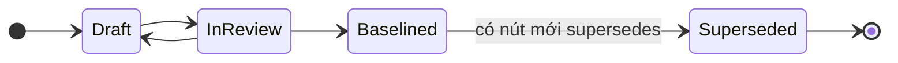
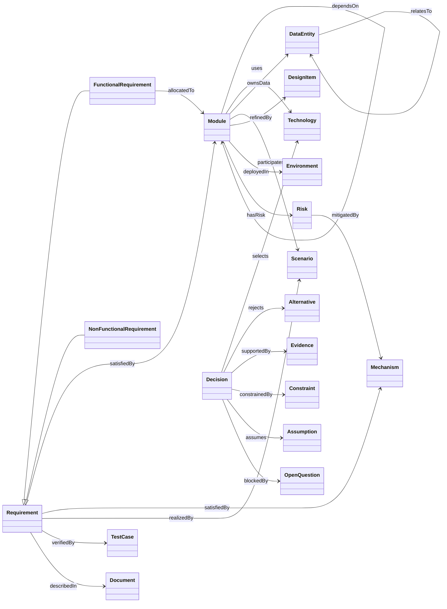
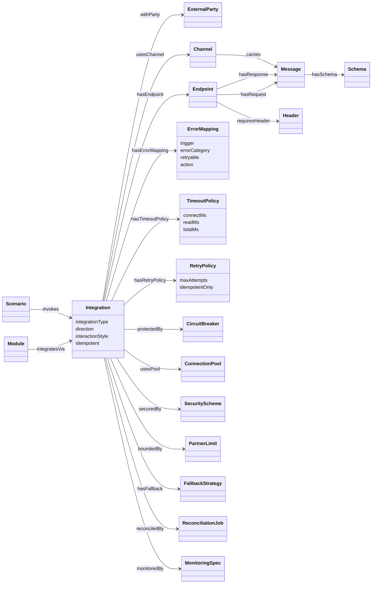
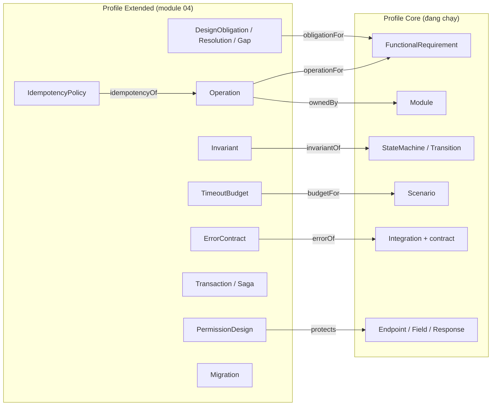
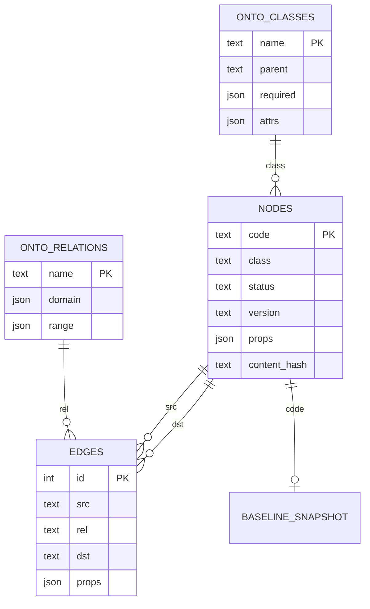
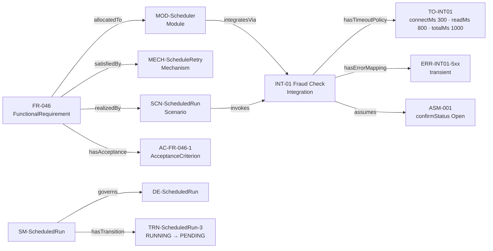

# Ontology TDD cho testspec-agent v2

Oct 12, 2026 · Bản 2.0 (draft)

## Cách đọc tài liệu

Tài liệu này là **hợp đồng đầu vào** của testspec-agent v2 (tsagent): KG của TDD phải theo ontology nào, lưu và trao đổi dưới dạng nào. Nó gồm hai profile:

| Profile | Nội dung | Trạng thái |
| --- | --- | --- |
| **Core** | Ontology `tdd:` đang chạy thật trong prototype `tdd_kg` (37 lớp, 41 quan hệ, luật R1–R17), cộng 9 lớp mở rộng mà tsagent v1 đã dùng (AC, StateMachine, Endpoint field…) | Có dữ liệu thật (MiniPay CR-001) |
| **Extended** | Các entity của [TDD-Ontology module 04](TDD-Ontology.md) mà tsagent v2 dùng để sinh test sâu hơn (Operation, Invariant, IdempotencyPolicy, TimeoutBudget, Saga, Migration, PermissionDesign…) | Đề xuất, dùng khi TDD đã số hóa theo module 04 |

tsagent v2 chạy được với KG chỉ có profile Core. Profile Extended là tùy chọn: có nút nào thì tsagent sinh thêm test cho nút đó ([ONTOLOGY-TEST-TSO.md](./ONTOLOGY-TEST-TSO.md) mục 7).

Quy ước ghi trường: `!` bắt buộc một giá trị, `+` một hoặc nhiều, `*` không hoặc nhiều, `?` tùy chọn.

| Mục | Nội dung |
| --- | --- |
| 1 | Nguyên tắc chung: định danh, trạng thái, phiên bản |
| 2 | Profile Core: lớp |
| 3 | Profile Core: quan hệ |
| 4 | Profile Core: mở rộng của tsagent |
| 5 | Profile Extended (từ module 04) |
| 6 | Luật kiểm |
| 7 | Lưu trữ: SQLite nodes/edges |
| 8 | Định dạng trao đổi `tdd-kg/v1` (JSON) |
| 9 | Ví dụ |

---

## 1. Nguyên tắc chung

### 1.1 Định danh và thuộc tính chung

Mọi nút kế thừa lớp gốc `Entity`.

| Thuộc tính | Bắt buộc | Ý nghĩa |
| --- | --- | --- |
| `code` | ! | Mã nghiệp vụ, duy nhất trong một KG, **không đổi qua phiên bản**. Chỉ gồm `A-Z a-z 0-9 . _ -` |
| `class` | ! | Tên lớp, không tiền tố (ví dụ `FunctionalRequirement`) |
| `label` | ? | Tên ngắn để hiển thị |
| `version` | ? | Phiên bản của nút, dạng chuỗi (ví dụ `0.1`) |
| `status` | ? | `Draft`, `InReview`, `Baselined`, `Superseded` |
| `sourceDoc`, `sourceSection` | ? | Tài liệu và mục gốc |
| `owner` | ? | Người chịu trách nhiệm |
| `description`, `note` | ? | Văn bản tự do |
| `testScope` | ? | `context`: nút chỉ làm ngữ cảnh (stub, truy vết), tsagent không sinh test cho chính nó |

Thuộc tính riêng của lớp nằm trong `props` (mục 7).

### 1.2 Trạng thái và phiên bản



- Nút **Baselined không được sửa tại chỗ** (R17). Thay đổi nội dung tạo **nút mới** với mã mới và cạnh `supersedes` sang nút cũ.
- Một thay đổi (CR) được đưa vào KG dưới dạng **patch chỉ thêm** nút và cạnh, kèm danh sách `supersede` (cơ chế của `tdd_kg/kg_patch.py`).
- Tài liệu chính (`Document` có `docType=TDD` hoặc `primary=true`) phải `Baselined` thì tsagent mới được baseline bộ test specs (luật T17 của tsagent).

---

## 2. Profile Core: lớp

Nguồn: `tmp/minipay-demo/tdd_kg/ontology.py`. Thuộc tính in đậm là bắt buộc (ngoài `code`).

### 2.1 Nhóm Nguồn, Yêu cầu, Quản trị

| Lớp | Cha | Thuộc tính |
| --- | --- | --- |
| Document | Entity | **docType**, baselineDate, primary |
| Requirement | Entity | **text**, priority, targetValue, targetUnit |
| FunctionalRequirement | Requirement | **text**, priority |
| NonFunctionalRequirement | Requirement | **text**, priority, targetValue, targetUnit, category, condition |
| Constraint | Entity | **constraintType** |
| Assumption | Entity | **statement**, dueDate, confirmStatus |
| OpenQuestion | Entity | **statement**, dueDate, confirmStatus |
| Risk | Entity | **likelihood**, **impact**, mitigation |
| Evidence | Entity | **summary**, measuredAt, location, metrics |

### 2.2 Nhóm Giải pháp, Triển khai, Truy vết

| Lớp | Thuộc tính |
| --- | --- |
| Module | **responsibility**, layer |
| Technology | **category**, techVersion |
| Decision | **statement**, rationale, noAlternativeNote |
| Alternative | **reasonRejected** |
| DataEntity | retentionRule, volumeEstimate |
| Mechanism | **mechanismKind** |
| Scenario | **responseBudgetMs**, steps |
| Environment | hostingType |
| TestCase | **level**, testStatus, location (test của hệ thống, khác test spec do tsagent sinh) |
| DesignItem | **kind**, **location**, demoImplementation |

### 2.3 Nhóm Contract

| Lớp | Thuộc tính |
| --- | --- |
| Integration | **integrationType**, **direction**, **interactionStyle**, **idempotent**, protocol, expectedRps |
| ExternalParty | **partyType**, ownerContact, sandboxAvailable, maintenanceWindow, contractConfirmed |
| Endpoint | **method**, **path**, apiVersion, mediaType |
| Channel | **partitionKey**, **deliverySemantics**, partitionCount, retentionDays, maxMessageKB, dlqName, consumerIdempotent |
| Message | **messageType**, direction, example, sensitiveFields |
| Schema | **format**, **location**, schemaVersion, compatibilityRule |
| Header | **name**, **required**, example |
| ErrorMapping | **trigger**, **errorCategory** (transient, permanent, unknownOutcome), **retryable**, **action** |
| TimeoutPolicy | **connectMs**, **readMs**, **totalMs**, poolAcquireMs, idleMs |
| RetryPolicy | **maxAttempts**, **idempotentOnly**, backoffType, jitter |
| CircuitBreaker | **failureRatePercent**, **minimumCalls**, **openDurationSec** |
| ConnectionPool | **maxTotal**, maxPerRoute, minIdle, maxLifetimeSec, idleTimeoutSec, validationEnabled, bulkheadGroup |
| SecurityScheme | **schemeType**, secretStore, rotationDays, signatureCheck |
| PartnerLimit | **maxConcurrentConnections**, requestsPerSecond, maxPayloadKB, slaAvailabilityPercent, p99LatencyMs |
| FallbackStrategy | **mode** |
| ReconciliationJob | schedule, scope |
| MonitoringSpec | metrics, alertThreshold |

---

## 3. Profile Core: quan hệ

| Nhóm | Quan hệ | Từ | Đến |
| --- | --- | --- | --- |
| Truy vết | satisfiedBy | Requirement | Module, Mechanism, Decision |
| | allocatedTo | FunctionalRequirement | Module |
| | realizedBy | Requirement | Scenario |
| | verifiedBy | Requirement | TestCase |
| Cấu trúc | refinedBy | Module, Integration | DesignItem |
| | dependsOn | Module | Module |
| | uses | Module | Technology |
| | ownsData | Module | DataEntity |
| | relatesTo (`cardinality`) | DataEntity | DataEntity |
| | participatesIn | Module | Scenario |
| | invokes | Scenario | Integration |
| | integratesVia | Module | Integration |
| Quyết định | deployedIn | Module | Environment |
| | selects | Decision | Technology |
| | rejects | Decision | Alternative |
| | supportedBy | Decision | Evidence |
| | constrainedBy | Decision, Module, Integration | Constraint |
| | assumes | Decision, Integration | Assumption |
| | blockedBy | Decision, Integration | OpenQuestion |
| Rủi ro | hasRisk | Module, Integration, Decision | Risk |
| | mitigatedBy | Risk | Mechanism, Decision |
| Phiên bản, nguồn | supersedes | Entity | Entity (cùng lớp) |
| | describedIn | Entity | Document |
| Contract | withParty | Integration | ExternalParty |
| | hasEndpoint | Integration | Endpoint |
| | usesChannel | Integration | Channel |
| | hasRequest, hasResponse | Endpoint | Message |
| | carries | Channel | Message |
| | hasSchema | Message | Schema |
| | requiresHeader | Endpoint, Message | Header |
| | hasErrorMapping | Integration | ErrorMapping |
| | hasTimeoutPolicy | Integration | TimeoutPolicy |
| | hasRetryPolicy | Integration | RetryPolicy |
| | protectedBy | Integration | CircuitBreaker |
| | usesPool | Integration | ConnectionPool |
| | securedBy | Integration | SecurityScheme |
| | boundedBy | Integration | PartnerLimit |
| | hasFallback | Integration | FallbackStrategy |
| | reconciledBy | Integration | ReconciliationJob |
| | monitoredBy | Integration | MonitoringSpec |

### 3.1 Sơ đồ: yêu cầu và giải pháp



### 3.2 Sơ đồ: contract của Integration



---

## 4. Profile Core: mở rộng của tsagent

Các lớp sau **không có** trong `tdd_kg/ontology.py` nhưng tsagent v1 đã nhận (qua md theo mẫu v1 và phụ lục có cấu trúc của solution). v2 đưa chúng vào ontology chính thức để phía TDD xuất được thẳng.

| Lớp | Thuộc tính | Quan hệ | Nguồn thường gặp |
| --- | --- | --- | --- |
| UserRequirement | **text**, priority | `tracesTo` → Requirement | URD |
| AcceptanceCriterion | **statement**, derivation | Requirement `hasAcceptance` → AC | SRS, solution |
| StateMachine | **name**, initial | `governs` → DataEntity; `hasTransition` → Transition | TDD, solution |
| State | **name**, terminal | `inMachine` → StateMachine | TDD |
| Transition | **from**, **to**, **trigger**, guard, effect | `inMachine` → StateMachine | TDD, solution |
| Field | **name**, type, required, min, max, minLength, maxLength, enum | Endpoint `hasField` → Field | solution |
| Response | **statusCode**, errorCode, condition | Endpoint `hasResponse` → Response | solution |
| ChangeRequest | **description**, changeKind | `affects` → Entity; `removes` → Entity | CR |
| Actor | **name** | | URD |

Ngoài ra Endpoint có thêm quan hệ `implements` → Requirement khi endpoint do solution khai cho một FR.

Lưu ý: trong Core, `Endpoint.hasResponse` trỏ tới `Message`. Mở rộng này cho phép trỏ tới `Response` (mã phản hồi). tsagent phân biệt bằng lớp của nút đích.

---

## 5. Profile Extended (từ TDD-Ontology module 04)

Profile Extended lấy các entity của [TDD-Ontology.md](TDD-Ontology.md). tsagent chỉ dùng các lớp dưới đây; các lớp khác của module 04 vẫn được nạp và lưu để truy vết.

| Nhóm module 04 | Lớp tsagent dùng | Trường tsagent đọc | Quan hệ (tên trong KG) |
| --- | --- | --- | --- |
| Design organization | DesignObligation | question, subjectScope, applicability, requiredChecks | `obligationFor` → Entity |
| | ObligationResolution | status, explanation | `resolves` → DesignObligation; `designRef` → Entity |
| | DesignGap | missingKnowledge, owner, blockingGates | `gapOf` → DesignObligation |
| | ApplicabilityDecision | result, rationale | `decides` → DesignObligation |
| Behavior | Operation | inputs, outputs, preconditions, postconditions, errorOutcomes, sideEffects, authContext | `ownedBy` → Module; `operationFor` → Requirement |
| | InteractionFlow | participants, entryCondition, successConditions, failurePaths | `hasStep` → InteractionStep |
| | InteractionStep | actor, ordering, branchGuard | `performs` → Operation |
| | Algorithm | preconditions, postconditions, terminationArgument | `ownedBy` → Module |
| | DecisionTable | inputs, rows, hitPolicy, completenessScope | `decides` → Operation |
| | Invariant | predicate, scope, enforcementPoints, failureBehavior | `invariantOf` → StateMachine, DataEntity, Transaction |
| | ConcurrencyPolicy | sharedResources, isolation, conflictHandling, progressGuarantee | `governs` → DataEntity |
| | Transition (bổ sung) | guard, effects, atomicity | (như Core) |
| Contract | ErrorContract | condition, classification, retryable, sideEffectState | `errorOf` → Operation, Integration |
| | TimeoutBudget | scope, endToEndDeadline, callBudgets, cancellation | `budgetFor` → Scenario, Operation |
| | IdempotencyPolicy | keyDerivation, keyScope, payloadFingerprint, retention, atomicStore, concurrentDuplicateBehavior | `idempotencyOf` → Operation |
| | FailurePolicy | failureClass, detection, effectState, recoveryAction | `failureOf` → Integration, Module |
| | EventContract | eventType, deliveryGuarantee, ordering, partitionKey | `carries` → Message |
| | ContractCompatibility | consumerVersions, compatibilityMode | `compatibilityOf` → Endpoint, EventContract |
| Data | Transaction | boundary, atomicity, isolation, commitPoint, rollbackBehavior | `includesOp` → Operation |
| | Saga | ordering, compensationPolicy, failureTerminalStates | `hasStep` → SagaStep |
| | SagaStep | compensation, idempotency, timeout, irreversibility | `performs` → Operation |
| | Migration | compatibilityWindow, rollbackOrRecovery, validationQueries | `hasStage` → MigrationStage |
| | MigrationStage | transform, preconditions, postconditions, resumability | `dependsOn` → MigrationStage |
| | IntegrityConstraint | predicate, enforcementMechanism | `constrains` → DataEntity |
| Security, ops | PermissionDesign | subject, resource, action, decisionPredicate, enforcementPoints, denyBehavior | `protects` → Endpoint, Operation |
| | SecretHandling | secretKind, reference, exposurePrevention | `secretOf` → Integration |
| | AuditDesign | events, actorAttribution, integrity | `auditOf` → Module |
| | LoadProfile | workloadMix, arrivalPattern, concurrency, duration | `loadFor` → NonFunctionalRequirement |
| | RecoveryPlan | failureScope, RTO, RPO, restoreValidation | `recoveryOf` → Module |
| | ObservabilityDesign | signals, thresholds, actions | `observes` → Module, Integration |
| | RolloutPlan | stages, abortConditions | `rolloutOf` → ChangeRequest |

Module 04 không đặt tên quan hệ; tên trong cột cuối là **đề xuất của tài liệu này** để KG xuất được dạng nodes/edges. Cần đội TDD xác nhận (OQ-O1).

Module 04 cũng chưa có entity cho công nghệ. Profile Core giữ `Technology` và `uses`, đủ cho tsagent dùng trong phân tích ảnh hưởng.



---

## 6. Luật kiểm

### 6.1 Luật của profile Core (R1–R17)

| Luật | Mức | Nội dung |
| --- | --- | --- |
| R1 | block | Mọi Requirement có ít nhất một `satisfiedBy` |
| R2 | block | Mọi NFR có `targetValue` và `targetUnit` |
| R3 | block | Mọi FR có `allocatedTo` một Module |
| R4 | warn | Decision có `rationale`; có `selects` thì có `rejects` hoặc `noAlternativeNote` |
| R5 | block | Integration có `withParty`, `securedBy`, `boundedBy`; Message có `hasSchema` |
| R6 | block | Integration outbound có `hasTimeoutPolicy`, `hasRetryPolicy`, `usesPool` |
| R7 | block | `connectMs < readMs < totalMs` và `poolAcquireMs < readMs` |
| R8 | block | `totalMs < responseBudgetMs` của mọi Scenario gọi Integration đó |
| R9 | block | Tích hợp ghi không idempotent: `idempotentOnly=true` hoặc có Header idempotency key |
| R10 | block | ErrorMapping phủ đủ transient, permanent, unknownOutcome |
| R11 | warn | `ConnectionPool.maxTotal ≤ PartnerLimit.maxConcurrentConnections` |
| R12 | block | Tích hợp queue: Channel có `deliverySemantics`, `dlqName`; `atLeastOnce` thì `consumerIdempotent` |
| R13 | warn | Risk có `mitigation` hoặc `mitigatedBy` |
| R14 | warn | Assumption, OpenQuestion có `owner`, `dueDate`; quá hạn chưa xác nhận thì cảnh báo |
| R15 | warn | NFR có `verifiedBy` một TestCase |
| R16 | warn | Integration có `contractConfirmed=true` hoặc `assumes` một Assumption còn hạn |
| R17 | block | Nút Baselined không bị sửa; thay đổi tạo nút mới `supersedes` nút cũ |

Mức `block` chặn baseline TDD phía nguồn. tsagent vẫn sinh bản Draft khi nguồn còn lỗi `block` nhưng không baseline bộ test specs.

### 6.2 Luật bổ sung khi nạp vào tsagent (I1–I8)

| Luật | Nội dung |
| --- | --- |
| I1 | Mọi cạnh có hai đầu là nút tồn tại trong cùng gói. Cạnh treo bị từ chối kèm chẩn đoán (không bỏ lặng lẽ) |
| I2 | Lớp của hai đầu cạnh khớp `domain`, `range` của quan hệ trong `ontology` gửi kèm; quan hệ lạ là cảnh báo |
| I3 | Mọi thuộc tính bắt buộc của lớp có mặt |
| I4 | Không có hai nút cùng `code` |
| I5 | `supersede.old` và `supersede.new` cùng lớp |
| I6 | Có đúng một Document chính (`primary=true`, hoặc `docType=TDD`, hoặc `docType=CR` của gói CR) |
| I7 | Giá trị nhiều phần tử phải là mảng JSON, không phải chuỗi nối |
| I8 | `format` và `ontologyVersion` của gói thuộc danh sách tsagent hỗ trợ |

### 6.3 Luật của profile Extended

Áp dụng các luật TDD-001 đến TDD-024 của module 04. tsagent chỉ đọc kết quả của các luật này (nếu phía TDD gửi kèm), không tự chạy, trừ TDD-002 (obligation applicable phải có resolution hoặc gap), được dùng làm tiền điều kiện của TSO-004.

---

## 7. Lưu trữ: SQLite nodes/edges

KG TDD được lưu theo đúng lược đồ của `tdd_kg/kg_store.py`. tsagent v2 dùng **cùng cấu trúc** cho bảng nguồn của mình, thêm cột `baseline_id` (xem TDD-TSAGENT-v2 mục 5).

```sql
CREATE TABLE onto_classes(name TEXT PRIMARY KEY, parent TEXT, grp TEXT, required TEXT, attrs TEXT, doc TEXT);
CREATE TABLE onto_relations(name TEXT PRIMARY KEY, domain TEXT, range TEXT, grp TEXT, doc TEXT, props TEXT);
CREATE TABLE nodes(code TEXT PRIMARY KEY, class TEXT NOT NULL, label TEXT, version TEXT, status TEXT,
  source_doc TEXT, source_section TEXT, owner TEXT, props TEXT NOT NULL DEFAULT '{}', content_hash TEXT);
CREATE TABLE edges(id INTEGER PRIMARY KEY AUTOINCREMENT, src TEXT NOT NULL, rel TEXT NOT NULL, dst TEXT NOT NULL,
  props TEXT NOT NULL DEFAULT '{}', UNIQUE(src, rel, dst));
CREATE INDEX ix_edges_src ON edges(src, rel);
CREATE INDEX ix_edges_dst ON edges(dst, rel);
CREATE INDEX ix_nodes_class ON nodes(class);
CREATE TABLE baseline_snapshot(code TEXT PRIMARY KEY, content_hash TEXT, version TEXT);
```



- **Ontology nằm ngay trong DB** (`onto_classes`, `onto_relations`), nên bên nhận kiểm được dữ liệu mà không cần danh sách lớp viết cứng.
- **Thuộc tính riêng của lớp** nằm trong cột JSON `props`. Giá trị nhiều phần tử là mảng JSON.
- **Nguồn sự thật** của prototype là file JSON (`minipay_tdd.json` + `patches/<CR>.json`); SQLite là bản dựng lại bằng `build_kg.py`.

---

## 8. Định dạng trao đổi `tdd-kg/v1`

Gói gửi cho tsagent (qua MCP `start_run.documents` hoặc file). Thay cho Turtle của v1: không cần thư viện RDF ở cả hai đầu, không mất kiểu dữ liệu.

```json
{
  "format": "tdd-kg/v1",
  "ontologyVersion": "tdd-core-1+ext-0",
  "feature": "SCHEDULED-TRANSFER",
  "package": {"kind": "slice", "cr": "CR-001", "generatedAt": "2026-10-12T04:00:00Z", "sourceHash": "sha256:..."},
  "ontology": {
    "classes": [{"name": "Integration", "parent": "Entity", "required": ["code", "integrationType", "direction", "interactionStyle", "idempotent"], "attrs": ["protocol", "expectedRps"]}],
    "relations": [{"name": "hasErrorMapping", "domain": ["Integration"], "range": ["ErrorMapping"]}]
  },
  "nodes": [
    {"code": "FR-046", "class": "FunctionalRequirement", "status": "Baselined", "version": "0.1",
     "sourceDoc": "SRS", "props": {"text": "Xử lý thất bại của lần chạy theo loại lỗi (BR-13)…", "priority": "Must"}},
    {"code": "SCN-ScheduledRun", "class": "Scenario", "props": {"responseBudgetMs": 60000, "steps": ["Quét mỗi 30 giây", "Chiếm lần chạy", "Gọi lõi chuyển tiền"]}},
    {"code": "MOD-Account", "class": "Module", "testScope": "context", "props": {"responsibility": "Quản lý tài khoản"}}
  ],
  "edges": [
    ["FR-046", "allocatedTo", "MOD-Scheduler", {}],
    ["DE-ScheduledTransfer", "relatesTo", "DE-ScheduledRun", {"cardinality": "1:N"}]
  ],
  "supersede": [{"old": "FR-013", "new": "FR-013-v2"}]
}
```

| Trường | Bắt buộc | Ý nghĩa |
| --- | --- | --- |
| `format` | ! | Luôn `tdd-kg/v1` |
| `ontologyVersion` | ! | Phiên bản ontology của gói; tsagent từ chối phiên bản không hỗ trợ (I8) |
| `feature` | ! | Mã feature của bộ test specs |
| `package.kind` | ! | `full` (toàn bộ KG) hoặc `slice` (lát cắt của CR: nút của CR + ngữ cảnh đánh `testScope=context`) |
| `ontology` | ! | Lớp và quan hệ dùng trong gói (bản rút từ `onto_classes`, `onto_relations`) |
| `nodes` | + | Nút. `props` giữ nguyên kiểu JSON |
| `edges` | * | `[src, rel, dst, props]` |
| `supersede` | * | Cặp thay thế ở phía TDD |

JSON Schema chính thức của gói đặt ở `tsagent/schemas/tdd-kg-v1.schema.json` (sẽ tạo khi cài đặt).

---

## 9. Ví dụ (MiniPay CR-001, rút gọn)



---

## 10. Câu hỏi mở

| Mã | Câu hỏi | Ảnh hưởng |
| --- | --- | --- |
| OQ-O1 | Tên quan hệ của profile Extended (mục 5) do đội TDD chốt | Mục 5, mapping của ontology test |
| OQ-O2 | KG TDD thật của dự án có lưu theo nodes/edges SQLite như prototype không, hay theo kho RDF? | Mục 7, 8 |
| OQ-O3 | Ai sở hữu JSON Schema `tdd-kg/v1`: phía TDD hay tsagent? | Mục 8 |
| OQ-O4 | Có đưa entity công nghệ (TechnologyComponent, CapabilityAssumption) vào module 04 không? | Mục 5 |
