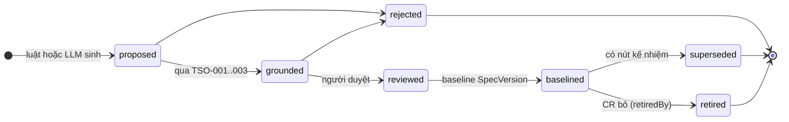
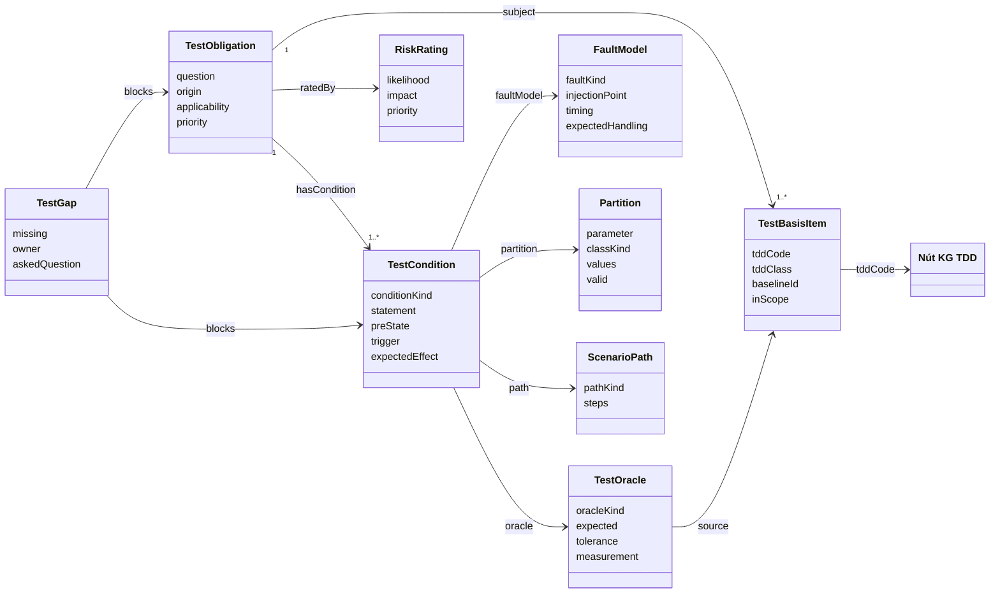
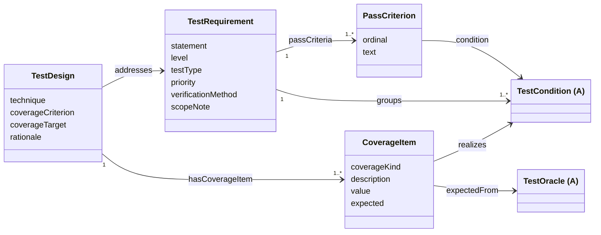
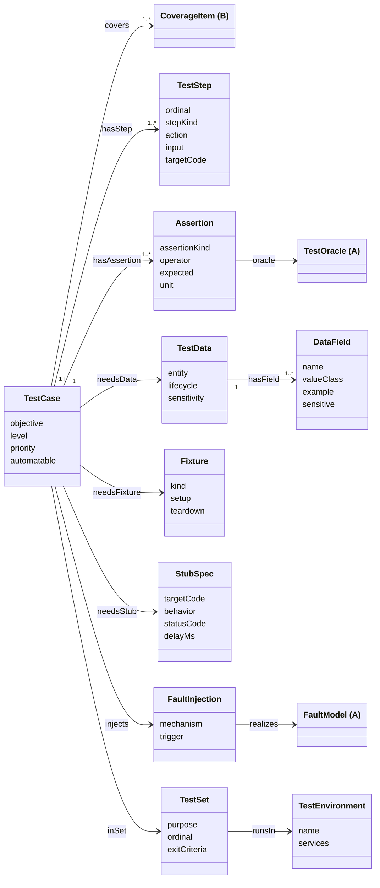
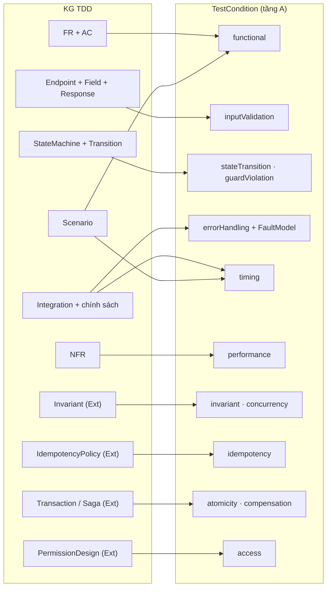
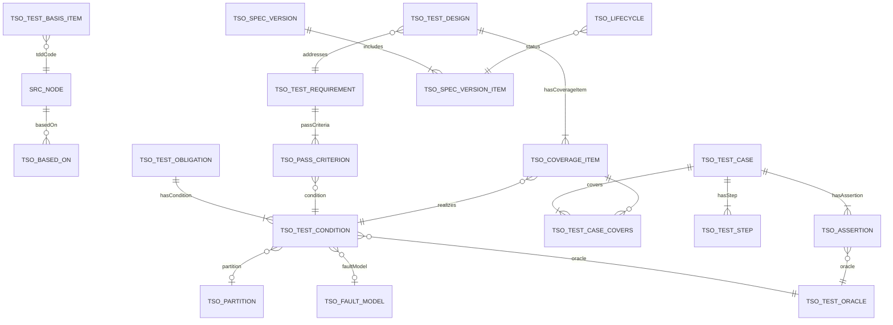
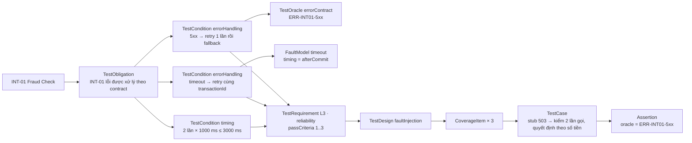

# Ontology test `tso:` của testspec-agent v2

Oct 12, 2026 · Bản 2.0 (draft)

## Cách đọc tài liệu

Ontology `tso:` (Test Specification Ontology) mô tả **KG test** mà tsagent v2 xây từ KG của TDD ([ONTOLOGY-TDD.md](./ONTOLOGY-TDD.md)) rồi dùng làm nguồn duy nhất để sinh test specs theo ISO/IEC/IEEE 29119-3. Nó thay ontology `tsp:` của v1.

- Mục 2–6: lớp, trường, quan hệ (mức khái niệm).
- Mục 7: ánh xạ từ ontology TDD sang `tso:` (luật seed).
- Mục 8: quy trình LLM điền dữ liệu.
- Mục 9: luật kiểm `TSO-*`.
- Mục 10: mô hình vật lý trên SQLite (bảng, khóa, ràng buộc).

Quy ước ghi trường: `!` bắt buộc một giá trị, `+` một hoặc nhiều, `*` không hoặc nhiều, `?` tùy chọn. Tên lớp trong KG TDD viết theo ONTOLOGY-TDD (ví dụ `FunctionalRequirement`, `IdempotencyPolicy`).

---

## 1. Nguyên tắc

| # | Nguyên tắc | Cách thực hiện |
| --- | --- | --- |
| P1 | **Có căn cứ** | Mọi nút `tso:` có `basedOn` ít nhất một nút TDD. LLM chỉ được dùng mã trong danh sách trắng lấy từ KG đầu vào |
| P2 | **Tách "kiểm gì" và "kiểm thế nào"** | Tầng A (phân tích) độc lập với tầng B (thiết kế) và C (đặc tả) |
| P3 | **Luật dựng khung, LLM điền, luật kiểm lại** | Luật seed sinh các nút bắt buộc; LLM điền nội dung và đề xuất thêm; luật `TSO-*` kiểm |
| P4 | **Oracle tường minh** | Mọi điều kiện và assertion nói rõ kết quả đúng lấy từ đâu |
| P5 | **Provenance cho từng nút** | `derivation`, `basedOn`, `evidence`, `model`, `promptHash`, `confidence`, `reviewStatus` |
| P6 | **KG là nguồn sự thật** | md chỉ là bản render; không sửa tay md |
| P7 | **Không bịa khi thiếu** | Thiếu thông tin thì sinh `TestGap` kèm câu hỏi cho owner |

---

## 2. Tổng quan ba tầng

```mermaid
flowchart LR
  TDD[("KG TDD<br/>Core + Extended")] -->|"luật seed + LLM"| A
  subgraph A["Tầng A · Phân tích"]
    direction TB
    A1[TestBasisItem]
    A2[TestObligation]
    A3[TestCondition]
    A4[TestOracle]
    A5[FaultModel · Partition · ScenarioPath]
    A6[RiskRating · TestGap]
  end
  A -->|"luật chọn kỹ thuật + LLM"| B
  subgraph B["Tầng B · Thiết kế"]
    direction TB
    B1[TestRequirement]
    B2[TestDesign]
    B3[CoverageItem]
  end
  B -->|"LLM viết test case"| C
  subgraph C["Tầng C · Đặc tả"]
    direction TB
    C1[TestCase · TestStep · Assertion]
    C2[TestData · Fixture]
    C3[StubSpec · FaultInjection]
    C4[TestEnvironment · TestSet]
  end
  C --> DOC["TestSpecDocument<br/>3 tài liệu md"]
  B --> DOC
  CORE{{"Lõi: Provenance · Evidence · ReviewRecord · GenerationRun · phiên bản"}} -.áp lên.-> A & B & C
```



| Tầng | Câu hỏi | Ai sinh |
| --- | --- | --- |
| Lõi | Nút này từ đâu ra, ai duyệt, phiên bản nào | Hệ thống |
| A. Phân tích | Cần kiểm gì, vì sao, thế nào là đúng | Luật seed + LLM |
| B. Thiết kế | Kỹ thuật nào, phủ tới đâu | Luật + LLM |
| C. Đặc tả | Chạy cụ thể ra sao | LLM, luật kiểm |

---

## 3. Lõi chung

| Lớp | Trường | Ràng buộc |
| --- | --- | --- |
| `TestEntity` (lớp cha) | `code! feature! nodeVersion! contentHash! provenance!` | `code` suy từ mã nguồn TDD, ổn định qua phiên bản; `nodeVersion` tăng khi `contentHash` đổi |
| `Provenance` | `derivation! basedOn+ evidence* model? promptHash? confidence! runId!` | `derivation` ∈ {stated, rule, llm, human}. `llm` thì bắt buộc có `model`, `promptHash`, ít nhất một `evidence` |
| `Evidence` | `sourceCode! quote? span?` | Trỏ tới nút TDD và đoạn văn bản LLM dựa vào |
| `ReviewRecord` | `reviewStatus! reviewer? reviewedAt? note?` | `reviewStatus` ∈ {proposed, approved, rejected, needsInfo} |
| `Lifecycle` | `status!` | `status` ∈ {Draft, InReview, Baselined, Superseded, Retired} |
| `GenerationRun` | `runId! stage! inputBaseline! model? llmCalls! startedAt! status!` | `stage` ∈ {ingest, analysis, design, specification, validate, render} |
| `SpecVersion` | `feature! version! status! basedOnBaseline! changedBy*` | Phiên bản của cả bộ test specs; ba tài liệu cùng số |



Trạng thái trong sơ đồ là tổ hợp của `ReviewRecord.reviewStatus` và `Lifecycle.status`. Nút `derivation=llm` chỉ được baseline khi đã `reviewed` hoặc thuộc loại mà policy cho tự duyệt (TSO-020).

---

## 4. Tầng A: phân tích

| Lớp | Trường | Ràng buộc |
| --- | --- | --- |
| `TestBasisItem` | `tddCode! tddClass! baselineId! inScope!` | Con trỏ tới một nút TDD ở đúng baseline. `inScope=false` khi nút có `testScope=context` |
| `TestObligation` | `question! origin! applicability! priority!` | "Phải chứng minh điều gì". `origin` ∈ {designObligation, seedRule, risk, llmProposal} |
| `TestCondition` | `conditionKind! statement! expectedEffect! preState? trigger?` | Một khía cạnh kiểm được của obligation |
| `TestOracle` | `oracleKind! expected! tolerance? measurement?` | `oracleKind` ∈ {postcondition, invariant, errorContract, threshold, stateMachine, decisionRow, schema, acceptanceCriterion, reference, humanJudgment} |
| `FaultModel` | `faultKind! injectionPoint! timing! expectedHandling!` | `timing` ∈ {before, during, afterCommit, beforeAck} |
| `Partition` | `parameter! classKind! values+ valid!` | `classKind` ∈ {equivalence, boundary, enum, null, format, missing} |
| `ScenarioPath` | `pathKind! steps+` | `pathKind` ∈ {main, alternative, failure, negative} |
| `RiskRating` | `likelihood! impact! priority! rationale!` | `priority` ∈ {P0, P1, P2, P3} |
| `TestGap` | `missing! owner! askedQuestion! dueDate?` | Thiếu thông tin để viết điều kiện hoặc oracle |

`conditionKind`: functional, inputValidation, stateTransition, guardViolation, invariant, decisionRule, errorHandling, idempotency, concurrency, timing, atomicity, compensation, migration, compatibility, access, secretExposure, audit, performance, resilience, observability, rollout.



---

## 5. Tầng B: thiết kế

| Lớp | Trường | Ràng buộc |
| --- | --- | --- |
| `TestRequirement` | `statement! level! testType! priority! verificationMethod! scopeNote!` | Gom các TestCondition cùng chủ thể và mức. `passCriteria` là danh sách đánh số, mỗi mục trỏ tới một TestCondition. `scopeNote` phân biệt với TR khác cùng chủ thể |
| `PassCriterion` | `ordinal! text! condition!` | Mục tiêu chí của TR |
| `TestDesign` | `technique! coverageCriterion! coverageTarget! rationale!` | Kỹ thuật 29119-4: equivalencePartitioning, boundaryValue, stateTransition, decisionTable, causeEffect, pairwise, scenario, errorGuessing, faultInjection, loadModel, accessMatrix |
| `CoverageItem` | `coverageKind! description! expected! value?` | Luôn hiện thực một TestCondition |

- `level` ∈ {L1 nghiệp vụ E2E, L2 nghiệp vụ, L3 cô lập service}.
- `testType` theo nhóm ISO 25010: functional, reliability, performance, security, compatibility, maintainability, usability.
- `verificationMethod` ∈ {test, benchmark, analysis, inspection}.



---

## 6. Tầng C: đặc tả

| Lớp | Trường | Ràng buộc |
| --- | --- | --- |
| `TestCase` | `objective! level! priority! automatable!` | Phủ ít nhất một CoverageItem; có bước `when` và Assertion |
| `TestStep` | `ordinal! stepKind! action! input? targetCode?` | `stepKind` ∈ {given, when, then, cleanup}; `targetCode` là mã nút TDD (Endpoint, Operation, Module) |
| `Assertion` | `assertionKind! operator! expected! unit?` | Bắt buộc có `oracle` |
| `TestData` | `entity! lifecycle! sensitivity!` | Có các `DataField`; dữ liệu nhạy cảm chỉ dùng `secretRef` |
| `DataField` | `name! valueClass! example! sensitive!` | |
| `Fixture` | `kind! setup! teardown!` | Trạng thái nền: tài khoản, số dư, đồng hồ giả |
| `StubSpec` | `targetCode! behavior! statusCode? delayMs? response?` | `behavior` ∈ {success, errorTransient, errorPermanent, timeout, slow, duplicate, malformedPayload} |
| `FaultInjection` | `mechanism! trigger!` | Hiện thực một FaultModel (giết tiến trình, chặn mạng, trả 503…) |
| `TestEnvironment` | `name! services+ secretRef*` | |
| `TestSet` | `purpose! ordinal! entryCriteria+ exitCriteria+` | `exitCriteria` đo được |
| `TestSpecDocument` | `docKind! specVersion!` | `docKind` ∈ {TestRequirements, TestDesign, TestCases} |



---

## 7. Ánh xạ từ ontology TDD (luật seed)

Luật seed **bắt buộc** sinh các nút tầng A khi KG TDD có nút loại tương ứng. LLM điền nội dung và có thể đề xuất thêm, không được bỏ nút seed.

### 7.1 Profile Core (chạy được với KG hiện có)

| Nút TDD | Seed ở tầng A | Oracle | Kỹ thuật (tầng B) |
| --- | --- | --- | --- |
| FunctionalRequirement + AcceptanceCriterion | 1 obligation cho FR; mỗi AC một `functional` | acceptanceCriterion | useCase / scenario |
| FunctionalRequirement không có AC | 1 `TestGap` "thiếu AC" + LLM đề xuất AC (`proposedConditions`, phải duyệt) | — | — |
| NonFunctionalRequirement | 1 `performance` (hoặc theo `category`) với oracle `threshold` có `measurement` (phân vị, cửa sổ đo) | threshold | loadModel / analysis |
| Endpoint (+ `implements`) + Field | Mỗi Field: Partition thiếu, biên, độ dài, enum → `inputValidation` | schema | equivalencePartitioning, boundaryValue |
| Endpoint + Response | Mỗi Response một `functional` hoặc `inputValidation` | errorContract | equivalencePartitioning |
| StateMachine + Transition | Mỗi Transition một `stateTransition`; mỗi `guard` một `guardViolation` | stateMachine | stateTransition |
| Module có `dependsOn` | Mỗi phụ thuộc một `errorHandling` (phụ thuộc lỗi) | errorContract | faultInjection |
| Integration + ErrorMapping | Mỗi ErrorMapping một `errorHandling` + FaultModel (`unknownOutcome` → timing `afterCommit`) | errorContract | faultInjection |
| Integration + TimeoutPolicy + RetryPolicy | 1 `timing` trường hợp xấu nhất: tổng (`totalMs` × số lần) + backoff ≤ `responseBudgetMs` của Scenario | threshold | boundaryValue |
| Integration + CircuitBreaker | Mở, nửa mở, đóng lại | stateMachine | stateTransition |
| Integration `idempotent` | `idempotency`: gửi lại cùng yêu cầu | invariant | errorGuessing |
| Integration + PartnerLimit | Đúng và vượt `requestsPerSecond`, `maxPayloadKB` | threshold | boundaryValue |
| Channel `atLeastOnce` / `dlqName` | `idempotency` giao trùng; `errorHandling` vào DLQ | invariant | errorGuessing |
| Integration inbound + SecurityScheme | `access`: hợp lệ, thiếu, sai | reference | accessMatrix |
| Scenario (≥ 2 Module `participatesIn`) | ScenarioPath main + mỗi failure path; `timing` theo `responseBudgetMs` | postcondition | scenario (L1) |
| Assumption, OpenQuestion chưa `Confirmed` | Gắn `TestGap` cho điều kiện phụ thuộc **trực tiếp** (qua `assumes`, `blockedBy` của chính chủ thể, không lan qua Integration dùng chung) | — | — |
| Risk `impact=High` | Tăng `RiskRating.priority` | — | — |

### 7.2 Profile Extended (khi TDD theo module 04)

| Nút TDD | Seed ở tầng A | Oracle | Kỹ thuật |
| --- | --- | --- | --- |
| DesignObligation (applicable) | 1 TestObligation `origin=designObligation` | — | theo điều kiện |
| DesignGap | 1 TestGap chặn obligation tương ứng | — | — |
| Operation | `functional` theo `postconditions`; mỗi `precondition` một điều kiện âm; mỗi `errorOutcome` một `errorHandling` | postcondition, errorContract | equivalencePartitioning |
| InteractionFlow | ScenarioPath main và mỗi `failurePath` | postcondition | scenario |
| DecisionTable | Mỗi row một `decisionRule`; thêm "không khớp dòng nào" nếu chưa đầy đủ | decisionRow | decisionTable |
| Invariant | 1 `invariant` cho mỗi `enforcementPoint` | invariant | faultInjection, errorGuessing |
| ConcurrencyPolicy | 1 `concurrency` cho mỗi tài nguyên chia sẻ | invariant | faultInjection |
| ErrorContract | `errorHandling` + FaultModel theo `sideEffectState` | errorContract | faultInjection |
| TimeoutBudget + RetryPolicy | `timing` trường hợp xấu nhất theo `endToEndDeadline` | threshold | boundaryValue |
| IdempotencyPolicy | `idempotency`: gửi lại; cùng key khác payload; trùng đồng thời; sau khi hết `retention` | invariant | errorGuessing, faultInjection |
| Transaction | `atomicity`: lỗi trước và sau `commitPoint` | invariant | faultInjection |
| Saga, SagaStep | `compensation` cho mỗi bước; xử lý tay cho bước `irreversibility` | postcondition | faultInjection |
| Migration, MigrationStage | Chạy tiến, rollback hoặc recovery, chạy lại, cửa sổ tương thích | postcondition | scenario |
| ContractCompatibility | `compatibility` cho mỗi `consumerVersions` | schema | scenario |
| PermissionDesign | Mỗi `enforcementPoint` × {cho phép, từ chối} một `access` | reference | accessMatrix |
| SecretHandling | `secretExposure` cho log, lỗi, sự kiện | reference | errorGuessing |
| AuditDesign | Mỗi `event` một `audit` | reference | scenario |
| LoadProfile | `performance` theo workload | threshold | loadModel |
| RecoveryPlan | `resilience`: đo RTO, RPO, kiểm dữ liệu sau khôi phục | threshold | faultInjection |
| ObservabilityDesign | Mỗi `threshold` một `observability` | reference | faultInjection |
| RolloutPlan | Mỗi `abortCondition` một `rollout` | reference | scenario |



---

## 8. Quy trình LLM điền dữ liệu

| Bước | Luật làm | LLM làm | Đầu ra |
| --- | --- | --- | --- |
| 1. Phân tích | Seed theo mục 7; tính danh sách trắng mã | Viết `statement`, `expected` của oracle, Partition, FaultModel; đề xuất điều kiện thêm (`proposedConditions`); sinh `TestGap` khi thiếu | Tầng A |
| 2. Thiết kế | Chọn kỹ thuật theo `conditionKind`; nhóm điều kiện thành TR theo (chủ thể, mức, loại) | Viết `statement`, `passCriteria`, `scopeNote` của TR; chọn giá trị cho CoverageItem | Tầng B |
| 3. Đặc tả | Khung TestCase (mỗi CoverageItem tối thiểu một TC) | Bước given/when/then, dữ liệu, fixture, stub, fault injection, assertion | Tầng C |

Mỗi lượt gọi LLM nhận **gói ngữ cảnh** của một chủ thể (nút TDD + láng giềng 1–2 bước + nút seed cần điền), trả JSON theo schema, bị kiểm `TSO-001..003` và luật của bước đó; sai thì được **một lượt sửa**, vẫn sai thì chỉ giữ nút seed và tạo `TestGap`.

Ví dụ đầu ra bước 1 (rút gọn):

```json
{
  "schemaVersion": 2,
  "subject": "INT-01",
  "conditions": [
    {"seedCode": "TCND-INT01-ERR-5xx", "conditionKind": "errorHandling",
     "statement": "Fraud Check trả 503: client retry 1 lần; vẫn lỗi thì áp fallback FB-INT01 (dưới 5 triệu cho qua, từ 5 triệu từ chối 503)",
     "oracle": {"oracleKind": "errorContract", "source": "ERR-INT01-5xx", "expected": "1 lần retry, sau đó fallback theo số tiền"},
     "faultModel": {"faultKind": "http5xx", "injectionPoint": "INT-01", "timing": "before", "expectedHandling": "retry rồi fallback"},
     "basedOn": ["INT-01", "ERR-INT01-5xx", "FB-INT01", "RT-INT01"],
     "evidence": [{"sourceCode": "ERR-INT01-5xx", "quote": "Retry 1 lần; vẫn lỗi thì coi là không khả dụng, áp FB-INT01"}],
     "confidence": 0.85}
  ],
  "proposedConditions": [],
  "gaps": []
}
```

---

## 9. Luật kiểm `TSO-*`

| ID | Luật | Tầng | Mức |
| --- | --- | --- | --- |
| TSO-001 | Mọi nút có `basedOn` ít nhất một nút TDD tồn tại ở baseline đang dùng | Mọi tầng | Chặn |
| TSO-002 | Nút `derivation=llm` có `model`, `promptHash`, `evidence` | Mọi tầng | Chặn |
| TSO-003 | Mọi mã tham chiếu thuộc danh sách trắng | Mọi tầng | Chặn |
| TSO-004 | Mọi Requirement trong phạm vi (và mọi DesignObligation applicable nếu có) có ít nhất một TestObligation | A | Chặn |
| TSO-005 | Mọi nút TDD có luật seed có đủ TestCondition seed | A | Chặn |
| TSO-006 | Mọi TestCondition có oracle; oracle `threshold` có `measurement` | A | Chặn |
| TSO-007 | TestGap có owner; điều kiện bị gap chặn không được baseline | A | Chặn baseline |
| TSO-008 | Mọi TestCondition được ít nhất một CoverageItem hiện thực | B | Chặn |
| TSO-009 | TR có `passCriteria` đánh số trỏ tới điều kiện; có `scopeNote` khi cùng chủ thể có nhiều TR | B | Chặn |
| TSO-010 | Kỹ thuật phù hợp `conditionKind` | B | Cảnh báo |
| TSO-011 | Mọi CoverageItem có TestCase phủ; mọi TestCase có bước `when` và Assertion | C | Chặn |
| TSO-012 | `Assertion.expected` khớp oracle (đơn vị, ngưỡng, mã lỗi) | C | Chặn |
| TSO-013 | FaultModel có FaultInjection; `timing=afterCommit` có assertion về hiệu ứng phụ | C | Chặn |
| TSO-014 | Có IdempotencyPolicy thì phủ đủ: gửi lại, khác payload, trùng đồng thời | A, C | Chặn |
| TSO-015 | Điều kiện `timing` dùng trường hợp xấu nhất, không cộng p95 thành phần | A | Chặn |
| TSO-016 | Điều kiện `performance` có workload; không có test "vượt ngưỡng + 1" cho chỉ tiêu dạng 0 hoặc 100 % | A, B | Chặn |
| TSO-017 | Mỗi điểm thực thi quyền có test cho phép và từ chối | A | Chặn |
| TSO-018 | Không có giá trị bí mật trong dữ liệu, bước, assertion | C | Chặn |
| TSO-019 | TR mức L1 đi qua ScenarioPath có ít nhất hai Module | B | Chặn |
| TSO-020 | Nút `llm` chỉ baseline khi `reviewed`, trừ loại nút và ngưỡng `confidence` policy cho phép | Mọi tầng | Chặn baseline |
| TSO-021 | Phiên bản hóa: nút Baselined bất biến; chuỗi `supersedes` thẳng; không mất nút giữa hai phiên bản; Retired có `retiredBy` | Mọi tầng | Chặn |

| Gate | Điều kiện |
| --- | --- |
| GA (phân tích xong) | TSO-001..007 |
| GB (thiết kế xong) | GA + TSO-008..010 |
| GS (baseline) | GB + TSO-011..021; Document TDD chính đã Baselined |

---

## 10. Mô hình vật lý trên SQLite

### 10.1 Quy tắc ánh xạ

| Ontology | SQLite |
| --- | --- |
| Lớp | Bảng tên `tso_<lớp>` (snake case) |
| `TestEntity` | Cột chung: `id INTEGER PK`, `feature`, `code`, `node_version`, `content_hash`, `supersedes_id`, `run_id`, `derivation`, `confidence`, `model`, `prompt_hash`; `UNIQUE(feature, code, node_version)` |
| Trường `!` | `NOT NULL` |
| Trường dạng liệt kê | `CHECK (col IN (...))` |
| Trường nhiều giá trị đơn giản (`values+`, `services+`) | Cột JSON (mảng) |
| Quan hệ N:1 | Cột khóa ngoại |
| Quan hệ N:M | Bảng nối `tso_<lớp>_<quan hệ>` |
| `basedOn` | Bảng nối `tso_based_on(entity_table, entity_id, src_node_id)` |
| `Evidence` | Bảng `tso_evidence(entity_table, entity_id, src_node_id, quote)` |
| `ReviewRecord`, `Lifecycle` | Bảng `tso_lifecycle(entity_table, entity_id, status, review_status, reviewer, reviewed_at, note)` |
| Ràng buộc `+` | Không ép được bằng khóa; kiểm bằng truy vấn trong luật TSO |

DDL được **sinh tự động** từ định nghĩa ontology (`tsagent/ontology/tso.yaml`), cùng nguồn với JSON Schema đầu ra của LLM, để lược đồ không lệch ontology.

### 10.2 Bảng chính (rút gọn)

```sql
-- tầng A
CREATE TABLE tso_test_obligation(
  id INTEGER PRIMARY KEY, feature TEXT NOT NULL, code TEXT NOT NULL, node_version INTEGER NOT NULL,
  content_hash TEXT NOT NULL, supersedes_id INTEGER REFERENCES tso_test_obligation(id),
  run_id TEXT NOT NULL, derivation TEXT NOT NULL CHECK (derivation IN ('stated','rule','llm','human')),
  confidence REAL NOT NULL, model TEXT, prompt_hash TEXT,
  question TEXT NOT NULL, origin TEXT NOT NULL CHECK (origin IN ('designObligation','seedRule','risk','llmProposal')),
  applicability TEXT NOT NULL, priority TEXT NOT NULL CHECK (priority IN ('P0','P1','P2','P3')),
  UNIQUE(feature, code, node_version));

CREATE TABLE tso_test_oracle(
  id INTEGER PRIMARY KEY, /* cột chung TestEntity */
  oracle_kind TEXT NOT NULL, expected TEXT NOT NULL, tolerance TEXT, measurement TEXT,
  source_basis_id INTEGER REFERENCES tso_test_basis_item(id));

CREATE TABLE tso_test_condition(
  id INTEGER PRIMARY KEY, /* cột chung TestEntity */
  obligation_id INTEGER NOT NULL REFERENCES tso_test_obligation(id),
  condition_kind TEXT NOT NULL, statement TEXT NOT NULL, expected_effect TEXT NOT NULL,
  pre_state TEXT, trigger_ TEXT,
  oracle_id INTEGER NOT NULL REFERENCES tso_test_oracle(id),
  fault_model_id INTEGER REFERENCES tso_fault_model(id),
  partition_id INTEGER REFERENCES tso_partition(id),
  path_id INTEGER REFERENCES tso_scenario_path(id));

-- tầng B
CREATE TABLE tso_test_requirement(
  id INTEGER PRIMARY KEY, /* cột chung */
  statement TEXT NOT NULL, level TEXT NOT NULL CHECK (level IN ('L1','L2','L3')),
  test_type TEXT NOT NULL, priority TEXT NOT NULL, verification_method TEXT NOT NULL, scope_note TEXT NOT NULL);
CREATE TABLE tso_pass_criterion(
  id INTEGER PRIMARY KEY, requirement_id INTEGER NOT NULL REFERENCES tso_test_requirement(id),
  ordinal INTEGER NOT NULL, text TEXT NOT NULL, condition_id INTEGER NOT NULL REFERENCES tso_test_condition(id),
  UNIQUE(requirement_id, ordinal));
CREATE TABLE tso_coverage_item(
  id INTEGER PRIMARY KEY, /* cột chung */
  design_id INTEGER NOT NULL REFERENCES tso_test_design(id),
  condition_id INTEGER NOT NULL REFERENCES tso_test_condition(id),
  oracle_id INTEGER NOT NULL REFERENCES tso_test_oracle(id),
  coverage_kind TEXT NOT NULL, description TEXT NOT NULL, expected TEXT NOT NULL, value TEXT);

-- tầng C
CREATE TABLE tso_test_case(
  id INTEGER PRIMARY KEY, /* cột chung */
  objective TEXT NOT NULL, level TEXT NOT NULL, priority TEXT NOT NULL, automatable INTEGER NOT NULL,
  set_id INTEGER REFERENCES tso_test_set(id));
CREATE TABLE tso_test_case_covers(
  case_id INTEGER NOT NULL REFERENCES tso_test_case(id),
  coverage_item_id INTEGER NOT NULL REFERENCES tso_coverage_item(id),
  PRIMARY KEY(case_id, coverage_item_id));
CREATE TABLE tso_assertion(
  id INTEGER PRIMARY KEY, /* cột chung */
  case_id INTEGER NOT NULL REFERENCES tso_test_case(id),
  assertion_kind TEXT NOT NULL, operator TEXT NOT NULL, expected TEXT NOT NULL, unit TEXT,
  oracle_id INTEGER NOT NULL REFERENCES tso_test_oracle(id));

-- phiên bản và vòng đời
CREATE TABLE tso_spec_version(
  id INTEGER PRIMARY KEY, feature TEXT NOT NULL, version INTEGER NOT NULL,
  base_baseline_id TEXT NOT NULL, status TEXT NOT NULL, graph_hash TEXT, UNIQUE(feature, version));
CREATE TABLE tso_spec_version_item(
  spec_version_id INTEGER NOT NULL REFERENCES tso_spec_version(id),
  entity_table TEXT NOT NULL, entity_id INTEGER NOT NULL,
  PRIMARY KEY(spec_version_id, entity_table, entity_id));
CREATE TABLE tso_lifecycle(
  entity_table TEXT NOT NULL, entity_id INTEGER NOT NULL,
  status TEXT NOT NULL CHECK (status IN ('Draft','InReview','Baselined','Superseded','Retired')),
  review_status TEXT NOT NULL CHECK (review_status IN ('proposed','approved','rejected','needsInfo')),
  reviewer TEXT, reviewed_at TEXT, note TEXT, retired_by TEXT,
  PRIMARY KEY(entity_table, entity_id));
```

Bất biến sau baseline do **trigger** thực thi, ví dụ:

```sql
CREATE TRIGGER tso_test_case_immutable BEFORE UPDATE ON tso_test_case
WHEN (SELECT status FROM tso_lifecycle WHERE entity_table='tso_test_case' AND entity_id=OLD.id) = 'Baselined'
BEGIN SELECT RAISE(ABORT, 'Baselined: không sửa được'); END;
```

### 10.3 Sơ đồ quan hệ bảng (phần lõi)



---

## 11. Ví dụ: MiniPay CR-001



---

## 12. So với `tsp:` (v1)

| `tsp:` | `tso:` | Thay đổi |
| --- | --- | --- |
| — | TestBasisItem, TestObligation, TestCondition, TestOracle, FaultModel, Partition, ScenarioPath, RiskRating, TestGap | Mới (tầng A) |
| TestRequirement (`passCriteria` là một chuỗi) | TestRequirement + PassCriterion | Tiêu chí đánh số, trỏ tới điều kiện; thêm `scopeNote`; `testType` theo ISO 25010 |
| CoverageItem | CoverageItem | Trỏ `realizes` TestCondition, `expectedFrom` TestOracle |
| Assertion | Assertion | Bắt buộc `oracle` |
| TestDataSpec, DataField | TestData, DataField | Đổi tên |
| — | Fixture, FaultInjection | Mới |
| Thuộc tính provenance trên nút | Bảng provenance, evidence, lifecycle | Tách riêng |
| Lưu RDF (named graph) | Lưu SQLite (bảng theo lớp) | Xem TDD-TSAGENT-v2 ADR-V2-01 |

---

## 13. Câu hỏi mở

| Mã | Câu hỏi |
| --- | --- |
| OQ-S1 | Policy tự duyệt nút LLM: loại nút và ngưỡng `confidence` (TSO-020) |
| OQ-S2 | Gom TR theo (chủ thể, mức, loại) hay theo obligation? Ảnh hưởng số TR và độ dễ đọc |
| OQ-S3 | Có cần lớp `TestProcedure` (thứ tự chạy nhiều TC) như 29119-3 không? |
