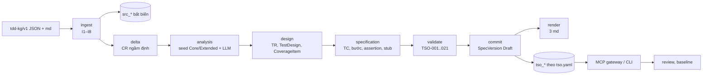

# testspec-agent (tsagent) v2 trong tdd-agentic-ai

Agent sinh test specs (Test Requirements, Test Design, Test Cases theo ISO/IEC/IEEE 29119-3) từ knowledge graph của TDD. KG test theo ontology `tso:`, lưu SQLite, sinh bằng luật seed + LLM.

> Mã: `src/tsagent/`; test: `tests/testspec_agent/`; script: `scripts/tsagent/`; container: `deploy/tsagent/`.
> Thiết kế: [TDD-TSAGENT-v2.md](TDD-TSAGENT-v2.md), [ONTOLOGY-TEST-TSO.md](ONTOLOGY-TEST-TSO.md), [ONTOLOGY-TDD.md](ONTOLOGY-TDD.md), [TDD-Ontology.md](TDD-Ontology.md) (module 04). Triển khai, tiến độ, so sánh với v1, hiệu năng, bảo mật: [implementation/](implementation/README.md). Tích hợp với luồng sinh TDD của tdd-agent: [integrate/TDD-INTEGRATE-TDD-AGENT.md](integrate/TDD-INTEGRATE-TDD-AGENT.md) (TDD, chờ duyệt).

## Kiến trúc



| Thư mục | Module | Nội dung |
| --- | --- | --- |
| `tsagent/ontology/` | — | `tso.yaml` (nguồn duy nhất), `codegen.py` sinh DDL, view, JSON Schema LLM, luật hình dạng; `profiles.yaml` |
| `tsagent/store/` | MOD-Store | SQLite (WAL, giao dịch theo bước), nguồn, phiên bản theo nút, vòng đời, snapshot |
| `tsagent/ingest/` | MOD-Ingest | `kg_json.py` (tdd-kg/v1, luật I1–I8), `md/` (md mẫu v1) |
| `tsagent/delta/` | MOD-Delta | delta hai baseline, tập ảnh hưởng, CR ngầm định |
| `tsagent/analyze/` | MOD-Analyze | mã nút, seed Core/Extended, gói ngữ cảnh, LLM điền |
| `tsagent/design/`, `tsagent/specify/` | MOD-Design, MOD-Specify | luật tầng B, C và LLM điền |
| `tsagent/validate/` | MOD-Validate | TSO-001..021, gate GA/GB/GS, quét bí mật |
| `tsagent/render/` | MOD-Render | ba tài liệu md, chống ghi đè bản sửa tay |
| `tsagent/llm/` | MOD-LLM | anthropic, openai, claude-cli, retry, breaker, cache, trần |
| `tsagent/orchestrator/` | MOD-Orchestrator | run theo bước, chạy tiếp, duyệt, baseline |
| `tsagent/gateway/` | MOD-Gateway | MCP HTTP/stdio |

## Cài đặt

```bash
python3 -m venv .venv
.venv/bin/pip install -e '.[dev]'
.venv/bin/tsagent init
```

## Kiểm thử

```bash
.venv/bin/pytest tests/testspec_agent                    # toàn bộ test của tsagent
.venv/bin/pytest tests/testspec_agent -m unit            # hoặc -m integration, system, contract
.venv/bin/pytest -m llm_real tests/testspec_agent        # gọi LLM thật (claude-cli), bỏ qua mặc định
.venv/bin/ruff check --config ruff-tsagent.toml src/tsagent tests/testspec_agent scripts/tsagent
.venv/bin/tsagent ontology codegen                       # sau khi sửa src/tsagent/ontology/tso.yaml
```

## Dùng nhanh

```bash
export TSAGENT_DB=.tsagent/tsagent.db TSAGENT_SPECS_ROOT=specs TSAGENT_SOURCE_ROOTS=$PWD
.venv/bin/tsagent init
TSAGENT_LLM=none .venv/bin/tsagent gen --feature SCHEDULED-TRANSFER --src tests/testspec_agent/fixtures/minipay/cr001-slice.tdd-kg.json tests/testspec_agent/fixtures/minipay/solution.md
.venv/bin/tsagent validate --feature SCHEDULED-TRANSFER          # gate GS: TestGap mở, nút LLM chưa duyệt
TSAGENT_LLM=none .venv/bin/tsagent gen --feature PAY --src tests/testspec_agent/fixtures/pay/urd.md tests/testspec_agent/fixtures/pay/srs.md tests/testspec_agent/fixtures/pay/tdd.md
.venv/bin/tsagent review list --feature PAY --derivation llm
.venv/bin/tsagent review approve --feature PAY --by qa
.venv/bin/tsagent review baseline --feature PAY --by qa
.venv/bin/tsagent history --feature PAY
```

Baseline cần Document TDD chính ở trạng thái `Baselined` (luật T17 của v1). Lát cắt CR-001 mẫu có Document chính `DOC-SRS-CR001` đang `InReview` nên `review baseline` bị từ chối có lý do; ví dụ trên baseline bằng bộ PAY.

Ba tài liệu nằm ở `specs/<feature>/01-test-requirements.md`, `02-test-design.md`, `03-test-cases.md`. Chạy lại cùng đầu vào trả run cũ (`deduplicated`); run lỗi giữa chừng chạy tiếp bằng cùng lệnh `gen` hoặc `tsagent run resume <runId>`; `--from-step design` chạy lại từ một bước; `--dry-run` không ghi phiên bản.

LLM: `TSAGENT_LLM` **bắt buộc, không có mặc định**: `claude-cli` (dùng phiên Claude Code đã đăng nhập), `anthropic`, `openai` (thiếu key hoặc model thì lỗi `LLM_KEY_MISSING`/`LLM_MODEL_MISSING` ngay), `none` (chỉ luật; đầu ba tài liệu ghi `llm: none` và một dòng cảnh báo). Chưa đặt thì `gen`, `run`, `serve` dừng với `LLM_NOT_CONFIGURED` (mã thoát 2). Nhóm gọi LLM lỗi được thử lại tối đa `TSAGENT_LLM_GROUP_RETRIES` lần (mặc định 2, lần thử lại bỏ qua cache); sau đó hơn 50 % số nhóm của một bước vẫn lỗi thì run lỗi `LLM_GROUPS_FAILED`, ít hơn thì run xong và `result.warnings` liệt kê nhóm lỗi. Trần lượt gọi theo bước: `TSAGENT_LLM_CAP_ANALYSIS`, `_DESIGN`, `_SPEC`.

## MCP gateway

```bash
TSAGENT_LLM=none TSAGENT_TOKEN=dev-token .venv/bin/tsagent serve --port 8766      # http://127.0.0.1:8766/mcp, /health
TSAGENT_LLM=none .venv/bin/tsagent serve --stdio
```

Tool đọc: `list_specs`, `get_spec`, `get_testcase`, `get_analysis`, `list_gaps`, `get_traceability`, `get_coverage`, `get_validation`, `get_version_history`, `diff_versions`, `search`, `get_neighbors`, `sql_select` (chỉ view `v_*`), `get_run_status`, `list_pending_review`. Tool ghi: `start_run`; `approve_nodes`, `reject_nodes`, `baseline_spec` chỉ có khi `TSAGENT_MCP_REVIEW=1`. Danh mục: `tsagent/schemas/mcp-tools.schema.json`.

## Quản lý CSDL

```bash
.venv/bin/tsagent kg check
.venv/bin/tsagent kg snapshot
.venv/bin/tsagent kg restore .tsagent/snapshots/<tệp>.db --into /tmp/khoi-phuc.db
.venv/bin/tsagent kg export --feature SCHEDULED-TRANSFER --out kg.json
.venv/bin/tsagent ontology check
```

## Biến môi trường

| Biến | Mặc định | Ý nghĩa |
| --- | --- | --- |
| `TSAGENT_DB` | `.tsagent/tsagent.db` | Tệp SQLite |
| `TSAGENT_SPECS_ROOT` | `specs` | Nơi ghi ba tài liệu |
| `TSAGENT_CACHE_DIR`, `TSAGENT_SNAPSHOT_DIR`, `TSAGENT_INBOX_DIR` | `.tsagent/cache`, `.tsagent/snapshots`, `<cache>/inbox` | Cache LLM, snapshot, tài liệu gửi qua MCP |
| `TSAGENT_SOURCE_ROOTS` | thư mục hiện tại | Đường dẫn nguồn được đọc (phân tách `:`) |
| `TSAGENT_LLM` | **không có (bắt buộc)** | `claude-cli`, `anthropic`, `openai`, `none` |
| `TSAGENT_LLM_STEPS` | `analysis,design,specification` | Bước dùng LLM |
| `TSAGENT_LLM_CAP_ANALYSIS`, `_DESIGN`, `_SPEC` | 200, 100, 300 | Trần lượt gọi theo bước |
| `TSAGENT_LLM_GROUP_RETRIES` | 2 | Số lần thử lại tối đa của một nhóm gọi LLM lỗi |
| `TSAGENT_LLM_PARALLEL` | 1 | Số lượt gọi LLM song song (kết quả giống chạy tuần tự); 4 với `claude-cli` giảm thời gian khoảng 3–4 lần |
| `TSAGENT_AUTO_APPROVE` | rỗng | `classes=A,B;min_confidence=0.9` |
| `TSAGENT_TOKEN`, `TSAGENT_MCP_REVIEW`, `TSAGENT_MAX_BODY_KB`, `TSAGENT_ALLOWED_ORIGINS` | rỗng, 0, 4096, rỗng | MCP |
| `TSAGENT_BUSY_TIMEOUT_MS` | 5000 | Chờ khóa ghi SQLite |
| `TSAGENT_CONTEXT_DEPTH`, `TSAGENT_CONTEXT_MAX_CHARS` | 2, 24000 | Gói ngữ cảnh LLM |
| `TSAGENT_PROFILES` | rỗng | Tệp YAML ghi đè tên quan hệ profile Extended |
| `ANTHROPIC_API_KEY`, `ANTHROPIC_MODEL`, `ANTHROPIC_BASE_URL`, `OPENAI_*`, `TSAGENT_CLAUDE_MODEL`, `CLAUDE_BIN` | | Nhà cung cấp LLM |

## Container

```bash
docker compose -f deploy/tsagent/docker-compose.yml up -d --build agent        # mã mount từ src/tsagent, http://127.0.0.1:8766/mcp
docker build -f deploy/tsagent/Dockerfile --target export --output type=local,dest=bin . && chmod 755 bin bin/tsagent
docker compose -f deploy/tsagent/docker-compose.yml --profile bin up -d agent-bin
docker compose -f deploy/tsagent/docker-compose.yml --profile bin down
```

Cấu hình: `--env-file deploy/tsagent/.env` (mẫu `deploy/tsagent/.env.example`). Dữ liệu trên volume `tsagent-data`.

## Trạng thái yêu cầu (TDD v2 mục 7.1)

| FR | Trạng thái | Kiểm bằng |
| --- | --- | --- |
| FR-001, FR-002 | xong | `test_kg_json.py`, `test_md_parser.py`, `test_ingest.py` |
| FR-003 | xong | `test_delta.py` |
| FR-004 | xong (Core; Extended chờ duyệt fixture, OQ-O1) | `test_seed_core.py`, `test_seed_ext.py` |
| FR-005 | xong | `test_analyze.py` |
| FR-006, FR-007 | xong | `test_design_rules.py`, `test_design.py`, `test_specify.py` |
| FR-008 | xong | `test_tso_rules_a.py`, `test_specify.py`, `test_review.py` |
| FR-009 | xong | `test_render.py` |
| FR-010, FR-011, FR-012 | xong | `test_store_versions.py`, `test_orchestrator.py`, `test_review.py` |
| FR-013 | xong | `test_store_ops.py`, `test_cli.py` |
| FR-014, FR-015 | xong | `test_mcp.py`, `test_llm_*.py` |
| FR-016 | xong | `test_store_ops.py` (xuất JSON) |
| FR-017 | bỏ (không dùng RDF; `.ttl` bị từ chối, `test_ingest.py::test_turtle_is_rejected_with_hint`) | |

Test: `tests/testspec_agent/unit` (từng module), `tests/testspec_agent/integration` (nhiều module, DB tạm, LLM giả), `tests/testspec_agent/contract` (MCP), `tests/testspec_agent/system` (so với v1, bảo mật). Đo hiệu năng: `scripts/tsagent/perf.py`; so với v1: `scripts/tsagent/compare_baseline.py`; fixture Extended: `scripts/tsagent/make_ext_fixture.py`.

## Tích hợp vào repo tdd-agentic-ai

Chuyển từ `vnp-workplace/backend/agents/testspec-agent` ngày 2026-10-13 (nhánh `tasks/integrate-tetspec-agent`). Những chỗ đã chỉnh để chạy trong repo này:

1. **`pyproject.toml`**:
   - thêm thư viện `httpx`, `pyyaml`, `markdown-it-py`; thêm `ruff` vào extra `dev`;
   - thêm lệnh `tsagent` và tệp dữ liệu đi kèm package (`tso.yaml`, `profiles.yaml`, SQL và JSON Schema sinh ra, prompt);
   - đăng ký nhóm test `unit`, `integration`, `system`, `contract`, `llm_real`; mặc định bỏ qua test gọi LLM thật.
   - Không có extra `rdf`: tsagent không dùng RDF; tệp `.ttl`/`.trig` bị từ chối kèm hướng dẫn chuyển sang `tdd-kg/v1` (FR-017 bỏ, DEVIATIONS D21).
2. **Thư mục test là `tests/testspec_agent/`**, không phải `tests/tsagent/`:
   - repo đã có `test_cli.py`, `test_config.py`, `test_orchestrator.py`, tên trùng làm pytest báo lỗi;
   - tên `tsagent` sẽ trùng với package thật;
   - import trong test dùng `testspec_agent.*` thay cho `tests.*`.
3. **Đường dẫn**: fixture mẫu của `tsagent selfcheck` là `tests/testspec_agent/fixtures/pay`; script trong `scripts/tsagent/` tính đường dẫn từ gốc repo.
4. **Docker**: build từ gốc repo (`-f deploy/tsagent/Dockerfile`), chép mã từ `src/tsagent`; `.dockerignore` ở gốc loại `data/` (49 MB), `.venv`, `docs`. Đã thử: container dev lên, `/health` trả `ok`.
5. **Lint**: `ruff-tsagent.toml` chỉ áp cho mã tsagent, không đổi cách lint của `tdd_agent`.
6. **`.gitignore`**: thêm `bin/` (nhị phân PyInstaller), `.tsagent/` (DB, cache mặc định), `specs/` (tài liệu render mặc định).

Đã chạy thử trong repo này: toàn bộ `pytest` (cả `tdd_agent` và tsagent), `tsagent gen` trên CR-001, `tsagent selfcheck`, `scripts/tsagent/compare_baseline.py`.

## Ngôn ngữ

Mã nguồn, comment, docstring, log, thông báo lỗi, help CLI, mô tả tool MCP và JSON Schema, prompt LLM của tsagent viết bằng tiếng Anh. Tài liệu test specs sinh ra viết bằng tiếng Việt: tiêu đề và nhãn khi render, câu mẫu luật, văn bản TestGap/câu hỏi THIẾU, tiêu đề luật TSO trong mục "Báo cáo kiểm" giữ tiếng Việt trong mã (có comment đánh dấu), và prompt yêu cầu LLM viết mọi giá trị văn bản bằng tiếng Việt.

## Chạy trong workflow của tdd-agent

Thiết kế: [integrate/TDD-INTEGRATE-TDD-AGENT.md](integrate/TDD-INTEGRATE-TDD-AGENT.md), [integrate/SOLUTION-INTEGRATE-TDD-AGENT.md](integrate/SOLUTION-INTEGRATE-TDD-AGENT.md); tiến độ: [integrate/PLAN.md](integrate/PLAN.md).

- Cổng **GT** của `change-request` (sau G4) khởi chạy run con `testspec` (cổng **TS1**) trong tiến trình nền; G5 và việc sinh code không chờ. Chạy tay: `tdd-agent run start testspec --request req.json` (`{"params": {"tdd": "TDD-P"}}`).
- TS1 đọc snapshot KG thiết kế **qua MCP server của tdd-agent** (tool đọc `kg_elements`, `kg_neighbors`; mặc định server của dự án qua stdio, `[testspec] kg_mcp` trỏ server HTTP ở xa), chọn phạm vi theo change spec (hoặc theo TDD), chiếu sang `tdd-kg/v1` theo bảng `src/tdd_agent/agents/testspec/mapping.yaml`, gọi tsagent trong tiến trình. KG test lưu ở `.tdd-agent/tsagent.db`, ba tài liệu ở `docs/testspec/<TDD>/`, bản lưu từng lần chạy ở `.tdd-agent/runs/<run>/testspec/`.
- Cấu hình `[testspec]` trong `.tdd-agent/config.toml` (`enabled`, `llm` bắt buộc, `parallel`, `group_retries`, `specs_dir`); trong workflow `TSAGENT_LLM` bị bỏ qua, các biến `TSAGENT_*` khác (model, key, trần lượt) vẫn dùng.
- Mã: `src/tdd_agent/agents/testspec/` (`gate.py`, `kgclient.py`, `scope.py`, `project.py`, `codes.py`, `mapping.py`, `runner.py`). Test: `tests/test_testspec_*.py`.

## Demo workflow MiniPay

`tmp/minipay-demo/` (không đưa vào git, khôi phục từ bản lưu trữ `/opt/repos/archive/testspec-agent/`): workflow CR → SRS → TDD → solution → testspec → tasks, gọi tsagent qua MCP. Test của demo dùng `.venv` ở gốc repo này:

```bash
cd tmp/minipay-demo && python3 -m venv .venv && .venv/bin/pip install -r requirements.txt
.venv/bin/python -m pytest tests            # 86 test, gồm tích hợp với tsagent thật
```

KG chính của demo (`tdd_kg.db`) ở trạng thái gốc (chưa áp CR-001). Kết quả lần chạy Claude thật của CR-001 giữ ở `changes/CR-001/run/` (`tdd_patch.approved.json`, `tdd_kg.after-CR-001.db`, `solution.md`); bộ test specs sinh lại từ đó lưu ở `run/testspec/` và [implementation/output-docs/CR-001-v2/](implementation/output-docs/CR-001-v2/README.md).
