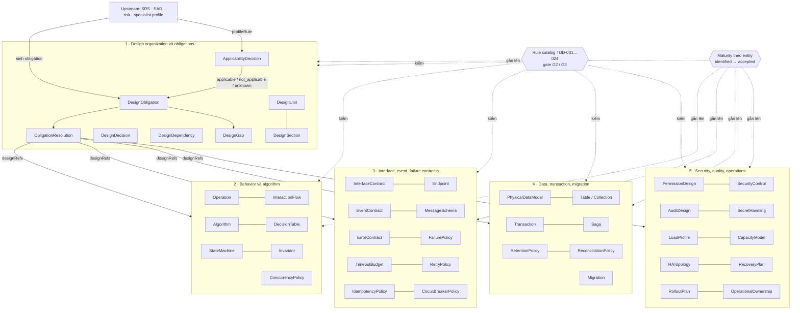
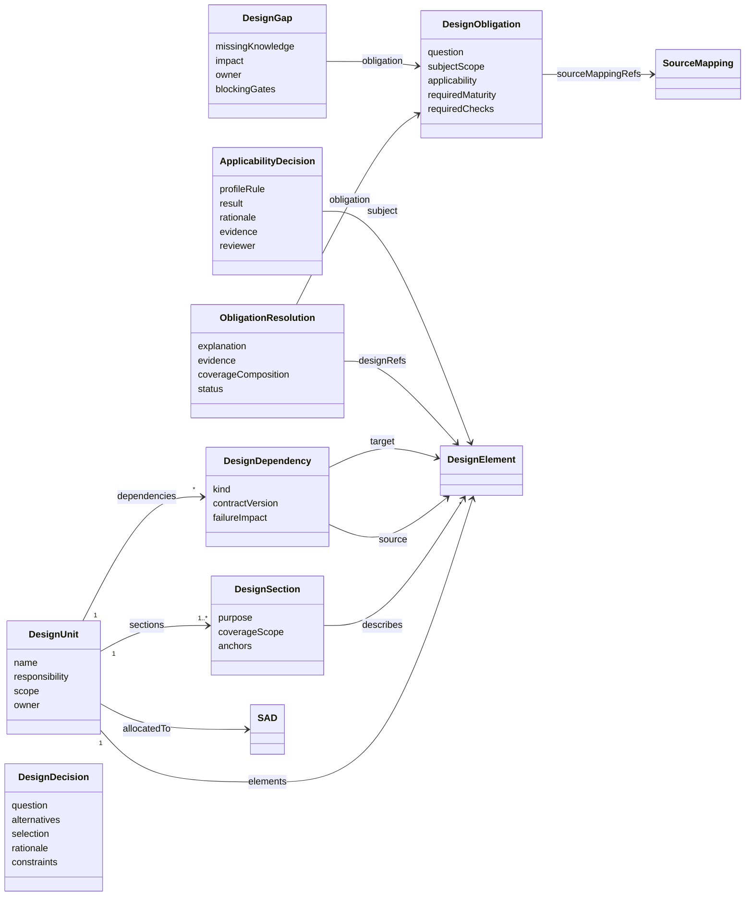
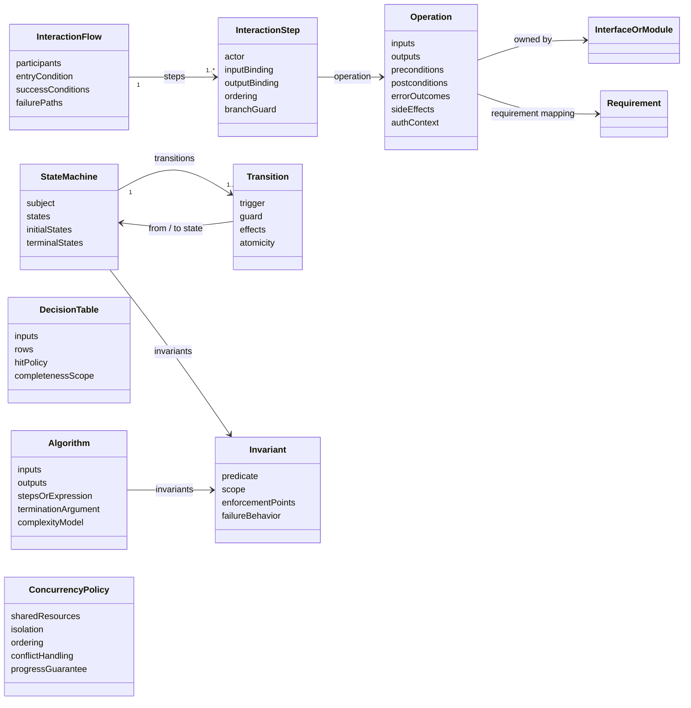
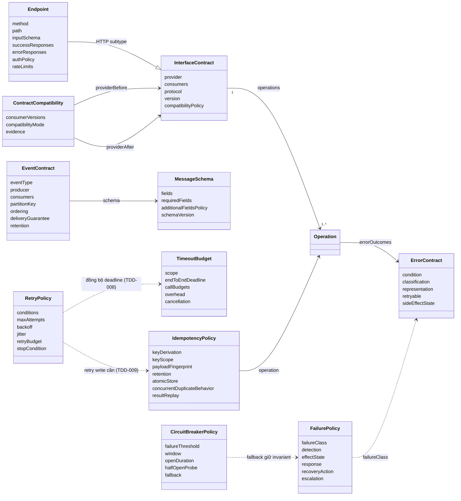
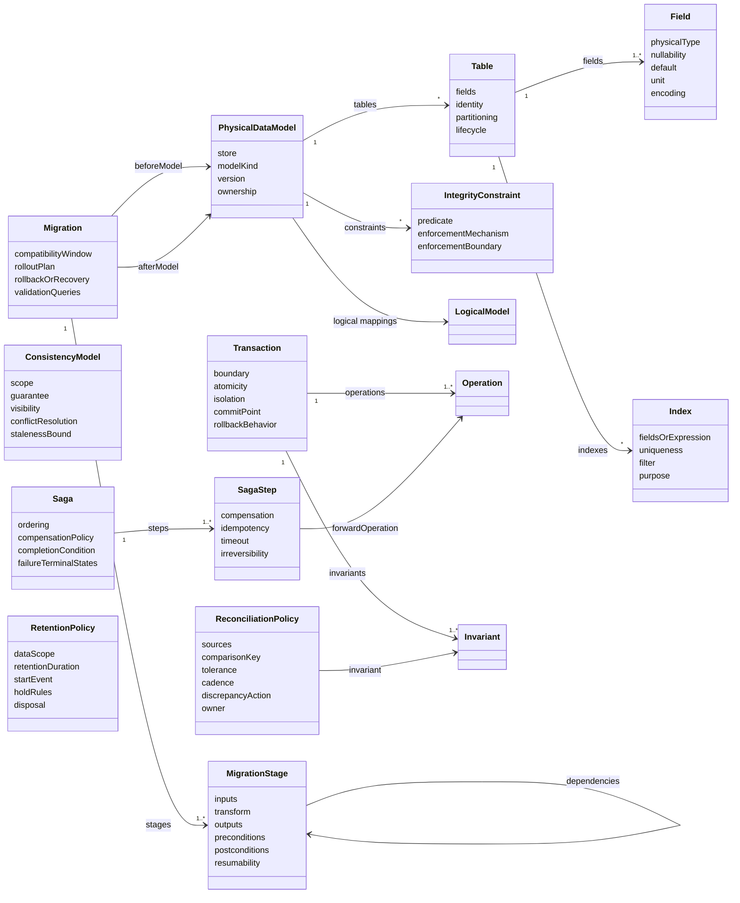
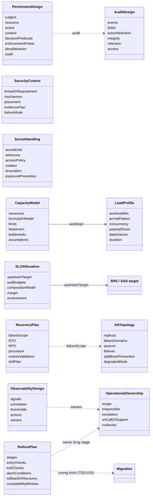
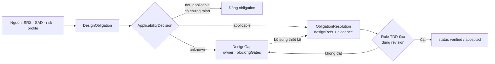
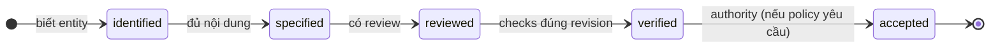
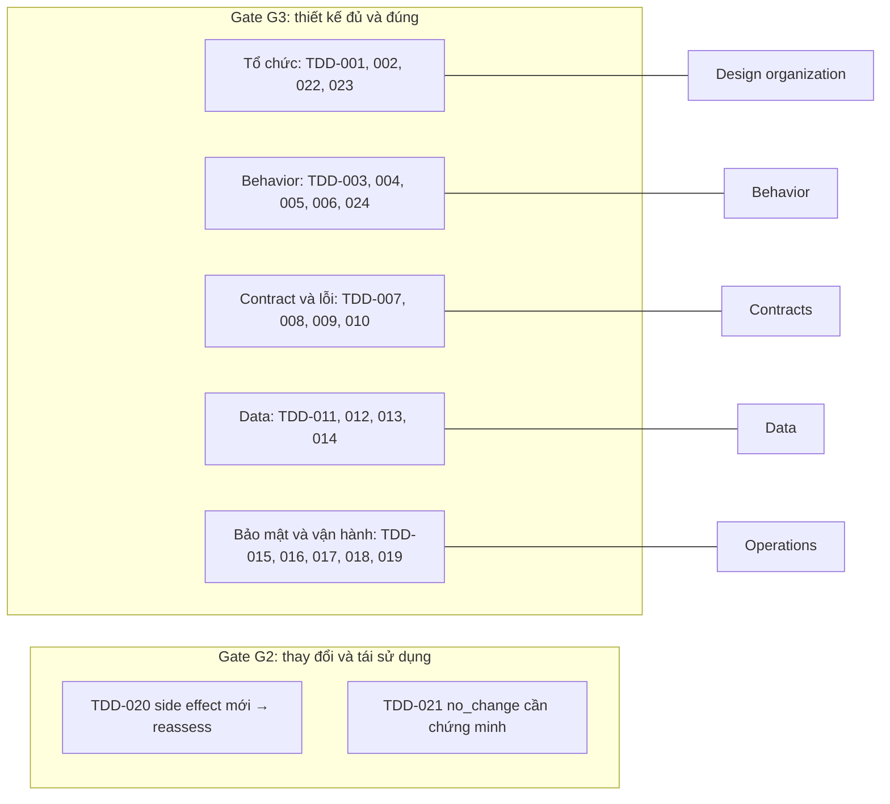

# 04 — TDD ontology: thiết kế có thể thực hiện và kiểm chứng

TDD sở hữu design semantics chi tiết. Module này có các subdomains cùng identity/provenance contract; specialist profiles lựa chọn applicability theo behavior/risk, không theo danh sách tài liệu đã có. Tables dưới mô tả core và conditional entities, không bắt mọi thiết kế tạo mọi type.

## 1. Design organization và obligations

| Entity | Fields | Relations / constraints |
|---|---|---|
| DesignUnit | `name! responsibility! scope! owner!` | sections+, elements*, dependencies*; allocatedTo SAD qua link |
| DesignSection | `purpose! coverageScope! anchors+` | describes elements*; section không thay semantic entity |
| DesignDecision | `question! alternatives+ selection! rationale! constraints+ tradeoffs*` | decision evidence; không sửa SRS/SAD authority |
| DesignDependency | `source! target! kind! contractVersion! failureImpact!` | calls/consumes/writes/reads/dependsOnInvariant |
| DesignObligation | `question! subjectScope! sourceMappingRefs+ applicability! requiredMaturity! requiredChecks+` | Không chỉ “có field”; phải có resolution đủ nghĩa |
| ObligationResolution | `obligation! designRefs+ explanation! evidence+ coverageComposition! status!` | planned/proposed/verified/accepted; accepted có reviewer nếu policy yêu cầu |
| DesignGap | `obligation! missingKnowledge! impact! owner! blockingGates+` | Open/resolved/superseded |
| ApplicabilityDecision | `profileRule! subject! result! rationale! evidence+ reviewer?` | applicable/not_applicable/unknown; N/A có chứng minh |

## 2. Behavior và algorithm

| Entity | Fields | Constraints |
|---|---|---|
| Operation | `inputs! outputs! preconditions! postconditions! errorOutcomes* sideEffects* authContext!` | Có owned interface/module, requirement mapping |
| InteractionFlow | `participants+ entryCondition! steps+ successConditions! failurePaths*` | Step ordering/parallel branches explicit |
| InteractionStep | `actor! operation! inputBinding! outputBinding! ordering! branchGuard?` | Bindings type-safe, producer trước consumer theo partial order |
| Algorithm | `inputs! outputs! preconditions! postconditions! stepsOrExpression! invariants* terminationArgument? complexityModel?` | Required termination/resource proof theo risk/profile |
| DecisionTable | `inputs+ rows+ hitPolicy! completenessScope!` | Có thể reuse rule semantics foundation, khác SRS identity |
| StateMachine | `subject! states+ initialStates+ transitions+ terminalStates* invariants*` | Deployment/process state và business state map có chủ đích |
| Transition | `from! to! trigger! guard! effects* atomicity!` | Guard/action interplay checked, không chỉ reachability |
| Invariant | `predicate! scope! enforcementPoints+ failureBehavior!` | State/transaction/temporal classification |
| ConcurrencyPolicy | `sharedResources+ isolation! ordering! conflictHandling! progressGuarantee!` | Deadlock/livelock checks trong supported model |

## 3. Interface, event và failure contracts

| Entity | Fields | Constraints |
|---|---|---|
| InterfaceContract | `provider! consumers* protocol! version! operations+ compatibilityPolicy!` | Consumer inventory completeness explicit |
| Endpoint | `method! path! inputSchema! successResponses+ errorResponses* authPolicy! rateLimits?` | HTTP-specific subtype, không áp cho mọi interface |
| EventContract | `eventType! schema! producer! consumers* partitionKey? ordering! deliveryGuarantee! retention!` | Event time vs processing time explicit |
| MessageSchema | `fields+ requiredFields* additionalFieldsPolicy! schemaVersion!` | Type/unit/nullability/enum meanings |
| ErrorContract | `condition! classification! representation! retryable! sideEffectState!` | Timeout không tự có nghĩa chưa commit |
| ContractCompatibility | `providerBefore! providerAfter! consumerVersions+ compatibilityMode! evidence!` | Input/output variance, schema/meaning preserved |
| TimeoutBudget | `scope! endToEndDeadline! callBudgets* overhead! cancellation! clockAssumptions!` | Deadline absolute/relative, units explicit |
| RetryPolicy | `conditions+ maxAttempts! backoff! jitter! retryBudget! stopCondition!` | Attempts gồm lần đầu hay số retry phải thống nhất |
| IdempotencyPolicy | `operation! keyDerivation! keyScope! payloadFingerprint! retention! atomicStore! concurrentDuplicateBehavior! resultReplay!` | Key collision/reuse with differing payload handled |
| FailurePolicy | `failureClass! detection! effectState! response! recoveryAction! escalation!` | Không chỉ generic “retry” |
| CircuitBreakerPolicy | `failureThreshold! window! openDuration! halfOpenProbe! fallback!` | Fallback giữ SRS invariants |

## 4. Data, transaction và migration

| Entity | Fields | Constraints |
|---|---|---|
| PhysicalDataModel | `store! modelKind! version! ownership!` | logical mappings+, tables/entities*, constraints* |
| Table / Collection | `fields+ identity! partitioning? indexes* lifecycle!` | Physical model cụ thể theo datastore |
| Field | `physicalType! nullability! default? unit? encoding? domainConstraints*` | Logical meaning mapping khi applicable |
| Index | `fieldsOrExpression+ uniqueness! filter? purpose!` | Performance hypothesis không tự proof |
| IntegrityConstraint | `predicate! enforcementMechanism! enforcementBoundary!` | FK/check/unique/application/distributed enforcement |
| Transaction | `operations+ boundary! atomicity! isolation! invariants+ commitPoint! rollbackBehavior!` | Cross-store writes không giả local ACID |
| Saga | `steps+ ordering! compensationPolicy! completionCondition! failureTerminalStates+` | Step effects/compensations separately specified |
| SagaStep | `forwardOperation! compensation? idempotency! timeout! irreversibility!` | Irreversible step cần recovery/manual intervention design |
| ConsistencyModel | `scope! guarantee! visibility! conflictResolution! stalenessBound?` | Read/write guarantees có consumer assumptions |
| Migration | `beforeModel! afterModel! stages+ compatibilityWindow! rolloutPlan! rollbackOrRecovery! validationQueries+` | Irreversible migration không ghi rollback giả |
| MigrationStage | `inputs! transform! outputs! dependencies* preconditions! postconditions! resumability!` | Stage DAG, checkpoint/retry/dedupe rõ |
| RetentionPolicy | `dataScope! retentionDuration! startEvent! holdRules* disposal! authorityRefs+` | Audit/business retain vs delete conflicts reviewed |
| ReconciliationPolicy | `sources+ comparisonKey! invariant! tolerance! cadence! discrepancyAction! owner!` | Tolerance có authority; không tự bỏ mismatch |

## 5. Security, quality và operations

| Entity | Fields | Constraints |
|---|---|---|
| PermissionDesign | `subject! resource! action! context! decisionPredicate! enforcementPoints+ denyBehavior! audit!` | Default rule và policy precedence explicit |
| SecurityControl | `threatOrRequirement! mechanism! placement! evidencePlan! failureMode!` | Control presence khác effectiveness |
| SecretHandling | `secretKind! reference! accessPolicy! rotation! revocation! exposurePrevention!` | Không chứa secret value |
| AuditDesign | `events+ fields+ actorAttribution! integrity! retention! access! failureBehavior!` | Sensitive values redaction policy |
| LoadProfile | `workloadMix! arrivalPattern! concurrency! payloadSizes! dataVolume! duration!` | Source assumptions/measured lineage |
| CapacityModel | `resources+ workload! formulaOrModel! limits! headroom! bottlenecks! assumptions+` | Không claim achieved capacity từ model |
| SLOAllocation | `upstreamTarget! subBudgets+ compositionModel! margin! environment!` | Cross-domain mapping tới SRS/SAD |
| HATopology | `replicas! failureDomains! quorum? failover! splitBrainPrevention! degradedMode!` | Common-mode failure explicit |
| RecoveryPlan | `failureScope! RTO! RPO! procedure! restoreValidation! drillPlan!` | Target khác measurement |
| ObservabilityDesign | `signals+ correlation! thresholds! actions! owners! retention!` | Signal phát hiện violation có diagnostic coverage |
| RolloutPlan | `stages+ entryChecks+ exitChecks+ abortConditions+ rollbackOrRecovery! compatibilityWindow!` | Monitor/decision owner cho từng stage |
| OperationalOwnership | `scope! responsible! escalation! onCallOrSupport! runbooks+` | Có quyền/phương tiện thực hiện runbook |

## 6. Logic thiết kế và preservation

Design phải preserve upstream required behaviors trong applicability domain; có thể thêm internal detail không đổi observable semantics. Mọi side effect mới (external write, audit export, data replication) kích hoạt applicability reassessment cho data/security/resilience. Không áp profile dựa trên việc “không thấy transaction node” để kết luận không cần transaction.

Ngân sách retry cho sequential attempts với maxAttempts N: worst-case latency ≤ tổng timeout từng attempt + tổng backoff tối đa + overhead, trừ khi cancellation/deadline cap được thiết kế và kiểm. Parallel branches dùng critical path; budget equations phải khai assumptions. Đây là model-bound check, không chứng minh percentile production bằng cách cộng p95 thành phần.

Idempotency cần atomic key reservation/commit hoặc protocol tương đương, scope đúng actor/operation/resource, fingerprint để chặn cùng key khác payload, retention phủ retry/redelivery horizon. Chỉ có field key chưa chứng minh exactly-once effect. Delivery guarantee của broker khác business effect guarantee.

State reachability trên graph không chứng minh guard feasible; guard satisfiability khác safety invariant preservation; cả hai khác liveness. Checker không hỗ trợ concurrency/unbounded guard phải trả unsupported và yêu cầu review/proof khác.

## 7. Rule catalog

| ID | Invariant / điều kiện | Evaluation | Gate |
|---|---|---|---|
| TDD-001 | Design inventory complete; mỗi unit có owner/scope và actual sections resolve được | inventory/reference check | G3 |
| TDD-002 | Mandatory obligations sinh từ sources/risk/profile đầy đủ; thiếu node không làm obligation N/A | applicability reconciliation | G3 |
| TDD-003 | Operations/algorithms đủ input/output/pre/post/error/side-effects theo applicability | shape + design review | G3 |
| TDD-004 | Flow bindings type-safe, ordering đúng, failure branches không bỏ required outcomes | dataflow/branch analysis | G3 |
| TDD-005 | State transitions feasible trong model, bảo toàn invariants; reachability không thay semantic proof | graph + solver / review | G3 |
| TDD-006 | Required termination/resource bounds có argument phù hợp supported algorithm model | static/model/human check | G3 |
| TDD-007 | Interface input/output/error/auth contracts nhất quán giữa producer và consumers | contract compatibility | G3 |
| TDD-008 | Retry/deadline/backoff/cancellation đồng bộ; worst-case budget hợp lệ theo declared model | budget evaluator | G3 |
| TDD-009 | Retry write có duplicate/concurrency handling đủ key scope, fingerprint, atomicity và retention | idempotency scenario checks | G3 |
| TDD-010 | Failure/timeout không giả no-effect; recovery/fallback giữ upstream invariants | failure effect analysis | G3 |
| TDD-011 | Physical data mapping giữ meaning/range/unit/null/identity/constraints của logical model | data refinement proof | G3 |
| TDD-012 | Transactions/invariants đúng boundary/isolation; cross-store atomicity có protocol thực | transaction model review | G3 |
| TDD-013 | Saga compensation/recovery đủ failed/partial/irreversible states, có owner cho manual path | failure-state coverage | G3 |
| TDD-014 | Migration DAG hợp lệ, old/new compatibility và backfill/retry/rollback-or-recovery có verification | migration model checks | G3 |
| TDD-015 | Permission enforcement bao mọi access paths trong scope; default/precedence/deny nhất quán | access-path/decision checks | G3 |
| TDD-016 | Security/audit design đáp ứng classification, no-secret exposure và tamper/retention obligations | controls + review | G3 |
| TDD-017 | Capacity/SLO model có workload/unit/assumptions; target không gắn nhãn measured achievement | quantity/model provenance | G3 |
| TDD-018 | HA/quorum/failure domains và RPO/RTO phù hợp SAD/SRS với degraded-mode nghĩa rõ | topology/recovery analysis | G3 |
| TDD-019 | Rollout có detection, abort, owner và rollback/recovery tương thích migration/data | operational consistency | G3 |
| TDD-020 | New side-effect/consumer/risk làm reassess profiles và impact closure | semantic diff trigger | G2 |
| TDD-021 | no_change chỉ khi current design bao phủ cả value domain và guarantees; no match không đủ | reuse conformance proof | G2 |
| TDD-022 | Realization giữ action, planned scope và actual anchors; ngoài plan quay impact approval | plan-realization comparison | G3 |
| TDD-023 | Design decisions không override SRS/SAD; conflicts trả upstream, không local approve | mapping/authority review | G3 |
| TDD-024 | Concurrency locking/ordering/isolation không vi phạm safety/progress trong claimed model | concurrency/model review | G3 |

## 8. Maturity

`identified` chỉ biết entity; `specified` đủ nội dung; `reviewed` có review; `verified` có checks đúng revision; `accepted` có authority nếu policy yêu cầu. Entity maturity không ép cùng lifecycle với tài liệu. TDD document “approved” có section chưa verified phải báo riêng và chặn nếu section nằm trong scope bắt buộc.

## 9. Sơ đồ

Các sơ đồ dưới vẽ lại mục 1 đến 8. Quan hệ lấy từ cột Fields và Relations: một trường trỏ tới entity khác (ví dụ `InteractionStep.operation`, `Migration.stages`) được vẽ thành cạnh. Mỗi lớp chỉ ghi các trường bắt buộc chính; danh sách đầy đủ xem bảng ở mục tương ứng.

### 9.1 Tổng quan

Năm nhóm entity dùng chung một contract định danh và provenance. Obligation nối nguồn upstream (SRS, SAD, rủi ro, profile) với các entity thiết kế. Rule catalog và maturity kiểm cả năm nhóm.

### 9.2 Design organization và obligations

`DesignElement` đại diện cho mọi entity thiết kế ở mục 2 đến 5. `SAD` và `SourceMapping` thuộc các module ontology khác.

### 9.3 Behavior và algorithm

### 9.4 Interface, event và failure contracts

### 9.5 Data, transaction và migration

### 9.6 Security, quality và operations

### 9.7 Vòng đời obligation và maturity

### 9.8 Rule catalog theo nhóm

