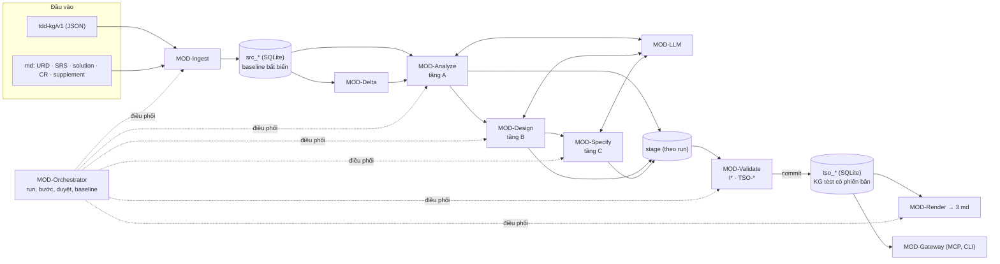
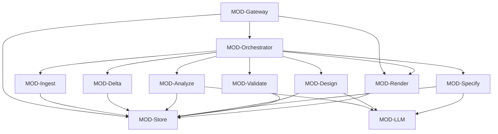
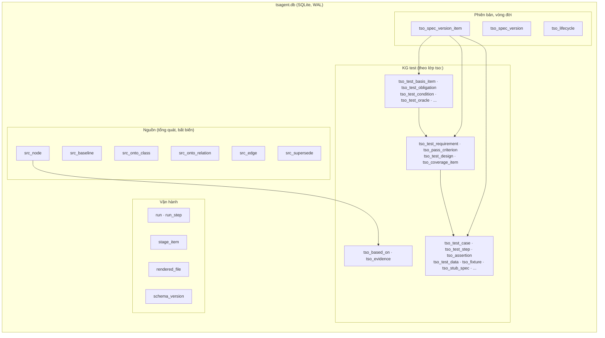
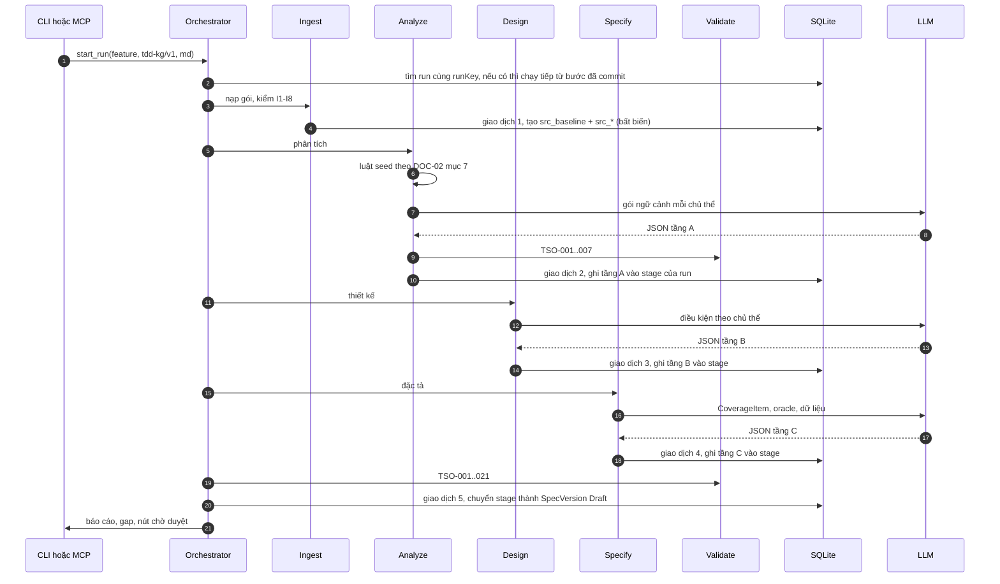
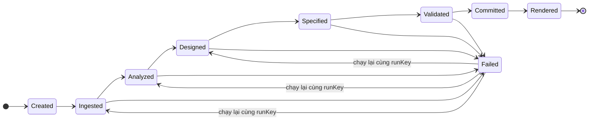
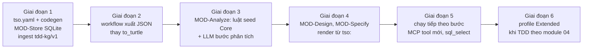

# tsagent v2: TDD

Oct 12, 2026 · Bản 2.0 (draft) · Thay thế `TDD-TSAGENT.md` (v1, repo vnp-workplace `docs/crs/v17/testspec-agent/TDD-TSAGENT.md`) (v1, bản 0.3) khi được duyệt

## Cách đọc tài liệu

tsagent (testspec-agent) nhận **KG của TDD** và tài liệu md (URD, SRS, solution, CR), dựng **KG test** theo ontology `tso:`, rồi sinh **một bộ test specs cho mỗi feature** (Test Requirements, Test Design, Test Cases theo ISO/IEC/IEEE 29119-3). Khi có CR, bộ test specs được cập nhật phiên bản tại chỗ.

Ba tài liệu của v2 đi cùng nhau:

| Tài liệu | Nội dung |
| --- | --- |
| [ONTOLOGY-TDD.md](./ONTOLOGY-TDD.md) | Ontology của KG đầu vào (profile Core và Extended), lưu trữ nodes/edges, định dạng trao đổi `tdd-kg/v1` |
| [ONTOLOGY-TEST-TSO.md](./ONTOLOGY-TEST-TSO.md) | Ontology test `tso:` ba tầng, luật seed, luật `TSO-*`, mô hình bảng SQLite |
| Tài liệu này | Thiết kế kỹ thuật của agent: module, quyết định, dữ liệu, giao tiếp, yêu cầu, luồng, cơ chế, rủi ro, truy vết |

Tài liệu viết theo khung 12 mục của ontology TDD, mọi thực thể có mã ổn định. Số liệu ghi "đề xuất" là giá trị khởi điểm chưa đo; số đo thật ở [implementation/PERF.md](implementation/PERF.md) và đã thay vào mục 7.2.

### Thay đổi chính so với v1

| Khía cạnh | v1 (đã cài đặt) | v2 (tài liệu này) |
| --- | --- | --- |
| KG đầu vào | Turtle (`kg-slice.ttl`) hoặc md mẫu v1; parse bằng Oxigraph | **JSON `tdd-kg/v1`** (nodes, edges, ontology gửi kèm) hoặc md mẫu v1; không cần thư viện RDF |
| Ontology test | `tsp:`, khung test sinh thẳng từ nút TDD | **`tso:` ba tầng**: phân tích (obligation, condition, oracle, fault model) → thiết kế → đặc tả |
| Vai trò LLM | Viết lại lời văn TC; suy luận AC khi thiếu | **Điền tầng phân tích, thiết kế, đặc tả** theo khung luật seed; mọi nút có căn cứ và bị kiểm |
| Lưu trữ | RDF quad trên Oxigraph nhúng (RocksDB) | **SQLite dạng quan hệ**: bảng nguồn tổng quát + bảng theo lớp `tso:` |
| Bất biến sau baseline | Chặn ở tầng API | **Trigger SQLite** chặn ở CSDL |
| Ghi nguyên tử | Một lệnh SPARQL UPDATE ở cuối pipeline; không chạy tiếp được | **Giao dịch SQLite theo bước** + vùng đệm theo run; chạy tiếp từ bước đã commit |
| Truy vấn tùy ý qua MCP | `sparql_select` | `sql_select` trên các view chỉ đọc |
| Nhà cung cấp LLM | anthropic, openai, claude-cli | giữ nguyên |

| Mục | Nội dung |
| --- | --- |
| 1 | Tài liệu và nguồn |
| 2 | Ràng buộc và giả định |
| 3 | Kiến trúc và module |
| 4 | Công nghệ và quyết định |
| 5 | Dữ liệu |
| 6 | Giao tiếp bên ngoài |
| 7 | Yêu cầu |
| 8 | Luồng xử lý |
| 9 | Cơ chế |
| 10 | Triển khai và cấu hình |
| 11 | Rủi ro và câu hỏi mở |
| 12 | Truy vết và kiểm thử |
| Phụ lục A | Vấn đề của v1 được giải quyết |
| Phụ lục B | Kế hoạch chuyển từ v1 |

---

## 1. Tài liệu và nguồn

### 1.1 Thông tin tài liệu

| Trường | Giá trị |
| --- | --- |
| Mã | `CR-TSAGENT-WP-002` |
| Phiên bản, trạng thái | 2.0, Draft |
| Thay thế | `CR-TSAGENT-WP-001` (v1) khi baseline |
| Vị trí mã nguồn | `backend/agents/testspec-agent/` (Python, ngoài `go.work`) |
| Chủ sở hữu | Tech Lead (chưa gán người) |

### 1.2 Phạm vi

Trong phạm vi:
- Nạp KG TDD (`tdd-kg/v1`) và md (URD, SRS, solution, CR, supplement); kiểm theo ontology gửi kèm.
- Dựng KG test `tso:` (tầng A, B, C) bằng luật seed và LLM; kiểm bằng luật `TSO-*`.
- Quản lý phiên bản, duyệt, baseline; render ba tài liệu md tại chỗ.
- Mở KG qua MCP gateway và CLI.

Ngoài phạm vi:
- Sinh script test và dữ liệu mock để chạy (bước sau).
- Chạy test, ghi kết quả, quản lý lỗi.
- Số hóa TDD thành KG (việc của phía TDD, ví dụ `tdd_kg` trong minipay-demo).
- Chạy luật solver của TDD-Ontology (guard khả thi, ngân sách, concurrency): tsagent chỉ đọc kết quả nếu được gửi kèm.

### 1.3 Tài liệu nguồn

| Mã | Tài liệu | Dùng để |
| --- | --- | --- |
| DOC-01 | [ONTOLOGY-TDD.md](./ONTOLOGY-TDD.md) | Hợp đồng đầu vào |
| DOC-02 | [ONTOLOGY-TEST-TSO.md](./ONTOLOGY-TEST-TSO.md) | Ontology và lược đồ của KG test |
| DOC-03 | `TDD-TSAGENT.md` (v1, repo vnp-workplace `docs/crs/v17/testspec-agent/TDD-TSAGENT.md`) | Thiết kế v1, giữ các quyết định không đổi |
| DOC-04 | `KG-TSAGENT.md` (v1, repo vnp-workplace `docs/crs/v17/testspec-agent/KG-TSAGENT.md`) | Hiện trạng lưu trữ v1 và hạn chế đã biết |
| DOC-05 | [TDD-Ontology.md](TDD-Ontology.md) (module 04) | Profile Extended của đầu vào |
| DOC-06 | ISO/IEC/IEEE 29119-2, -3, -4; 29148; ISO/IEC 25010 | Quy trình, mẫu tài liệu, kỹ thuật test; phân loại chất lượng |

### 1.4 Thuật ngữ

| Thuật ngữ | Nghĩa |
| --- | --- |
| KG TDD | KG đầu vào theo DOC-01 |
| KG test | KG theo `tso:` do tsagent dựng |
| Baseline nguồn | Bản chụp bất biến của KG TDD đã nạp, mã `b-<băm>` |
| SpecVersion | Phiên bản của bộ test specs một feature; ba tài liệu cùng số |
| Luật seed | Luật bắt buộc sinh nút tầng A từ nút TDD (DOC-02 mục 7) |
| Run | Một lần chạy pipeline, chia bước: ingest, analysis, design, specification, validate, render |

---

## 2. Ràng buộc và giả định

### 2.1 Ràng buộc

| Mã | Loại | Mô tả |
| --- | --- | --- |
| CON-01 | standard | Tài liệu ra theo 29119-3; đầu vào md theo 29148, 42010 hoặc mẫu md v1 |
| CON-02 | technology | KG test lưu trên **SQLite** dạng quan hệ, lược đồ sinh từ định nghĩa ontology `tso:` (thay CON-02 v1) |
| CON-03 | scope | Mỗi feature một bộ test specs; CR cập nhật phiên bản tại chỗ |
| CON-04 | scope | Giữ mọi nút cũ (Superseded, Retired); không xóa |
| CON-05 | scope | Ba mức test L1, L2, L3 |
| CON-06 | scope | Test Case là mô tả có cấu trúc, chưa phải script |
| CON-07 | technology | Không dùng lược đồ viết tay lệch ontology; DDL, JSON Schema của LLM và kiểm luật cùng sinh từ một định nghĩa (thay CON-07 v1) |
| CON-08 | standard | Không lưu bí mật trong KG, md, log; chỉ tham chiếu theo tên biến |
| CON-09 | network | LLM qua mạng ngoài (anthropic, openai) hoặc qua Claude Code CLI cục bộ |
| CON-10 | scope | Python, đặt tại `backend/agents/testspec-agent/`, chạy độc lập |
| CON-11 | scope | Đầu ra của LLM chỉ vào KG sau khi qua luật `TSO-001..003` (căn cứ, provenance, danh sách trắng) |

### 2.2 Giả định

| Mã | Giả định | owner | dueDate | Trạng thái |
| --- | --- | --- | --- | --- |
| ASM-01 | Phía TDD xuất được gói `tdd-kg/v1` (như `tdd_kg` của minipay-demo) | Tech Lead | 2026-10-26 | Unconfirmed |
| ASM-02 | Mỗi feature có SRS riêng và mã feature ổn định | QA Lead | 2026-10-26 | Unconfirmed |
| ASM-03 | Chi phí LLM cho một feature cỡ CR-001 chấp nhận được với khoảng 200 lượt gọi | Tech Lead | 2026-11-02 | Unconfirmed |
| ASM-04 | Quy mô tối đa 50 feature, mỗi feature tối đa 300 yêu cầu, 1.000 TC mỗi phiên bản | QA Lead | 2026-11-02 | Unconfirmed |
| ASM-05 | Một tiến trình dịch vụ ghi; nhiều tiến trình đọc (CLI, MCP) | Tech Lead | 2026-10-26 | Unconfirmed |

---

## 3. Kiến trúc và module

### 3.1 Tổng quan



### 3.2 Module

| Mã | Tên | Trách nhiệm | layer |
| --- | --- | --- | --- |
| MOD-Orchestrator | Điều phối | Tạo run, chạy từng bước, chạy tiếp từ bước đã commit, idempotent theo `runKey`, duyệt, baseline | application |
| MOD-Ingest | Nạp | Đọc `tdd-kg/v1`, md mẫu v1, phụ lục solution, supplement; kiểm I1–I8; ghi baseline nguồn | application |
| MOD-Delta | So sánh | Delta giữa hai baseline nguồn, tập ảnh hưởng, chọn hồi quy, CR ngầm định | domain |
| MOD-Analyze | Phân tích (tầng A) | Luật seed; gọi LLM điền điều kiện, oracle, partition, fault model; sinh TestGap | domain |
| MOD-Design | Thiết kế (tầng B) | Chọn kỹ thuật, gom TR, viết tiêu chí, CoverageItem (luật + LLM) | domain |
| MOD-Specify | Đặc tả (tầng C) | Khung TC; LLM viết bước, dữ liệu, fixture, stub, fault injection, assertion | domain |
| MOD-Validate | Kiểm | I1–I8 (đầu vào), R1–R17 (nguồn, nếu cần), TSO-001..021 | domain |
| MOD-Store | Kho SQLite | Lược đồ sinh từ ontology, giao dịch, vùng đệm, phiên bản, trigger bất biến, snapshot | infrastructure |
| MOD-Render | Render | Ba tài liệu md tại chỗ, lịch sử phiên bản, phạm vi hồi quy, từ chối ghi đè bản sửa tay | application |
| MOD-LLM | Client LLM | anthropic, openai (HTTP) và claude-cli; pool, timeout, retry, breaker, cache, trần lượt gọi, kiểm schema | infrastructure |
| MOD-Gateway | MCP, CLI | Tool MCP, lệnh CLI, xác thực, giới hạn | interface |

### 3.3 Phụ thuộc



MOD-Store và MOD-LLM không phụ thuộc module nào. Đồ thị không có chu trình.

---

## 4. Công nghệ và quyết định

### 4.1 Công nghệ

| Mã | Tên | Dùng cho |
| --- | --- | --- |
| TECH-Python | Python ≥ 3.12 | Toàn bộ agent |
| TECH-SQLite | SQLite (thư viện `sqlite3` chuẩn), chế độ WAL | MOD-Store |
| TECH-JSONSchema | jsonschema | Kiểm gói `tdd-kg/v1`, đầu ra LLM |
| TECH-YAML | PyYAML | Định nghĩa ontology `tso.yaml` |
| TECH-MarkdownIt | markdown-it-py | Bộ phân tích md |
| TECH-Httpx | httpx | LLM qua HTTP |
| TECH-ClaudeCLI | Claude Code CLI | Nhà cung cấp `claude-cli` (dev, demo) |
| TECH-Pytest | pytest | Kiểm thử |

Không dùng thư viện RDF (`pyoxigraph` đã bỏ hoàn toàn). Đầu vào chỉ là gói `tdd-kg/v1` (JSON) và md; tệp `.ttl`/`.trig` bị từ chối với hướng dẫn chuyển sang `tdd-kg/v1` (ALT-V2-03, bỏ FR-017 ngày 2026-10-13).

### 4.2 Quyết định

| Mã | Quyết định | Lý do | Thay thế / giữ |
| --- | --- | --- | --- |
| ADR-V2-01 | Lưu KG trên **SQLite dạng quan hệ** thay RDF/Oxigraph | tsagent không dùng suy luận, không chạy SHACL, SPARQL chỉ ở truy vấn tự viết; SQLite cho ràng buộc do CSDL thực thi (NOT NULL, CHECK, khóa ngoại, trigger), nhiều tiến trình đọc (WAL), một file dễ sao lưu, không phụ thuộc thư viện 0.x | Thay ADR-01, ADR-02, ADR-03 của v1 |
| ADR-V2-02 | Đầu vào KG là **JSON `tdd-kg/v1`** thay Turtle | KG TDD nguồn (prototype `tdd_kg`) vốn là nodes/edges; chuyển qua Turtle làm mất kiểu dữ liệu, thuộc tính cạnh, `supersedes`; JSON giữ nguyên và không cần thư viện RDF | Mới |
| ADR-V2-03 | **Lưu trữ lai**: nguồn ở bảng tổng quát `src_node`, `src_edge`; KG test ở bảng theo lớp `tso_*` | Ontology TDD do bên ngoài sở hữu, thay đổi không được làm migrate tsagent; ontology test do tsagent sở hữu, cần ràng buộc chặt | Mới |
| ADR-V2-04 | Ontology test **`tso:` ba tầng** | Tách "kiểm gì" và "kiểm thế nào"; có oracle, fault model; khắc phục TR mơ hồ và test NFR máy móc của v1 | Thay `tsp:` (v1 Phụ lục A) |
| ADR-V2-05 | Pipeline **luật seed → LLM điền → luật kiểm** cho cả ba tầng | Độ phủ bắt buộc do luật bảo đảm; nội dung giàu nhờ LLM; mọi đầu ra LLM bị kiểm căn cứ | Thay ADR-05 v1 |
| ADR-V2-06 | **Một định nghĩa ontology** (`tsagent/ontology/tso.yaml`) sinh DDL, JSON Schema đầu ra LLM, và danh mục luật hình dạng | Tránh lệch giữa lược đồ, ontology và kiểm tra (lý do của CON-07 v1) | Mới |
| ADR-V2-07 | **Giao dịch theo bước + vùng đệm theo run**; commit từng bước | Chạy tiếp được sau lỗi; không mất kết quả LLM đã tốn tiền | Hiện thực MECH-02 v1 |
| ADR-V2-08 | Bất biến sau baseline bằng **trigger SQLite** | Chặn cả khi sửa ngoài API | Bổ sung MECH-03 |
| ADR-V2-09 | MCP **`sql_select` trên view chỉ đọc** thay `sparql_select` | Mất SPARQL nhưng giữ khả năng truy vấn tùy ý an toàn; kết nối mở `mode=ro`, có timeout | Thay tool v1 |
| ADR-V2-10 | Giữ phiên bản theo nút (`code`, `node_version`, `supersedes_id`, `spec_version_item`) | Giữ V1–V11 của v1 | Giữ ADR-04 v1 |
| ADR-V2-11 | Giữ: bộ phân tích md xác định (ADR-06 v1), httpx (ADR-08), cache LLM theo băm tệp (ADR-09), Step/Assertion là nút riêng (ADR-10), hồi quy là quan hệ của phiên bản (ADR-12), từ chối ghi đè md sửa tay (ADR-13), duyệt qua CLI hoặc MCP khi bật cờ (ADR-11) | Không đổi | Giữ |

### 4.3 Phương án đã loại

| Mã | Phương án | Lý do loại |
| --- | --- | --- |
| ALT-V2-01 | Giữ Oxigraph | Không có SHACL; khóa một tiến trình; WAL lớn; tsagent không dùng thế mạnh RDF |
| ALT-V2-02 | Jena Fuseki làm kho dùng chung | Thêm server JVM; hợp cho kho KG TDD của tổ chức hơn là cho agent; vẫn có thể làm nguồn xuất `tdd-kg/v1` |
| ALT-V2-03 | Nhận Turtle (mặc định hoặc plugin) | Cần thư viện RDF; mất kiểu dữ liệu khi chuyển; không nguồn nào còn xuất Turtle (workflow minipay, TDD agent đều xuất `tdd-kg/v1`). Plugin đã làm ở T3.5 bị gỡ ngày 2026-10-13 |
| ALT-V2-04 | Mỗi lớp TDD một bảng | Phải migrate mỗi khi ontology TDD đổi |
| ALT-V2-05 | Lưu toàn bộ KG test dạng nodes/edges tổng quát | Mất ràng buộc do CSDL thực thi, truy vấn khó đọc |
| ALT-V2-06 | LLM sinh test specs trực tiếp từ KG TDD, không qua tầng A | Không bảo đảm độ phủ, không truy vết được "vì sao có test này" |

---

## 5. Dữ liệu

### 5.1 Thực thể dữ liệu

| Mã | Tên | Mô tả | Lưu giữ |
| --- | --- | --- | --- |
| DE-01 | SourcePackage | Gói `tdd-kg/v1` và md đã nhận | Hộp thư, theo cấu hình |
| DE-02 | SourceBaseline | Bản chụp bất biến của KG TDD đã nạp (`src_*`) | Vĩnh viễn |
| DE-03 | AnalysisItem | Nút tầng A | Vĩnh viễn |
| DE-04 | DesignItem | Nút tầng B | Vĩnh viễn |
| DE-05 | SpecItem | Nút tầng C | Vĩnh viễn |
| DE-06 | SpecVersion | Phiên bản bộ test specs | Vĩnh viễn |
| DE-07 | Lifecycle | Trạng thái, duyệt | Vĩnh viễn |
| DE-08 | GenerationRun | Run, bước, lượt gọi LLM | Vĩnh viễn |
| DE-09 | StageArea | Đầu ra chưa commit của một run | Xóa khi commit hoặc hủy |
| DE-10 | LlmCacheEntry | Phản hồi LLM theo băm | 90 ngày (đề xuất) |
| DE-11 | Snapshot | Bản sao file SQLite | 10 bản gần nhất + 1 bản mỗi tháng (đề xuất) |

### 5.2 Bố cục CSDL

Một file SQLite cho mỗi store (`TSAGENT_DB`), chế độ WAL.



### 5.3 Bảng nguồn

```sql
CREATE TABLE src_baseline(
  id TEXT PRIMARY KEY,                -- b-<12 ký tự băm nội dung gói>
  feature TEXT NOT NULL, ordinal INTEGER NOT NULL, format TEXT NOT NULL, ontology_version TEXT NOT NULL,
  primary_doc TEXT, content_hash TEXT NOT NULL, ingested_at TEXT NOT NULL, UNIQUE(feature, ordinal));
CREATE TABLE src_onto_class(baseline_id TEXT NOT NULL REFERENCES src_baseline(id), name TEXT NOT NULL,
  parent TEXT, required TEXT NOT NULL, attrs TEXT NOT NULL, PRIMARY KEY(baseline_id, name));
CREATE TABLE src_onto_relation(baseline_id TEXT NOT NULL REFERENCES src_baseline(id), name TEXT NOT NULL,
  domain TEXT NOT NULL, range TEXT NOT NULL, PRIMARY KEY(baseline_id, name));
CREATE TABLE src_node(id INTEGER PRIMARY KEY, baseline_id TEXT NOT NULL REFERENCES src_baseline(id),
  code TEXT NOT NULL, class TEXT NOT NULL, label TEXT, version TEXT, status TEXT, source_doc TEXT, source_section TEXT,
  owner TEXT, test_scope TEXT, props TEXT NOT NULL DEFAULT '{}', content_hash TEXT NOT NULL,
  supersedes_node_id INTEGER REFERENCES src_node(id),     -- cùng mã ở baseline trước, khi nội dung đổi
  UNIQUE(baseline_id, code));
CREATE TABLE src_edge(baseline_id TEXT NOT NULL REFERENCES src_baseline(id),
  src_id INTEGER NOT NULL REFERENCES src_node(id), rel TEXT NOT NULL, dst_id INTEGER NOT NULL REFERENCES src_node(id),
  props TEXT NOT NULL DEFAULT '{}', PRIMARY KEY(baseline_id, src_id, rel, dst_id));
CREATE TABLE src_supersede(baseline_id TEXT NOT NULL REFERENCES src_baseline(id),
  old_code TEXT NOT NULL, new_code TEXT NOT NULL, PRIMARY KEY(baseline_id, old_code));
```

- Cấu trúc cột cùng với `tdd_kg/kg_store.py` (DOC-01 mục 7), thêm `baseline_id`.
- Mọi bảng `src_*` có trigger từ chối `UPDATE`, `DELETE` (R17 phía tsagent).
- CR ngầm định (nguồn đổi mà không kèm CR) được ghi như một `src_node` lớp `ChangeRequest` **trong cùng giao dịch** tạo baseline. Nếu baseline đã tồn tại thì ghi vào bảng `src_derived_node` riêng, không bỏ qua lặng lẽ (khắc phục KG-TSAGENT 4.1).

### 5.4 Bảng KG test

Theo DOC-02 mục 10: mỗi lớp `tso:` một bảng `tso_<lớp>`, cột chung của `TestEntity`, khóa ngoại cho quan hệ N:1, bảng nối cho N:M, `tso_based_on` và `tso_evidence` cho provenance, `tso_lifecycle` cho trạng thái.

### 5.5 Quy tắc phiên bản

Giữ V1–V11 của v1 (DOC-03 mục 5.4), hiện thực trên bảng:

| # | Quy tắc | Hiện thực |
| --- | --- | --- |
| V1 | Mỗi feature một chuỗi SpecVersion; ba tài liệu cùng số | `tso_spec_version(feature, version)` |
| V2 | Mỗi nút có `node_version` riêng, tăng khi `content_hash` đổi | `UNIQUE(feature, code, node_version)` |
| V3 | Nút Draft được ghi lại tại chỗ trong SpecVersion Draft đang mở | Xóa dòng Draft của run trước trong cùng giao dịch |
| V4 | Đổi nút Baselined: dòng mới `node_version+1`, `supersedes_id` trỏ dòng cũ; dòng cũ thành Superseded khi baseline | Trigger chặn sửa dòng cũ |
| V5 | Nội dung không đổi thì dùng lại dòng cũ | `tso_spec_version_item` trỏ dòng cũ |
| V6 | Nút bị bỏ: Retired, `retired_by` là CR | Baseline từ chối nếu không xác định được CR |
| V7 | Đường dẫn md giữ nguyên | Như v1 |
| V8 | Tối đa một SpecVersion Draft mỗi feature | `CHECK` qua trigger |
| V9 | Đọc phiên bản cũ không ghi đè đường dẫn chính | Như v1 |
| V10 | SpecVersion ghi baseline nguồn đã dùng | `base_baseline_id` |
| V11 | Chỉ baseline khi không còn lỗi chặn và mọi nút `llm` đã duyệt theo policy | TSO-020, gate GS |

### 5.6 Mã nút

Mã suy từ mã nguồn, không đánh số tuần tự:

| Lớp | Mẫu mã |
| --- | --- |
| TestObligation | `TOB-<feature>-<mã chủ thể>-<nhóm>` |
| TestCondition | `TCND-<feature>-<mã chủ thể>-<kind>-<khóa>` |
| TestOracle | `TORC-<feature>-<mã nguồn của oracle>` |
| TestRequirement | `TR-<feature>-L<n>-<mã chủ thể>-<nhóm>` |
| TestDesign | `TD-<feature>-L<n>-<mã chủ thể>-<kỹ thuật>` |
| CoverageItem | `TCOV-<feature>-L<n>-<mã điều kiện>-<khóa>` |
| TestCase | `TC-L<n>-<feature>-<mã điều kiện>-<khóa>` |

---

## 6. Giao tiếp bên ngoài

| Mã | Tên | Loại | Hướng | Giao thức |
| --- | --- | --- | --- | --- |
| INT-01 | API LLM | ThirdParty | outbound | HTTPS JSON (anthropic, openai) hoặc tiến trình `claude -p` |
| INT-02 | MCP gateway | InternalService | inbound | MCP JSON-RPC 2.0 qua HTTP hoặc stdio |
| INT-03 | Nguồn KG TDD | InternalService | inbound | Gói `tdd-kg/v1` qua INT-02 (`start_run.documents`) hoặc file |

### 6.1 INT-01: LLM

Giữ toàn bộ chính sách v1 (DOC-03 mục 6.1): TimeoutPolicy, RetryPolicy, CircuitBreaker, ConnectionPool, ErrorMapping, cache theo băm. Thay đổi:

| Mục | v2 |
| --- | --- |
| Nhà cung cấp | `none`, `anthropic`, `openai`, `claude-cli` (dev, demo; không tool, không MCP, prompt qua stdin) |
| Schema đầu ra | Sinh từ `tso.yaml` cho từng bước: `analysis.schema.json`, `design.schema.json`, `specification.schema.json` |
| Schema gửi kèm prompt | Luôn nối JSON Schema vào system prompt (lỗi của v1 đã sửa) |
| Trần lượt gọi | Theo từng bước: `TSAGENT_LLM_CAP_ANALYSIS`, `_DESIGN`, `_SPEC`; hết trần thì giữ nút seed và tạo TestGap |
| Chế độ `none` | Pipeline vẫn chạy: chỉ nút seed, nội dung theo mẫu luật, mọi điều kiện thiếu nội dung thành TestGap |

### 6.2 INT-02: MCP gateway

| Tool | Tham số | Trả về | Ghi |
| --- | --- | --- | --- |
| `list_specs` | `limit`, `offset` | Feature, phiên bản, trạng thái | đọc |
| `get_spec` | `feature`, `docKind`, `version`, `offset`, `max_chars` | md của một tài liệu | đọc |
| `get_testcase` | `feature`, `code`, `version` | TC kèm bước, assertion, oracle, dữ liệu, stub | đọc |
| `get_analysis` | `feature`, `subject?`, `version` | Obligation, condition, oracle, gap của tầng A | đọc (mới) |
| `list_gaps` | `feature`, `open_only` | TestGap kèm câu hỏi, owner | đọc (mới) |
| `get_traceability` | `feature`, `version` | Nguồn → obligation → condition → TR → CoverageItem → TC | đọc |
| `get_coverage` | `feature`, `version` | Kết quả luật TSO, số nút | đọc |
| `get_version_history`, `diff_versions` | | Như v1 | đọc |
| `search`, `get_neighbors` | | Như v1, trên bảng | đọc |
| `sql_select` | `query`, `limit` | Chỉ trên view `v_*`, kết nối `mode=ro`, timeout | đọc (thay `sparql_select`) |
| `start_run` | `feature`, `documents` (`tdd-kg/v1`, md), `dry_run`, `force`, `steps?` | `runId`; chạy nền; chạy tiếp từ bước đã commit nếu cùng `runKey` | ghi |
| `get_run_status` | `runId` | Trạng thái từng bước | đọc |
| `list_pending_review` | `feature`, `derivation?` | Nút chờ duyệt | đọc |
| `approve_nodes`, `reject_nodes`, `baseline_spec` | | Chỉ khi `TSAGENT_MCP_REVIEW=1` | ghi |

View chỉ đọc cho `sql_select`: `v_source_node`, `v_obligation`, `v_condition`, `v_requirement`, `v_coverage`, `v_testcase`, `v_trace` (nguồn tới TC), `v_gap`.

### 6.3 INT-03: Nguồn KG TDD

Hợp đồng là DOC-01 mục 8. Workflow minipay-demo thay `to_turtle()` bằng xuất JSON từ `merged_kg()` và `build_slice()`; lát cắt CR giữ cơ chế `testScope=context`.

---

## 7. Yêu cầu

### 7.1 Yêu cầu chức năng

| Mã | Nội dung | priority | allocatedTo |
| --- | --- | --- | --- |
| FR-001 | Nạp gói `tdd-kg/v1` và md; kiểm I1–I8; báo lỗi có tệp, vị trí, quy tắc; ghi baseline nguồn bất biến | Must | MOD-Ingest |
| FR-002 | Lưu ontology gửi kèm của mỗi baseline và kiểm nút, cạnh theo ontology đó | Must | MOD-Ingest |
| FR-003 | Tính delta giữa hai baseline, tập ảnh hưởng, CR ngầm định (lưu được cả khi baseline đã có) | Must | MOD-Delta |
| FR-004 | Sinh tầng A bằng luật seed (DOC-02 mục 7) cho profile Core và Extended | Must | MOD-Analyze |
| FR-005 | Dùng LLM điền tầng A: statement, oracle, partition, fault model; đề xuất điều kiện thêm; sinh TestGap khi thiếu | Must | MOD-Analyze |
| FR-006 | Sinh tầng B: chọn kỹ thuật theo `conditionKind`, gom TR, tiêu chí đánh số, `scopeNote`, CoverageItem | Must | MOD-Design |
| FR-007 | Sinh tầng C: TestCase, bước, dữ liệu, fixture, stub, fault injection, assertion có oracle | Must | MOD-Specify |
| FR-008 | Kiểm KG test bằng TSO-001..021; báo cáo theo gate GA, GB, GS | Must | MOD-Validate |
| FR-009 | Render ba tài liệu md theo 29119-3 tại đường dẫn cố định; từ chối ghi đè bản sửa tay | Must | MOD-Render |
| FR-010 | Phiên bản theo nút; cập nhật tại chỗ khi có CR; giữ nút cũ; chọn hồi quy | Must | MOD-Store |
| FR-011 | Duyệt và baseline: theo nút, theo lớp, theo `derivation`; policy tự duyệt theo `confidence` | Must | MOD-Orchestrator |
| FR-012 | Chạy theo bước; chạy tiếp từ bước đã commit sau lỗi; chạy lại một bước với `force` | Must | MOD-Orchestrator |
| FR-013 | Quản lý KG: khởi tạo lược đồ từ `tso.yaml`, migrate lược đồ, kiểm toàn vẹn, snapshot, khôi phục, xuất JSON | Must | MOD-Store |
| FR-014 | MCP gateway và CLI với các tool ở 6.2 | Should | MOD-Gateway |
| FR-015 | Cấu hình nhà cung cấp LLM, bước dùng LLM, trần lượt gọi theo bước | Should | MOD-LLM |
| FR-016 | Xuất KG test ra JSON để agent khác dùng | Could | MOD-Store |
| FR-017 | ~~Nhận Turtle qua plugin tùy chọn~~ **Bỏ (2026-10-13)**: không dùng RDF; Turtle bị từ chối kèm hướng dẫn | — | MOD-Ingest |

### 7.2 Yêu cầu phi chức năng

| Mã | category | Nội dung | targetValue | targetUnit | Điều kiện |
| --- | --- | --- | --- | --- | --- |
| NFR-001 | reliability | Cùng đầu vào, cùng phiên bản ontology và cùng cache LLM thì md giống từng byte | 100 | percent | Hai lần chạy |
| NFR-002 | functional_suitability | SpecVersion Baselined thỏa TSO-004, 005, 008, 011 (phủ và truy vết) | 100 | percent | Trước baseline |
| NFR-003 | maintainability | Nút `tso:` có provenance đầy đủ | 100 | percent | Mọi nút |
| NFR-004 | security | Số lần sửa thành công dòng Baselined (kể cả sửa SQL trực tiếp) | 0 | count | Mọi hoạt động |
| NFR-005 | performance_efficiency | Bước luật (seed, gom, kiểm, render) cho một feature 300 yêu cầu, không tính LLM | 60 | s, p95 (đo 2026-10-12: 5,8 s) | |
| NFR-006 | performance_efficiency | Truy vấn đọc qua MCP (truy vấn hẹp, hoặc lặp lại khi DB không đổi); lượt đầu của tool nạp cả phiên bản ≤ 2,5 s cho tới khi xong PERF F1 | 200 | ms, p95 (đo: 2–6 ms; lượt đầu 0,5–2,3 s) | DB 3.500.000 dòng |
| NFR-007 | reliability | Run hoàn tất khi LLM lỗi (chỉ nút seed + TestGap) | 100 | percent | LLM lỗi hoặc `none` |
| NFR-008 | security | Bí mật trong KG, md, log; truy cập MCP không xác thực ngoài dev | 0 | count | |
| NFR-009 | reliability | RTO khôi phục từ snapshot | 5 | min (đo: 34 s, DB 426 MB) | Snapshot mới nhất |
| NFR-010 | reliability | Kết quả LLM đã commit bị mất khi run lỗi ở bước sau | 0 | count | Mọi bước |
| NFR-011 | reliability | Ghi dở trong CSDL sau khi run lỗi | 0 | count | Mọi bước |
| NFR-012 | usability | Lỗi nạp có tệp, vị trí, quy tắc | 100 | percent | |
| NFR-013 | functional_suitability | Tỷ lệ nút `llm` bị từ chối khi review (theo dõi chất lượng) | ≤ 15 | percent (đề xuất) | Mỗi SpecVersion |

---

## 8. Luồng xử lý

### 8.1 SCN-01: sinh test specs lần đầu

`responseBudgetMs`=3600000 (đo trên MiniPay CR-001 với `claude-cli`: 52 phút cho 110 lượt tuần tự; dùng `TSAGENT_LLM_PARALLEL=4` để giảm khoảng 3–4 lần)



### 8.2 SCN-02: cập nhật theo CR

1. Nạp gói mới thành baseline mới; nút đổi nội dung có `supersedes_node_id`.
2. Delta tính thêm, đổi, bỏ; tập ảnh hưởng theo cạnh (sâu 3 bước).
3. Chỉ chạy lại tầng A cho chủ thể bị ảnh hưởng; tầng B, C chỉ cho điều kiện mới hoặc đổi.
4. Nút trùng `content_hash` được dùng lại; nút đổi thành `node_version+1`; nút bỏ chờ Retired.
5. Chọn hồi quy: TC đã baseline thuộc phần bị ảnh hưởng nhưng không đổi.
6. Render ghi đè đúng tệp cũ.

### 8.3 SCN-03: duyệt và baseline

1. `review list` lọc theo `derivation` (llm trước), loại nút, `confidence`.
2. Approve, reject, needsInfo theo nút hoặc theo nhóm.
3. `review baseline`: kiểm gate GS; tài liệu TDD chính đã Baselined; mọi nút bị bỏ có CR.
4. Một giao dịch: Draft → Baselined, phiên bản trước → Superseded, nút bỏ → Retired, băm phiên bản.

### 8.4 SCN-04: chạy tiếp sau lỗi



Mỗi bước commit vào stage của run. Chạy lại cùng `runKey` bắt đầu từ bước kế tiếp của bước commit cuối. Kết quả LLM đã có trong cache nên chạy lại bước cũng không tốn thêm (NFR-010).

### 8.5 SCN-05: truy vấn qua MCP

Gateway mở kết nối SQLite `mode=ro`, chạy truy vấn có giới hạn thời gian (`sqlite3.Connection.set_progress_handler`) và số dòng; `sql_select` chỉ được dùng view `v_*`.

### 8.6 SCN-06: snapshot và khôi phục

`kg snapshot` dùng backup API của SQLite ra file mới kèm `.sha256`; `kg restore` khôi phục vào file trống, chạy `kg check`, đạt mới thay file chính.

### 8.7 SCN-07: rà soát bằng phiên agent trong workflow

Giữ như v1. Phiên rà soát đọc thêm `get_analysis`, `list_gaps`; `supplement.md` được nạp như nguồn bổ sung và đi qua cùng luật seed.

---

## 9. Cơ chế

| Mã | Loại | Mô tả | Đáp ứng |
| --- | --- | --- | --- |
| MECH-01 | idempotency | `runKey` = băm(feature, băm gói, `ontologyVersion`, phiên bản `tso.yaml`, chế độ LLM, mô hình, trần) | FR-012, NFR-001 |
| MECH-02 | transaction | Mỗi bước là một giao dịch `BEGIN IMMEDIATE`; dữ liệu bước ghi vào stage của run; commit cuối chuyển stage thành SpecVersion | NFR-010, NFR-011 |
| MECH-03 | integrity | Trigger chặn sửa dòng Baselined và mọi dòng `src_*` | NFR-004 |
| MECH-04 | provenance | `tso_based_on`, `tso_evidence`, cột provenance trên mọi bảng | NFR-003 |
| MECH-05 | security | Tài liệu là dữ liệu: bọc thẻ data, danh sách trắng mã, kiểm schema; claude-cli không tool, không MCP | NFR-008 |
| MECH-06 | security | Bí mật chỉ qua biến môi trường; quét đầu ra tìm mẫu bí mật | NFR-008 |
| MECH-07 | determinism | Render xếp thứ tự ổn định, không dấu thời gian trong thân md | NFR-001 |
| MECH-08 | backup | Backup API của SQLite, băm, khôi phục vào file trống rồi kiểm | NFR-009 |
| MECH-09 | cache | Cache LLM theo băm (system + schema + user + mô hình) | NFR-001 |
| MECH-10 | seed | Luật seed sinh nút bắt buộc trước khi gọi LLM | FR-004, NFR-002 |
| MECH-11 | fallback | LLM lỗi, hết trần hoặc breaker mở: giữ nút seed, nội dung mẫu luật, tạo TestGap | NFR-007 |
| MECH-12 | grounding | Danh sách trắng mã + TSO-001..003 trước khi ghi stage | CON-11 |
| MECH-13 | schema-gen | Sinh DDL, JSON Schema đầu ra LLM, danh mục luật hình dạng từ `tso.yaml` | CON-07 |
| MECH-14 | guard | `sql_select`: view chỉ đọc, `mode=ro`, timeout, giới hạn dòng | NFR-008 |
| MECH-15 | migration | Bảng `schema_version`; migrate lược đồ khi `tso.yaml` đổi, có kiểm tra sau migrate | FR-013 |

---

## 10. Triển khai và cấu hình

| Môi trường | Ghi chú |
| --- | --- |
| dev | CLI trực tiếp; LLM `none` hoặc `claude-cli` |
| test | CI; LLM giả; DB tạm |
| staging, prod | Dịch vụ dùng chung; LLM HTTP có trần; snapshot theo lịch |

| Biến | Ý nghĩa |
| --- | --- |
| `TSAGENT_DB` | Đường dẫn file SQLite (thay `TSAGENT_STORE_DIR`) |
| `TSAGENT_SPECS_ROOT`, `TSAGENT_CACHE_DIR`, `TSAGENT_SNAPSHOT_DIR`, `TSAGENT_INBOX_DIR` | Như v1 |
| `TSAGENT_LLM` | `none`, `anthropic`, `openai`, `claude-cli` |
| `TSAGENT_LLM_STEPS` | `analysis`, `design`, `specification` |
| `TSAGENT_LLM_CAP_ANALYSIS`, `_DESIGN`, `_SPEC` | Trần lượt gọi theo bước |
| `TSAGENT_LLM_PARALLEL` | Số lượt gọi LLM song song (mặc định 1) |
| `TSAGENT_PROFILES` | Ghi đè tên quan hệ profile Extended |
| `TSAGENT_CONTEXT_DEPTH`, `TSAGENT_CONTEXT_MAX_CHARS`, `TSAGENT_BUSY_TIMEOUT_MS`, `TSAGENT_ALLOWED_ORIGINS` | Gói ngữ cảnh LLM, chờ khóa ghi, Origin được phép |
| `TSAGENT_AUTO_APPROVE` | Policy tự duyệt (loại nút, ngưỡng `confidence`); mặc định tắt |
| `TSAGENT_TOKEN`, `TSAGENT_MCP_REVIEW`, `TSAGENT_SOURCE_ROOTS`, `TSAGENT_MAX_BODY_KB` | Như v1 |
| `ANTHROPIC_*`, `OPENAI_*`, `TSAGENT_CLAUDE_MODEL`, `CLAUDE_BIN` | Như v1 |

Một tiến trình dịch vụ ghi; CLI và MCP đọc song song nhờ WAL. CLI ghi khi dịch vụ đang chạy sẽ chờ khóa ghi (`busy_timeout`) thay vì lỗi như v1.

---

## 11. Rủi ro và câu hỏi mở

### 11.1 Rủi ro

| Mã | Mô tả | likelihood | impact | mitigation |
| --- | --- | --- | --- | --- |
| RISK-01 | LLM bịa điều kiện hoặc kết quả mong đợi | Medium | High | MECH-12, oracle bắt buộc (TSO-006, 012), review (TSO-020) |
| RISK-02 | Chi phí LLM cao do ba bước | High | Medium | Trần theo bước, cache, chỉ chạy lại phần bị ảnh hưởng, gói ngữ cảnh nhỏ |
| RISK-03 | Số lượng nút cần duyệt quá lớn | High | Medium | Policy tự duyệt theo loại và `confidence`; duyệt theo nhóm; ưu tiên nút `llmProposal` |
| RISK-04 | Ontology TDD Extended chưa chốt tên quan hệ | Medium | Medium | Profile Core chạy độc lập; Extended bật theo `ontologyVersion` |
| RISK-05 | Lược đồ `tso:` đổi phải migrate | Medium | Medium | MECH-13, MECH-15; kiểm sau migrate |
| RISK-06 | SQLite một luồng ghi giới hạn song song nhiều feature | Medium | Low | Ghi theo bước ngắn; LLM chạy ngoài giao dịch; nhiều feature tuần tự ở bước ghi |
| RISK-07 | Tiêm chỉ dẫn qua tài liệu nguồn | Medium | High | MECH-05 |
| RISK-08 | Mất khả năng SPARQL cho agent khác | Low | Low | `sql_select` trên view; xuất JSON (FR-016) |

### 11.2 Câu hỏi mở

| Mã | Câu hỏi | owner | dueDate | Chặn |
| --- | --- | --- | --- | --- |
| OQ-01 | KG TDD thật của dự án có xuất `tdd-kg/v1` được không (ASM-01)? | Tech Lead | 2026-10-26 | ADR-V2-02 |
| OQ-02 | Tên quan hệ profile Extended (DOC-01 OQ-O1) | Architect | 2026-11-02 | FR-004 (Extended) |
| OQ-03 | Policy tự duyệt nút LLM | QA Lead | 2026-11-02 | FR-011, TSO-020 |
| OQ-04 | Gom TR theo chủ thể hay theo obligation (DOC-02 OQ-S2) | QA Lead | 2026-11-02 | FR-006 |
| OQ-05 | Ngân sách LLM cho mỗi feature | Tech Lead | 2026-11-02 | ASM-03 |
| OQ-06 | Đường dẫn lưu test specs trong repo và quy trình commit (OQ-04 v1, chưa đóng) | QA Lead | 2026-10-26 | FR-009 |

---

## 12. Truy vết và kiểm thử

### 12.1 Yêu cầu → module, luồng, test

| FR | allocatedTo | realizedBy | verifiedBy |
| --- | --- | --- | --- |
| FR-001 | MOD-Ingest | SCN-01, SCN-02 | TST-01, TST-02 |
| FR-002 | MOD-Ingest | SCN-01 | TST-03 |
| FR-003 | MOD-Delta | SCN-02 | TST-04 |
| FR-004 | MOD-Analyze | SCN-01 | TST-05 |
| FR-005 | MOD-Analyze | SCN-01 | TST-06, TST-07 |
| FR-006 | MOD-Design | SCN-01 | TST-08 |
| FR-007 | MOD-Specify | SCN-01 | TST-09 |
| FR-008 | MOD-Validate | SCN-01, SCN-03 | TST-10 |
| FR-009 | MOD-Render | SCN-01, SCN-02 | TST-11 |
| FR-010 | MOD-Store | SCN-02 | TST-12, TST-13 |
| FR-011 | MOD-Orchestrator | SCN-03 | TST-14 |
| FR-012 | MOD-Orchestrator | SCN-04 | TST-15 |
| FR-013 | MOD-Store | SCN-06 | TST-16 |
| FR-014 | MOD-Gateway | SCN-05, SCN-07 | TST-17 |
| FR-015 | MOD-LLM | SCN-01 | TST-07 |
| FR-016 | MOD-Store | SCN-05 | TST-18 |
| FR-017 | (bỏ) | — | — |

| NFR | satisfiedBy | verifiedBy |
| --- | --- | --- |
| NFR-001 | MECH-01, MECH-07, MECH-09 | TST-11 |
| NFR-002 | MECH-10, MOD-Validate | TST-10 |
| NFR-003 | MECH-04 | TST-06 |
| NFR-004 | MECH-03 | TST-13 |
| NFR-005, NFR-006 | MOD-Store, MECH-14 | TST-20 |
| NFR-007 | MECH-11 | TST-07 |
| NFR-008 | MECH-05, MECH-06, MECH-14 | TST-17 |
| NFR-009 | MECH-08 | TST-16 |
| NFR-010, NFR-011 | MECH-02 | TST-15 |
| NFR-012 | MOD-Ingest | TST-02 |
| NFR-013 | MOD-Orchestrator | TST-21 |

### 12.2 Test của agent

| Mã | level | Nội dung |
| --- | --- | --- |
| TST-01 | unit | Nạp `tdd-kg/v1` mẫu (xuất từ minipay `tdd_kg`) và md mẫu v1 |
| TST-02 | unit | I1–I8: cạnh treo, sai domain/range, thiếu thuộc tính, mã trùng, chuỗi thay mảng; lỗi có vị trí |
| TST-03 | unit | Ontology gửi kèm được lưu theo baseline và dùng để kiểm |
| TST-04 | unit | Delta, tập ảnh hưởng; CR ngầm định lưu được khi baseline đã có (kịch bản lỗi 4.1 của v1) |
| TST-05 | unit | Mỗi luật seed của DOC-02 mục 7 sinh đúng nút trên KG mẫu (Core và Extended) |
| TST-06 | integration | Đầu ra LLM: mọi nút có `basedOn`, `evidence`, `promptHash`; mã ngoài danh sách trắng bị loại |
| TST-07 | integration | LLM giả trả lỗi, sai schema, hết trần: run hoàn tất bằng nút seed + TestGap |
| TST-08 | unit | Gom TR, tiêu chí đánh số, `scopeNote`; chọn kỹ thuật theo `conditionKind` |
| TST-09 | integration | TestCase có bước `when`, assertion có oracle, fault injection cho mỗi fault model |
| TST-10 | unit | Từng luật TSO-001..021 với mẫu đạt và không đạt |
| TST-11 | system | Chạy hai lần với cùng cache: md giống từng byte |
| TST-12 | integration | CR end-to-end: phiên bản 2 tại chỗ, nút cũ còn, nút không đổi dùng lại, nút bỏ Retired có CR |
| TST-13 | integration | Trigger: UPDATE, DELETE trực tiếp lên dòng Baselined và `src_*` bị từ chối |
| TST-14 | integration | Duyệt theo lớp, theo `derivation`; policy tự duyệt; baseline bị chặn khi còn nút `llm` chưa duyệt |
| TST-15 | integration | Dừng tiến trình giữa mỗi bước: không ghi dở; chạy tiếp từ bước đã commit; không gọi lại LLM |
| TST-16 | system | Snapshot, khôi phục, đo RTO |
| TST-17 | contract | MCP: xác thực, tool mới, `sql_select` từ chối ngoài view, timeout |
| TST-18 | unit | Xuất JSON KG test và đọc lại không mất dữ liệu |
| TST-19 | unit | (bỏ cùng FR-017) Tệp Turtle bị từ chối với `INGEST-TYPE` và hướng dẫn chuyển sang `tdd-kg/v1` |
| TST-20 | system | 50 feature × 1.000 TC: thời gian bước luật, p95 truy vấn |
| TST-21 | system | So sánh với v1 trên MiniPay CR-001: số điều kiện, các khoảng trống của v1 được phủ (trùng đồng thời, chết giữa chừng, ngân sách xấu nhất, phân quyền từng endpoint) |

### 12.3 Mục LLD

| Mã | location | Chi tiết hóa |
| --- | --- | --- |
| DI-01 | `tsagent/ontology/tso.yaml`, `tsagent/ontology/codegen.py` | Định nghĩa ontology, sinh DDL và JSON Schema |
| DI-02 | `tsagent/store/` (`schema.sql` sinh ra gồm trigger, `db.py`, `source.py`, `tso.py`, `lifecycle.py`, `ops.py`) | MOD-Store |
| DI-03 | `tsagent/ingest/kg_json.py`, `tsagent/ingest/md/`, `tsagent/ingest/tdd_ontology.py` | MOD-Ingest |
| DI-04 | `tsagent/analyze/seed_core.py`, `seed_ext.py`, `context.py`, `fill.py`, `codes.py`, `profiles.py` | MOD-Analyze |
| DI-05 | `tsagent/design/`, `tsagent/specify/` | MOD-Design, MOD-Specify |
| DI-06 | `tsagent/validate/tso_rules.py`, `report.py`, `secrets.py`; luật I1–I8 ở `tsagent/ingest/kg_json.py` | MOD-Validate |
| DI-07 | `tsagent/llm/` (giữ từ v1) | MOD-LLM |
| DI-08 | `tsagent/render/`, `tsagent/gateway/` | MOD-Render, MOD-Gateway |

---

## Phụ lục A: vấn đề của v1 được giải quyết

| Vấn đề v1 (nguồn) | Giải pháp v2 |
| --- | --- |
| Mất CR ngầm định khi `kg ingest` trước `gen`; Retired thiếu `retiredBy` chặn baseline mọi feature (KG-TSAGENT 4.1) | CR ngầm định lưu ở `src_derived_node`; baseline từ chối nếu không có CR; luật toàn vẹn lọc theo feature |
| Nạp TTL mất thuộc tính nhiều giá trị, bỏ cạnh treo không báo (4.2) | Đầu vào JSON giữ mảng; I1 báo cạnh treo |
| Baseline ghi hai lần (4.3) | Một giao dịch |
| Mỗi baseline nguồn là bản chụp đầy đủ (4.4) | Giữ bản chụp (bất biến), nhưng bảng nguồn nhỏ hơn nhiều so với quad; có thể nén theo delta về sau |
| WAL 70 MB (4.5) | SQLite WAL tự checkpoint; ghi theo bước nhỏ |
| Không có vùng đệm, không chạy tiếp được (4.6) | MECH-02, SCN-04 |
| Kiểu dữ liệu chưa thống nhất (4.7) | Kiểu do lược đồ quyết định |
| `sparql_select` không giới hạn thời gian (4.8) | `sql_select` có timeout |
| TR chỉ chép tên yêu cầu, tiêu chí khung chung chung, TR chồng lấn | `passCriteria` đánh số trỏ tới điều kiện; `scopeNote` |
| Test NFR "vượt ngưỡng + 1" vô nghĩa | Oracle `threshold` có `measurement`; TSO-016 |
| Thiếu test trùng đồng thời, chết giữa chừng, ngân sách xấu nhất, phân quyền từng endpoint | Luật seed + FaultModel + TSO-013..017 |
| `pendingConfirmation` lan qua Integration dùng chung (123 nút ở CR-001) | TestGap chỉ gắn theo `assumes`, `blockedBy` của chính chủ thể |
| Schema đầu ra không gửi cho LLM | Schema luôn nối vào system prompt |

## Phụ lục B: kế hoạch chuyển từ v1



| Giai đoạn | Tiêu chí xong |
| --- | --- |
| 1 | Bộ test lưu trữ (phiên bản, bất biến, snapshot) đạt trên SQLite; nạp được gói xuất từ minipay `tdd_kg` |
| 2 | Workflow minipay chạy được với JSON; không còn `kg-slice.ttl` |
| 3 | TST-05, 06, 07 đạt; tầng A của CR-001 có các điều kiện mà v1 bỏ sót |
| 4 | Ba tài liệu md render từ `tso:`; TST-21 cho thấy độ phủ tăng so với v1 |
| 5 | TST-15, 17 đạt |
| 6 | TST-05 phần Extended đạt khi có KG theo module 04 |

Dữ liệu v1 (store Oxigraph) không chuyển tự động: bộ test specs đã baseline ở v1 được giữ dưới dạng md và snapshot TriG; v2 sinh lại từ KG TDD và ghi nhận phiên bản v1 trong lịch sử của SpecVersion đầu tiên.

## Phụ lục C: điều chỉnh khi cài đặt (đưa vào lúc baseline 2.0.0)

Các điều chỉnh dưới đây có hiệu lực và là một phần của thiết kế; lý do chi tiết ở [implementation/DEVIATIONS.md](implementation/DEVIATIONS.md).

| # | Mục thiết kế | Cài đặt |
| --- | --- | --- |
| D1 | PLAN mục 6 | `tsagent/log.py` |
| D2 | ONTOLOGY-TEST-TSO mục 10.1, 10.2 | Khóa ngoại và bảng nối trỏ tới bảng định danh ổn định `tso_node(id)` (một dòng mỗi mã, không đổi qua phiên bản); phiên bản cụ thể phân giải qua `tso_spec_version_item(spec_version_id, node_id → tbl, row_id)` |
| D3 | TDD v2 mục 6.2; PLAN T1.4 | Mỗi lớp một view `v_<lớp snake>` (`v_test_obligation`, `v_test_condition`, `v_test_requirement`, `v_coverage_item`, `v_test_case`…), cộng `v_source_node`, `v_trace`, `v_gap`, `v_spec_current` |
| D4 | ONTOLOGY-TEST-TSO mục 3 | Cột `supersedes_id` trỏ dòng phiên bản trước trong cùng bảng |
| D5 | ONTOLOGY-TEST-TSO mục 6 | Không có bảng riêng; ba tài liệu suy ra từ `tso_spec_version` khi render |
| D6 | ONTOLOGY-TEST-TSO mục 3 | Một bảng `tso_lifecycle(tbl, row_id, status, review_status, reviewer, reviewed_at, note, retired_by)` |
| D7 | ONTOLOGY-TEST-TSO mục 4 | Thêm `key` (khóa ổn định của điều kiện trong chủ thể, dùng sinh mã) |
| D8 | PLAN T3.4 | BFS trong bộ nhớ trên cạnh của hai `SourcePackage` (`tsagent/delta.impact`) |
| D9 | PLAN T2.2 | Hàm phiên bản ở `tsagent/store/tso.py`; vòng đời ở `store/lifecycle.py`, test chung `tests/integration/test_store_versions.py` |
| D10 | PLAN T3.5 | Plugin Turtle đã gỡ (2026-10-13, D21): không còn đường vào RDF |
| D11 | TDD v2 mục 5.6 | Thêm TB (TestBasisItem), TFM, TPRT, TPATH, TRISK, TGAP, TPC; khóa trùng mã chủ thể thì bỏ khóa; quá 96 ký tự thì cắt và gắn băm 8 ký tự |
| D12 | ONTOLOGY-TEST-TSO mục 7.1 | Thêm: Mechanism theo `mechanismKind` (concurrency → trùng đồng thời + chết giữa chừng `afterCommit`; rate-limit → đúng/vượt giới hạn), `access` cho Endpoint có thông tin xác thực mà thiếu Response 401/403, UserRequirement → điều kiện truy vết tới FR; NFR không có `category` thì suy loại từ văn bản; điều kiện thiếu kết quả mong đợi có TestGap "nội dung" mà LLM điền được thì bỏ |
| D13 | ONTOLOGY-TEST-TSO mục 8 | Lọc theo mục: mục hợp lệ vẫn được áp, mục sai bị loại; chủ thể có TestGap `llm-invalid` gắn obligation (không chặn điều kiện). LLM lỗi tạm thời: giữ seed, ghi `skipped` |
| D14 | ONTOLOGY-TEST-TSO mục 9 (TSO-006, 007, 016) | TestGap được người duyệt `approved` (chấp nhận rủi ro) hoặc `rejected` thì không còn chặn; thiếu `measurement`/workload mà điều kiện đã có TestGap chặn thì TSO-006/016 không chặn gate GA/GB (TSO-007 chặn ở baseline) |
| D15 | TDD v2 SCN-02 bước 3 | Luật B, C chạy lại toàn bộ (rẻ, xác định); LLM tầng A chỉ gọi cho chủ thể trong tập ảnh hưởng và dùng lại nội dung phiên bản trước; LLM tầng B, C không gọi lại cho nhóm không đổi nhờ cache theo băm gói; commit dùng lại dòng trùng `content_hash` |
| D16 | BASELINE-V1 B19 | `get_traceability(compact)` gom một dòng mỗi chủ thể nguồn kèm số lượng; `list_pending_review` thêm `pendingConfirmationCount`, `inferredCount` và cắt danh sách ở `limit`; `list_gaps` phân trang (`limit`, `offset`, `total`); workflow minipay cập nhật theo |
| D17 | PLAN T7.5 | Container và `make start-dev` dùng cổng 8766 (workflow `serve` giữ 8765) |
| D18 | TDD v2 mục 10 | Thêm `TSAGENT_LLM_PARALLEL` (mặc định 1): gọi LLM song song theo nhóm, áp kết quả tuần tự theo thứ tự cố định; gói ngữ cảnh dựng trước mọi lượt áp nên kết quả và khóa cache giống chạy tuần tự |
| D19 | ONTOLOGY-TEST-TSO TSO-017 | Với chủ thể không phải endpoint (LLM đề xuất `access` cho FR), ca cho phép là điều kiện `functional` của chính chủ thể; DesignObligation không phải điểm thực thi |
| D21 | TDD v2 FR-017, ADR-V2-02 | Bỏ hẳn plugin Turtle và extra `rdf`; `.ttl`/`.trig` bị từ chối (`INGEST-TYPE`) |
| D20 | TDD v2 SCN-02 | Ghi lại Draft gộp CR của mọi lượt vào Draft |
