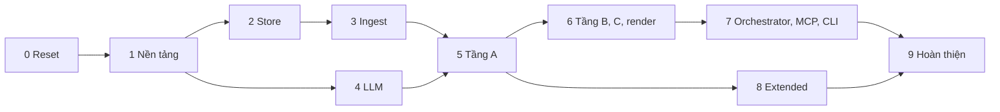
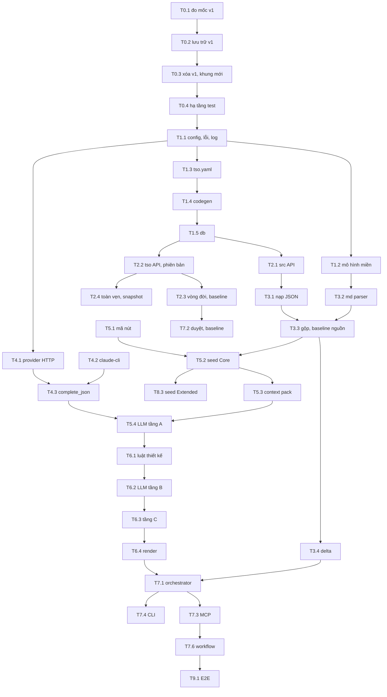

# Kế hoạch xây mới tsagent v2

Oct 12, 2026 · Theo [TDD-TSAGENT-v2.md](../TDD-TSAGENT-v2.md), [ONTOLOGY-TEST-TSO.md](../ONTOLOGY-TEST-TSO.md), [ONTOLOGY-TDD.md](../ONTOLOGY-TDD.md)

## 1. Mục tiêu

Viết lại `backend/agents/testspec-agent` **từ đầu** theo thiết kế v2. Code v1 bị gỡ hoàn toàn, không tái dùng module nào:

- Đầu vào JSON `tdd-kg/v1` và md mẫu v1 (bộ phân tích md viết mới).
- Lưu SQLite dạng quan hệ: bảng nguồn `src_*`, bảng theo lớp `tso_*`, sinh từ `tso.yaml`.
- KG test `tso:` ba tầng, sinh bằng luật seed + LLM, kiểm bằng TSO-001..021.
- Chạy theo bước, chạy tiếp được sau lỗi.
- MCP gateway và CLI mới; tích hợp lại workflow minipay.

## 2. Nguyên tắc

1. **Xây mới, không chạy song song.** Không có cờ chọn engine, không có lớp tương thích với v1. Một bộ code, một bộ test.
2. **v1 chỉ còn là tài liệu tham khảo.** Trước khi xóa, v1 được đo mốc và lưu trữ (giai đoạn 0). Khi viết lại, được đọc bản lưu trữ để hiểu hành vi, nhưng **không chép code**.
3. **Một định nghĩa ontology** (`tso.yaml`) sinh DDL, JSON Schema đầu ra LLM và danh mục luật hình dạng.
4. **Test đi trước hoặc cùng code.** Mỗi task kết thúc bằng test tự động xanh.
5. **Agent tự đứng được**: venv và `make init` nằm ngay trong thư mục agent, không dùng `go.work` hay môi trường ngoài.
6. **Giữ hợp đồng MCP mà workflow đang dùng** khi có thể (`start_run`, `get_run_status`, `get_spec`, `get_coverage`, `get_validation`, `get_traceability`, `list_pending_review`, `approve_nodes`, `baseline_spec`, `search`, `get_neighbors`) để workflow minipay sửa ít nhất.

## 3. Ảnh hưởng trong thời gian xây mới

| Đối tượng | Ảnh hưởng | Cách xử lý |
| --- | --- | --- |
| Workflow minipay (`tmp/minipay-demo`) | Bước `testspec` không chạy được từ giai đoạn 0 tới giai đoạn 7 | Bỏ đặt `TSAGENT_URL` thì workflow tự bỏ qua hai bước testspec; hoặc chạy bản v1 đã lưu trữ ở cổng khác nếu cần demo |
| Tài liệu v1 (TDD-TSAGENT.md, KG-TSAGENT.md) | Mô tả code không còn tồn tại | Đánh dấu `superseded` ở giai đoạn 9 |
| Đầu ra đã sinh (`output-docs/`) | Giữ nguyên | Dùng làm mốc so sánh |

## 4. Giai đoạn

| GĐ | Nội dung | File task |
| --- | --- | --- |
| 0 | Đo mốc v1, lưu trữ v1, xóa code v1, dựng khung dự án mới, hạ tầng test | [PHASE-0-reset.md](./PHASE-0-reset.md) |
| 1 | Nền tảng: cấu hình, lỗi, log, mô hình miền, `tso.yaml`, codegen, kết nối DB | [PHASE-1-foundation.md](./PHASE-1-foundation.md) |
| 2 | Kho SQLite: nguồn, KG test, vùng đệm, phiên bản, vòng đời, toàn vẹn, snapshot | [PHASE-2-store.md](./PHASE-2-store.md) |
| 3 | Nạp `tdd-kg/v1`, bộ phân tích md mới, gộp, delta | [PHASE-3-ingest.md](./PHASE-3-ingest.md) |
| 4 | Client LLM mới: anthropic, openai, claude-cli, chính sách lỗi, cache, trần | [PHASE-4-llm.md](./PHASE-4-llm.md) |
| 5 | Tầng A: mã nút, luật seed Core, gói ngữ cảnh, LLM phân tích, TSO-001..007 | [PHASE-5-analyze.md](./PHASE-5-analyze.md) |
| 6 | Tầng B, C và render ba tài liệu md | [PHASE-6-design-specify-render.md](./PHASE-6-design-specify-render.md) |
| 7 | Orchestrator, duyệt, baseline, MCP, CLI, đóng gói, tích hợp workflow | [PHASE-7-orchestrator-interfaces.md](./PHASE-7-orchestrator-interfaces.md) |
| 8 | Profile Extended (TDD-Ontology module 04) | [PHASE-8-extended.md](./PHASE-8-extended.md) |
| 9 | Kiểm thử đầu-cuối, hiệu năng, bảo mật, tài liệu | [PHASE-9-hardening.md](./PHASE-9-hardening.md) |



Giai đoạn 4 làm song song được với 2, 3. Giai đoạn 8 làm song song được với 6, 7.

## 5. Phụ thuộc giữa các task chính



## 6. Cấu trúc thư mục đích

```
backend/agents/testspec-agent/
├── Makefile                 init (venv), test, lint, codegen, serve, build, start-dev, stop-dev
├── pyproject.toml
├── README.md
├── deploy/                  Dockerfile, docker-compose.yml, .env.example
├── scripts/                 export_tdd_kg_json.py, compare_baseline.py
├── tsagent/
│   ├── config.py · errors.py · logging.py · cli.py · __main__.py
│   ├── model/               kiểu miền: SourcePackage, SrcNode, SrcEdge, TsoEntity, Provenance
│   ├── ontology/            tso.yaml, codegen.py, profiles.yaml
│   ├── store/               db.py, source.py, tso.py, versions.py, lifecycle.py, ops.py, schema.sql (sinh), migrations/
│   ├── ingest/              kg_json.py, md/ (parser mới), merge.py, ttl_plugin.py (tùy chọn)
│   ├── delta/
│   ├── llm/                 providers/ (anthropic, openai, claude_cli), client.py, cache.py, fake.py
│   ├── analyze/             codes.py, seed_core.py, seed_ext.py, context.py, fill.py, prompts/
│   ├── design/              rules.py, fill.py, prompts/
│   ├── specify/             rules.py, fill.py, prompts/
│   ├── validate/            input_rules.py, tso_rules.py, report.py, secrets.py
│   ├── render/
│   ├── orchestrator/        run.py, steps.py, review.py
│   ├── gateway/             mcp_http.py, mcp_stdio.py, tools.py, views.sql
│   └── schemas/             tdd-kg-v1.schema.json, v2/*.schema.json (sinh), mcp-tools.schema.json
└── tests/                   unit/, integration/, system/, contract/, fixtures/
```

## 7. Quy ước

| Quy ước | Nội dung |
| --- | --- |
| Đánh dấu | Xong mục nào đổi `- [ ]` thành `- [x]` trong file giai đoạn. Task xong khi mọi mục `[x]` và đạt Definition of Done; khi đó cập nhật `Trạng thái` và ô của task trong [README.md](./README.md) |
| Trạng thái | `Chưa bắt đầu` → `Đang làm` → `Review` → `Xong (ngày, commit)`; task bỏ ghi `Bỏ` kèm lý do, không xóa |
| Mã task | `T<giai đoạn>.<số>`, không đổi khi đã dùng |
| Nhánh | `feat/tsagent-v2-p<n>` cho mỗi giai đoạn |
| Test | `make test` phải xanh trước khi đánh dấu task xong |
| Lệch thiết kế | Ghi vào [DEVIATIONS.md](./DEVIATIONS.md) cùng commit |
| Phạm vi | Ý mới ngoài TDD v2 ghi vào mục "Ngoài phạm vi" của README, không làm trong kế hoạch này |

## 8. Definition of Done (mọi task)

- [ ] Đúng TDD v2 và ontology, hoặc lệch đã ghi DEVIATIONS.md
- [ ] Test của task viết và xanh; `make test` và `make lint` xanh
- [ ] Không có bí mật trong code, test, fixture
- [ ] Comment chỉ giải thích "vì sao" ở chỗ không hiển nhiên
- [ ] README của agent cập nhật khi đổi cách dùng (lệnh, biến môi trường)
- [ ] Checklist và trạng thái của task đã cập nhật

## 9. Rủi ro

| Rủi ro | Giảm thiểu |
| --- | --- |
| Mất v1 vĩnh viễn (thư mục chưa commit) | T0.2 bắt buộc lưu trữ và kiểm khôi phục được trước khi xóa |
| Viết lại lâu hơn dự kiến, demo testspec gián đoạn | Giai đoạn 7 có tích hợp workflow sớm nhất có thể; bản v1 lưu trữ chạy được cho demo |
| Mất hành vi đúng của v1 khi viết lại (phiên bản, hand-edit, chính sách LLM, bảo mật MCP) | Mốc v1 (T0.1) liệt kê hành vi và kịch bản; mỗi kịch bản thành test ở giai đoạn tương ứng |
| Chi phí LLM khi phát triển | LLM giả trong test; `claude-cli` với trần nhỏ khi thử thật; cache |
| Ontology Extended chưa chốt | Giai đoạn 8 tách riêng, tên quan hệ trong cấu hình |
