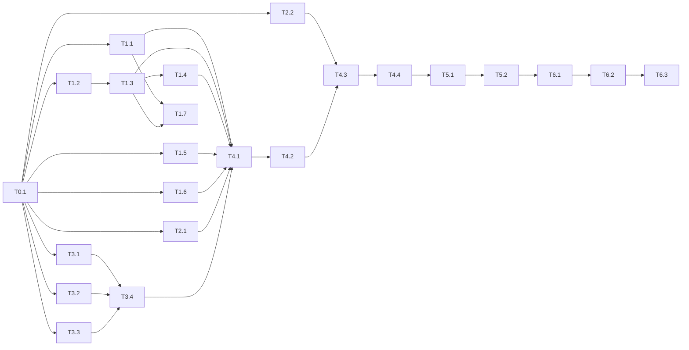

# Đưa tsagent vào workflow của tdd-agent: PLAN

Kế hoạch hiện thực [SOLUTION](SOLUTION-INTEGRATE-TDD-AGENT.md) (theo [TDD](TDD-INTEGRATE-TDD-AGENT.md) 0.5). Checklist chi tiết từng task ở [TASKS.md](TASKS.md).

Giả định: bảy chỗ làm rõ C-01 đến C-07 ở SOLUTION mục 12 được chấp nhận. Chỗ nào bị đổi thì task liên quan được sửa trước khi làm.

## Theo dõi tiến độ

1. Làm task theo thứ tự phụ thuộc (sơ đồ bên dưới), test trước.
2. Tick `[x]` trong [TASKS.md](TASKS.md) khi mục xong **và** test xanh; bị chặn thì thêm `> BLOCKED: <lý do>` dưới tiêu đề task.
3. Làm mới bảng tiến độ:

   ```bash
   python scripts/tsagent/plan_progress.py
   ```

4. Ghi một dòng vào [Nhật ký](#nhật-ký) mỗi khi xong task, gặp lệch so với SOLUTION, hoặc bị chặn.

`python scripts/tsagent/plan_progress.py --check` thoát mã 1 khi bảng dưới đã cũ so với TASKS.md.

## Tiến độ

<!-- progress:start -->
**Tổng: 31/37 task xong · 168/183 mục (91 %)**

| Pha | Task | Việc | Mục | Trạng thái |
| --- | --- | --- | --- | --- |
| P0 Chuẩn bị | T0.1 | Ghi mốc test hiện tại | 3/3 | ✅ done |
| P1 tsagent | T1.1 | Cấu hình LLM bắt buộc (§8.1) | 10/10 | ✅ done |
| P1 tsagent | T1.2 | Bỏ qua cache khi retry (§8.2) | 4/4 | ✅ done |
| P1 tsagent | T1.3 | Retry theo nhóm (§8.3) | 9/9 | ✅ done |
| P1 tsagent | T1.4 | Ngưỡng 50 % nhóm lỗi (§8.3) | 8/8 | ✅ done |
| P1 tsagent | T1.5 | Tham số `origin` của run (§7.3) | 4/4 | ✅ done |
| P1 tsagent | T1.6 | Front matter `llm:` (§8.4) | 4/4 | ✅ done |
| P1 tsagent | T1.7 | Cập nhật nơi dùng tsagent độc lập (§8.5) | 3/4 | 🟡 doing |
| P2 Lõi tdd-agent | T2.1 | Mục cấu hình `[testspec]` (§9) | 5/5 | ✅ done |
| P2 Lõi tdd-agent | T2.2 | Móc `ChildRuns` (§3.2) | 5/5 | ✅ done |
| P3 Phép chiếu | T3.1 | `mapping.yaml` và bộ nạp (§6.2, §6.3) | 5/5 | ✅ done |
| P3 Phép chiếu | T3.2 | Chuẩn hóa mã (§6.5) | 3/3 | ✅ done |
| P3 Phép chiếu | T3.3 | Đọc snapshot và chọn phạm vi (§5) | 6/6 | ✅ done |
| P3 Phép chiếu | T3.4 | Dựng gói `tdd-kg/v1` (§6.1, §6.4) | 6/6 | ✅ done |
| P4 Cổng GT và TS1 | T4.1 | `runner.py`: gọi tsagent (§7, §9.3) | 7/7 | ✅ done |
| P4 Cổng GT và TS1 | T4.2 | Cổng TS1 (§4) | 5/5 | ✅ done |
| P4 Cổng GT và TS1 | T4.3 | Cổng GT (§3) | 8/8 | ✅ done |
| P4 Cổng GT và TS1 | T4.4 | Khai báo trong `flows.py` (§2) | 5/5 | ✅ done |
| P5 Hiển thị và tài liệu | T5.1 | Dòng test specs trong `change status` (§10) | 4/4 | ✅ done |
| P5 Hiển thị và tài liệu | T5.2 | Tài liệu người dùng | 4/4 | ✅ done |
| P6 Kiểm chứng | T6.1 | Hồi quy toàn bộ | 3/3 | ✅ done |
| P6 Kiểm chứng | T6.2 | E2E PBOM + CR T-14 (`llm = none`, tiến trình tách rời thật) | 0/4 | ⚪ todo |
| P6 Kiểm chứng | T6.3 | Đo MiniPay CR-001 với `claude-cli` (TC-41) | 0/3 | ⚪ todo |
| P7 Đọc KG thiết kế qua MCP (TDD 0.6, SOLUTION 0.3 mục 13) | T7.1 | Tool đọc `kg_elements` trên MCP server của tdd-agent | 4/4 | ✅ done |
| P7 Đọc KG thiết kế qua MCP (TDD 0.6, SOLUTION 0.3 mục 13) | T7.2 | Client MCP đọc KG cho TS1 | 5/5 | ✅ done |
| P7 Đọc KG thiết kế qua MCP (TDD 0.6, SOLUTION 0.3 mục 13) | T7.3 | TS1, GT dùng MCP | 5/5 | ✅ done |
| P7 Đọc KG thiết kế qua MCP (TDD 0.6, SOLUTION 0.3 mục 13) | T7.4 | Tài liệu | 3/3 | ✅ done |
| P8 Ngữ cảnh Plan / Solution (đề xuất TDD 0.7, SOLUTION 0.4 mục 14) | T8.1 | Cấu hình `context_mode`, `context_path` (§14.2) | 5/5 | ✅ done |
| P8 Ngữ cảnh Plan / Solution (đề xuất TDD 0.7, SOLUTION 0.4 mục 14) | T8.2 | Đọc Solution (§14.3, §14.4) | 5/5 | ✅ done |
| P8 Ngữ cảnh Plan / Solution (đề xuất TDD 0.7, SOLUTION 0.4 mục 14) | T8.3 | Đọc Plan (§14.3, §14.4) | 5/5 | ✅ done |
| P8 Ngữ cảnh Plan / Solution (đề xuất TDD 0.7, SOLUTION 0.4 mục 14) | T8.4 | Nạp tài liệu và kiểm đường dẫn (§14.2, §14.9) | 4/4 | ✅ done |
| P8 Ngữ cảnh Plan / Solution (đề xuất TDD 0.7, SOLUTION 0.4 mục 14) | T8.5 | Chiếu thành nút (§14.5, §14.6) | 5/5 | ✅ done |
| P8 Ngữ cảnh Plan / Solution (đề xuất TDD 0.7, SOLUTION 0.4 mục 14) | T8.6 | Gate, băm, hiển thị (§14.8, §14.10) | 5/5 | ✅ done |
| P8 Ngữ cảnh Plan / Solution (đề xuất TDD 0.7, SOLUTION 0.4 mục 14) | T8.7 | E2E và đo trên repo `notes` (§11.4) | 1/2 | 🟡 doing |
| P8 Ngữ cảnh Plan / Solution (đề xuất TDD 0.7, SOLUTION 0.4 mục 14) | T8.8 | Tài liệu (§14) | 3/5 | 🟡 doing |
| P8 Ngữ cảnh Plan / Solution (đề xuất TDD 0.7, SOLUTION 0.4 mục 14) | T8.9 | Tool MCP `testspec_start`, `testspec_get` (§14.13) | 6/6 | ✅ done |
| P8 Ngữ cảnh Plan / Solution (đề xuất TDD 0.7, SOLUTION 0.4 mục 14) | T8.10 | Tích hợp phía Orca (ngoài repo `tdd-agentic-ai`) | 1/5 | 🟡 doing |
<!-- progress:end -->

## Pha và phụ thuộc

| Pha | Mục tiêu | SOLUTION |
| --- | --- | --- |
| P0 Chuẩn bị | Mốc test và lint trước khi sửa | |
| P1 tsagent | LLM bắt buộc, retry nhóm, ngưỡng 50 %, `origin`, front matter | §8, §7.3 |
| P2 Lõi tdd-agent | Mục `[testspec]`, loại khỏi fingerprint, móc `ChildRuns` | §9, §3.2 |
| P3 Phép chiếu | Ánh xạ, chuẩn hóa mã, phạm vi, dựng gói `tdd-kg/v1` | §5, §6 |
| P4 Cổng | `runner`, TS1, GT, khai báo `flows.py` | §2, §3, §4, §7 |
| P5 Hiển thị và tài liệu | `change status`, README, hướng dẫn | §10, §1 SOL-16 |
| P6 Kiểm chứng | Hồi quy, E2E PBOM, đo MiniPay | §11 |
| P7 Đọc KG qua MCP | Tool `kg_elements`, client MCP của TS1, GT/TS1 không đọc kho trực tiếp | §13 |
| P8 Ngữ cảnh Plan / Solution *(đề xuất)* | `context_mode` (`none`, `plan`, `solution`; mỗi run một chế độ), đọc Solution (kể cả chưa duyệt) và Plan (`tasks.md`, `specs/`, `proposal.md`, `design.md`), chiếu thành nút, băm, tool MCP `testspec_start`/`testspec_get` cho Orca, đo trên repo `notes` | §14 |



P1, P2, P3 độc lập với nhau, làm song song được. Đường găng: T0.1 → T1.2 → T1.3 → T1.4 → T4.1 → T4.2 → T4.3 → T4.4 → T5.1 → T5.2 → T6.x.

## Truy vết ca kiểm thử

| Ca (SOLUTION §11) | Task |
| --- | --- |
| TC-01, 02, 04, 05, 10, 15 | T4.3 |
| TC-03, 06, 07 | T4.2 (phạm vi ở T3.3, gói ở T3.4) |
| TC-08, 12 | T3.4 |
| TC-09 | T4.4 (phần run bị thay ở T4.2) |
| TC-11 | T2.1, T4.4 |
| TC-13 | T3.2 |
| TC-14 | T3.1 |
| TC-16 | T5.1 |
| TC-21, 22, 23, 24 | T1.1 |
| TC-25, 26, 29, 31, 32 | T1.3 (`fresh` ở T1.2) |
| TC-27, 28 | T1.4 |
| TC-30 | T1.4, T1.6 |
| TC-41 | T6.3 |
| TC-51 | T8.1 |
| TC-52, 53, 54 | T8.2 |
| TC-55, 56 | T8.3 |
| TC-57 | T8.4 |
| TC-58, 59, 60, 61, 62, 63 | T8.5 |
| TC-64 | T8.6 |
| TC-65, 66 | T8.7 |
| TC-67, 68, 69, 70, 71, 72, 73, 74 | T8.9 |
| TC-75, 76 | T8.3 |

## Điều kiện xong

- Mọi task `done`, mọi ca TC-01 đến TC-32 có test tự động xanh, TC-41 có số đo trong PERF.md.
- Không test cũ nào đỏ mới so với mốc T0.1; ruff sạch.
- Lệch phát sinh so với SOLUTION đều ghi trong Nhật ký và cập nhật vào SOLUTION.

## Nhật ký

| Ngày | Task | Ghi chú |
| --- | --- | --- |
| 2026-10-13 | — | Tạo PLAN và TASKS từ SOLUTION 0.1 |
| 2026-10-13 | T0.1 | Mốc: 607 passed, 2 skipped; ruff tsagent sạch |
| 2026-10-13 | T1.1–T1.6 | tsagent: chế độ LLM bắt buộc, kiểm key/model, `fresh`, retry nhóm, ngưỡng 50 %, `origin`, front matter `llm:`. Test cũ giả lập "mọi nhóm LLM hỏng" đổi kỳ vọng sang `LLMGroupsFailed`; golden PAY cập nhật |
| 2026-10-13 | T1.7 | Chưa build image Docker (để cùng P6); `docker compose config` đã kiểm |
| 2026-10-13 | T2.1–T2.2 | `[testspec]` + loại khỏi fingerprint; móc `ChildRuns` |
| 2026-10-13 | T3.1–T3.4 | Phép chiếu: lệch C-08..C-11 (SOLUTION 12.1) |
| 2026-10-13 | T4.1–T4.4 | GT/TS1 nối vào `change-request`; lệch C-13; 383 test tdd-agent cũ vẫn xanh |
| 2026-10-13 | T5.1–T5.2 | `change status`, tài liệu, mẫu `init`; lệch C-14, C-15 |
| 2026-10-13 | T6.1 | Hồi quy 683 passed; T6.2, T6.3 (E2E, đo MiniPay) tạm bỏ qua theo yêu cầu |
| 2026-10-13 | T7.1–T7.4 | Chủ dự án yêu cầu đọc KG qua MCP: TDD 0.6 (INT-ADR-11), SOLUTION 0.3 mục 13; tool `kg_elements`, `kgclient.py` (stdio/HTTP), GT không đọc KG, TS1 không dùng `ctx.knowledge`; hồi quy 692 passed |
| 2026-10-13 | (chạy thật) | MiniPay (`tmp/minipay-run`): `tdd-agent init` (43 phần tử) → client MCP gọi `run_start`/`run_resume` flow `testspec` (`claude-cli`, 4 luồng) → TS1 đọc KG qua MCP stdio → 22 TR, 25 TC, 60 TestGap trong 179 s, 82 lượt Claude, 2 nhóm thử lại. Đầu vào phải chỉnh bản sao: thêm URD trích từ SRS; SAD đổi ô đầu bảng NFR (tránh `SAD_READONLY`). Tài liệu render quyền 600 (mkstemp) |
| 2026-10-14 | (ngôn ngữ) | Chủ dự án yêu cầu: comment, docstring, log, lỗi, help CLI, mô tả tool MCP/JSON Schema, prompt của tsagent và `agents/testspec` sang tiếng Anh; nội dung tài liệu test specs giữ tiếng Việt. Golden PAY không đổi; hồi quy 692 passed |
| 2026-10-19 | P8 | Đề xuất ngữ cảnh Plan/Solution cho test specs: TDD 0.7 (INT-ADR-12..15, INT-FR-15..20), SOLUTION mục 14, `CLI_Project_Usage.md`, task T8.1–T8.8. **Chưa có mã**; chờ duyệt. Mốc để so: chạy `testspec` trên repo `notes` không ngữ cảnh cho 6 TR, 10 TC, 8 TestGap, 15 lượt gọi LLM |
| 2026-10-19 | P8 | Chủ dự án chốt: Solution chưa duyệt vẫn dùng được; Plan đọc cả `proposal.md`, `design.md`; chỉ một chế độ mỗi run; thêm tool MCP `testspec_start`, `testspec_get` cho Orca (TDD 0.7: INT-ADR-16, 17, INT-FR-21..24; SOLUTION 14.13; task T8.9, T8.10). Vẫn **chưa có mã** |
| 2026-10-19 | P8 (T8.1–T8.9) | Hiện thực: `context.py` (đọc Solution, Plan gồm `proposal.md`/`design.md`, ghi tài liệu MCP), phép chiếu `_inject_context`, băm GT/TS1, tool MCP `testspec_start`/`testspec_get`, 82 ca mới xanh, hồi quy toàn repo xanh. Phát hiện khi chạy thật trên `notes`: tsagent trả run cũ không ghi lại Draft khi đổi qua lại giữa các đầu vào → sửa trong `runner.py` (C-25, TC-77). Chạy thật qua MCP stdio và `claude-cli` (PERF.md TC-66). Allowlist cầu MCP phía Orca đã thêm; còn phần `request-service` (T8.10) |
