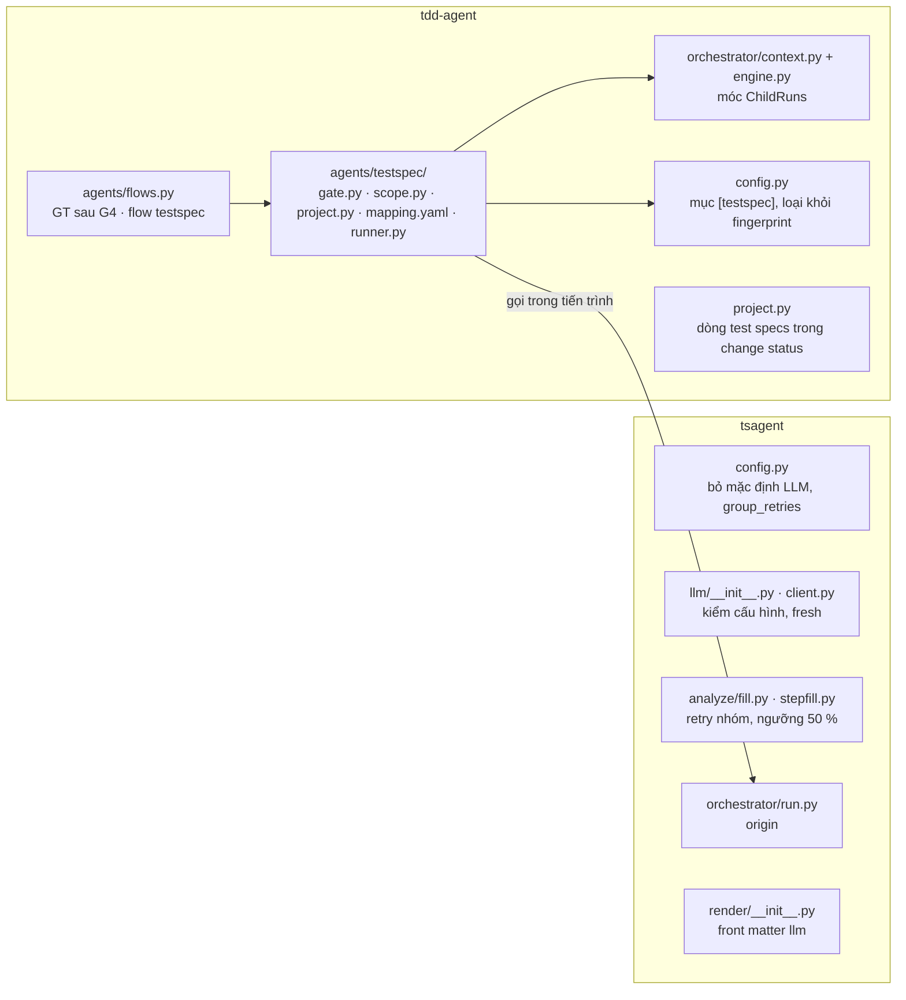
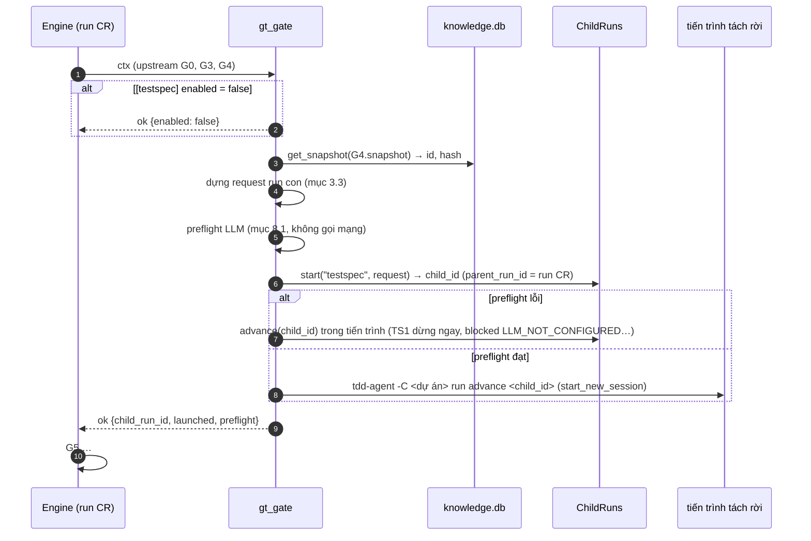
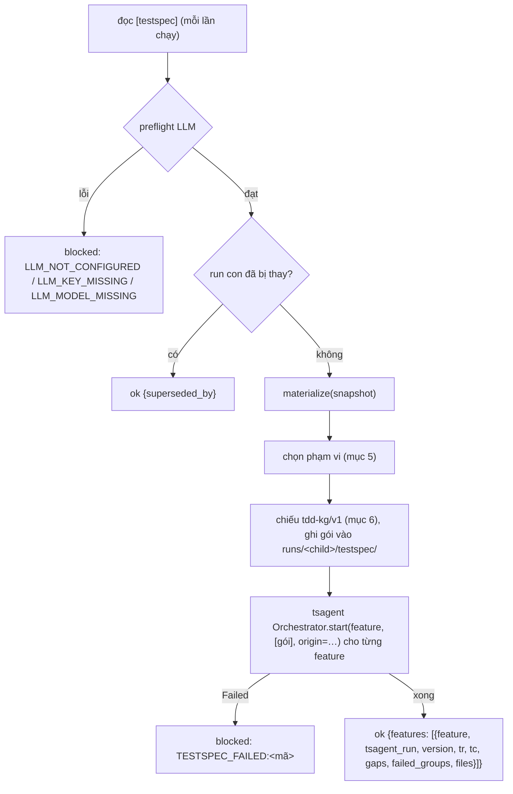
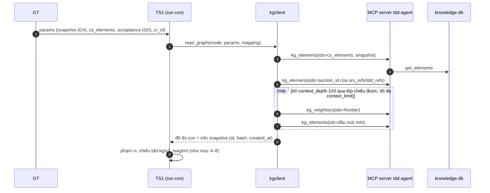

# Đưa tsagent vào workflow của tdd-agent: SOLUTION

Oct 13, 2026 · Bản 0.3 (P0–P5, P7 của [PLAN](PLAN.md) đã hiện thực; lệch khi hiện thực ở [mục 12.1](#121-lệch-khi-hiện-thực); **đọc KG qua MCP ở [mục 13](#13-đọc-kg-thiết-kế-qua-mcp-tdd-06)**, thay mục 3.3, 5.1 về chỗ đọc kho) · Hiện thực [TDD-INTEGRATE-TDD-AGENT.md](TDD-INTEGRATE-TDD-AGENT.md) bản 0.6

> **Bản 0.4 (2026-10-19, đã hiện thực):** [mục 14](#14-ngữ-cảnh-plan-hoặc-solution-đề-xuất-04) thêm hai chế độ ngữ cảnh cho test specs theo `[testspec] context_mode` (`plan`, `solution`; mỗi run một chế độ) và hai tool MCP `testspec_start`, `testspec_get` để Orca tích hợp, hiện thực TDD 0.7 (INT-ADR-12..17). Các mục 1 đến 13 giữ nguyên; mục 14 chỉ thêm, mặc định `none` không đổi hành vi.

## Cách đọc tài liệu

TDD chốt **làm gì**. Tài liệu này chốt **làm thế nào**: tệp nào đổi, hàm nào thêm, dữ liệu đi qua đâu, ca kiểm thử nào chứng minh. Sau khi duyệt, tài liệu này được tách thành `PLAN.md` và các task có checklist.

Mọi chỗ tài liệu này **làm rõ hoặc lệch** so với TDD được gom ở [mục 12](#12-chỗ-làm-rõ-so-với-tdd-cần-duyệt), cần duyệt cùng tài liệu.

Mã giải pháp có tiền tố `SOL-`. Mã yêu cầu (`INT-FR-…`) và cơ chế (`INT-MECH-…`) lấy từ TDD.

---

## 1. Tổng quan thay đổi



| Mã | Tệp | Loại | Nội dung |
| --- | --- | --- | --- |
| SOL-01 | `src/tdd_agent/agents/testspec/__init__.py` | mới | Xuất `gt_gate`, `ts1_gate`, `testspec_extra_inputs` |
| SOL-02 | `src/tdd_agent/agents/testspec/gate.py` | mới | Hàm thực thi GT và TS1 (mục 3, 4) |
| SOL-03 | `src/tdd_agent/agents/testspec/scope.py` | mới | Lấy snapshot, chọn phạm vi theo change spec / theo TDD (mục 5) |
| SOL-04 | `src/tdd_agent/agents/testspec/project.py` | mới | Phép chiếu KG thiết kế → `tdd-kg/v1` (mục 6) |
| SOL-05 | `src/tdd_agent/agents/testspec/mapping.yaml` | mới | Bảng ánh xạ dạng dữ liệu, có `version` (mục 6) |
| SOL-06 | `src/tdd_agent/agents/testspec/runner.py` | mới | Dựng `tsagent.Config` từ `[testspec]`, kiểm LLM, gọi tsagent, ghi mốc (mục 7, 8) |
| SOL-07 | `src/tdd_agent/agents/flows.py` | sửa | GT trong `change-request`; flow `testspec` (mục 2) |
| SOL-08 | `src/tdd_agent/orchestrator/context.py`, `engine.py` | sửa nhỏ | Móc `ChildRuns` để cổng khởi chạy run con (mục 3.2) |
| SOL-09 | `src/tdd_agent/orchestrator/model.py` | sửa nhỏ | Thêm trạng thái `testspec_dispatched` vào `STATE_ORDER` |
| SOL-10 | `src/tdd_agent/config.py` | sửa | Mục `[testspec]` trong `DEFAULTS`; loại khỏi `fingerprint()` (mục 9) |
| SOL-11 | `src/tdd_agent/project.py` | sửa | `change status` thêm dòng test specs (mục 10) |
| SOL-12 | `src/tsagent/config.py`, `llm/__init__.py`, `llm/client.py` | sửa | Bỏ mặc định LLM, `LLM_NOT_CONFIGURED`, kiểm key/model, `fresh` (mục 8.1, 8.2) |
| SOL-13 | `src/tsagent/analyze/fill.py`, `stepfill.py` | sửa | Retry nhóm, ngưỡng 50 % (mục 8.3) |
| SOL-14 | `src/tsagent/orchestrator/run.py` | sửa | Tham số `origin` lưu vào `run.params` (mục 7.3) |
| SOL-15 | `src/tsagent/render/__init__.py` | sửa | Front matter `llm:` (mục 8.4) |
| SOL-16 | `README.md`, `docs/tsagent/README.md`, `docs/CLI_Project_Usage.md`, `deploy/tsagent/*` (`.env.example`, compose) | sửa | Cấu hình bắt buộc, cách đọc test specs |
| SOL-17 | `tests/test_testspec_*.py`, `tests/testspec_agent/conftest.py` | mới/sửa | Ca kiểm thử mục 11 |
| SOL-24 *(0.4)* | `src/tdd_agent/agents/testspec/context.py` | mới | Đọc, kiểm, chuẩn hóa Solution (JSON) hoặc Plan (OpenSpec change gồm `tasks.md`, `specs/`, `proposal.md`, `design.md`) thành `Bundle` các mục; ghi tài liệu gửi qua MCP (mục 14.3, 14.4, 14.13) |
| SOL-25 *(0.4)* | `src/tdd_agent/agents/testspec/project.py` | sửa | `Projector.build(..., context=Bundle)`: thêm nút ngữ cảnh sau khi chiếu KG (mục 14.5, 14.6) |
| SOL-26 *(0.4)* | `src/tdd_agent/agents/testspec/gate.py`, `runner.py` | sửa nhỏ | TS1 nạp `Bundle` sau kiểm LLM; `origin.context`, tóm tắt `context`; `extra_inputs` của GT và TS1 có băm ngữ cảnh; `runner.py` chạy lại tsagent khi run trùng đầu vào không còn là run đã ghi Draft hiện tại (mục 14.8, 14.10, C-25) |
| SOL-27 *(0.4)* | `src/tdd_agent/config.py` | sửa | `[testspec] context_mode`, `context_path` trong `DEFAULTS` và kiểm giá trị (mục 14.2) |
| SOL-28 *(0.4)* | `src/tdd_agent/project.py` | sửa nhỏ | Mẫu `init` ghi sẵn hai khóa (chú thích); dòng `Test specs:` của `change status` nêu chế độ ngữ cảnh (mục 14.10) |
| SOL-29 *(0.4)* | `tests/test_testspec_context.py`, `tests/test_testspec_config.py` | mới/sửa | Ca TC-51 đến TC-66 (mục 11.4) |
| SOL-30 *(0.4)* | `src/tdd_agent/mcp/tools.py` | sửa | Tool ghi `testspec_start` (thêm vào `WRITE_TOOLS`) và tool đọc `testspec_get`; kiểm `kind` trùng cấu hình, tên tệp, dung lượng; ghi nguyên tử (mục 14.13) |
| SOL-31 *(0.4)* | `src/tdd_agent/mcp/server.py` | sửa nhỏ | Đăng ký `testspec_get` vào `READ_TOOLS`, mô tả tool và lược đồ tham số; cập nhật `INSTRUCTIONS` |
| SOL-32 *(0.4)* | `tests/test_mcp_testspec.py` | mới | Ca TC-67 đến TC-74 (mục 11.4) |

Không thêm lệnh CLI, không thêm bảng vào `knowledge.db` hay `operational.db`, không đổi schema `tsagent.db`.

---

## 2. Khai báo workflow (`agents/flows.py`)

### 2.1 GT trong `change-request`

GT nằm **sau G4, trước G5** trong bộ cổng. Engine chạy cổng theo thứ tự, nên GT chạy ngay khi G4 xong; GT trả `ok` trong vài trăm ms nên engine đi tiếp G5 ở cùng lượt `advance`.

```python
from .testspec import gt_gate, ts1_gate, gt_extra_inputs, ts1_extra_inputs

GateDef("G4", "spec_eligible", cs_table_gate, ...),                                   # như cũ
GateDef("GT", "testspec_dispatched", gt_gate, source_roles=(), depends_on=("G0", "G3", "G4"),
        extra_inputs=gt_extra_inputs, ignore_params=LATE_PARAMS),
GateDef("G5", "spec_authored", authoring_gate, ...),                                  # như cũ, depends_on không có GT
```

| Thuộc tính | Giá trị | Lý do |
| --- | --- | --- |
| `approval` | không | INT-ADR-01: không người xác nhận |
| `depends_on` | `("G0", "G3", "G4")` | GT đọc CR (G0), snapshot thiết kế (G3), change spec (G4) |
| G5, G6, G7 `depends_on` | **giữ nguyên, không có GT** | INT-FR-02: GT chạy lại hay lỗi không làm G5–G7 `stale` |
| `source_roles` | `()` | GT không đọc tài liệu nguồn trực tiếp; đổi SRS/SAD đi qua G0/G3/G4 |
| `ignore_params` | `LATE_PARAMS` | `code_targets`, `verifications` không ảnh hưởng test specs |
| `state_after` | `testspec_dispatched` (mới) | Trạng thái riêng: nếu dùng lại `spec_eligible`, `state_rank` trả vị trí của G4 và engine ghi chuyển trạng thái thừa mỗi lượt `advance` |

`changespec-agent` (flow chỉ G4, G5) **không** thêm GT ở giai đoạn này.

### 2.2 Flow `testspec`

```python
testspec = FlowDef("testspec", (
    GateDef("TS1", "testspec_written", ts1_gate, source_roles=(), extra_inputs=ts1_extra_inputs),
), initial_state="intake")
return {f.name: f for f in (change, generation, edit, impact_only, changespec_only, testspec)}
```

TS1 không cần duyệt. Run con kết thúc ở `completed` khi ba tài liệu đã ghi.

### 2.3 Hàm băm đầu vào (INT-MECH-04)

| Cổng | `extra_inputs` | Không gồm |
| --- | --- | --- |
| GT | `{"testspec": {enabled, llm, specs_dir}, "mapping": <version + sha256 của mapping.yaml>}` | `parallel`, `group_retries` (núm vận hành: đổi chúng không được sinh lại test specs) |
| TS1 | `{"mapping": …}` | cấu hình `[testspec]` (đọc lúc chạy, INT-NFR-04) |

Băm upstream (G0, G3, G4) do engine tự tính. Vì vậy: change spec đổi (G4 chạy lại) → băm GT đổi → GT chạy lại → run con mới (INT-FR-12); bật/tắt nhánh hay đổi `llm` → GT chạy lại ở lượt `advance` kế tiếp.

---

## 3. Cổng GT: khởi chạy run con

### 3.1 Trình tự



Preflight lỗi **không** chặn run CR (INT-CON-02): GT vẫn `ok`, run con mang lỗi. Như vậy lỗi cấu hình vẫn "dừng ngay" ở run con (INT-FR-06) và không cần sinh tiến trình. Bộ test sẵn có của tdd-agent (không đặt `[testspec] llm`) cũng nhờ đó không sinh tiến trình nào.

### 3.2 Móc `ChildRuns` (SOL-08)

`GateContext` hiện không có tay cầm tới engine. Thêm một trường tùy chọn, engine tự gắn trong `_ctx`:

```python
# orchestrator/context.py
@dataclass
class ChildRuns:
    start: Callable[[str, dict], str]      # (flow, request) -> run_id, parent_run_id = run hiện tại
    advance: Callable[[str], str]          # run_id -> status

@dataclass
class GateContext:
    ...
    children: ChildRuns | None = None

# orchestrator/engine.py, trong _ctx(...)
children = ChildRuns(start=lambda flow, req: self.start(flow, req, parent_run_id=run.run_id).run_id,
                     advance=lambda rid: self.advance(rid).status)
```

`advance` của run con lấy khóa của chính run con (khóa theo `run_id`), không đụng khóa run cha. Không thêm bộ điều phối hay lệnh mới (INT-CON-01).

### 3.3 Request của run con

Run con nhận **mã** của dữ liệu bất biến, không chép đầu ra cổng:

```json
{
  "mode": "cr",
  "params": {
    "parent_run_id": "run-ab12cd",
    "cr_id": "CR-014",
    "snapshot": "snap-000042",
    "snapshot_hash": "9f…",
    "cs_elements": ["CS-CR-014-1", "CS-CR-014-2"],
    "tdds": ["TDD-PBOM"],
    "acceptance": [{"id": "AC-REM-14", "text": "GIVEN … WHEN … THEN …"}]
  }
}
```

| Trường | Lấy từ |
| --- | --- |
| `snapshot` | `upstream(ctx, "G4")["snapshot"]`: snapshot G4 commit, đã chứa thiết kế sau G3 **và** các phần tử `ChangeSpecItem` |
| `snapshot_hash` | `ctx.knowledge.get_snapshot(snapshot).hash` |
| `cs_elements` | `upstream(ctx, "G4")["cs_elements"]` |
| `tdds` | `document_id` (vai trò TDD) trong `tdd_refs` của các dòng change spec; rỗng thì `[config.project.tdd_id]` |
| `acceptance` | G0: `acceptance_text` (CR viết bằng văn xuôi) hoặc `cr.acceptance`; mục không có văn bản giữ `text: null` |

Snapshot bất biến nên run con đọc đúng dữ liệu dù run CR đã đi tiếp hay G4 chạy lại.

### 3.4 Tiến trình tách rời

```python
def launch_detached(cfg, child_id):
    log = cfg.work_dir / "logs" / f"testspec-{child_id}.log"
    cmd = [sys.executable, "-m", "tdd_agent.cli", "-C", str(cfg.base_dir), "run", "advance", child_id]
    proc = subprocess.Popen(cmd, stdout=log.open("ab"), stderr=subprocess.STDOUT, stdin=subprocess.DEVNULL,
                            start_new_session=True, close_fds=True, env=os.environ.copy())
    return proc.pid
```

- `start_new_session=True`: lệnh `tdd-agent change start/advance` kết thúc, run con vẫn chạy.
- `pid` và `launched_at` ghi vào kết quả task GT để `change status` biết tiến trình còn sống không (mục 10).
- Hàm khởi chạy là thuộc tính module (`gate.LAUNCH = launch_detached`) để test thay bằng hàm chạy ngay trong tiến trình hoặc chỉ ghi lại lời gọi.
- Tiến trình chết giữa chừng: run con còn `running`. Chạy lại bằng `tdd-agent run advance <child>`: engine thực thi lại TS1 (lần thử kế tiếp), tsagent tìm lại run dở qua `runKey` và chạy tiếp từ bước chưa xong.

### 3.5 Đầu ra GT

```json
{"enabled": true, "child_run_id": "run-77aa01", "launched": "detached", "pid": 41231,
 "preflight": {"ok": true, "llm": "claude-cli"}, "snapshot": "snap-000042", "supersedes": "run-5c0f9e"}
```

`supersedes`: run con trước đó của cùng run CR (nếu có), để TS1 của run cũ biết mình đã bị thay (mục 4.3).

---

## 4. Cổng TS1

### 4.1 Trình tự



### 4.2 Hai chế độ

| Chế độ | Nhận ra bằng | Snapshot | Phạm vi |
| --- | --- | --- | --- |
| CR (`mode: "cr"`) | GT tạo; có `parent_run_id`, `cs_elements` | `params.snapshot` (từ G4) | Theo change spec (mục 5.2) |
| Tay | `tdd-agent run start testspec --request req.json` | `params.snapshot` nếu có, không thì `knowledge.head()` | Theo TDD (mục 5.3) |

Request chạy tay:

```json
{"params": {"tdd": "TDD-PBOM", "snapshot": "snap-000040", "feature": "TDD-PBOM"}}
```

`tdd` bắt buộc (thiếu → `blocked: TESTSPEC_PARAM:tdd`); `snapshot`, `feature` tùy chọn. Lệnh `run start` chạy TS1 ngay trong tiến trình (như mọi flow khác), không tách rời.

### 4.3 Run con bị thay

G4 chạy lại khi run con cũ còn đang chạy → GT tạo run con mới. TS1 của run cũ, **trước khi gọi tsagent**, đọc task GT của run cha: nếu `child_run_id` khác mình thì trả `ok {"superseded_by": …}` và không sinh gì. Run cũ đã qua bước kiểm này thì chạy hết; tsagent tuần tự hóa ghi theo feature (khóa SQLite, `busy_timeout`), run sau ghi đè Draft của run trước nên kết quả cuối là của change spec mới.

### 4.4 Ánh xạ kết quả sang trạng thái engine

| Kết quả tsagent | Trạng thái task TS1 | Run con |
| --- | --- | --- |
| Xong, không nhóm lỗi | `completed` | `completed` |
| Xong, có nhóm lỗi ≤ 50 % | `completed`, `output.warnings` | `completed` |
| Lỗi cấu hình (preflight, 401/403, chưa đăng nhập) | `blocked`, `LLM_*` | `blocked` |
| > 50 % nhóm một bước lỗi | `blocked`, `TESTSPEC_FAILED:LLM_GROUPS_FAILED` | `blocked` |
| Gói không qua I1–I8 | `blocked`, `TESTSPEC_FAILED:INPUT_INVALID` + báo cáo | `blocked` |
| Lỗi lập trình | `failed` (engine ném lại) | `failed` |

Engine của tdd-agent biểu diễn lỗi nghiệp vụ bằng `blocked` (sửa nguyên nhân rồi `run advance` là chạy lại), chỉ dùng `failed` cho lỗi lập trình. "Run con `failed`" của TDD (INT-FR-14) vì thế là `blocked` kèm mã `TESTSPEC_FAILED:*` hoặc `LLM_*`; `change status` hiển thị là **lỗi** (xem mục 12, C-02).

---

## 5. Lấy KG của bước trước và chọn phạm vi

### 5.1 Đọc snapshot

```python
graph = ctx.knowledge.materialize(params["snapshot"])     # {"version", "elements": [...], "edges": [...], ...}
```

- `materialize` đọc trong giao dịch đọc của `KnowledgeStore` (SQLite WAL), không ghi gì, nên chạy song song với G5 (ghi snapshot mới) không xung đột.
- Snapshot không tồn tại (`SNAPSHOT_NOT_FOUND`) → `blocked`.
- Kiểm `get_snapshot(id).hash == params["snapshot_hash"]` (chế độ CR); lệch → `blocked: TESTSPEC_SNAPSHOT_MISMATCH`.
- Phần tử dùng khóa của tdd-agent: `id`, `class`, `name`, `props`, `provenance`, `tdds`/`owner_doc`; cạnh: `src`, `rel`, `dst`.

### 5.2 Phạm vi theo change spec (chế độ CR)

```python
items = [e for e in graph["elements"] if e["id"] in params["cs_elements"]]        # ChangeSpecItem
refs  = {r["section_id"] for i in items for r in i["props"]["srs_refs"] + i["props"]["tdd_refs"]}
by_id = {e["id"]: e for e in graph["elements"]}
targets = {x for x in refs if x in by_id}                                         # chỉ ref là mã phần tử
targets |= {e["id"] for e in graph["elements"] if e["class"] == "Requirement" and e["id"] in refs}
context = neighbors(targets, depth=2) - targets                                   # BFS trên graph["edges"], hai chiều
```

| Tập | Thành gì trong gói |
| --- | --- |
| `targets` | Nút `primary: true`: đối tượng kiểm |
| `context` (≤ 2 bước) | Nút `testScope: "context"`: chỉ làm ngữ cảnh, tsagent không sinh obligation |
| Ref không phải mã phần tử (mục SRS dạng văn bản, `section_id = "document"`) | Không thành nút; liệt kê trong `output.unresolved_refs` |
| Mỗi `feature` (một TDD trong `params.tdds`) | Lọc `targets` bằng `tdd_members(graph, tdd)` của `agents/common.py`; phần tử không thuộc TDD nào → gán cho TDD đầu tiên |

Láng giềng duyệt **trên toàn snapshot**, không giới hạn trong TDD, vì phần tử ngữ cảnh (ví dụ `ExternalSystem` dùng chung) có thể thuộc TDD khác.

Tiêu chí CR: với mỗi dòng change spec, mỗi `cr_acceptance_refs` thành một nút `AcceptanceCriterion` (mã giữ nguyên, ví dụ `AC-REM-14`), `statement` lấy từ `params.acceptance`, cạnh `hasAcceptance` từ mỗi Requirement trong `targets` của dòng đó. Không có văn bản → nút vẫn tạo, kèm `OpenQuestion` THIẾU (mục 6.4). INT-FR-10 được kiểm sau khi tsagent chạy: tiêu chí nào chưa có `TestCondition` trỏ tới thì ghi vào `output.uncovered_acceptance`.

### 5.3 Phạm vi theo TDD (chạy tay)

```python
targets, _ = tdd_members(graph, params["tdd"])      # elements thuộc TDD (tdds hoặc owner_doc)
targets = {e["id"] for e in targets if mapping.maps(e["class"])}
context = neighbors(targets, depth=2) - targets
```

TDD không có phần tử nào → `blocked: TESTSPEC_EMPTY_SCOPE`. Không có tiêu chí CR; tiêu chí lấy từ `Requirement.acceptance` (mục 6.2).

---

## 6. Phép chiếu sang `tdd-kg/v1`

### 6.1 Khung gói

```json
{
  "format": "tdd-kg/v1",
  "ontologyVersion": "tdd-core-1+ext-1",
  "feature": "TDD-PBOM",
  "package": {"kind": "slice", "cr": "CR-014", "generatedAt": "<created_at của snapshot>", "sourceHash": "<snapshot_hash>"},
  "ontology": {"classes": [...], "relations": [...]},
  "nodes": [...],
  "edges": [["FR-REM-14", "hasAcceptance", "AC-REM-14"], ...],
  "supersede": [{"old": "...", "new": "..."}]
}
```

| Trường | Cách điền |
| --- | --- |
| `package.kind` | `slice` (CR), `full` (chạy tay) |
| `package.cr` | `cr_id` (CR), `null` (tay) |
| `generatedAt` | Thời điểm tạo snapshot, **không** dùng giờ hiện tại: cùng snapshot → cùng gói (INT-NFR-05) |
| `ontology` | Khai báo tsagent (`tsagent.ingest.tdd_ontology`: core + ext) cho các lớp có trong gói, với `required` **nới** theo mục 6.4 |
| `supersede` | Từ cạnh `supersedes` của tdd-agent giữa hai phần tử cùng có trong gói |
| Thứ tự | `nodes` sắp theo `code`, `edges` theo `(src, rel, dst)`; JSON `sort_keys`, `ensure_ascii=False` |

Gói lưu ở `.tdd-agent/runs/<child>/testspec/<feature>.tdd-kg.json` (mục 7.2) rồi truyền cho tsagent bằng đường dẫn.

### 6.2 Bảng ánh xạ lớp

Nằm trong `mapping.yaml` (dữ liệu, INT-ADR-10); bảng dưới là nội dung bản `version: 1`.

| tdd-agent v0.4 (điều kiện) | tsagent | Thuộc tính tsagent ← tdd-agent |
| --- | --- | --- |
| `Requirement` (`req_kind` ∈ functional, business, `null`) | `FunctionalRequirement` | `text` ← `statement` ‖ `summary`; `priority` ← `priority` |
| `Requirement` (`req_kind` ∈ quality, non_functional, performance, security…) | `NonFunctionalRequirement` | `text` ← `statement`; `category` ← `req_kind` |
| `QualityTarget` | `NonFunctionalRequirement` | `text` ← `summary` ‖ `name`; `category` ← `characteristic`; `targetValue`, `targetUnit` ← tách từ `target` (`"≤ 300 ms"` → `300`, `ms`); không tách được → giữ chuỗi ở `props.target`, không đặt `targetValue` |
| `Requirement.acceptance` (văn bản) | `AcceptanceCriterion` (mã `<req>-AC<n>`) | `statement` ← từng dòng; `derivation: "tdd-agent"` |
| Tiêu chí CR (mục 5.2) | `AcceptanceCriterion` | `statement` ← văn bản GIVEN/WHEN/THEN; `derivation: "cr"`, `basis` ← `cr_id` |
| `BusinessRule` | `FunctionalRequirement` | `text` ← `summary`; `props.ruleKind` ← `rule_kind` |
| `Operation` có `method` và `path_or_name` bắt đầu bằng `/` | `Endpoint` | `method`, `path` ← `path_or_name`; `idempotent`; `auth` ← `authn` |
| `Operation` khác | `Mechanism` | `mechanismKind: "operation"` |
| `Message` | `Message` | `messageType` ← `request`/`response` theo cạnh `accepts`/`returns`, không rõ → `"payload"` |
| `Attribute` (của `Message` có cạnh `accepts`) | `Field` | `name` ← `name`; `type` ← `datatype`; `required` ← `not nullable`; `enum` ← `enum_values` |
| `ErrorCode` | `Response` | `statusCode` ← `http_status`; `errorCode` ← `code`; `condition` ← `when` |
| `Interface`, `Dependency` tới `ExternalSystem` | `Integration` | `integrationType` ← `protocol`; `direction` ← `outbound` nếu có `consumes`, ngược lại `inbound`; `interactionStyle` ← `style`; `idempotent` |
| `ExternalSystem` | `ExternalParty` | `partyType: "external-system"` |
| `RoutePolicy.timeout` | `TimeoutPolicy` (mã `<route>-TO`) | `totalMs` ← `timeout` (đổi sang ms); `connectMs`, `readMs` THIẾU |
| `RoutePolicy.retry` | `RetryPolicy` (mã `<route>-RT`) | `maxAttempts`, `idempotentOnly` ← tách từ `retry` |
| `RateLimitProfile` | `PartnerLimit` | `requestsPerSecond` ← `limit` (khi đơn vị là /s); `maxConcurrentConnections` THIẾU |
| `StateMachine` | `StateMachine` | `name`; `initial` ← `initial_state` |
| `State` | `State` | `name`; `terminal` ← `final` |
| `Transition` | `Transition` | `from`, `to` ← cạnh `transition_from`, `transition_to`; `trigger`, `guard`; `effect` ← `action` |
| `Module`, `Component` | `Module` | `responsibility`; `layer` ← `component_kind` |
| `Flow`, `Scenario` | `Scenario` | `steps` ← `steps` ‖ `main_flow` (mảng); `responseBudgetMs` ← `Budget`/`sla_ref` nếu có |
| `Entity` | `DataEntity` | `props.table` ← `table_name` |
| `Control`, `Job`, `Algorithm` | `Mechanism` | `mechanismKind` ← `control` / `job` / `algorithm` |
| `Decision` | `Decision` | `statement` ← `chosen` ‖ `summary`; `rationale` |
| `Alternative` | `Alternative` | `reasonRejected` ← `summary` |
| `Assumption` | `Assumption` | `statement`; `dueDate` ← `validate_by` |
| `Constraint` | `Constraint` | `constraintType` ← `constraint_kind`; `props.statement` |
| `OpenIssue` | `OpenQuestion` | `statement` ← `question`; `owner`; `dueDate` ← `due`; `confirmStatus` ← `status` |
| `Risk` | `Risk` | `likelihood`, `impact`; `mitigation` ← `treatment` |
| `ChangeRequest` | `ChangeRequest` | `description` ← `name`; `changeKind: "cr"` |
| Lớp v0.6 module 04 (`IdempotencyPolicy`, `TimeoutBudget`, `DesignObligation`…) | Lớp Extended cùng tên nếu tsagent có, không thì `Mechanism` | Giữ `props` gốc |
| `Document`, `DocumentVersion`, `Section`, `SourceBlock`, `Block`, `Template…`, `WorkItem`, `Milestone`, `Gate`, `Metric`, `AlertRule`, `LogSpec`, `TraceSpec`, `DeploymentUnit`, `Environment`, `ChangeSet`, `ChangeOp`, `ChangeSpecItem`, `TestReceipt`, `AcceptanceReceipt` | Không chiếu | Liệt kê theo lớp trong `output.unmapped` (INT-FR-03) |

Thuộc tính gốc của tdd-agent luôn được chép nguyên vào `props.tddAgent` của nút (truy vết, LLM đọc được làm ngữ cảnh). `sourceDoc` ← `owner_doc` ‖ TDD của feature; `sourceSection` ← `source_ref`; `owner` ← `owner` ‖ `null`; `label` ← `name`; `description` ← `summary`.

### 6.3 Bảng ánh xạ quan hệ

| tdd-agent | tsagent | Ghi chú |
| --- | --- | --- |
| `satisfies` (X → Requirement) | `satisfiedBy` (Requirement → X) | Đảo chiều; X là Module, Mechanism hoặc Decision sau chiếu, lớp khác bỏ |
| `derives_from` (Requirement → Requirement) | không chiếu | |
| `provides`, `exposes` (Module/Interface → Operation) | `integratesVia` / `hasEndpoint` | Module → Integration; Integration → Endpoint |
| `consumes` (Module → ExternalSystem/Interface) | `integratesVia` + `withParty` | |
| `accepts` / `returns` (Operation → Message) | `hasRequest` / `hasResponse` | |
| `may_fail_with` (Operation → ErrorCode) | `hasResponse` (Endpoint → Response) | |
| `has_attribute` (Message → Attribute) | `hasField` (Endpoint → Field) | Gắn lên Endpoint nhận Message đó |
| `governed_by` (Operation/Interface → RoutePolicy, RateLimitProfile) | `hasTimeoutPolicy`, `hasRetryPolicy`, `boundedBy` | Trên Integration chứa Operation |
| `has_state`, `in_machine` | `hasState`, `inMachine` | |
| `transition_from`, `transition_to` | thuộc tính `from`, `to` của Transition + `hasTransition` | |
| `depends_on` (Module → Module) | `dependsOn` | |
| `reads`, `writes` (Module → Entity) | `ownsData` | Chỉ `writes` |
| `blocked_by` (X → OpenIssue) | `blockedBy` | |
| `assumes`, `constrained_by`, `decided_by` | `assumes`, `constrainedBy`, `satisfiedBy` (Requirement → Decision) | |
| `mitigates` (Control/Decision → Risk) | `mitigatedBy` (Risk → Mechanism/Decision) | Đảo chiều |
| `supersedes` | mục `supersede` của gói | |
| `affects` (ChangeRequest → X) | `affects` | Chỉ X trong gói |
| Còn lại | không chiếu | Đếm theo tên trong `output.unmapped_relations` |

Cạnh có đầu mút không có trong gói bị bỏ (đếm vào `output.dropped_edges`), không để I1 báo lỗi.

### 6.4 THIẾU và thuộc tính bắt buộc (INT-CON-06, INT-FR-11)

Bộ kiểm I3 của tsagent báo **lỗi** khi nút thiếu thuộc tính `required` khai trong khối `ontology` của gói. Phép chiếu không bịa giá trị, nên:

1. Khối `ontology` gửi kèm khai `required` **chỉ gồm thuộc tính phép chiếu luôn điền được** (thường chỉ `code`); danh sách thuộc tính bắt buộc chuẩn của tsagent vẫn nằm trong `attrs`.
2. Với mỗi thuộc tính bắt buộc chuẩn mà nguồn không có (hoặc tdd-agent ghi THIẾU trong `gaps` của phần tử), phép chiếu tạo một `OpenQuestion` mã `<code>-Q-<attr>`, `statement: "THIẾU <attr> của <code> trong KG thiết kế"`, `owner` ← owner phần tử ‖ `"SA"`, cùng cạnh `<code> blockedBy <code>-Q-<attr>`.
3. `OpenIssue` có sẵn trong KG giữ nguyên (`blocked_by` → `blockedBy`).

tsagent biến `blockedBy` thành `TestGap` chặn obligation tương ứng; tài liệu ghi chỗ thiếu thay vì giá trị đoán.

### 6.5 Chuẩn hóa mã

Mã tsagent phải khớp `^[A-Za-z0-9][A-Za-z0-9._-]*$`; mã tdd-agent có thể chứa `:`, `/`, `#`, khoảng trắng, chữ có dấu.

```python
def norm_code(raw: str) -> str:
    s = unicodedata.normalize("NFKD", raw).encode("ascii", "ignore").decode()
    s = re.sub(r"[^A-Za-z0-9._-]+", "-", s).strip("-._") or "X"
    if not s[0].isalnum():
        s = "X" + s
    return s if s == raw else f"{s}-h{sha256(raw.encode()).hexdigest()[:6]}"
```

- Mã hợp lệ giữ nguyên. Mã phải đổi thì thêm hậu tố `-h` cộng 6 ký tự băm của mã gốc: ổn định qua các lần chạy, không trùng giữa hai mã gốc khác nhau.
- Mã gốc lưu ở `props.tddAgent.id`; bảng `{mã tsagent: mã gốc}` ghi vào `output.code_map` khi có ít nhất một mã đổi.
- Nút sinh thêm (mục 6.2: `<req>-AC<n>`, `<route>-TO`, `<code>-Q-<attr>`) dựng từ mã đã chuẩn hóa.

---

## 7. Lưu KG test của bước GT

### 7.1 Nơi lưu

| Dữ liệu | Nơi | Bất biến? |
| --- | --- | --- |
| KG nguồn đã chiếu | `tsagent.db` bảng `src_baseline`, `src_node`, `src_edge`… (tsagent `prepare_change`) | Có (trigger `immutable`) |
| KG test (obligation, condition, TR, coverage, TC…) | `tsagent.db` bảng `tso_*`; phiên bản ở `tso_spec_version` (Draft) | Draft sửa tại chỗ |
| Mốc liên kết tới snapshot KG thiết kế | `tsagent.db` cột `run.params` (JSON) khóa `origin` | Có (run không bị sửa sau khi xong) |
| Gói `tdd-kg/v1` đã gửi, tóm tắt, bản chụp tài liệu | `.tdd-agent/runs/<child>/testspec/` | Có (thư mục theo run) |
| Ba tài liệu | `docs/testspec/<feature>/01-test-requirements.md`, `02-test-design.md`, `03-test-cases.md` | Ghi đè theo lần chạy mới nhất |
| Tóm tắt cho tdd-agent | `operational.db`, task `TS1` của run con (`output`) | Có |

Đường dẫn `tsagent.db`: `<work_dir>/tsagent.db` (mặc định `.tdd-agent/tsagent.db`). Cache LLM: `<work_dir>/tsagent/cache`; snapshot JSON của tsagent: `<work_dir>/tsagent/snapshots`. `.tdd-agent/.gitignore` đã bỏ qua mọi thứ trừ `config.toml` nên không cần sửa.

### 7.2 Thư mục run con

```
.tdd-agent/runs/<child>/testspec/
  TDD-PBOM.tdd-kg.json        # gói đúng như đã gửi (xác định)
  TDD-PBOM.summary.json       # status() của tsagent + origin + unmapped/unresolved/uncovered
  TDD-PBOM/01..03-*.md        # bản chụp ba tài liệu của lần chạy này
```

Bản chụp giữ lại tài liệu của mỗi lần chạy, kể cả khi `docs/testspec/` đã bị lần sau ghi đè.

### 7.3 Ghi mốc liên kết (`origin`)

tsagent `Orchestrator.start` / `prepare` thêm tham số `origin: dict | None`, lưu vào `run.params["origin"]` (không vào `runKey`):

```json
{"system": "tdd-agent", "project": "/repo", "run_id": "run-77aa01", "parent_run_id": "run-ab12cd", "cr_id": "CR-014",
 "snapshot": "snap-000042", "snapshot_hash": "9f…", "cs_elements": ["CS-CR-014-1"], "mapping_version": 1,
 "package_sha256": "…"}
```

Truy ngược (TDD 5.3) từ một phiên bản test specs:

```sql
-- phiên bản → baseline nguồn → run đã tạo baseline → origin
SELECT v.feature, v.version, v.base_baseline_id, json_extract(r.params, '$.origin') AS origin
FROM tso_spec_version v JOIN run r ON r.base_baseline_id = v.base_baseline_id
WHERE v.feature = ? ORDER BY r.created_at DESC;
```

Chiều ngược lại (từ run CR) đi qua `operational.db`: run con có `parent_run_id`; task TS1 có `tsagent_run` và `version`.

### 7.4 Chạy lại không tạo phiên bản thừa (INT-NFR-05)

| Tình huống | Hành vi |
| --- | --- |
| Cùng snapshot, cùng change spec, cùng mapping, cùng cấu hình LLM | Gói giống từng byte → cùng `runKey` → tsagent trả run cũ (`deduplicated: true`); TS1 ghi `output.deduplicated`, không gọi LLM, không đổi `tso_*` |
| Engine: `advance` lại run con đã `completed` | Băm đầu vào TS1 không đổi → engine dùng lại kết quả, không chạy |
| Change spec đổi | Gói khác → baseline nguồn mới (giữ cũ) → tsagent phân tích delta, chỉ gọi LLM cho chủ thể bị ảnh hưởng → Draft của feature cập nhật tại chỗ, `changed_by` cộng thêm `cr_id` |
| Run dở (tiến trình chết) | `runKey` trùng run chưa `finished` → tsagent chạy tiếp từ bước chưa xong |

---

## 8. Thay đổi trong tsagent

### 8.1 Cấu hình LLM bắt buộc (INT-FR-06, 07, 08)

`config.py`:

```python
def _provider():
    p = _env("TSAGENT_LLM", "")
    if p and p not in LLM_PROVIDERS:
        raise ConfigError(f"TSAGENT_LLM không hỗ trợ: {p!r} (chỉ {', '.join(LLM_PROVIDERS)})")
    return p                          # "" = chưa đặt; không báo lỗi lúc dựng Config

llm_group_retries: int = field(default_factory=lambda: _int("TSAGENT_LLM_GROUP_RETRIES", 2, 0))
```

`Config()` không ném lỗi khi chưa đặt, để code và test có thể dựng `Config` rồi gán `llm_provider`. Lỗi được ném ở **một chỗ**: `llm/__init__.py`:

```python
class LLMNotConfigured(ConfigError): code = "LLM_NOT_CONFIGURED"
class LLMKeyMissing(ConfigError):    code = "LLM_KEY_MISSING"
class LLMModelMissing(ConfigError):  code = "LLM_MODEL_MISSING"

def check_llm(cfg) -> dict:          # không gọi mạng; GT, TS1 và make_provider đều dùng
    p = cfg.llm_provider
    if not p:
        raise LLMNotConfigured("chưa chọn chế độ LLM: đặt TSAGENT_LLM (hoặc [testspec] llm) = claude-cli | anthropic | openai | none")
    if p == "anthropic":
        _need("ANTHROPIC_API_KEY", LLMKeyMissing); _need_val(cfg.anthropic_model, "ANTHROPIC_MODEL", LLMModelMissing)
    if p == "openai":
        _need("OPENAI_API_KEY", LLMKeyMissing); _need_val(cfg.openai_model, "OPENAI_MODEL", LLMModelMissing)
    return {"llm": p}

def make_provider(cfg):
    check_llm(cfg)
    ...                               # như cũ; bỏ mặc định "claude-sonnet-5-5" của anthropic
```

| Chế độ | Kiểm | Ghi chú |
| --- | --- | --- |
| `""` | `LLM_NOT_CONFIGURED` | Trước mọi bước: `Orchestrator.__init__` gọi `make_client` → `make_provider` |
| `anthropic`, `openai` | key + model | Lỗi nêu tên biến cần đặt |
| `claude-cli` | không thêm | Giữ hành vi hiện tại: chưa đăng nhập hay không thấy lệnh `claude` vẫn là `LLMPermanent(fatal)` ở lượt gọi đầu |
| `none` | không | Chạy bằng luật |
| `fake` | như cũ | Chỉ trong test |

Mã lỗi đi ra: `tsagent` CLI in `code` và thoát mã 2 (lỗi cấu hình); MCP `serve` không khởi động; trong tdd-agent, TS1 chuyển thành `blocked` với đúng mã. Lỗi 401/403 trong lúc chạy vẫn là `LLMPermanent(fatal)` như hiện tại: dừng run, không retry.

### 8.2 `complete_json(..., fresh=False)`

Đầu ra hợp lệ schema nhưng sai căn cứ vẫn được cache. Lần retry nhóm nếu đọc cache sẽ nhận lại đúng câu trả lời cũ, nên `LLMClient.complete_json` thêm `fresh`: `True` thì bỏ qua `cache.get` (vẫn `cache.put` kết quả mới). Chỉ lần retry dùng `fresh=True`.

### 8.3 Retry nhóm và ngưỡng 50 % (INT-FR-09, 14)

Retry nhóm là **tầng trên** retry của provider: `call_with_retry` vẫn lo lỗi tạm thời từng lượt (backoff, breaker); retry nhóm làm lại cả nhóm (lượt gọi + lượt sửa) khi nhóm kết thúc không dùng được.

Kết quả một lần thử của nhóm:

| Kết quả | Điều kiện |
| --- | --- |
| `ok` | Không lỗi, không còn vấn đề căn cứ sau lượt sửa |
| `partial` | Còn vấn đề căn cứ sau lượt sửa nhưng có ít nhất một mục hợp lệ |
| `failed` | `LLMError` không fatal (hết retry provider, schema sai sau lượt sửa, `CircuitOpen`), hoặc không có mục hợp lệ nào |
| (không tính) | `LLMDisabled`, `BudgetExceeded` (trần lượt): không retry, không tính vào tỉ lệ; `fatal`: dừng run ngay |

Thuật toán, dùng chung cho `Filler` (tầng A) và `StepFiller` (tầng B, C), đặt trong `analyze/fill.py`:

```python
def run_groups(call, jobs, cfg, grade):
    """Gọi song song theo vòng; vòng sau chỉ gồm nhóm chưa ok. Trả [(kết quả tốt nhất, lỗi cuối, số lần thử)]."""
    best = [None] * len(jobs); last_err = [None] * len(jobs); tries = [0] * len(jobs)
    todo = list(range(len(jobs)))
    for rnd in range(cfg.llm_group_retries + 1):
        if not todo:
            break
        if rnd:
            wait_breaker(cfg)                                    # breaker đang mở: chờ tới nửa mở (tối đa 60 s)
        res = run_parallel(lambda i: call(jobs[i], fresh=rnd > 0), todo, cfg.llm_parallel)
        nxt = []
        for i, (out, err) in zip(todo, res):
            tries[i] += 1
            if err is not None and getattr(err, "fatal", False):
                raise err
            if isinstance(err, (LLMDisabled, BudgetExceeded)):
                last_err[i] = err; continue                       # không retry
            g = grade(jobs[i], out, err)                          # ok | partial | failed
            if g != "failed" and better(out, best[i]):
                best[i] = out
            if g != "ok":
                last_err[i] = err; nxt.append(i)
        todo = nxt
    return best, last_err, tries
```

- Áp kết quả vẫn **tuần tự theo thứ tự nhóm** sau khi mọi vòng xong, nên kết quả xác định (như hiện tại).
- `better`: `ok` hơn `partial`; hai `partial` thì nhiều mục hợp lệ hơn thắng; bằng nhau giữ lần đầu.
- Hết lượt: `partial` áp phần hợp lệ + `TestGap` `llm-invalid` (như hiện tại); `failed` giữ mẫu luật + `TestGap` `llm-failed` ghi lỗi đại diện.
- Lượt retry tính vào trần lượt của bước (`llm_caps`); hết trần giữa chừng thì nhóm còn lại là `BudgetExceeded`.

Ngưỡng, kiểm ở cuối mỗi bước `analysis`, `design`, `specification`:

```python
attempted = groups gọi LLM (trừ dùng lại, LLMDisabled, BudgetExceeded)
failed    = nhóm kết thúc ở "failed"
if attempted and failed * 2 > attempted:
    raise LLMGroupsFailed(step, failed, attempted, sample=lỗi đại diện)   # TsagentError, code LLM_GROUPS_FAILED
```

`LLMGroupsFailed` đi qua nhánh `except` sẵn có của `Orchestrator.execute`: run tsagent `Failed`, `notes` ghi `"<bước>: 7/12 nhóm lỗi sau 2 lần retry: <lỗi>"`. Ngược lại `FillResult` thêm `failed_groups`, `retried`, `retry_calls`; `run.result.warnings` liệt kê nhóm lỗi để TS1 đưa vào tóm tắt.

`llm = none`: `client.enabled(step)` sai → bước dùng mẫu luật, không có nhóm nào được gọi → `attempted = 0` → không retry, không áp ngưỡng (đúng TDD mục 10).

### 8.4 Front matter `llm:`

`render.front_matter` thêm hai khóa vào đầu ba tài liệu:

```yaml
llm: claude-cli          # hoặc none, anthropic, openai
llm_model: ""            # tag model nếu provider có
```

Lấy từ `run.mode` và `run.model` của run đã sinh phiên bản. Chế độ `none` thêm một dòng cảnh báo ngay dưới tiêu đề: "Tài liệu sinh bằng luật, chưa qua LLM."

### 8.5 Ảnh hưởng tới người dùng tsagent độc lập (INT-RISK-05)

| Chỗ | Sửa |
| --- | --- |
| `tests/testspec_agent/conftest.py` | Fixture `autouse` đặt `TSAGENT_LLM=none` (test nào cần chế độ khác tự đặt) |
| `deploy/tsagent/.env.example`, compose | `TSAGENT_LLM=` để trống kèm chú thích bắt buộc; compose không đặt mặc định |
| `scripts/tsagent/*` | Script đo/so sánh đọc `TSAGENT_LLM` tường minh, báo lỗi rõ nếu thiếu |
| `docs/tsagent/README.md` | Bảng biến: `TSAGENT_LLM` bắt buộc; `TSAGENT_LLM_GROUP_RETRIES` |
| `tsagent selfcheck` | Đặt `none` trong tiến trình con của nó (selfcheck chỉ kiểm luật) |

---

## 9. Cấu hình tdd-agent (`config.py`)

### 9.1 `DEFAULTS`

```python
"testspec": {"enabled": True, "llm": "", "parallel": 4, "group_retries": 2, "specs_dir": "docs/testspec"},
```

`_merge` từ chối khóa lạ, nên mục phải có trong `DEFAULTS`. `llm = ""` nghĩa là chưa đặt. Biến môi trường dùng quy ước sẵn có: `TDD_AGENT__TESTSPEC__LLM=claude-cli`, `TDD_AGENT__TESTSPEC__GROUP_RETRIES=3`.

Kiểm khi nạp: `llm` ∈ {`""`, `claude-cli`, `anthropic`, `openai`, `none`}; `parallel` ≥ 1; `group_retries` ≥ 0; sai → `ConfigError CONFIG_INVALID` như các mục khác.

### 9.2 Loại `[testspec]` khỏi `fingerprint()`

`Config.fingerprint()` đi vào băm đầu vào của **mọi** cổng. Nếu để nguyên, sửa `group_retries` làm G0–G7 của mọi run CR thành `stale` và hủy các phê duyệt G1, G2, G5. Sửa:

```python
FINGERPRINT_EXCLUDE = ("testspec",)

def fingerprint(self) -> str:
    data = {k: v for k, v in self.redacted().items() if k not in FINGERPRINT_EXCLUDE}
    return sha256(json.dumps(data, sort_keys=True).encode()).hexdigest()
```

Phần `[testspec]` có ảnh hưởng tới kết quả (`enabled`, `llm`, `specs_dir`) đi vào băm của GT qua `extra_inputs` (mục 2.3).

### 9.3 Dựng `tsagent.Config` trong TS1 (`runner.py`)

```python
def tsagent_config(cfg) -> tsagent.Config:
    ts = cfg.section("testspec")
    c = tsagent.Config()                       # vẫn đọc TSAGENT_* khác: model, key, base URL, trần lượt, độ sâu ngữ cảnh
    c.llm_provider = ts["llm"]                 # trong workflow, [testspec] llm là nguồn duy nhất; TSAGENT_LLM bị bỏ qua
    c.llm_parallel = ts["parallel"]
    c.llm_group_retries = ts["group_retries"]
    c.db = str(cfg.work_dir / "tsagent.db")
    c.cache_dir = str(cfg.work_dir / "tsagent" / "cache")
    c.snapshot_dir = str(cfg.work_dir / "tsagent" / "snapshots")
    c.specs_root = str(cfg.repo_root / ts["specs_dir"])
    c.source_roots = (str(cfg.work_dir / "runs"),)   # tsagent chỉ đọc gói trong thư mục run
    return c
```

Đọc lại mỗi lần TS1 chạy (Runtime của tiến trình run con nạp `config.toml` mới nhất), nên đổi `group_retries`, `parallel` có hiệu lực từ run con kế tiếp mà không khởi động lại gì (INT-NFR-04).

---

## 10. Hiển thị (`project.py`)

`_change_summary` thêm khóa `testspec` và một dòng:

```python
child = latest(r for r in rt.operational.list_runs(flow="testspec", limit=200) if r.parent_run_id == run_id)
```

| Trạng thái run con | Dòng hiển thị |
| --- | --- |
| Không có (GT chưa chạy) | không in |
| `enabled = false` | `Test specs: tắt ([testspec] enabled = false)` |
| `running`, tiến trình còn sống | `Test specs: đang sinh (run-77aa01, bắt đầu 10:02)` |
| `running`, `pid` không còn | `Test specs: dừng bất thường; chạy tiếp: tdd-agent run advance run-77aa01` |
| `completed` | `Test specs: xong · 68 TR, 257 TC, 12 khoảng trống · docs/testspec/TDD-PBOM/` (+ `· 3 nhóm lỗi sau retry` nếu có) |
| `blocked` `LLM_*` | `Test specs: lỗi cấu hình LLM_NOT_CONFIGURED: đặt [testspec] llm trong .tdd-agent/config.toml` |
| `blocked` `TESTSPEC_FAILED:*` | `Test specs: lỗi <mã>: <lỗi đại diện>; xem tdd-agent run show run-77aa01` |

TDD mục 6 ghi lệnh `run get`; lệnh có sẵn tên là **`run show`**, tài liệu và README dùng `run show`.

---

## 11. Ca kiểm thử

LLM giả (`FakeLLM`) và hàm khởi chạy thay thế (`gate.LAUNCH`) cho mọi ca, trừ ca đo NFR-02. Fixture: PBOM và CR T-14 sẵn có của tdd-agent; MiniPay CR-001 cho đo.

### 11.1 tdd-agent

| Mã | Ca | Kỳ vọng | Yêu cầu |
| --- | --- | --- | --- |
| TC-01 | CR T-14, `[testspec] llm = "none"`, `LAUNCH` ghi lại lời gọi | GT `completed` < 2 s; output có `child_run_id`; run con có `parent_run_id`; `advance` đi tiếp G5 trong cùng lượt | INT-FR-01, NFR-01 |
| TC-02 | Như TC-01, run con không bao giờ chạy | G5 → G7 hoàn tất bình thường; G5–G7 không `stale` | INT-FR-02 |
| TC-03 | Chạy TS1 trong tiến trình, `none` | Gói qua I1–I8 (0 lỗi); ba tệp trong `docs/testspec/TDD-PBOM/`; `output.unmapped` có `Section`, `Document` | INT-FR-03, 04 |
| TC-04 | Không đặt `llm` | GT `completed`; run con `blocked` `LLM_NOT_CONFIGURED` ngay, không sinh tiến trình, không gọi tsagent | INT-FR-06, NFR-03 |
| TC-05 | `llm = "anthropic"`, không `ANTHROPIC_API_KEY` | Run con `blocked` `LLM_KEY_MISSING` nêu tên biến | INT-FR-07 |
| TC-06 | `run start testspec` với `{"params": {"tdd": "TDD-PBOM"}}` | Run `completed`, phạm vi = `tdd_members`, không cần CR | INT-FR-05 |
| TC-07 | CR có tiêu chí AC-REM-14 | Gói có `AcceptanceCriterion` AC-REM-14 nối `hasAcceptance`; output không có nó trong `uncovered_acceptance` | INT-FR-10 |
| TC-08 | Phần tử có `gaps` / thiếu `method` | Có `OpenQuestion` `-Q-method` + `blockedBy`; tài liệu có TestGap; không có giá trị bịa | INT-FR-11, CON-06 |
| TC-09 | `change update` làm G4 chạy lại | GT chạy lại, run con mới, `supersedes` = run cũ; run cũ (chưa chạy) trả `superseded_by`; tsagent `changed_by` có `cr_id` | INT-FR-12 |
| TC-10 | `enabled = false` | GT `ok {enabled: false}`, không tạo run con | INT-FR-13 |
| TC-11 | Sửa `group_retries` sau khi CR đã qua G2 | Không cổng nào `stale`, phê duyệt giữ nguyên | mục 9.2 |
| TC-12 | Chiếu hai lần cùng snapshot | Gói giống từng byte; lần chạy tsagent thứ hai `deduplicated` | INT-NFR-05 |
| TC-13 | Mã có `:`/`/`/chữ có dấu | Mã hợp lệ, ổn định qua hai lần, không trùng; `code_map` đầy đủ | mục 6.5 |
| TC-14 | Test hợp đồng: mọi lớp trong `classes.yaml` v0.4 | Mỗi lớp hoặc có dòng trong `mapping.yaml`, hoặc nằm trong danh sách không chiếu; thiếu → test đỏ | INT-RISK-03 |
| TC-15 | Run con bị giết giữa chừng, `run advance` lại | Chạy tiếp, tsagent dùng lại run dở; `change status` báo dừng bất thường trước đó | mục 3.4 |
| TC-16 | `change status` ở các trạng thái mục 10 | Đúng dòng hiển thị | INT-FR-01 |

### 11.2 tsagent

| Mã | Ca | Kỳ vọng | Yêu cầu |
| --- | --- | --- | --- |
| TC-21 | `Config()` không đặt `TSAGENT_LLM` | Không lỗi khi dựng; `Orchestrator(cfg)` ném `LLM_NOT_CONFIGURED` | INT-FR-06 |
| TC-22 | `tsagent gen` không đặt biến | Thoát mã 2, thông báo nêu bốn giá trị hợp lệ | INT-FR-06 |
| TC-23 | `openai` có key, không `OPENAI_MODEL` | `LLM_MODEL_MISSING` | INT-FR-07 |
| TC-24 | `claude-cli` | Hành vi như trước (test sẵn có xanh) | INT-FR-08 |
| TC-25 | Nhóm lỗi k lần, N = 2: k = 1, 2 | Nhóm có nội dung LLM; lần retry gọi `fresh=True` | INT-FR-09 |
| TC-26 | k = 3 > N | Mẫu luật + TestGap `llm-failed` | INT-FR-09 |
| TC-27 | 7/12 nhóm lỗi hết N | Run `Failed`, `LLM_GROUPS_FAILED`, notes nêu 7/12 | INT-FR-14 |
| TC-28 | 6/12 nhóm lỗi | Run xong, `warnings` liệt kê 6 nhóm | INT-FR-14 |
| TC-29 | `TSAGENT_LLM_GROUP_RETRIES=0` rồi `=3` ở run sau | Số lượt gọi đúng theo N từng run | INT-NFR-04 |
| TC-30 | `none` tường minh | Chạy hết, không retry, không áp ngưỡng; front matter `llm: none` + cảnh báo | TDD mục 10 |
| TC-31 | Lỗi 401 | Không retry nhóm, run dừng | TDD 8.3 |
| TC-32 | Song song 4 luồng + retry | Kết quả giống chạy 1 luồng (cùng `graph_hash`) | INT-ADR-09 |

### 11.3 Đo

| Mã | Ca | Chỉ tiêu |
| --- | --- | --- |
| TC-41 | MiniPay CR-001, `claude-cli`, `parallel = 4`, `group_retries = 2` | TS1 ≤ 20 phút (INT-NFR-02); ghi số lượt, số nhóm retry vào `docs/tsagent/implementation/PERF.md` |

Đánh dấu `llm_real`, không chạy trong `pytest` mặc định.

### 11.4 Ngữ cảnh Plan / Solution *(0.4, mục 14)*

Dữ liệu mẫu: Solution của Request #2 ("Thêm `GET /healthz`") trên repo `notes` và `tasks.md` + `specs/healthz/spec.md` của OpenSpec change `req-2-them-api`; fixture nhỏ trong `tests/` dùng đồ thị `testspec_graph.design_graph()` (yêu cầu `FR-3`).

| Mã | Ca | Kỳ vọng | Yêu cầu |
| --- | --- | --- | --- |
| TC-51 | Mặc định và kiểm cấu hình | `context_mode = "none"`, `context_path = ""`; giá trị lạ, đường dẫn tuyệt đối hay có `..` → `CONFIG_INVALID` | INT-FR-15 |
| TC-52 | Solution dạng bản ghi Orca (`chosenOption = 0`, `options` lồng) | Chỉ phương án đã chọn: 1 Decision, rủi ro, giả định, câu hỏi chặn, tiêu chí; mã yêu cầu của phương án bị loại **không** vào gợi ý | INT-FR-16, INT-ADR-14 |
| TC-53 | Solution không có phương án chọn / `status` khác `approved` (`draft`) | **Vẫn chạy**: dùng phương án khuyến nghị, `notes` nêu rõ; chưa duyệt thì nêu "giả định là đề xuất"; giả định `needs_confirmation = true` vẫn thành TestGap | INT-FR-16, 19, 21 |
| TC-54 | Solution không có `options`, hay không phải JSON | `TESTSPEC_CONTEXT_INVALID` | INT-FR-18 |
| TC-55 | Plan chỉ có `tasks.md` + `specs/` (không `proposal.md`, `design.md`): 2 task và 1 scenario (4 bước) | 3 mục tiêu chí: `T1.1`, `T1.2`, `SC1`; thuộc tính `codeTargets`, `verifyCommand`, `dependsOn`, `phase`; scenario ghép `GIVEN … WHEN … THEN … AND …` | INT-FR-17 |
| TC-56 | Task thiếu Done when | Không tạo nút, `notes` nêu task; không bịa câu | INT-FR-17, 19 |
| TC-57 | Đường dẫn: thiếu, không tồn tại, ra ngoài repo bằng symlink; ghi đè `params.context_path` | `TESTSPEC_CONTEXT_MISSING` / `TESTSPEC_CONTEXT_PATH`; chế độ **không** ghi đè được bằng `params` | INT-FR-18, INT-ADR-12 |
| TC-58 | Chiếu Solution lên gói | Gói qua I1–I8 (0 lỗi); cạnh `satisfiedBy`, `constrainedBy`, `assumes`, `blockedBy`, `hasRisk`, `hasAcceptance` đúng miền/đích; nút ngữ cảnh có `testScope: "context"` (trừ tiêu chí) | INT-FR-16 |
| TC-59 | Seed trên gói TC-58 | TestGap cho giả định chưa xác nhận và câu hỏi chặn; **không** cho giả định đã chốt (Constraint) | INT-ADR-15 |
| TC-60 | Chiếu Plan, rồi seed | Có điều kiện `stated` từ Done when và scenario; TestGap "chưa có tiêu chí chấp nhận" của yêu cầu được phục vụ biến mất | INT-FR-17 |
| TC-61 | Mục không nêu yêu cầu nào, phạm vi nhiều yêu cầu | Vào `context.unanchored`; số nút + số mục chưa gắn = tổng số mục | INT-FR-19 |
| TC-62 | `none` | Gói giống từng byte lần chạy 0.6 (`dumps` bằng nhau), không khóa `context` trong tóm tắt | INT-FR-15 |
| TC-63 | Chiếu hai lần cùng tài liệu | Gói giống từng byte; lần chạy tsagent thứ hai `deduplicated` | INT-NFR-05 |
| TC-64 | Sửa tài liệu ngữ cảnh, giữ nguyên change spec | Băm GT/TS1 đổi; GT chạy lại, run con mới; `origin.context.sha256` mới | INT-FR-20 |
| TC-65 | E2E `llm = "none"` trên repo `notes` + Solution Request #2, qua `run start testspec` | Run `completed`; TestGap của `FR-NOTE-03` có phần giả định A-2; không có TestGap cho A-1, A-3 | INT-FR-16 |
| TC-66 | **Đo** `claude-cli` trên repo `notes`: không ngữ cảnh / `solution` / `plan` | Ghi số TR, TC, TestGap, số lượt gọi; kỳ vọng: gap "định dạng phản hồi" và "xác thực" của `FR-NOTE-03` (mốc 2026-10-19: 6 TR, 10 TC, 8 TestGap, 15 lượt gọi LLM, không ngữ cảnh) giảm; đánh dấu `llm_real` | INT-ADR-14, INT-RISK-08 |
| TC-67 | `testspec_start` Solution `document`, `context_mode = solution`, LLM `none`, client MCP trong bộ nhớ | Ghi `.tdd-agent/context/solution-REQ-2/solution.json`; run con `testspec` có `params.context_path`, `params.context_ref`; trả `run_id`, `sha256`, `files`; **không** chạy | INT-FR-22 |
| TC-68 | `testspec_start` Plan `files` đủ bốn loại tệp, `context_mode = plan` | Ghi đúng cây thư mục `plan-REQ-2/` (`tasks.md`, `proposal.md`, `design.md`, `specs/healthz/spec.md`); sau `run_dispatch` run `completed` | INT-FR-22 |
| TC-69 | `kind = plan` khi cấu hình `solution` (và ngược lại; `none` thì cả hai) | `TESTSPEC_CONTEXT_MODE_MISMATCH` với `details.configured`, `details.requested`; không ghi tệp, không tạo run | INT-ADR-17 |
| TC-70 | Chưa đặt `[testspec] llm`; `enabled = false` | `LLM_NOT_CONFIGURED` / `TESTSPEC_DISABLED` ngay, **không tạo run**, không ghi tệp | INT-FR-22 |
| TC-71 | Gọi lại cùng `external` (`executionId`, `stepId`) và cùng nội dung; rồi đổi nội dung | Lần hai `reused: true`, cùng `run_id`; nội dung đổi → run mới, `sha256` mới | INT-FR-22 |
| TC-72 | `testspec_get()`, `testspec_get(feature)`, `testspec_get(feature, "cases", offset)` sau một run xong | Ba dạng đúng lược đồ; không lộ khóa API; `gaps` có mã, câu hỏi, chủ; `cases` phân trang với `next` | INT-FR-23 |
| TC-73 | Tên tệp `../x.md`, `/etc/passwd`, `specs/a/b/spec.md`, `run.sh`; một tệp 300 KiB; 41 tệp | `TESTSPEC_CONTEXT_FILE` / `TESTSPEC_CONTEXT_TOO_LARGE`; thư mục `.tdd-agent/context/` không đổi (không có tệp mới, không có tệp tạm) | INT-FR-24 |
| TC-74 | Luồng Orca giả qua stdio thật: `testspec_get` → `testspec_start` → `run_dispatch` → `run_get` (poll) → `testspec_get` | Chuỗi chạy hết; `run_get` kết thúc `completed`; `testspec_get(feature)` có khối `context` khớp lời gọi đầu | INT-ADR-16 |
| TC-75 | Plan đầy đủ như OpenSpec change của Request #2: `proposal.md` (Why, What Changes, Capabilities, Impact), `design.md` (Context, Decisions 4 mục, Risks / Trade-offs 3 mục, Rollback) | `ADR-REQ-2-PROPOSAL`; 4 `Decision` `ADR-REQ-2-D1..D4`; mục Rủi ro có chữ "assumed"/"assumption" thành `Assumption` (TestGap), mục còn lại thành `Risk`; Context ≤ 600 ký tự; mã `FR-NOTE-03`, `BRL-02`, `ADR-02` gắn đúng yêu cầu; `notes` rỗng | INT-FR-17 |
| TC-76 | Plan thiếu `proposal.md` hoặc `design.md`; `design.md` có mục lạ | Chạy tiếp, `notes` nêu tệp thiếu và mục bị bỏ; không dừng | INT-FR-17, 19 |
| TC-77 | Chạy `none` → `solution` → `none` (cùng TDD), rồi `none` lần nữa | Lần ba **không** `deduplicated`: ghi lại Draft của lần một (cùng số TestGap), `tsagent_run` mới; lần bốn (cùng đầu vào liền kề) `deduplicated` và trùng lần ba | INT-NFR-05, INT-FR-20 |

---

## 12. Chỗ làm rõ so với TDD (cần duyệt)

| Mã | TDD nói | SOLUTION làm | Lý do |
| --- | --- | --- | --- |
| C-01 | Sửa nhỏ chỉ ở `flows.py` | Thêm móc `ChildRuns` vào `GateContext` (`context.py`, `engine.py`, khoảng 10 dòng) | Cổng không có tay cầm tới engine để tạo run con; tạo `RunRecord` trực tiếp sẽ lặp logic `start` (pin nguồn, quota, quan sát) |
| C-02 | Run con `failed` khi > 50 % nhóm lỗi | Run con `blocked` với `TESTSPEC_FAILED:LLM_GROUPS_FAILED`; hiển thị là **lỗi** | Engine dùng `blocked` cho lỗi nghiệp vụ (chạy lại được bằng `run advance`), `failed` chỉ cho lỗi lập trình |
| C-03 | Mục 5.3: change spec đổi thì "tạo phiên bản kế tiếp, giữ phiên bản cũ" | Baseline **nguồn** mới (bất biến, giữ cũ); phiên bản test specs là Draft **cập nhật tại chỗ** (đúng INT-FR-12); tài liệu của từng lần chạy được giữ ở `.tdd-agent/runs/<child>/testspec/` | Test specs chưa baseline (INT-ADR-03); tsagent chỉ cho một Draft mỗi feature |
| C-04 | `tdd-agent run get <run>` | `tdd-agent run show <run>` | Tên lệnh có sẵn |
| C-05 | Cấu hình đọc mỗi lần chạy | Thêm: loại `[testspec]` khỏi `Config.fingerprint()` | Không thì sửa `group_retries` làm mọi cổng CR `stale`, mất phê duyệt |
| C-06 | Không nói | Preflight lỗi thì GT vẫn tạo run con nhưng chạy ngay trong tiến trình (dừng tức thì), không sinh tiến trình | Lỗi vẫn hiện ở run con; bộ test sẵn có không sinh tiến trình |
| C-07 | Không nói | Trong workflow chỉ đọc `[testspec] llm`; `TSAGENT_LLM` bị bỏ qua (biến `TSAGENT_*` khác vẫn dùng) | Một nguồn cấu hình rõ ràng cho tdd-agent |

---

### 12.1 Lệch khi hiện thực

| Mã | SOLUTION 0.1 | Hiện thực | Lý do |
| --- | --- | --- | --- |
| C-08 | Đối tượng kiểm đánh `primary: true` (mục 5.2) | Đối tượng kiểm là nút **không** có `testScope: "context"`; `primary` chỉ dùng cho một nút `Document` chính của TDD | tsagent dùng `primary` cho Document chính (bộ kiểm I6 chỉ cho một) |
| C-09 | Giá trị nguồn lấy từ thuộc tính v0.4 | Tìm lần lượt trong `props`, `attrs`, `ext` của phần tử (khóa có thể là tên cột tiếng Việt, ví dụ `HTTP`, `Mã`) | KG thật (PBOM) để giá trị ở cả ba chỗ |
| C-10 | Nút sinh thêm (`-TO`, `-RT`) chỉ cho đối tượng kiểm | Sinh cho cả phần tử ngữ cảnh (mang `testScope: "context"`); câu hỏi THIẾU chỉ cho đối tượng kiểm | RoutePolicy thường là ngữ cảnh của Integration |
| C-11 | Tiêu chí CR nối từ Requirement của dòng | Nối từ mọi phần tử loại yêu cầu (Requirement, QualityTarget, BusinessRule) của dòng; tiêu chí CR có văn bản lấy từ G0 (`acceptance_text`), không có thì từ `verification` của dòng khi dòng chỉ có một tiêu chí | Tiêu chí CR áp cho cả dòng; G0 chỉ có văn bản khi CR viết bằng văn xuôi |
| C-12 | Nhóm lỗi ở tầng B, C có TestGap `llm-failed` | Tầng B, C ghi `skipped` + `failed_groups` + `run.result.warnings`; TestGap `llm-failed` chỉ ở tầng A | `StepFiller` không có cơ chế TestGap; nội dung vẫn là mẫu luật, cảnh báo đi vào tóm tắt |
| C-13 | TS1 kiểm "run bị thay" qua `child_run_id` trong task GT | So với run con mới nhất của run cha (`list_runs`) | Task GT chưa ghi đầu ra khi run con tách rời đã chạy |
| C-14 | Dòng `change status` tiếng Việt (mục 10) | Tiếng Anh, theo các dòng sẵn có của `project.py` | Đồng nhất giọng văn của CLI |
| C-15 | — | `tdd-agent init` ghi sẵn mục `[testspec]` với `llm = ""` kèm chú thích | Người dùng thấy ngay chỗ phải đặt |

### 12.2 Chỗ làm rõ của bản 0.4 (mục 14)

| Mã | TDD 0.7 nói | SOLUTION làm | Lý do |
| --- | --- | --- | --- |
| C-16 | Ngữ cảnh chiếu thành nút của gói | Dùng lớp **có sẵn** của ontology tdd (Decision, Constraint, Assumption, OpenQuestion, Risk, AcceptanceCriterion); **không** thêm lớp, không sửa `tso.yaml`, không sửa tsagent | Luật seed (`rule_fr`, `rule_assumptions`, `rule_risk`) và bộ kiểm I1–I8 đã hiểu các lớp này; thêm lớp kéo theo sửa ontology test |
| C-17 | Nút gắn vào "yêu cầu mà tài liệu nêu tên" | Yêu cầu = nút trong phạm vi thuộc lớp con của `Requirement` (kể cả `BusinessRule` đã chiếu thành `FunctionalRequirement`); giả định, câu hỏi chặn, tiêu chí chỉ vào **một** yêu cầu chính; quyết định, rủi ro vào mọi yêu cầu được nêu | Mỗi giả định chưa xác nhận sinh một TestGap cho mỗi yêu cầu nó gắn; gắn vào nhiều yêu cầu làm nhiễu |
| C-18 | Câu hỏi mở chỉ **chặn** mới thành `OpenQuestion` | Câu hỏi không chặn ghi vào thuộc tính `openQuestions` của Decision (chỉ làm ngữ cảnh) | `rule_assumptions` biến mọi `OpenQuestion` chưa đóng thành TestGap chặn điều kiện; một câu hỏi vụn không được chặn baseline |
| C-19 | Chế độ chỉ từ cấu hình | `params.context_path` và `params.context_ref` ghi đè được; `params.context_mode` **bị bỏ qua** | Orca chọn tài liệu từng Request, nhưng chế độ là chính sách của dự án |
| C-20 | Đọc `design_references.snapshot` để so | So với snapshot TS1 đọc; lệch chỉ **cảnh báo**, không dừng | Solution có thể đọc snapshot cũ hơn hợp lệ; người dùng quyết |
| C-21 | Solution chưa duyệt vẫn dùng được | Không kiểm `status` ngoài việc ghi `notes`; giả định cần xác nhận vẫn là TestGap | Chủ dự án chốt 2026-10-19 |
| C-22 | Plan đọc cả `design.md` và `proposal.md` | Heuristic theo tên mục (`Why`, `What Changes`, `Decisions`, `Risks / Trade-offs`, `Non-Goals`); mục chứa `assum…` là giả định | OpenSpec không có lược đồ ép buộc cho hai tệp này; chỉ nhận mục có tên chuẩn của mẫu `openspec`, mục lạ bỏ và ghi `notes` |
| C-23 | Tích hợp Orca bằng MCP | Thêm hai tool `testspec_start`, `testspec_get`; `testspec_start` gom `run_start` + ghi tài liệu để Orca không cần ghi tệp vào repo | Orca chỉ có cầu `mcp.callTool`; ghi tệp ở một chỗ giúp kiểm tên, dung lượng |
| C-24 | Mỗi run một chế độ | `context.kind` phải trùng `context_mode`; không có tham số đổi chế độ trong lời gọi | Chính sách của dự án nằm ở cấu hình (INT-ADR-17) |

### 12.3 Lệch khi hiện thực của mục 14

| Mã | Đề xuất | Hiện thực | Lý do |
| --- | --- | --- | --- |
| C-25 | Chạy lại cùng đầu vào thì `deduplicated` (INT-NFR-05) | Chỉ khi run trả về **là** run đã xong gần nhất của feature; nếu một đầu vào khác đã ghi Draft sau đó thì chạy lại (`force`) | Phát hiện khi chạy thật trên repo `notes`: đổi `plan` → `solution` trả lại run cũ mà không ghi lại Draft, test specs trên đĩa vẫn là của `plan`. Ca TC-77 |
| C-26 | Khối `context` của báo cáo chiếu | Trong báo cáo chiếu khóa là `context_doc` (khóa `context` đã dùng cho số phần tử ngữ cảnh của KG); trong tóm tắt TS1 và `testspec_get` vẫn là `context` | Tránh ghi đè khóa có sẵn |
| C-27 | Đọc thử sau khi ghi (bước 6-7 của 14.13) | Đọc thử **trước khi** thay thư mục cũ | Tài liệu sai không làm mất tài liệu tốt của cùng `ref` |
| C-28 | `testspec_start` trả thư mục | Trả thư mục cho `document`/`files`; tóm tắt run ghi tệp đọc | `context_path` của run là thư mục, `origin.context.path` là tệp thật đã đọc |
| C-29 | Thư mục ghi tài liệu MCP | `<work_dir>/context/`; `work_dir` ngoài repo → `TESTSPEC_CONTEXT_PATH` nêu cách sửa | `context_path` luôn tương đối với repo; mặc định `work_dir` = `.tdd-agent` nên không ảnh hưởng |
| C-30 | `testspec_get` báo `llm` | Chỉ tên chế độ (`claude-cli`…), `null` khi chưa đặt; không có khóa, token | Không lộ bí mật |

## 13. Đọc KG thiết kế qua MCP (TDD 0.6)

Thay cho mục 3.3 và 5.1 ở chỗ đọc kho: **GT không đọc KG**, **TS1 không dùng `ctx.knowledge`**; mọi lần đọc KG thiết kế của nhánh test specs đi qua tool đọc của MCP server tdd-agent.



| Mã | Phần | Nội dung |
| --- | --- | --- |
| SOL-18 | `mcp/tools.py`, `mcp/server.py` | Tool đọc mới **`kg_elements(ids?, tdd?, classes?, snapshot?, offset)`**: nhiều phần tử của một snapshot theo mã (mã không có → `missing`) hoặc theo TDD (cùng nghĩa `tdd_members`; KG không ghi thành viên TDD → cả KG, `membership: "whole_kg"`), lọc theo lớp; kết quả có `info` (id, seq, hash, created_at, graph_version) và phân trang `next` như mọi tool đọc |
| SOL-19 | `agents/testspec/kgclient.py` | Client MCP: `kg_mcp = ""` → chạy `python -m tdd_agent.cli -C <dự án> mcp serve --transport stdio` làm tiến trình con; `kg_mcp = "http(s)://…"` → streamable HTTP với `Authorization: Bearer $<kg_mcp_token_env>`. Gom trang `next`; chia mã theo lô 200; lời gọi đầu ghim snapshot (head nếu không chỉ) cho mọi lời gọi sau. Chạy coroutine trong luồng riêng (TS1 có thể nằm trong event loop của MCP `run_start`) |
| SOL-20 | Đồ thị con | Theo change spec: dòng change spec → phần tử `section_id` trỏ tới → láng giềng. Theo TDD: `kg_elements(tdd, classes=lớp chiếu được)` → láng giềng. Láng giềng đi đúng thứ tự `scope.neighbors` nên đồ thị con chứa mọi nút phạm vi sẽ chọn; lấy cả cạnh chạm nút ở bước cuối (quan hệ giữa phần tử ngữ cảnh, `lift`, `derive`). Test chứng minh gói chiếu từ đồ thị con giống từng byte gói chiếu từ cả snapshot |
| SOL-21 | `gate.py` | GT chỉ chuyển `snapshot`, `cs_elements`, `cr_id`, tiêu chí G0. TS1 tự bổ sung `tdds`, tiêu chí chỉ có ở dòng change spec và văn bản từ `verification` (`complete_cr_params`) sau khi đọc qua MCP. Tóm tắt TS1 có `kg: {source, mcp_calls, elements, edges}`; `origin` trong `tsagent.db` có `kg_source` |
| SOL-22 | Cấu hình | `[testspec] kg_mcp = ""`, `kg_mcp_token_env = "TDD_AGENT_MCP_TOKEN"`; `kg_mcp` khác rỗng phải là URL http(s). Không vào `fingerprint()`; không vào băm của GT (đổi nguồn đọc không làm sinh lại test specs) |
| SOL-23 | Lỗi | Không kết nối/giao thức → `blocked: TESTSPEC_KG_MCP` (nêu đích stdio/URL); HTTP thiếu token → `TESTSPEC_KG_MCP_TOKEN`; lỗi của tool (ví dụ `SNAPSHOT_NOT_FOUND`) giữ nguyên mã |

Ca kiểm thử: `tests/test_mcp_kg_elements.py` (tool), `tests/test_testspec_kgclient.py` (đồ thị con = cả snapshot, lỗi, **stdio thật** trên dự án SQLite tạm), `tests/test_testspec_flow.py` (cả luồng qua MCP server thật dựng trên kho của orchestrator, truyền trong bộ nhớ).

## 14. Ngữ cảnh Plan hoặc Solution (đề xuất 0.4)

> **Trạng thái: đã hiện thực (2026-10-19)** (task T8.1 đến T8.9 của [PLAN](PLAN.md), pha P8; phía Orca T8.10 làm dở). Mục này hiện thực TDD 0.7 (INT-ADR-12..17, INT-FR-15..24). 82 ca kiểm thử mới xanh (`tests/test_testspec_context.py` 52, `tests/test_mcp_testspec.py` 21, `tests/test_testspec_context_flow.py` 9) và một lần chạy thật trên repo `notes` qua MCP stdio (PERF.md, TC-66). Lệch khi hiện thực ở [mục 12.3](#123-lệch-khi-hiện-thực-của-mục-14).

### 14.1 Vấn đề

Chạy `tdd-agent run start testspec` trên repo `notes` (2026-10-19, `claude-cli`, 15 lượt gọi LLM) cho 6 yêu cầu kiểm, 10 test case và **8 TestGap**. Bốn gap trong đó hỏi lại đúng điều Solution của Request #2 đã trả lời: "phản hồi `GET /healthz` có mã HTTP và body chính xác thế nào (ví dụ `{"status":"ok"}`, 200)?", "có cần xác thực?", "health có kiểm tra phụ thuộc nào khác?". Test cases không có chữ "405", dù Solution đã chốt method khác GET trả 405. Test specs chỉ biết SRS/SAD/TDD trong KG và tiêu chí CR; **không** có đường dữ liệu nào đưa Solution hay Plan của Request vào.

### 14.2 Cấu hình

```toml
[testspec]
context_mode = "none"      # none | plan | solution
context_path = ""          # tệp hoặc thư mục trong repo (mục 14.3); một run có thể ghi đè bằng params.context_path
```

| Khóa | Giá trị | Ghi chú |
| --- | --- | --- |
| `context_mode` | `none` (mặc định), `plan`, `solution` | Sai → `CONFIG_INVALID`. `none`: không đọc gì thêm, gói giống từng byte bản 0.6 |
| `context_path` | rỗng hoặc đường dẫn **tương đối** trong repo, không có `..` | Rỗng mà chế độ khác `none` → `TESTSPEC_CONTEXT_MISSING` |

`DEFAULTS["testspec"]` thêm hai khóa (`"context_mode": "none"`, `"context_path": ""`); kiểm khi nạp như `specs_dir` (mục 9.1). Biến môi trường theo quy ước có sẵn: `TDD_AGENT__TESTSPEC__CONTEXT_MODE=solution`. Dùng cho **một lần chạy**: `tdd-agent --set testspec.context_mode=plan run start testspec ...`.

Hai khóa **không** vào `Config.fingerprint()` (như phần còn lại của `[testspec]`, mục 9.2); phần ảnh hưởng tới kết quả đi vào `extra_inputs` (mục 14.8).

Một run (request của `run start testspec`) có thể mang thêm:

| Tham số | Ý nghĩa |
| --- | --- |
| `params.context_path` | Ghi đè `context_path` cho run này (Orca trỏ tài liệu của từng Request) |
| `params.context_ref` | Mã tham chiếu dùng trong mã nút (mặc định lấy từ tài liệu, hoặc `SOL`/`PLAN`) |
| `params.context_mode` | **Bị bỏ qua** (C-19): chế độ chỉ đọc từ cấu hình |

### 14.3 Hợp đồng tài liệu vào

**`solution`: một tệp JSON** (hoặc thư mục có `solution.json`). Chấp nhận hai dạng:

```jsonc
// Dạng 1: bản ghi như Orca lưu (solution.list)
{ "id": "…", "status": "approved", "chosenOption": 0,            // chỉ số hoặc id ("opt-1")
  "options": { "options": [ … ], "recommendation": {…}, "assumptions": […],
               "open_questions": […], "requirement_coverage": […], "design_references": {…} },
  "acceptance_criteria": [ { "id": "AC-1", "text": "GIVEN … WHEN … THEN …" } ],   // tùy chọn, Orca thêm từ Request
  "request": { "ref": "REQ-2" } }                                                  // tùy chọn
// Dạng 2: chính tài liệu Solution ở mức gốc: { "options": [ … ], "recommendation": {…}, … }
```

| Trường của Solution (lược đồ Orca) | Dùng |
| --- | --- |
| `options[]` (`id`, `title`, `summary`, `approach`, `affected_areas`, `risks`, `rollback`, `recommended`) | **Chỉ phương án đã chọn.** Không có `chosenOption`: dùng `recommendation.option_id`, rồi `recommended: true`, rồi phương án đầu, kèm cảnh báo |
| `assumptions[]` (`id`, `text`, `needs_confirmation`) | Cả hai loại (mục 14.5) |
| `open_questions[]` (`id`, `text`, `blocking`) | Loại **chặn** thành nút; loại không chặn vào thuộc tính của Decision |
| `requirement_coverage[]`, `acceptance_criteria[]` | Tiêu chí và độ phủ |
| `design_references.snapshot` | So với snapshot TS1 đọc; lệch thì cảnh báo (C-20) |
| `status` | **Không bắt buộc `approved`** (chốt 2026-10-19): khác `approved` thì ghi cảnh báo và giả định vẫn là đề xuất; không chặn |
| `pros`, `cons`, `effort`, `breaking_change`, lý do khuyến nghị của phương án khác | **Không dùng** |

**`plan`: một OpenSpec change** (thư mục chứa `tasks.md`, hoặc chính `tasks.md`; `specs/**/spec.md`, `proposal.md`, `design.md` nằm cạnh). `tasks.md` bắt buộc; thiếu `proposal.md` hay `design.md` thì cảnh báo trong `notes`:

| Phần | Cú pháp đọc | Dùng |
| --- | --- | --- |
| `tasks.md` giữa `<!-- orca:begin plan request=<ref> … -->` và `<!-- orca:end plan -->` | `- [ ] T<phase>.<n> <tiêu đề> [type=…] [h=…] [ac=…] [depends=…]`, bốn dòng thụt hai khoảng trắng `Serves:`, `Code:`, `Verify:`, `Done when:` (ngữ pháp của skill `tdd-openspec-author`) | Mỗi task **có Done when** thành một tiêu chí; `Serves:` quyết định yêu cầu được phục vụ; `Code:` và `Verify:` thành thuộc tính |
| `specs/**/spec.md` | `### Requirement: …` rồi `#### Scenario: …` với các dòng bắt đầu bằng `- **GIVEN**`, `- **WHEN**`, `- **THEN**` hoặc `- **AND**` | Mỗi scenario thành một tiêu chí |
| `proposal.md` | Các mục `## Why`, `## What Changes` (gạch đầu dòng), `## Capabilities` (`- \`tên\`: mô tả`), `## Impact`, `## Rollback` nếu có | Một `Decision` (thay đổi, lý do, tác động, rollback); mã yêu cầu trong `Why` và `What Changes` quyết định yêu cầu được gắn |
| `design.md` | `## Context`; `## Decisions` (mỗi gạch đầu dòng một quyết định); `## Risks / Trade-offs` (mỗi gạch đầu dòng); `## Non-Goals`; `## Open Questions`; `## Rollback` | Mỗi quyết định một `Decision`; mỗi mục Rủi ro/Đánh đổi một `Risk`, **trừ** mục có chữ `assum` (assume, assumed, assumption) thì một `Assumption` chưa xác nhận; mỗi Non-Goal một `Constraint`; Open Questions chỉ vào thuộc tính `openQuestions` (không thành gap) |

Tệp phải nằm **trong repo** của dự án. Đường dẫn thoát ra ngoài (kể cả bằng symlink) → `TESTSPEC_CONTEXT_PATH`. Hệ quả cho Orca: worktree proposal nằm cạnh repo (`<repo>-request-<n>-proposal`), ngoài repo, nên Orca **không trỏ thẳng** được. Orca gửi nội dung qua MCP `testspec_start`; tdd-agent tự ghi vào `.tdd-agent/context/<kind>-<ref>/` (mục 14.13).

### 14.4 Mô-đun đọc (`agents/testspec/context.py`, SOL-24)

Không gọi mô hình hay mạng. Giao diện:

| Hàm / kiểu | Việc |
| --- | --- |
| `Item(kind, key, text, props, anchors)` | Một mục chuẩn hóa. `kind` ∈ `decision`, `constraint`, `assumption`, `open_question`, `risk`, `acceptance`; `key` là id trong tài liệu (`opt-1`, `A-2`, `T1.1`, `SC1`); `anchors` là mã yêu cầu mục tự nêu |
| `Bundle(mode, path, sha256, ref, items, hints, notes)` | Kết quả đọc. `hints` là mọi mã phần tử tài liệu nêu, theo thứ tự xuất hiện; `notes` là cảnh báo |
| `parse_solution(obj, path, sha, ref)` | Dạng 1 và 2; chọn phương án; tách giả định/câu hỏi theo bảng 14.5 |
| `parse_plan(tasks_path, path, sha, ref)` | Đọc `tasks.md`, `specs/**/spec.md`, `proposal.md`, `design.md`; task thiếu Done when, thiếu `proposal.md`/`design.md` vào `notes` |
| `parse_proposal(text)`, `parse_design(text)` | Tách các mục `## …` theo tên (không phân biệt hoa thường), gạch đầu dòng thành từng quyết định/rủi ro; mục không nhận ra bị bỏ, ghi vào `notes` |
| `write_inline(cfg, kind, ref, payload)` | Ghi tài liệu gửi qua MCP vào `.tdd-agent/context/<kind>-<ref>/` (danh sách tên cho phép, dung lượng, ghi nguyên tử); trả `path` và danh sách tệp (mục 14.13) |
| `resolve_source(cfg, mode, rel)` | Kiểm đường dẫn nằm trong repo, tìm `solution.json` / `tasks.md` |
| `fingerprint(cfg, params)` | `{mode, path, sha256}` (băm nội dung; plan gồm `tasks.md`, `proposal.md`, `design.md` và các `spec.md`); lỗi tìm tệp trả `{mode, path, error}` để khác trạng thái tốt |
| `load(cfg, params)` | `Bundle` hoặc `None` khi `none` |

Mã trong văn bản (`FR-NOTE-03`, `BRL-02`) được tìm bằng một biểu thức chính quy (chữ hoa đầu, các phần nối bằng `-`); mã không có trong gói bị bỏ khi gắn (mục 14.6).

### 14.5 Phép chiếu thành nút (SOL-25)

Sau khi chiếu KG (mục 6) và trước khi dựng `Document` chính, `Projector._inject_context` thêm nút và cạnh. Mã nút: `<tiền tố>-<ref>-<khóa>`, `ref` = `params.context_ref` hoặc `request.ref` hoặc mã trong `orca:begin plan request=…`; ký tự ngoài `[A-Za-z0-9]` thành `-`.

**Solution:**

| Mục | Lớp tsagent | Mã nút | Quan hệ | Thuộc tính chính | Hiệu ứng trong test specs |
| --- | --- | --- | --- | --- | --- |
| Phương án đã chọn | `Decision` | `ADR-<ref>-<id>` | yêu cầu —`satisfiedBy`→ Decision (mọi yêu cầu phương án nêu) | `statement` (tiêu đề + tóm tắt), `rationale` (nếu là phương án khuyến nghị), `approach` (≤ 1200 ký tự), `affectedAreas`, `rollback`, `openQuestions` (loại không chặn) | Ngữ cảnh cho LLM; mã trích được |
| `risks[]` của phương án | `Risk` (`likelihood = Medium`, `impact` theo `severity`) | `RISK-<ref>-R<n>` | yêu cầu —`hasRisk`→ Risk | `statement` | `RiskRating` nâng ưu tiên; điều kiện lỗi |
| Giả định `needs_confirmation = false` | `Constraint` (`constraintType = confirmed-assumption`) | `CON-<ref>-<id>` | Decision —`constrainedBy`→ Constraint | `statement` | Sự thật cho oracle; **không** TestGap |
| Giả định `needs_confirmation = true` | `Assumption` (`confirmStatus = unconfirmed`) | `ASM-<ref>-<id>` | yêu cầu chính —`assumes`→ Assumption | `statement` | `rule_assumptions` → **TestGap** chặn điều kiện của yêu cầu |
| Câu hỏi `blocking = true` | `OpenQuestion` (`confirmStatus = open`) | `OQ-<ref>-<id>` | yêu cầu chính —`blockedBy`→ OpenQuestion | `statement` | **TestGap** |
| `acceptance_criteria[]` + độ phủ | `AcceptanceCriterion` (`derivation = solution`) | `AC-<ref>-<id>` | yêu cầu —`hasAcceptance`→ tiêu chí | `statement`, `coverage`, `coverageNote`, `option` | `rule_fr`: điều kiện `stated`, hết TestGap `no-ac` |

Mọi nút trừ tiêu chí mang `testScope: "context"` (đọc, không phải đối tượng kiểm). `sourceDoc = "SOLUTION"`, `props.context = {mode, ref, sha256}`.

**Plan:**

| Mục | Lớp | Mã nút | Quan hệ | Thuộc tính |
| --- | --- | --- | --- | --- |
| Done when của task | `AcceptanceCriterion` (`derivation = plan`) | `AC-<ref>-T<phase>-<n>` | yêu cầu ở `Serves:` —`hasAcceptance`→ | `statement` = Done when; `task`, `phase`, `type`, `acceptanceIds` (`ac=`), `dependsOn`, `codeTargets` (`modify main.go::handleHealthz`), `verifyScenario`, `verifyCommand` |
| Scenario trong `spec.md` | `AcceptanceCriterion` (`derivation = plan`) | `AC-<ref>-SC<n>` | yêu cầu nêu trong tên/mô tả requirement | `statement` = `GIVEN … WHEN … THEN …`; `scenario`, `requirement`, `file` |
| `proposal.md` | `Decision` | `ADR-<ref>-PROPOSAL` | yêu cầu nêu trong Why / What Changes / Impact —`satisfiedBy`→ | `statement` = các gạch đầu dòng của What Changes; `why`, `capabilities`, `impact`, `rollback` |
| Mỗi quyết định trong `design.md` | `Decision` | `ADR-<ref>-D<n>` | yêu cầu nêu trong quyết định (không nêu: mọi yêu cầu tài liệu nêu) —`satisfiedBy`→ | `statement` = câu quyết định; `context` (mục Context, ≤ 600 ký tự), `openQuestions` |
| Rủi ro / Đánh đổi trong `design.md` | `Risk` (`likelihood = Medium`, `impact = Medium`) | `RISK-<ref>-R<n>` | yêu cầu nêu trong mục / mọi yêu cầu tài liệu nêu —`hasRisk`→ | `statement` |
| Mục Rủi ro / Đánh đổi có chữ `assum…` | `Assumption` (`confirmStatus = unconfirmed`) | `ASM-<ref>-R<n>` | yêu cầu chính —`assumes`→ | `statement`; → **TestGap** |
| Non-Goals trong `design.md` | `Constraint` (`constraintType = non-goal`) | `CON-<ref>-N<n>` | Decision `design` —`constrainedBy`→ | `statement` |

**Ví dụ (Request #2, chế độ `solution`).** Phương án `opt-1` (`handleHealthz` trong `main.go`), giả định A-1 (body JSON gọn, đã chốt), A-2 (method khác GET trả 405, cần xác nhận), A-3 (không cần xác thực, đã chốt), tiêu chí AC-1 cho:

```text
FR-NOTE-03 ─satisfiedBy→ ADR-REQ-2-opt-1 ─constrainedBy→ CON-REQ-2-A-1, CON-REQ-2-A-3
FR-NOTE-03 ─assumes────→ ASM-REQ-2-A-2          (TestGap: "A-2 chưa xác nhận: method khác GET trả 405")
FR-NOTE-03 ─hasAcceptance→ AC-REQ-2-AC-1        (điều kiện stated: GET /healthz trả 200, body {"status":"ok"})
BRL-02     ─satisfiedBy→ ADR-REQ-2-opt-1        (handler không có *store receiver ⇒ BRL-02 đúng theo cấu trúc)
```

Vậy gap "định dạng phản hồi" và "xác thực" của `FR-NOTE-03` được trả lời bằng A-1, A-3, AC-1; việc "405" vẫn là TestGap có chủ cho đến khi A-2 được xác nhận (INT-ADR-15).

### 14.6 Gắn vào yêu cầu (anchor)

| Bước | Quy tắc |
| --- | --- |
| 1. Yêu cầu hợp lệ | Nút **trong phạm vi** (không `testScope: "context"`) thuộc lớp con của `Requirement` |
| 2. Mục nêu mã | `Item.anchors` ∩ yêu cầu hợp lệ (theo thứ tự xuất hiện) |
| 3. Không nêu | Quyết định, rủi ro: mọi yêu cầu mà **tài liệu** nêu (`hints`); giả định chưa xác nhận, câu hỏi chặn, tiêu chí: **yêu cầu chính** = yêu cầu đầu tiên trong `hints`, hoặc yêu cầu duy nhất của phạm vi |
| 4. Mục nêu nhiều yêu cầu và thuộc nhóm "một yêu cầu" | Chỉ yêu cầu đầu tiên (C-17) |
| 5. Vẫn trống | Vào `context.unanchored` (`kind:key`); **không** gắn bừa |

Cạnh bị `_fits` từ chối (sai miền/đích) đếm vào `dropped_edges` của báo cáo chiếu.

### 14.7 Hiệu ứng lên tsagent (không sửa tsagent)

| Cơ chế tsagent sẵn có | Cách dùng |
| --- | --- |
| `rule_fr`: tiêu chí → điều kiện `stated` (`seed_core.py`), không tiêu chí → TestGap `no-ac` | Tiêu chí từ Solution/Plan thành điều kiện và dập gap `no-ac` |
| `rule_assumptions`: `assumes`/`blockedBy` chưa xác nhận → TestGap chặn điều kiện của chủ thể | Giả định chưa xác nhận và câu hỏi chặn |
| `rule_risk`: `Risk` → `RiskRating`, nâng ưu tiên | Rủi ro của phương án |
| Gói ngữ cảnh (`context_pack`): láng giềng 2 bước vào `allowedCodes` | `satisfiedBy` → Decision (hop 1), `constrainedBy` → Constraint (hop 2): LLM trích được `ADR-…`, `CON-…` làm bằng chứng |
| Cắt gói khi vượt `context_max_chars` (24 000): bỏ láng giềng ưu tiên thấp trước | `satisfiedBy`, `constrainedBy` ưu tiên thấp nên bị bỏ trước; `hasAcceptance` (ưu tiên 0) không bị bỏ trước (INT-RISK-09) |

### 14.8 Băm và chạy lại

`gt_extra_inputs` và `ts1_extra_inputs` thêm khóa `context = fingerprint(cfg, params)` (mục 14.4). Hệ quả:

- Đổi `context_mode`, `context_path` hoặc **nội dung** tài liệu → băm GT đổi → GT chạy lại → run con mới (INT-FR-12 mở rộng, INT-FR-20).
- TS1 tự đọc `params` của run con nên tính băm theo đúng đường dẫn run đó dùng.
- Tài liệu giữ nguyên, KG không đổi → gói giống từng byte → tsagent báo `deduplicated`, không tạo phiên bản thừa (INT-NFR-05).
- **Đổi qua lại giữa các đầu vào** (không ngữ cảnh → `solution` → `plan` → `solution`): tsagent trả lại run đã xong của cùng đầu vào mà **không ghi lại** Draft, nên Draft vẫn là kết quả của run ghi sau cùng. `runner.run_packages` so run trả về với run đã xong gần nhất của feature và, nếu khác, chạy lại (`force`); chạy liền hai lần cùng đầu vào vẫn `deduplicated` (C-25, TC-77).

### 14.9 Lỗi và cảnh báo

| Mã / vị trí | Khi nào | Ở đâu |
| --- | --- | --- |
| `CONFIG_INVALID` | `context_mode` lạ; `context_path` tuyệt đối hoặc có `..` | Khi nạp cấu hình |
| `TESTSPEC_CONTEXT_MISSING` | Chế độ khác `none` mà không có đường dẫn, hoặc không tìm thấy `solution.json` / `tasks.md` | `blocked` ở TS1, trước khi đọc KG |
| `TESTSPEC_CONTEXT_PATH` | Đường dẫn (kể cả qua symlink) ra ngoài repo | như trên |
| `TESTSPEC_CONTEXT_INVALID` | Không phải JSON; Solution không có `options`; Plan không có Done when hay scenario nào | như trên |
| `TESTSPEC_CONTEXT_MODE_MISMATCH` | `testspec_start` gửi `context.kind` khác `[testspec] context_mode`; `details` có `configured` và `requested` | Lỗi của tool MCP, không tạo run (INT-ADR-17) |
| `TESTSPEC_CONTEXT_FILE` | `testspec_start`: tên tệp ngoài danh sách cho phép, có `..`, tuyệt đối, hoặc thiếu `tasks.md` (plan) / `document` (solution) | như trên, không ghi gì (INT-FR-24) |
| `TESTSPEC_CONTEXT_TOO_LARGE` | `testspec_start`: quá 256 KiB một tệp, 40 tệp hoặc 2 MiB cả lời gọi | như trên |
| `TESTSPEC_DISABLED` | `testspec_start` khi `[testspec] enabled = false` | như trên |
| `context.notes` (cảnh báo) | Không có phương án chọn; `status` chưa `approved` (chốt: vẫn dùng); task thiếu Done when; thiếu `proposal.md` hoặc `design.md`; mục `design.md` không nhận ra; snapshot Solution lệch; mã đã tồn tại | Tóm tắt TS1, không dừng run |
| `context.unanchored` | Mục không gắn được yêu cầu nào | như trên |

Lỗi ngữ cảnh dừng run **trước** mọi lời gọi tsagent (cùng chỗ với lỗi `LLM_NOT_CONFIGURED`), nên không tốn lượt LLM.

### 14.10 Hiển thị và tóm tắt

- Tóm tắt TS1: `context_mode`; mỗi feature có `context` = `{mode, path, ref, sha256, nodes, by_kind, anchors, unanchored, notes}`.
- `origin.context = {mode, path, ref, sha256}` vào `run.params.origin` của tsagent (mục 7.3), để truy ngược từ test specs về đúng tài liệu.
- `tdd-agent change status` (mục 10): dòng `Test specs:` thêm `context: solution REQ-2 (6 nút)` hoặc `context: none`.
- Mẫu `tdd-agent init` ghi sẵn hai khóa dạng chú thích.

### 14.11 Hợp đồng với Orca

Orca ở máy khác với repo của dự án và chỉ có cầu `mcp.callTool` của Dev Server Agent, nên tích hợp đi qua **MCP** (mục 14.13), không qua tệp do Orca ghi trước.

| Việc | Ai làm | Cách |
| --- | --- | --- |
| Biết chế độ của dự án | Orca | `testspec_get()` không tham số → `config.context_mode`. `none`: không làm gì; `solution` hoặc `plan`: gửi đúng loại tài liệu đó (INT-ADR-17) |
| Lấy tài liệu để gửi | Orca (`request-service`) | `solution`: bản ghi Solution của Request (`options`, `chosenOption`, `status`) cộng `acceptance_criteria` và `request.ref` của Request. `plan`: các tệp của OpenSpec change qua REST `…/plan/bundle/file` (`tasks.md`, `proposal.md`, `design.md`, `specs/**/spec.md`) |
| Khởi chạy | Orca | `testspec_start(context={kind, ref, document\|files}, external={system: "orca", executionId, stepId, userId})` → `run_id`; rồi `run_dispatch(run_id)` |
| Theo dõi | Orca | `run_get(run_id)` tới `completed` hoặc `blocked` (mã lỗi trong `run_get`); `blocked` vì cấu hình LLM thì người dùng đặt `[testspec] llm` rồi `run_dispatch` lại |
| Đọc kết quả | Orca, agent của Plan | `testspec_get(feature)` cho số liệu và TestGap; `testspec_get(feature, document="cases")` cho test case. Skill `tdd-openspec-author` (bước Plan) có thể trích mã `TC-…` vào dòng `Verify:` |
| Gọi lại | Orca | Cùng `external` và cùng nội dung → `reused: true`, không tạo run mới; nội dung đổi → run mới, phiên bản test specs mới |

Thời điểm gợi ý (Orca quyết định, tdd-agent không kiểm trạng thái duyệt của Request):

- `solution`: sau khi **người chọn phương án** (có `chosenOption`), trước bước Plan, để Plan trích được mã test case. Chưa chọn thì dùng phương án khuyến nghị và có cảnh báo; Solution chưa duyệt vẫn dùng được (INT-FR-21).
- `plan`: ngay khi Plan sinh xong (có thể trước khi duyệt Plan).

Phía Orca cần (ngoài tài liệu này, task riêng): thêm `testspec_start`, `testspec_get` vào allowlist cầu MCP (`mcpBridge.servers["tdd-agent"].tools`, xem `deploy/agent/agent-runtime.env.example`); một bước hoặc nút "Test specs" của Request gọi chuỗi trên; hiển thị kết quả (tab) và TestGap. Không đổi gì ở luồng Solution, Plan hay thực thi hiện có.

### 14.12 Giới hạn và việc để sau

- Mỗi run **một chế độ**, do cấu hình quyết định (INT-ALT-09, INT-ADR-17); cần cả Solution và Plan thì chạy hai lần.
- Không ghi ngược vào KG thiết kế (INT-ALT-10), không đổi baseline nguồn.
- Heuristic đọc `design.md` (mục Rủi ro / Đánh đổi chứa `assum…` là giả định) có thể nhận sai (INT-RISK-12).
- `testspec_start` chưa có tham số chọn phạm vi theo change spec; luôn theo một TDD (như chạy tay, INT-ADR-05).
- Chất lượng đo ở TC-66 trước khi đưa vào mặc định; mặc định vẫn `none`.

### 14.13 Tool MCP `testspec_start`, `testspec_get` (SOL-30, SOL-31)

Cả hai nằm trên server `tdd-agent mcp serve` (stdio hoặc HTTP), dùng chung xác thực, giới hạn kích thước, kiểm toán và định dạng lỗi `{error: {code, message, details}}` của các tool có sẵn. `testspec_start` là **tool ghi**: thêm vào `WRITE_TOOLS`, cần `[mcp] write = true` như `run_start`, `change_start`; `testspec_get` là tool đọc (`READ_TOOLS`).

**`testspec_start`**

```jsonc
// vào
{ "tdd": "TDD-NOTES",                       // tùy chọn; mặc định [project] tdd_id
  "snapshot": "snap-000001",                // tùy chọn; mặc định mới nhất
  "context": {
    "kind": "solution",                     // solution | plan; PHẢI trùng [testspec] context_mode
    "ref": "REQ-2",                         // [A-Za-z0-9._-]{1,64}; vào mã nút
    // đúng MỘT trong ba:
    "document": { … },                      // kind = solution: Solution JSON (mục 14.3, dạng 1 hoặc 2)
    "files": { "tasks.md": "…", "proposal.md": "…", "design.md": "…", "specs/healthz/spec.md": "…" },   // kind = plan
    "path": ".tdd-agent/context/solution-REQ-2.json"                                                    // tệp đã có trong repo
  },
  "external": { "system": "orca", "executionId": "…", "stepId": "…", "userId": "…" } }   // tùy chọn
// ra
{ "run_id": "run-…", "reused": false, "snapshot": "snap-000001",
  "context": { "mode": "solution", "ref": "REQ-2", "path": ".tdd-agent/context/solution-REQ-2",
               "sha256": "…", "files": ["solution.json"], "notes": ["solution status is 'draft', not approved: its assumptions are proposals"] },
  "run": { … } }                            // như run_start
```

Thứ tự xử lý (dừng ở bước lỗi đầu tiên, **trước** khi tạo run và trước mọi lời gọi LLM):

| # | Bước | Lỗi |
| --- | --- | --- |
| 1 | Quyền ghi của MCP | như các tool ghi khác |
| 2 | `[testspec] enabled` | `TESTSPEC_DISABLED` |
| 3 | `context.kind` = `context_mode` (`none` thì mọi `kind` bị từ chối) | `TESTSPEC_CONTEXT_MODE_MISMATCH` |
| 4 | Cấu hình LLM (`runner.preflight`) | `LLM_NOT_CONFIGURED`, `LLM_KEY_MISSING`, … |
| 5 | Đúng một trong `document` / `files` / `path`; `ref` hợp lệ; có `tdd` (hoặc `[project] tdd_id`); tên tệp trong danh sách cho phép (`solution.json`; `tasks.md`, `proposal.md`, `design.md`, `specs/<tên>/spec.md`); không `..`, không tuyệt đối; dung lượng | `TESTSPEC_CONTEXT_FILE`, `TESTSPEC_CONTEXT_TOO_LARGE`, `INVALID_ARGUMENT` |
| 6 | Ghi vào thư mục tạm `.tdd-agent/context/.tmp-<kind>-<ref>-<pid>` và **đọc thử bằng cùng bộ đọc của TS1** (`read_bundle`) để lỗi định dạng lộ ngay | `TESTSPEC_CONTEXT_INVALID`, `TESTSPEC_CONTEXT_MISSING` |
| 7 | Chỉ khi đọc thử đạt: đổi tên thư mục cũ của cùng `ref` rồi đổi tên thư mục tạm thành `<kind>-<ref>/` (hai lần đổi tên, không ai đọc được tài liệu nửa vời); tài liệu cũ **không bị thay** khi bước 6 lỗi | — |
| 8 | Có `external`: `run_list` theo `executionId` + `stepId`; có run `testspec` chưa kết thúc và cùng `sha256` → trả run đó (`reused: true`) | — |
| 9 | `run_start("testspec", {mode: "run", params: {tdd, snapshot, context_path, context_ref}}, external)` | lỗi của `run_start` |

Tool **không chạy** run: bên gọi gọi `run_dispatch` (cùng cách `change_start`, `generate_start`). `run_dispatch` chạy `tdd-agent run advance` ở **tiến trình riêng, đọc `.tdd-agent/config.toml`**: `[testspec] llm` và `context_mode` phải nằm trong tệp cấu hình của dự án (cờ `--set` đặt khi khởi động server MCP không truyền sang tiến trình đó). Với `kind` = `path`, `context.path` trả về là đường dẫn đã gửi; với `document`/`files` là thư mục `.tdd-agent/context/<kind>-<ref>`, còn tóm tắt run (`context.path`) ghi tệp đọc cụ thể (`…/solution.json`, `…/tasks.md`).

**`testspec_get`**

| Gọi | Trả về |
| --- | --- |
| `testspec_get()` | `{config: {enabled, llm, context_mode, context_path, specs_dir}, features: [{feature, version, status, updated_at, files, tr, tc, gaps}]}`. `llm` chỉ là chế độ (`claude-cli`…), không có khóa |
| `testspec_get(feature)` | Như một dòng của `features`, thêm `gaps: [{code, missing, question, owner, blocks}]` (đọc từ `tsagent.db`, chỉ đọc) và `context` của lần chạy mới nhất (`origin.context`, `notes`, `unanchored`) |
| `testspec_get(feature, document, offset)` | Nội dung markdown của `requirements` (`01-…`), `design` (`02-…`) hoặc `cases` (`03-…`), phân trang như `source_get`: `truncated`, `next` |

Quy tắc chung: `feature` không có → `TESTSPEC_NOT_FOUND`; `document` lạ → `INVALID_ARGUMENT`; kết quả cắt theo giới hạn kích thước chung của MCP.

Cầu `mcp.callTool` phía Orca: cho phép thêm `testspec_start` và `testspec_get` vào `tools` của server `tdd-agent` (cùng `run_start`, `run_get`, `run_list`, `run_dispatch`, `run_cancel`). `testspec_start` đặt `external.system = "orca"`, nên `run_list` tìm lại run theo execution như các tool khác.

## Phụ lục: sau khi duyệt

| Bước | Tài liệu |
| --- | --- |
| 1 | `PLAN.md`: chia mục 1–11 thành task có checklist, thứ tự: tsagent (8) → cấu hình (9) → móc engine (3.2) → phép chiếu (5, 6) → GT/TS1 (3, 4, 7) → hiển thị (10) → tài liệu → đo |
| 2 | Implement theo TDD (test trước) |
