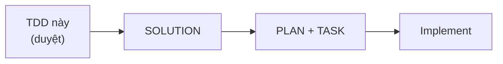
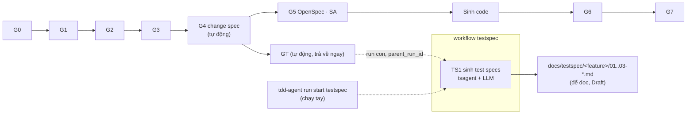
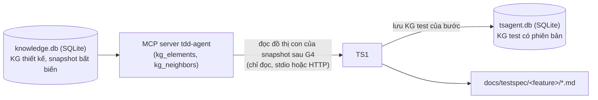
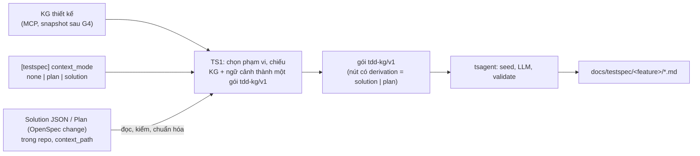
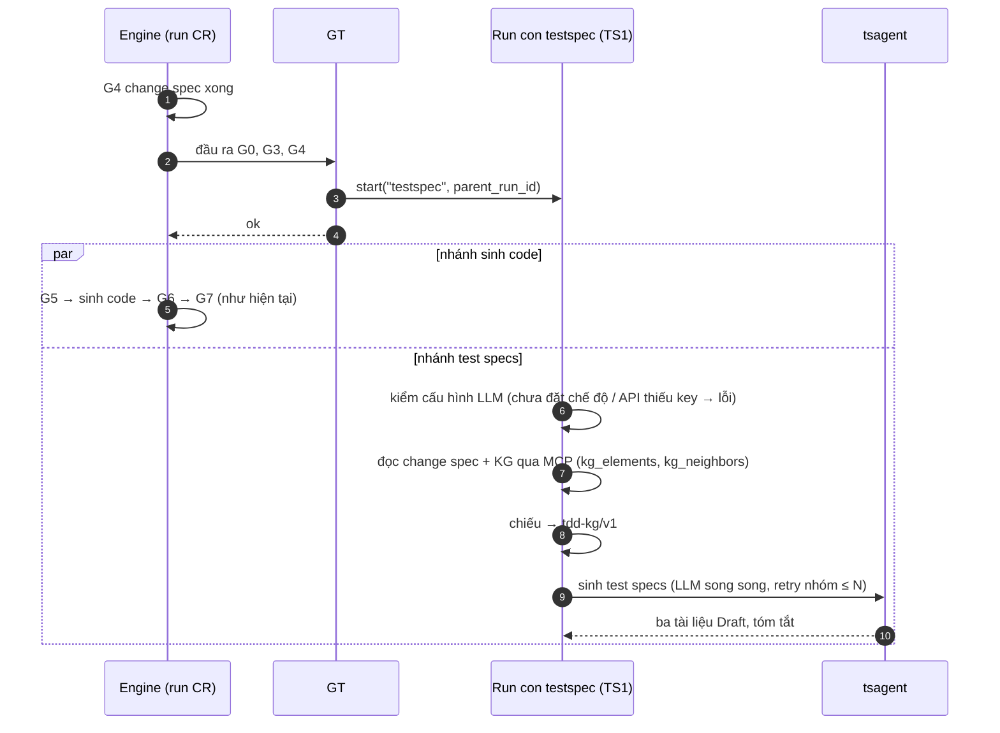
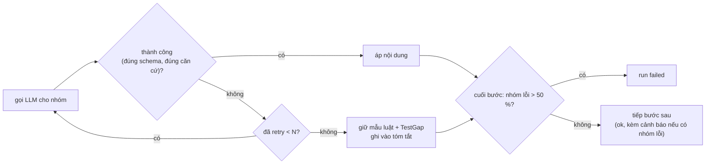

# Đưa tsagent vào workflow của tdd-agent: TDD

Oct 13, 2026 · Bản 0.6 (0.5 đã duyệt; 0.6 đổi cách đọc KG thiết kế sang MCP theo yêu cầu chủ dự án; hiện thực theo [SOLUTION](SOLUTION-INTEGRATE-TDD-AGENT.md))

| Bản | Thay đổi |
| --- | --- |
| 0.1 | Hai module (exporter, cầu nối) và lệnh riêng: bỏ, vì tdd-agent đã có workflow engine |
| 0.2 | Một cổng GT sau G3; test specs duyệt ở G5; LLM mặc định `none` |
| 0.3 | GT sau G4, song song với nhánh sinh code; run con có cổng duyệt; bắt buộc LLM |
| 0.4 | Theo góp ý: GT **tự chạy khi G4 xong** (không người xác nhận); test specs **chỉ để đọc**, run con chỉ sinh tài liệu (bỏ cổng duyệt, không nối G6); **giữ** chế độ `none`, chỉ đổi mặc định sang `claude-cli`; nhóm lỗi được **retry, số lần cấu hình động**; chưa có change spec thì **chạy tay** |
| 0.5 | **Không có mặc định LLM**: chưa đặt `TSAGENT_LLM` (hoặc `[testspec] llm`) thì run dừng ngay với lỗi, người dùng tự chọn; retry nhóm mặc định 2 lần; run con `failed` khi hơn 50 % nhóm vẫn lỗi sau retry |
| 0.6 | **TS1 đọc KG thiết kế qua MCP** của tdd-agent (tool đọc `kg_elements`, `kg_neighbors`), không đọc thẳng `knowledge.db`; GT không đọc KG; MCP server cục bộ qua stdio (mặc định) hoặc ở xa qua HTTP + bearer token |
| **0.7 (đã hiện thực 2026-10-19)** | **Ngữ cảnh bổ sung cho test specs theo cấu hình** `[testspec] context_mode`: `plan` (đọc Plan của Request, một OpenSpec change: `tasks.md`, `specs/**/spec.md`, **`proposal.md`, `design.md`**) hoặc `solution` (đọc tài liệu Solution của Request, **kể cả chưa duyệt**); mỗi run **một chế độ**; mặc định `none` giữ nguyên hành vi 0.6. Tài liệu ngữ cảnh vào gói `tdd-kg/v1` như các nút bình thường (INT-ADR-12..15, 17, mục 5.4). **Thêm tool MCP `testspec_start`, `testspec_get`** để Orca gửi tài liệu và khởi chạy qua cầu `mcp.callTool` (INT-ADR-16, mục 6.1) |

## Cách đọc tài liệu

Tài liệu mô tả **thiết kế** việc sinh test specs bằng tsagent như một nhánh của workflow `change-request` có sẵn trong tdd-agent: khi bảng change spec (G4) xong, test specs được sinh tự động, song song với việc viết OpenSpec và sinh code, để người dùng đọc. Tài liệu không đi xuống chi tiết cài đặt.



Mã trong tài liệu có tiền tố `INT-`.

---

## 1. Tài liệu và nguồn

### 1.1 Hiện trạng workflow của tdd-agent

tdd-agent có **workflow engine theo cổng** (`src/tdd_agent/orchestrator/`): workflow (`FlowDef`) là dãy cổng (`GateDef`); mỗi cổng có hàm thực thi nhận `GateContext` (đọc KG, đọc đầu ra cổng trước), có thể cần người duyệt, có `depends_on`, băm đầu vào (cổng cũ khi đầu vào đổi), chạy tiếp được; run có thể có **run cha** (`parent_run_id`). Lệnh chung `tdd-agent run start <flow> --request <file.json>` khởi chạy một workflow bất kỳ. Workflow `change-request` (`agents/flows.py`):

| Cổng | Việc | Duyệt |
| --- | --- | --- |
| G0 | Tiếp nhận CR, đề xuất sửa SRS | tự động |
| G1 | SRS delta | BA |
| G2 | Tác động lên các TDD | SA/Dev |
| G3 | Hiện thực TDD mới (snapshot KG mới) | tự động |
| **G4** | **Bảng change spec** (`ChangeSpecItem`: `srs_refs`, `tdd_refs`, `cr_acceptance_refs`, `code_target`, `verification`) | **tự động** |
| G5 | Viết OpenSpec, publish → đầu vào sinh code | SA |
| G6 | Kết quả test thật (`TestReceipt`) | bằng chứng |
| G7 | Nghiệm thu | BA/owner |

### 1.2 Phạm vi

Trong phạm vi:
- **Nhánh test specs** trong `change-request`: tự bắt đầu khi G4 xong, chạy song song với G5 và sinh code, sinh ba tài liệu test specs để người dùng đọc.
- Workflow `testspec` chạy được tay (khi chưa có change spec, hoặc muốn sinh lại).
- Mặc định LLM và retry theo nhóm của tsagent.

Ngoài phạm vi (giai đoạn này): duyệt và baseline test specs trong workflow; nối test specs với G6 (TC cần chạy, receipt); tsagent chạy test thật; sửa ontology tdd-agent; sinh test specs tự động trong `init`/`generate`.

### 1.3 Tài liệu nguồn

| Mã | Tài liệu |
| --- | --- |
| DOC-01 | `src/tdd_agent/agents/flows.py`, `orchestrator/model.py`, `context.py`, `engine.py`, `agents/changespec.py`, `cli.py` |
| DOC-02 | `docs/CLI_Project_Usage.md` |
| DOC-03 | Ontology tdd-agent: `data/ontology_v0.4/o4/*.yaml`, `data/ontology_v0.5/o5/*.v0.6.json` |
| DOC-04 | [../TDD-TSAGENT-v2.md](../TDD-TSAGENT-v2.md), [../ONTOLOGY-TDD.md](../ONTOLOGY-TDD.md) |

### 1.4 Thuật ngữ

| Từ | Nghĩa |
| --- | --- |
| **GT** | Cổng mới trong `change-request` ("Gate Test"): khi G4 xong, khởi chạy run con sinh test specs rồi trả về ngay |
| Workflow `testspec` | Workflow mới một cổng (**TS1**: sinh test specs); chạy làm run con của CR, hoặc chạy tay |
| Nhánh sinh code | G5 (OpenSpec) và việc implement theo OpenSpec |
| Phép chiếu | Chuyển KG thiết kế (+ change spec) sang gói `tdd-kg/v1` của tsagent |
| Nhóm | Đơn vị một lượt gọi LLM của tsagent (một chủ thể ở tầng A, một chủ thể ở tầng B, một tập test ở tầng C) |
| Feature | Đơn vị một bộ test specs; = TDD bị ảnh hưởng (CR) hoặc TDD được chỉ định (chạy tay) |

---

## 2. Ràng buộc và giả định

### 2.1 Ràng buộc

| Mã | Ràng buộc |
| --- | --- |
| INT-CON-01 | Dùng workflow engine có sẵn (cổng, run con, chạy tiếp, `run start`); không thêm bộ điều phối hay lệnh CLI mới |
| INT-CON-02 | Nhánh test specs **không chặn** G5, sinh code, G6, G7 |
| INT-CON-03 | Hai KG giữ hai tệp SQLite riêng; nhánh test specs chỉ đọc KG thiết kế, và **chỉ qua tool đọc MCP** của tdd-agent |
| INT-CON-04 | Đầu vào tsagent là gói `tdd-kg/v1`, qua bộ kiểm I1–I8 |
| INT-CON-05 | **Không có chế độ LLM mặc định**: người dùng phải đặt tường minh (`claude-cli`, `anthropic`, `openai`, hoặc `none`); chưa đặt thì run dừng ngay |
| INT-CON-06 | Không bịa: chỗ THIẾU của tdd-agent không thành giá trị ở phía test |

### 2.2 Giả định

| Mã | Giả định | Nếu sai |
| --- | --- | --- |
| INT-ASM-01 | Máy chạy tdd-agent có Claude Code đăng nhập (tdd-agent vốn cần) | Cấu hình provider API kèm key |
| INT-ASM-02 | KG v0.4 đủ chi tiết cho phần tử trong phạm vi change spec | Gửi kèm TDD md làm nguồn bổ sung |
| INT-ASM-03 | Mã phần tử ổn định qua snapshot; đổi tên dùng `supersedes` | Test specs coi phần tử đổi tên là mới |

---

## 3. Kiến trúc và module

### 3.1 Tổng quan



- GT khởi chạy run con rồi trả `ok` ngay; engine đi tiếp G5 trong khi run con chạy.
- Run con kết thúc khi ba tài liệu đã ghi; test specs ở trạng thái Draft, không có bước tiếp theo trong workflow.
- Chạy tay: `tdd-agent run start testspec --request <file>` (TDD chỉ định, không cần CR).

### 3.2 Module

| Mã | Module | Vị trí (đề xuất) | Trách nhiệm |
| --- | --- | --- | --- |
| INT-MOD-01 | **Nhánh test specs** | `src/tdd_agent/agents/testspec.py` | Cổng GT (khởi chạy run con); workflow `testspec` với TS1: xác định phạm vi (theo change spec, hoặc theo TDD khi chạy tay), chiếu sang `tdd-kg/v1`, kiểm cấu hình LLM, gọi tsagent trong tiến trình, trả tóm tắt |
| INT-MOD-02 | **Cấu hình LLM bắt buộc và retry nhóm của tsagent** | `src/tsagent/config.py`, `src/tsagent/analyze/fill.py`, `src/tsagent/stepfill.py` | Bỏ mặc định `none`: chưa đặt `TSAGENT_LLM` → lỗi khi khởi tạo; provider API thiếu key/model → lỗi khi khởi tạo; retry mỗi nhóm lỗi tối đa N lần (mặc định 2, cấu hình động); quá nửa số nhóm lỗi → run lỗi |
| — | Sửa nhỏ | `agents/flows.py` | Khai GT sau G4 trong `change-request`; khai workflow `testspec` |

---

## 4. Quyết định

### 4.1 Quyết định

| Mã | Quyết định | Lý do |
| --- | --- | --- |
| INT-ADR-01 | Test specs là **nhánh của workflow có sẵn**, bắt đầu khi **G4 xong**, không cần người xác nhận | G4 vốn tự động; change spec là đơn vị cần kiểm chứng |
| INT-ADR-02 | Chạy **song song** với G5 và sinh code qua **run con** (`parent_run_id`); GT trả về ngay | Không kéo dài đường găng của CR; engine đã có run cha-con |
| INT-ADR-03 | Giai đoạn này test specs **chỉ để đọc**: run con chỉ sinh tài liệu (Draft), không duyệt, không baseline, không nối G6 | Theo yêu cầu; duyệt và nối G6 làm sau khi người dùng đánh giá chất lượng |
| INT-ADR-04 | Phạm vi = phần tử do change spec tham chiếu (`srs_refs`, `tdd_refs`) + láng giềng làm ngữ cảnh; tiêu chí CR thành tiêu chí chấp nhận của yêu cầu | Đúng phần CR đổi; mỗi tiêu chí CR có điều kiện kiểm |
| INT-ADR-05 | Chưa có change spec → **chạy tay** workflow `testspec` bằng `tdd-agent run start`, phạm vi là một TDD | Không thêm lệnh; `init`/`generate` không tự sinh test specs |
| INT-ADR-06 | **Không có mặc định LLM**: bỏ mặc định `none`, không thay bằng mặc định nào khác. Chưa đặt `TSAGENT_LLM` (tsagent độc lập) hoặc `[testspec] llm` (trong workflow) thì run **dừng ngay** với lỗi `LLM_NOT_CONFIGURED`, nêu các giá trị hợp lệ. `none` vẫn dùng được khi đặt tường minh | Tránh rủi ro người dùng không biết mình đang gọi LLM (tốn lượt) hay chỉ chạy luật (tài liệu nghèo); buộc chọn chủ động |
| INT-ADR-07 | Provider API (`anthropic`, `openai`) **thiếu key hoặc model → lỗi ngay** khi khởi tạo, không rơi về chế độ khác; `claude-cli` giữ hành vi hiện tại | Lỗi cấu hình lộ sớm, không âm thầm sinh tài liệu kém |
| INT-ADR-08 | Nhóm gọi LLM lỗi (lỗi tạm thời, hoặc đầu ra sai sau lượt sửa) được **retry tối đa N lần**, **mặc định N = 2**, N đọc từ cấu hình mỗi run (không sửa mã, không khởi động lại); hết N lần thì nhóm giữ mẫu luật + TestGap, tóm tắt nêu nhóm lỗi. Sau retry, **hơn 50 % số nhóm của một bước vẫn lỗi → run `failed`**; ngược lại run `ok` kèm cảnh báo | Tăng tỉ lệ nhóm có nội dung LLM; vài nhóm lỗi không làm hỏng cả run, nhưng lỗi diện rộng (provider hỏng, prompt sai) phải lộ ra |
| INT-ADR-09 | Gọi tsagent **trong tiến trình**; LLM gọi song song (`parallel`) | Cùng gói cài; 4 luồng giảm thời gian khoảng 4 lần |
| INT-ADR-10 | Phép chiếu nằm trong INT-MOD-01; bảng ánh xạ là **dữ liệu** | Một chỗ biết cả hai ontology; ontology tdd-agent còn đổi |
| INT-ADR-11 | TS1 **đọc KG thiết kế qua MCP server của tdd-agent** (tool đọc), không mở `knowledge.db`. Mặc định chạy server của chính dự án qua stdio (`tdd-agent -C <dự án> mcp serve`); `[testspec] kg_mcp` trỏ server ở xa (HTTP, bearer token). Thêm tool đọc `kg_elements` (nhiều phần tử theo mã / theo TDD / theo lớp, phân trang). Chỉ đọc đồ thị con của phạm vi | Tách nhánh test specs khỏi kho của tdd-agent: chạy được ở máy/container khác, dùng đúng hợp đồng, phân quyền, vết của MCP |
| INT-ADR-12 *(0.7)* | Test specs nhận thêm **ngữ cảnh** theo `[testspec] context_mode` = `none` (mặc định) \| `plan` \| `solution`. Chế độ **chỉ đọc từ cấu hình**, không đổi theo run; một run có thể ghi đè **đường dẫn** (`params.context_path`) và mã tham chiếu (`params.context_ref`), không ghi đè chế độ | Giống `llm`: một nguồn cấu hình rõ ràng, hành vi tái lập được; Orca chọn tài liệu từng Request mà không đụng chế độ |
| INT-ADR-13 *(0.7)* | Tài liệu ngữ cảnh được **chiếu thành nút của gói `tdd-kg/v1`** (Decision, Constraint, Assumption, OpenQuestion, Risk, AcceptanceCriterion), không nhét thành văn xuôi vào prompt | tsagent chỉ cho LLM trích mã nằm trong `allowedCodes` và buộc có bằng chứng; nút thật mới được trích, kiểm và truy vết (`basedOn`, `evidence`); luật seed có sẵn (điều kiện từ tiêu chí, TestGap từ giả định chưa xác nhận) tự áp dụng |
| INT-ADR-14 *(0.7)* | Chế độ `solution` chỉ dùng **phương án đã chọn** (không có thì phương án khuyến nghị, kèm cảnh báo) và **không yêu cầu Solution đã duyệt** (chưa duyệt thì chạy, ghi cảnh báo, giả định vẫn là đề xuất). Chế độ `plan` đọc **cả bốn phần** của OpenSpec change: câu **Done when** của task và **scenario** (tiêu chí kiểm chứng được), **`proposal.md`** (thay đổi và lý do) và **`design.md`** (quyết định, rủi ro, đánh đổi, ngoài phạm vi) | Phương án bị loại không phải thiết kế của thay đổi; chủ dự án chốt (2026-10-19) rằng Plan phải đọc cả `design.md` và `proposal.md`, và Solution chưa duyệt vẫn dùng được; các phần chỉ phục vụ quản lý (giờ ước tính, thứ tự task) thì không đọc |
| INT-ADR-15 *(0.7)* | Giữ nguyên **độ tin cậy** của nguồn: giả định **chưa xác nhận** thành `Assumption` (sinh TestGap), giả định không cần xác nhận thành `Constraint` có nhãn nguồn, câu hỏi mở chỉ **chặn** mới thành `OpenQuestion`; mọi nút ghi `derivation` = `solution` hay `plan` | Không biến lời đoán của AI thành yêu cầu; không để một câu hỏi vụn (phiên bản Go) chặn baseline cả yêu cầu |
| INT-ADR-16 *(0.7)* | Thêm hai tool MCP vào server tdd-agent: **`testspec_start`** (tool ghi: nhận tài liệu ngữ cảnh **trực tiếp trong lời gọi**, ghi vào `.tdd-agent/context/<loại>-<ref>/` sau khi kiểm tên tệp và dung lượng, rồi tạo run con `testspec`; trả `run_id`) và **`testspec_get`** (tool đọc: cấu hình hiệu lực, danh sách test specs, TestGap, nội dung ba tài liệu phân trang). Chạy tiếp và theo dõi bằng `run_dispatch`, `run_get` có sẵn | Orca chạy ở máy khác với repo của dự án và chỉ có cầu `mcp.callTool`; không có chỗ ghi tệp trước khi gọi. Gửi nội dung trong lời gọi giúp Orca không cần quyền ghi tệp vào repo, và tdd-agent kiểm mọi thứ ở một chỗ |
| INT-ADR-17 *(0.7)* | **Một run, một chế độ, do cấu hình quyết định.** `testspec_start` nhận `context.kind` (`solution` hoặc `plan`) nhưng kind phải **trùng** `[testspec] context_mode`; khác → lỗi `TESTSPEC_CONTEXT_MODE_MISMATCH` nêu chế độ đang cấu hình. `testspec_get` không tham số báo `context_mode` để Orca biết phải gửi tài liệu nào | Chủ dự án chốt chỉ chạy một chế độ; chính sách của dự án nằm ở cấu hình, không do bên gọi đổi |

### 4.2 Phương án đã loại

| Mã | Phương án | Lý do loại |
| --- | --- | --- |
| INT-ALT-01 | Exporter + cầu nối + lệnh riêng (0.1) | Lặp lại việc engine đã làm |
| INT-ALT-02 | GT sau G3 (0.2) | Chưa có change spec; nằm trên đường găng |
| INT-ALT-03 | Duyệt test specs (G5 ở 0.2, cổng TS2 ở 0.3) và nối G6 | Chưa cần ở giai đoạn này (INT-ADR-03) |
| INT-ALT-04 | Bỏ hẳn `none` | Còn cần cho test tự động và chạy thử |
| INT-ALT-07 | Mặc định `claude-cli` khi chưa đặt (bản 0.4) | Người dùng có thể vô tình gọi LLM thật (tốn lượt, cần đăng nhập) mà không biết; thay bằng bắt buộc đặt |
| INT-ALT-05 | Thiếu key tự rơi về `claude-cli`/`none` | Che lỗi cấu hình |
| INT-ALT-06 | Số lần retry cố định trong mã | Không chỉnh được theo provider và độ ổn định |
| INT-ALT-08 *(0.7)* | Dán Solution hoặc Plan vào prompt của tsagent dưới dạng văn bản tự do | LLM không trích được mã, bằng chứng không truy vết được, luật seed không thấy; đổi prompt cả nhánh LLM |
| INT-ALT-09 *(0.7)* | Cho phép cả hai chế độ cùng lúc trong một run | Hai nguồn có thể mâu thuẫn (Solution nói 405, Plan nói 200); khó giải thích nút nào do nguồn nào. Cần cả hai thì chạy hai lần, mỗi lần một chế độ |
| INT-ALT-10 *(0.7)* | Ghi Solution/Plan ngược vào KG thiết kế rồi để TS1 đọc qua MCP như cũ | Orca và tdd-agent không ghi ngược vào KG (quyết định T1.7 phía Orca); Solution và Plan là dữ liệu **của một Request**, không phải thiết kế đã duyệt |

---

## 5. Dữ liệu

### 5.1 Vào và ra

| Hướng | Dữ liệu | Nguồn hoặc đích |
| --- | --- | --- |
| Vào (CR) | Bảng change spec, snapshot KG sau G3, CR và tiêu chí GIVEN/WHEN/THEN | Đầu ra G4, G3, G0 của run cha |
| Vào (chạy tay) | Mã TDD, snapshot (mặc định: mới nhất) | Tệp request của `run start` |
| Vào | Cấu hình `[testspec]` | `.tdd-agent/config.toml` (đọc lúc chạy) |
| Vào *(0.7, tùy chọn)* | Ngữ cảnh: tài liệu Solution (JSON) hoặc Plan (thư mục OpenSpec change) của Request gây ra thay đổi | Tệp trong repo của dự án, trỏ bởi `[testspec] context_path` hoặc `params.context_path` (mục 5.4) |
| Trung gian | Gói `tdd-kg/v1` | Lưu kèm run con |
| Ra | KG test của bước GT, phiên bản test specs (Draft), mốc tới snapshot KG thiết kế đã đọc | `.tdd-agent/tsagent.db` (SQLite, mục 5.3) |
| Ra | Ba tài liệu | `docs/testspec/<feature>/` |
| Ra | Tóm tắt run con: số TR, TC, khoảng trống, nhóm lỗi sau retry, tệp | Kết quả run con (`run get`, `change status`) |

### 5.2 Nguyên tắc chiếu

Bảng đầy đủ thuộc SOLUTION.

| Nhóm tdd-agent (v0.4) | Thành tsagent |
| --- | --- |
| Requirement, QualityTarget (+ tiêu chí CR) | FunctionalRequirement, NonFunctionalRequirement, AcceptanceCriterion |
| Operation có method/path, ErrorCode, Message + Attribute | Endpoint, Response, Field |
| Interface, ExternalSystem, RoutePolicy, RateLimitProfile | Integration, ExternalParty, TimeoutPolicy/RetryPolicy, PartnerLimit |
| StateMachine, Transition | StateMachine, Transition |
| Module, Component, Flow/Scenario, Entity | Module, Scenario, DataEntity |
| OpenIssue, Assumption, Risk, Decision, Constraint | cùng nghĩa; THIẾU → câu hỏi mở chặn phần tử |
| Control, Job, Algorithm | Mechanism |
| Lớp v0.6 module 04 | Lớp Extended cùng tên |
| Cấu trúc tài liệu, vận hành | Không chiếu |

Mã không hợp lệ với tsagent được chuẩn hóa ổn định, giữ mã gốc. Phạm vi CR: phần tử do change spec tham chiếu là đối tượng kiểm; chạy tay: phần tử thuộc TDD chỉ định; láng giềng tới 2 bước là ngữ cảnh.

### 5.3 Đọc và lưu KG ở bước GT

Mức TDD chỉ chốt **đọc từ đâu, lưu vào đâu**; cách lấy snapshot của bước trước và cách ghi snapshot của bước này được làm rõ ở SOLUTION.



| Việc | Mức TDD |
| --- | --- |
| Đọc | TS1 đọc **một snapshot** KG thiết kế (lưu trong `.tdd-agent/knowledge.db`) **qua MCP server của tdd-agent**: snapshot tại thời điểm G4 xong (có thiết kế sau G3 và change spec của CR), hoặc snapshot chỉ định / mới nhất khi chạy tay. Chỉ đọc phần đồ thị cần cho phạm vi; snapshot bất biến nên chạy song song với G5 vẫn đọc đúng. GT không đọc KG, chỉ chuyển mã snapshot |
| Lưu | Kết quả của bước GT được **lưu xuống SQLite** `.tdd-agent/tsagent.db` (tệp riêng, INT-CON-03): KG nguồn đã chiếu (baseline nguồn, bất biến), KG test (obligation, điều kiện, TR, coverage, TC…) thành một **phiên bản** test specs, và mốc liên kết tới snapshot KG thiết kế đã đọc. Chạy lại cùng đầu vào không tạo phiên bản mới; change spec đổi thì tạo phiên bản kế tiếp, giữ phiên bản cũ |
| Truy ngược | Từ một phiên bản test specs biết được snapshot KG thiết kế, run CR và change spec đã sinh ra nó |
| Để cho SOLUTION | Cách GT nhận mã snapshot của bước trước và truyền sang run con; cách đọc đồ thị của snapshot; cách chọn phạm vi từ change spec; lược đồ bảng và cách ghi mốc liên kết; cách chạy lại không tạo phiên bản thừa |

### 5.4 Ngữ cảnh bổ sung: Plan hoặc Solution *(0.7)*

Test specs hiện chỉ biết **KG thiết kế** (SRS, SAD, TDD) và tiêu chí CR. Khi thay đổi đến từ một Request của Orca, hai tài liệu của Request đó chứa điều test specs đang phải hỏi lại: định dạng phản hồi, hành vi với method khác, ràng buộc đã chốt, rủi ro, câu hỏi chưa trả lời. Mục này chốt **hai chế độ** đưa chúng vào, theo `[testspec] context_mode`.

| | `solution` | `plan` |
| --- | --- | --- |
| Tài liệu | Solution của Request (JSON như Orca lưu), **đã duyệt hay chưa đều dùng được** | Plan của Request: OpenSpec change (`tasks.md`, `specs/**/spec.md`, `proposal.md`, `design.md`) |
| Lấy gì | Phương án **đã chọn**: quyết định, giả định, câu hỏi chặn, rủi ro; tiêu chí chấp nhận của Request và độ phủ | Câu **Done when** của từng task (kèm `Code:` và `Verify:`); **scenario** GIVEN/WHEN/THEN; từ `proposal.md`: thay đổi, lý do, tác động, rollback; từ `design.md`: quyết định, rủi ro/đánh đổi, ngoài phạm vi |
| Cho test specs biết | **Vì sao và với giả định nào**: ràng buộc đã chốt, điều chưa xác nhận | **Kiểm bằng cách nào và ở đâu** (file/ký hiệu đích, lệnh kiểm, câu kiểm chứng được) và **thiết kế đã chọn** (quyết định, đánh đổi, rủi ro đã nêu) |
| Hiệu ứng chính | Giả định chưa xác nhận và câu hỏi chặn thành TestGap có chủ; giả định đã chốt thành sự thật cho oracle; rủi ro thành điều kiện lỗi và ưu tiên; tiêu chí thành điều kiện `stated` | Mỗi Done when và scenario thành một tiêu chí chấp nhận: có điều kiện `stated`, hết TestGap "chưa có tiêu chí chấp nhận"; quyết định thiết kế thành ngữ cảnh có thể trích; mục trong "Rủi ro / Đánh đổi" ghi là giả định thì thành TestGap, còn lại thành rủi ro |
| Tin cậy | Lời AI đã được người duyệt; phần `needs_confirmation` vẫn là giả định | Cũng do AI viết, đã qua cổng duyệt Plan; chưa chạy nên là kỳ vọng, không phải kết quả |



Nguyên tắc (chi tiết ở SOLUTION mục 14):

- `none` (mặc định): không đọc gì thêm; gói giống từng byte bản 0.6.
- Ngữ cảnh gắn vào **yêu cầu trong phạm vi** mà tài liệu nêu tên (mã `FR-…`, `BRL-…`); mục không nêu yêu cầu nào thì gắn vào yêu cầu chính (yêu cầu đầu tiên tài liệu nêu, hoặc yêu cầu duy nhất của phạm vi); không gắn được thì **liệt kê trong tóm tắt, không đoán**.
- Mã nút của ngữ cảnh mang mã tham chiếu của Request (`REQ-2`): `ADR-REQ-2-opt-1`, `ASM-REQ-2-A-2`, `AC-REQ-2-T1-1`. Chạy lại cùng tài liệu cho cùng gói (xác định).
- Tài liệu ngữ cảnh đổi (băm khác) thì GT và TS1 chạy lại như khi change spec đổi (INT-FR-12).
- Ngữ cảnh **không** ghi ngược vào KG thiết kế và không đổi baseline nguồn của KG.

---

## 6. Giao tiếp

Không thêm lệnh:

| Lệnh có sẵn | Người dùng thấy |
| --- | --- |
| `tdd-agent change start/advance` | Khi G4 xong, run con test specs tự chạy; run CR đi tiếp G5 |
| `tdd-agent change status` | Thêm dòng trạng thái run con (đang sinh, xong + đường dẫn tài liệu, lỗi + lý do) |
| `tdd-agent run start testspec --request req.json` | Chạy tay; `req.json` ví dụ `{"params": {"tdd": "TDD-01"}}` |
| `tdd-agent run get <run>` | Tóm tắt run con |

### 6.1 Tool MCP cho Orca *(0.7)*

Hai tool mới trên server `tdd-agent mcp serve`; Orca gọi qua cầu `mcp.callTool` của Dev Server Agent cùng các tool có sẵn (`run_dispatch`, `run_get`, `run_list`, `run_cancel`). Chi tiết lược đồ ở SOLUTION mục 14.13.

| Tool | Loại | Việc |
| --- | --- | --- |
| `testspec_start(tdd?, snapshot?, context, external?)` | ghi (cần `[mcp] write = true`) | Nhận tài liệu ngữ cảnh trong lời gọi, ghi vào `.tdd-agent/context/<loại>-<ref>/`, tạo run con `testspec`; trả `run_id`. Không chạy: Orca gọi `run_dispatch` |
| `testspec_get(feature?, document?, offset?)` | đọc | Cấu hình hiệu lực (có `context_mode`), danh sách test specs, TestGap, nội dung ba tài liệu |

```mermaid
sequenceDiagram
  autonumber
  participant O as Orca (request-service)
  participant A as Dev Server Agent (mcp.callTool)
  participant M as MCP tdd-agent
  O->>A: testspec_get()
  A->>M: testspec_get
  M-->>O: config.context_mode = solution | plan
  O->>A: testspec_start(context = {kind = context_mode, ref, document / files})
  A->>M: testspec_start
  M->>M: kiểm kind = context_mode, LLM, tên tệp; ghi .tdd-agent/context/…
  M-->>O: run_id, context {path, sha256}
  O->>A: run_dispatch(run_id)
  loop tới khi completed / blocked
    O->>A: run_get(run_id)
  end
  O->>A: testspec_get(feature, document = cases)
  M-->>O: ba tài liệu, TestGap
```

Orca lấy nội dung gửi đi từ chính dữ liệu của mình: Solution từ bản ghi của Request; các tệp của OpenSpec change qua `plan bundle` (REST `…/plan/bundle/file`). Không cần ghi tệp vào repo của dự án.

---

## 7. Yêu cầu

### 7.1 Yêu cầu chức năng

| Mã | Nội dung | Ưu tiên |
| --- | --- | --- |
| INT-FR-01 | Khi G4 xong, GT tự khởi chạy run con test specs và trả về ngay, không cần người xác nhận | Must |
| INT-FR-02 | G5, sinh code, G6, G7 không chờ và không phụ thuộc run con | Must |
| INT-FR-03 | TS1 chiếu phạm vi sang gói `tdd-kg/v1` hợp lệ (I1–I8); lớp không chiếu được liệt kê trong tóm tắt | Must |
| INT-FR-04 | TS1 sinh ba tài liệu test specs vào `docs/testspec/<feature>/` (Draft); run con kết thúc ở đó | Must |
| INT-FR-05 | Workflow `testspec` chạy tay được qua `tdd-agent run start` với một TDD, không cần CR | Must |
| INT-FR-06 | Chưa đặt chế độ LLM (`TSAGENT_LLM` hoặc `[testspec] llm`) → run dừng ngay trước mọi bước, lỗi `LLM_NOT_CONFIGURED` nêu các giá trị hợp lệ; `none` chạy được khi đặt tường minh | Must |
| INT-FR-07 | Provider API thiếu key hoặc model → lỗi ngay khi khởi tạo, nêu biến cần đặt | Must |
| INT-FR-08 | `claude-cli` giữ hành vi hiện tại | Must |
| INT-FR-09 | Nhóm lỗi được retry tối đa N lần (mặc định 2); N cấu hình được lúc chạy; hết N lần thì nhóm giữ mẫu luật + TestGap và được nêu trong tóm tắt | Must |
| INT-FR-14 | Sau retry, hơn 50 % số nhóm của một bước vẫn lỗi → run `failed` (nêu số nhóm lỗi và lỗi đại diện); ngược lại `ok` kèm cảnh báo | Must |
| INT-FR-10 | Mỗi tiêu chí CR của dòng change spec có ít nhất một điều kiện kiểm; thiếu thì nêu trong tóm tắt | Should |
| INT-FR-11 | THIẾU thành câu hỏi mở chặn phần tử, có owner | Must |
| INT-FR-12 | Change spec đổi (G4 chạy lại) → GT khởi chạy run con mới; tsagent cập nhật phiên bản tại chỗ | Should |
| INT-FR-13 | Tắt nhánh test specs bằng cấu hình; khi tắt, workflow như hiện tại | Should |
| INT-FR-15 *(0.7)* | `[testspec] context_mode` ∈ {`none`, `plan`, `solution`}, mặc định `none`; `none` cho gói và test specs **giống từng byte** bản 0.6; giá trị khác → `CONFIG_INVALID` | Must |
| INT-FR-16 *(0.7)* | `solution`: đọc tài liệu Solution (JSON), chỉ lấy **phương án đã chọn** (không có thì phương án khuyến nghị, kèm cảnh báo), giả định, câu hỏi chặn, rủi ro, tiêu chí chấp nhận; chiếu thành nút của gói theo bảng ở SOLUTION 14.5 | Must |
| INT-FR-17 *(0.7)* | `plan`: đọc `tasks.md`, `specs/**/spec.md`, **`proposal.md`** và **`design.md`** của OpenSpec change. Mỗi câu Done when và mỗi scenario thành một `AcceptanceCriterion` của yêu cầu nó phục vụ (mang `Code:`, `Verify:`, `Serves:`); `proposal.md` thành một `Decision` (thay đổi, lý do, tác động, rollback); mỗi quyết định trong `design.md` thành một `Decision`; mục "Rủi ro / Đánh đổi" thành `Risk`, mục ghi là giả định thành `Assumption`; "Ngoài phạm vi" thành `Constraint`. Thiếu `proposal.md` hoặc `design.md` thì cảnh báo, không dừng (`tasks.md` bắt buộc) | Must |
| INT-FR-18 *(0.7)* | Thiếu tài liệu, sai định dạng hay đường dẫn ra ngoài repo → run dừng với `TESTSPEC_CONTEXT_MISSING`, `TESTSPEC_CONTEXT_INVALID`, `TESTSPEC_CONTEXT_PATH` (không rơi về `none`) | Must |
| INT-FR-19 *(0.7)* | Mục không gắn được vào yêu cầu nào được liệt kê trong tóm tắt (`context.unanchored`); điều tài liệu không có (task thiếu Done when, giải pháp chưa duyệt, snapshot lệch) được nêu trong `context.notes`; không có giá trị nào bị bịa | Must |
| INT-FR-20 *(0.7)* | Băm của tài liệu ngữ cảnh (chế độ, đường dẫn, sha256 nội dung) vào `extra_inputs` của GT và TS1; tài liệu đổi thì chạy lại; `origin.context` trong `tsagent.db` ghi mốc; đổi qua lại giữa các đầu vào không để Draft giữ kết quả của run ghi trước đó (tsagent chạy lại thay vì trả run cũ) | Should |
| INT-FR-21 *(0.7)* | Solution chưa `approved` vẫn dùng được: chạy bình thường, `context.notes` nêu trạng thái, giả định vẫn là đề xuất (không thành sự thật) | Must |
| INT-FR-22 *(0.7)* | MCP `testspec_start`: nhận `context` gồm `kind` (`solution`\|`plan`), `ref` và đúng một trong `document` (Solution JSON), `files` (tên tệp → nội dung của OpenSpec change), `path` (tệp đã có trong repo); kiểm `kind` trùng `[testspec] context_mode` (`TESTSPEC_CONTEXT_MODE_MISMATCH`), `enabled`, cấu hình LLM (lỗi trả ngay, **không tạo run**); ghi tài liệu vào `.tdd-agent/context/<kind>-<ref>/`; tạo run con `testspec` mang `params.context_path`, `params.context_ref`; trả `run_id`, mốc tài liệu (đường dẫn, sha256, tệp). Có `external` thì gọi lại cùng `executionId`+`stepId` và cùng sha256 trả **run cũ** (`reused: true`), không tạo run mới | Must |
| INT-FR-23 *(0.7)* | MCP `testspec_get`: không tham số → `{config: {enabled, llm, context_mode, specs_dir}, features: [...]}`; có `feature` → phiên bản, trạng thái, số TR/TC/TestGap, danh sách TestGap (mã, câu hỏi, chủ, mục bị chặn), khối `context` của lần chạy mới nhất; có `feature` + `document` (`requirements`\|`design`\|`cases`) → nội dung markdown phân trang `offset`/`next` như các tool đọc khác | Must |
| INT-FR-24 *(0.7)* | Tên tệp và dung lượng của tài liệu gửi qua `testspec_start` bị kiểm: chỉ `solution.json`, `tasks.md`, `proposal.md`, `design.md`, `specs/<tên>/spec.md`; không `..`, không đường dẫn tuyệt đối, không symlink; tối đa 256 KiB mỗi tệp, 40 tệp, 2 MiB cả lời gọi; sai → `TESTSPEC_CONTEXT_FILE` hoặc `TESTSPEC_CONTEXT_TOO_LARGE`, không ghi gì | Must |

### 7.2 Yêu cầu phi chức năng

| Mã | Nội dung | Chỉ tiêu (đề xuất) |
| --- | --- | --- |
| INT-NFR-01 | GT không làm chậm đường găng G4 → G5 | GT ≤ 2 s |
| INT-NFR-02 | Thời gian TS1 với `claude-cli`, 4 luồng, CR cỡ CR-001 MiniPay | ≤ 20 phút (E2E đo 13 phút) |
| INT-NFR-03 | Lỗi cấu hình LLM (chưa đặt chế độ, thiếu key/model) báo trước lượt gọi LLM đầu tiên | 100 % |
| INT-NFR-04 | Đổi số lần retry có hiệu lực từ run kế tiếp mà không sửa mã hay khởi động lại | 100 % |
| INT-NFR-05 | Xác định: cùng đầu vào + cấu hình → cùng gói; chạy lại không tạo phiên bản mới | 100 % |
| INT-NFR-06 | Lỗi run con không làm hỏng trạng thái run CR | 0 |

---

## 8. Luồng xử lý

### 8.1 INT-SCN-01: CR có test specs song song



### 8.2 INT-SCN-02: chạy tay (chưa có change spec)

```
tdd-agent run start testspec --request req.json      # {"params": {"tdd": "TDD-01"}}
tdd-agent run get <run>
```

Phạm vi là phần tử thuộc TDD chỉ định; còn lại như INT-SCN-01.

### 8.3 INT-SCN-03: nhóm lỗi và retry



Mặc định N = 2 (`group_retries`). Lỗi cấu hình hoặc xác thực (chưa đặt chế độ LLM, thiếu key, 401/403, chưa đăng nhập) **không** retry: dừng run con ngay với lỗi rõ.

---

## 9. Cơ chế

| Mã | Cơ chế | Đáp ứng |
| --- | --- | --- |
| INT-MECH-01 | GT khởi chạy run con (`parent_run_id`), trả về ngay | INT-FR-01, 02, INT-NFR-01 |
| INT-MECH-02 | Kiểm cấu hình LLM khi khởi tạo: chế độ đã đặt; provider API có key, model | INT-FR-06, 07, INT-NFR-03 |
| INT-MECH-03 | Retry theo nhóm (N mặc định 2, đọc từ cấu hình mỗi run); ngưỡng 50 % nhóm lỗi mỗi bước | INT-FR-09, 14, INT-NFR-04 |
| INT-MECH-04 | `extra_inputs` của GT gồm băm change spec, bảng ánh xạ, cấu hình → change spec đổi thì GT chạy lại | INT-FR-12, INT-NFR-05 |
| INT-MECH-05 | Gói xác định + `runKey` của tsagent | INT-NFR-05 |
| INT-MECH-06 | THIẾU → OpenQuestion + `blockedBy` | INT-FR-11 |
| INT-MECH-07 | Client MCP của TS1 (stdio cục bộ / HTTP + token), tool đọc `kg_elements` | INT-ADR-11 |
| INT-MECH-08 *(0.7)* | Bộ đọc ngữ cảnh (`agents/testspec/context.py`): đọc, kiểm và chuẩn hóa Solution/Plan thành danh sách mục; không gọi mô hình, không gọi mạng | INT-FR-16, 17, 18 |
| INT-MECH-09 *(0.7)* | Phép chiếu thêm nút ngữ cảnh sau khi chiếu KG: gắn theo mã yêu cầu được nêu; tsagent không đổi (dùng luật seed `rule_fr`, `rule_assumptions`, `rule_risk` và gói ngữ cảnh có sẵn) | INT-ADR-13, 15, INT-FR-19 |
| INT-MECH-10 *(0.7)* | Hai tool MCP `testspec_start` (ghi, tạo run con và chuyển `context_path`) và `testspec_get` (đọc); ghi tệp ngữ cảnh an toàn (danh sách tên cho phép, kiểm dung lượng, ghi nguyên tử); tái dùng `run_start`, `run_dispatch`, `run_get`, `run_list` | INT-ADR-16, 17, INT-FR-22, 23, 24 |

---

## 10. Triển khai và cấu hình

Một gói cài có cả `tdd-agent` và `tsagent`. Mục mới trong `.tdd-agent/config.toml` (đọc mỗi lần chạy):

```toml
[testspec]
enabled = true
llm = "claude-cli"     # BẮT BUỘC, không có mặc định: "claude-cli" | "anthropic" | "openai" (thiếu key/model → lỗi ngay) | "none" (chỉ luật)
parallel = 4           # số lượt gọi LLM song song
group_retries = 2      # số lần retry tối đa cho một nhóm lỗi (mặc định 2)
specs_dir = "docs/testspec"
kg_mcp = ""            # KG thiết kế đọc qua MCP: rỗng = server của dự án qua stdio; hoặc "https://host/mcp"
kg_mcp_token_env = "TDD_AGENT_MCP_TOKEN"   # biến chứa bearer token khi kg_mcp là HTTP
```

Thiếu dòng `llm` thì run con dừng ngay với `LLM_NOT_CONFIGURED`. Với `llm = "none"` (đặt tường minh): run chạy hết bằng luật, không gọi LLM, nên không có retry và không áp ngưỡng 50 %; nội dung là mẫu luật, chỗ thiếu nội dung thành TestGap; tóm tắt và đầu tài liệu ghi rõ `llm: none` để người đọc biết tài liệu chưa qua LLM. Tương ứng khi chạy tsagent độc lập: `TSAGENT_LLM` (**bắt buộc**, không còn mặc định), `TSAGENT_LLM_PARALLEL`, biến mới `TSAGENT_LLM_GROUP_RETRIES` (mặc định 2). Test tự động của tsagent đặt `TSAGENT_LLM=none` tường minh.

---

## 11. Rủi ro và câu hỏi mở

### 11.1 Rủi ro

| Mã | Rủi ro | Giảm thiểu |
| --- | --- | --- |
| INT-RISK-01 | Chi phí LLM mỗi CR (khoảng 100 lượt cho CR cỡ CR-001), cộng retry | Phạm vi theo change spec; cache; trần lượt; `group_retries` nhỏ |
| INT-RISK-02 | Máy CI không có Claude Code đăng nhập | Cấu hình provider API kèm key; lỗi rõ khi thiếu |
| INT-RISK-03 | Ontology tdd-agent đổi làm hỏng phép chiếu | Test hợp đồng trên fixture PBOM; phiên bản bảng ánh xạ trong `extra_inputs` |
| INT-RISK-04 | Retry làm run con lâu khi provider quá tải | Retry vẫn qua breaker và backoff của tsagent; tóm tắt nêu số lượt |
| INT-RISK-05 | Bỏ mặc định làm lệnh `tsagent gen`/`serve` cũ (không đặt `TSAGENT_LLM`) và cấu hình Docker hiện có dừng lại | Lỗi nêu rõ giá trị hợp lệ; cập nhật README, `.env.example`, compose (đặt tường minh); test tự động đặt `none` |
| INT-RISK-06 *(0.7)* | Lời đoán của AI trong Solution (giả định) bị coi là yêu cầu và thành điều kiện kiểm cứng | Chỉ giả định **không cần xác nhận** thành `Constraint` có nhãn `confirmed-assumption`; giả định cần xác nhận thành `Assumption` (TestGap); mọi nút ghi `derivation`; test specs vẫn là Draft |
| INT-RISK-07 *(0.7)* | Tài liệu ngữ cảnh lệch KG: Solution đọc snapshot khác snapshot TS1 đọc, hoặc Plan viết cho bản Solution cũ | Ghi `design_references.snapshot` và so với snapshot TS1; lệch thì cảnh báo trong `context.notes`; băm tài liệu vào `extra_inputs` |
| INT-RISK-08 *(0.7)* | Câu Done when mô tả việc làm ("tests pass"), không mô tả hành vi, sinh điều kiện nhiễu | Ưu tiên scenario; đo chất lượng ở TC-66 trước khi mở rộng; chế độ `plan` chỉ đọc Done when và scenario |
| INT-RISK-09 *(0.7)* | Thêm nút ngữ cảnh làm gói ngữ cảnh của LLM vượt giới hạn ký tự và bị cắt | Nút ngữ cảnh ngắn (cắt 600 ký tự, `approach` 1200); `satisfiedBy`, `constrainedBy` là neighbour ưu tiên thấp nên bị bỏ trước, tiêu chí (`hasAcceptance`) không bao giờ bị bỏ trước |
| INT-RISK-10 *(0.7)* | Văn bản do bên gọi gửi qua MCP (Solution, Plan viết bởi AI) chứa chỉ dẫn cài sẵn (prompt injection) hoặc bí mật | Văn bản chỉ thành **dữ liệu** của nút; gói ngữ cảnh gửi cho LLM bọc làm dữ liệu (`wrap_data`) và LLM chỉ được trích mã trong `allowedCodes`; cắt độ dài; bộ quét bí mật của tsagent chạy ở `validate`; tool ghi cần `[mcp] write = true` |
| INT-RISK-11 *(0.7)* | `testspec_start` bị lạm dụng để ghi tệp tùy ý hoặc đầy đĩa | Danh sách tên tệp cố định, chỉ ghi dưới `.tdd-agent/context/`, giới hạn dung lượng (INT-FR-24), ghi nguyên tử, không theo symlink; ghi nhật ký kiểm toán như các tool ghi khác |
| INT-RISK-12 *(0.7)* | Heuristic đọc `design.md` (mục "Rủi ro / Đánh đổi" chứa chữ "assum…" thì là giả định) nhận sai | Chỉ ảnh hưởng loại nút (TestGap hay Risk), không bịa nội dung; ghi trong `context.notes` số mục theo từng loại; đo ở TC-66 |

### 11.2 Đã chốt (2026-10-13)

| Câu hỏi | Chốt |
| --- | --- |
| G4 có cần người xác nhận trước GT? | Không; GT tự chạy khi G4 xong |
| Test specs có duyệt, nối G6? | Chưa; chỉ sinh để đọc |
| Bỏ `none`? | Không bỏ; bỏ **mặc định** |
| Chưa đặt chế độ LLM? | Dừng run ngay, người dùng tự đặt (không có mặc định) |
| Nhóm lỗi? | Retry tối đa N lần, N mặc định 2, cấu hình động |
| Nhiều nhóm lỗi sau retry? | Hơn 50 % nhóm của một bước → run `failed`; ít hơn → `ok` kèm cảnh báo |
| Chưa có change spec? | Chạy tay |

Không còn câu hỏi mở (tới bản 0.6).

### 11.3 Đã chốt cho bản 0.7 (2026-10-19)

| Câu hỏi | Chốt |
| --- | --- |
| Chế độ `solution` có bắt buộc Solution ở trạng thái `approved`? | **Không.** Solution chưa duyệt vẫn dùng được, ghi cảnh báo (INT-FR-21, INT-ADR-14) |
| Plan có đọc `design.md` và `proposal.md`? | **Có**, cùng `tasks.md` và `specs/**/spec.md` (INT-FR-17, INT-ADR-14) |
| Một thay đổi có Solution **và** Plan: chạy cả hai chế độ? | **Chỉ một chế độ mỗi run, do cấu hình quyết định** (INT-ADR-17, INT-ALT-09). Cần cả hai thì chạy hai lần |
| Solution/Plan tới từ đâu, Orca đưa vào thế nào? | **Qua MCP**: `testspec_start` nhận nội dung trong lời gọi (INT-ADR-16, INT-FR-22); không bắt Orca ghi tệp vào repo |

Còn mở: số liệu chất lượng của TC-66 (có đáng đưa vào quy trình mặc định không).

---

## 12. Truy vết và kiểm thử

| Yêu cầu | Luồng | Kiểm bằng (định hướng) |
| --- | --- | --- |
| INT-FR-01, 02 | INT-SCN-01 | CR mẫu T-14 (runner giả, LLM giả): GT trả về ngay; G5 chạy khi run con còn chạy; G6 không phụ thuộc |
| INT-FR-03, 04, 10, 11 | INT-SCN-01 | Gói qua I1–I8; ba tài liệu ghi ra; tiêu chí CR có điều kiện; THIẾU có TestGap |
| INT-FR-05 | INT-SCN-02 | `run start testspec` với `TDD-01` của fixture PBOM |
| INT-FR-06, 07, 08 | | Không đặt chế độ → lỗi `LLM_NOT_CONFIGURED` trước mọi bước; `anthropic` không key → lỗi khi khởi tạo; `claude-cli` như cũ; `none` tường minh chạy được |
| INT-FR-09, 14, INT-NFR-04 | INT-SCN-03 | LLM giả lỗi k lần: k ≤ N → nhóm có nội dung LLM; k > N → mẫu luật + TestGap; > 50 % nhóm lỗi → run `failed`; đổi N trong config có hiệu lực run sau |
| INT-FR-12 | | `change update` → run con mới, phiên bản test specs 2 |
| INT-FR-13 | | `enabled = false`: workflow như hiện tại |
| INT-NFR-02 | | Đo MiniPay CR-001 với `claude-cli`, 4 luồng |
| INT-FR-15 | | Mặc định `none` → gói giống từng byte bản 0.6; giá trị lạ → `CONFIG_INVALID` (TC-51, TC-62) |
| INT-FR-16 | | Solution mẫu của Request `REQ-2` (phương án đã chọn): nút Decision, Constraint, Assumption, OpenQuestion, Risk, AcceptanceCriterion đúng bảng; giả định chưa xác nhận → TestGap (TC-52, TC-53, TC-58, TC-59) |
| INT-FR-17 | | Plan mẫu (`tasks.md` + `spec.md`): mỗi Done when và scenario thành tiêu chí; TestGap `no-ac` của yêu cầu biến mất (TC-55, TC-56, TC-60) |
| INT-FR-18, 19 | | Thiếu/sai tài liệu, đường dẫn ngoài repo, mục không gắn được (TC-54, TC-57, TC-61) |
| INT-FR-21 | | Solution `status = draft` vẫn chạy, `notes` nêu trạng thái (TC-53) |
| INT-FR-22 | | `testspec_start` Solution/Plan inline: ghi đúng thư mục, tạo run con có `context_path`; sai `kind` → `TESTSPEC_CONTEXT_MODE_MISMATCH`; LLM chưa đặt → lỗi, không tạo run; gọi lại cùng `external` → `reused` (TC-67..TC-71) |
| INT-FR-23 | | `testspec_get` ba dạng và phân trang (TC-72) |
| INT-FR-24 | | Tên tệp lạ, `..`, tuyệt đối, vượt dung lượng → từ chối, không ghi gì (TC-73) |
| INT-ADR-16, 17 | | Luồng Orca giả: `testspec_start` → `run_dispatch` → `run_get` → `testspec_get` qua cầu MCP (TC-74) |
| INT-FR-20 | | Tài liệu đổi → GT/TS1 chạy lại; `origin.context` có sha256 (TC-64) |
| INT-ADR-14, INT-RISK-08 | | Đo trên repo `notes` với dữ liệu Request #2: số TestGap và số TC trước và sau, `claude-cli` (TC-65, TC-66) |

---

## Phụ lục: sau khi duyệt

| Bước | Tài liệu |
| --- | --- |
| 1 | `SOLUTION-INTEGRATE-TDD-AGENT.md`: cách lấy snapshot KG của bước trước và lưu KG/snapshot của bước GT (mục 5.3), bảng ánh xạ, chuẩn hóa mã, phạm vi theo change spec và theo TDD, khai báo GT và workflow `testspec` trong `flows.py`, đổi mặc định LLM và retry nhóm của tsagent, ca kiểm thử |
| 2 | `PLAN.md` + task có checklist |
