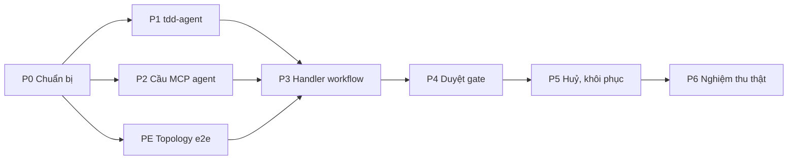

# PLAN — Tích hợp luồng agent kiểu tdd-agent vào Workflow Orca

| Trường | Giá trị |
|---|---|
| **Từ thiết kế** | [TDD-WF-AGENT-001](./TDD-WF-AGENT-001-workflow-agent-pipeline.md) v0.1 |
| **Danh sách task** | [TASKS.md](./TASKS.md) |
| **Ngày lập** | 2026-10-14 |
| **Trạng thái** | 🚧 Đang làm — 24/38 xong, 12 làm dở, 2 chưa làm (đánh giá 2026-10-14, chi tiết ở [TASKS.md](./TASKS.md#đánh-giá-2026-10-14)) |
| **Repo** | `orca` (nhánh gốc đề xuất: `feat/e2e-acceptance-fixes`), `tdd-agentic-ai` (nhánh `tasks/integrate-tetspec-agent`) |

## 1. Mục tiêu bàn giao

1. Ba template workflow chạy được trên Orca: **TDD generation**, **Test specs từ TDD có sẵn**, **Change request → TDD → Test specs** (G0..G7, có nhánh test specs song song).
2. Duyệt gate tdd-agent ngay trên Orca, gắn đúng `decision_hash` đã hiển thị.
3. Chịu được restart workflow-service và mất kết nối dev server ngắn; huỷ execution dừng run tdd-agent.
4. E2E chạy trên topology Docker tách máy (Orca một nơi, dev server một nơi), CI dùng AI stub và tdd-agent `llm=fake`.

## 2. Các giai đoạn

| Giai đoạn | Nội dung | Task | Điều kiện xong (DoD) |
|---|---|---|---|
| **P0 — Chuẩn bị** | Kiểm lại các điểm chưa chắc (Q1, Q9), chốt hợp đồng `mcp.callTool`, cờ tính năng | T0.1–T0.3 | Câu hỏi mở Q1, Q9 có câu trả lời ghi vào TDD; schema JSON của `mcp.callTool` được duyệt |
| **P1 — tdd-agent** | `run_dispatch`, `sources[].path`, `origin.external`, pid/heartbeat, client `orca-workflow` | T1.1–T1.5 | pytest `tdd-agentic-ai` xanh; gọi được qua `tdd-agent mcp serve` stdio bằng client MCP thử |
| **PE — Môi trường e2e tách máy** | Topology Docker §11.1, kiểm `TOP-01..07` | TE.1–TE.5 | `split-up.sh` dựng được từ máy sạch; `verify_topology.py` xanh với `--multi` |
| **P2 — Cầu MCP trên agent** | RPC `mcp.callTool`, allowlist, pool tiến trình, timeout infra-fleet | T2.1–T2.4 | Unit TS xanh; từ workflow-service gọi được `run_get` trên `devserver-a` trong topology PE |
| **P3 — Handler workflow** | `tddagentclient`, handler `start`, `advance`, `wait_child`, template TDD generation và Test specs | T3.1–T3.6 | Suite `TWA-01..06` xanh trên topology PE (AI stub, tdd-agent fake) |
| **P4 — Duyệt gate** | `step_approvals`, RPC duyệt, handler `approval`, `wait_evidence`, frontend, template Change request | T4.1–T4.8 | Suite `TWA-07..12` xanh; chạy CR G1..G7 qua UI (Playwright) |
| **P5 — Huỷ, khôi phục, vận hành** | `run_cancel`, heartbeat, metrics, khôi phục khi restart | T5.1–T5.5 | Suite `TWA-13..17` xanh |
| **P6 — Nghiệm thu thật** | Chạy MiniPay với claude-cli thật, đo thời gian, báo cáo | T6.1–T6.2 | Báo cáo nghiệm thu, các blocker còn lại có backlog |

Ngoài phạm vi kế hoạch này (giữ ở TDD §10 giai đoạn 4): chuyển sang bước `gate` của CR-WFD-004, `mcp_call` của CR-WFD-005, bỏ barrier wave (CR-WFD-002).

## 3. Thứ tự và phụ thuộc

P1, PE và P2 chạy song song được (ba người hoặc ba nhánh). Đường găng: P0 → P2 → P3 → P4 → P5 → P6.

## 4. Mốc

| Mốc | Sau giai đoạn | Chứng minh được |
|---|---|---|
| M1 — "Orca chạm tdd-agent" | P2 + PE | Một lời gọi `run_get` đi workflow-service → infra-fleet → agent trong container khác → tdd-agent |
| M2 — "Sinh TDD và test specs từ Orca" | P3 | Template TDD generation và Test specs chạy xong, file nằm trên dev server |
| M3 — "Change request có duyệt" | P4 | CR G1..G7 duyệt trên Orca, nhánh test specs song song |
| M4 — "Sẵn sàng dùng" | P5 + P6 | Huỷ, khôi phục, đo thật trên MiniPay |

## 5. Quy ước làm việc

- Mỗi task một commit (hoặc PR nhỏ), message tiếng Anh, không có dòng `Co-Authored-By`.
- Code tdd-agent: comment, log, prompt tiếng Anh; nội dung tài liệu sinh ra tiếng Việt (quy ước của repo đó).
- Orca: chạy `impact` của GitNexus trước khi sửa symbol có sẵn (`main.go` composition root, `exec_timeouts.go`, `agent-protocol-features.ts`), `detect_changes` trước khi commit (AGENTS.md).
- Không thêm `max-lines` disable; file mới đặt tên theo khái niệm cụ thể (AGENTS.md).
- Task xong: đổi `Status` trong [TASKS.md](./TASKS.md) sang `[x]`, ghi ngày, cập nhật bảng tiến độ dưới đây và nhật ký.
- Thứ gì chưa chạy thật thì ghi "chưa kiểm chứng", không đánh dấu xong.

## 6. Tiến độ

| Giai đoạn | Tổng task | Xong | Đang làm | Ghi chú |
|---|---|---|---|---|
| P0 | 3 | 3 | 0 | Q1, Q9 trả lời trong TDD §12; hợp đồng ở `contracts/` |
| P1 | 5 | 5 | 0 | thêm ngoài kế hoạch: `generate_start`, `change_start`, `approval_submit(advance=false)` |
| PE | 5 | 0 | 5 | stack lên được, agent bắt tay OK; chưa chạy TOP-* |
| P2 | 4 | 4 | 0 | đã gọi thật vào tdd-agent MiniPay |
| P3 | 6 | 5 | 1 | T3.6: template + suite viết xong, chưa chạy e2e |
| P4 | 8 | 4 | 4 | thiếu: test DB thật, chạy CR, bảng gate (Q10), Playwright |
| P5 | 5 | 3 | 2 | T5.4 chưa gọi `/metrics` thật; T5.5 chưa chạy |
| P6 | 2 | 0 | 0 | |
| **Tổng** | **38** | **24** | **12** | |

## 7. Rủi ro của kế hoạch

| Rủi ro | Ảnh hưởng | Giảm thiểu |
|---|---|---|
| Stack `deploy/dev` cố định `container_name`, không chạy song song với stack `orca-go` khác | PE không chạy được trên máy đang có stack | Script từ chối rõ ràng; CI dùng runner sạch |
| Go host 1.22 < yêu cầu 1.25 của `backend-go` | Build binary phụ thuộc tải toolchain | `GOTOOLCHAIN=auto` (đã chạy được `go test`), hoặc build trong container `golang` |
| `approval_submit` của tdd-agent chỉ nhận actor cấu hình | Danh tính người duyệt mờ phía tdd-agent | Rationale chứa user Orca (T4.5); `on_behalf_of` để backlog |
| Engine TS cũ vẫn còn trong `backend/` | Người dùng nhầm engine | Template chỉ đăng ký ở workflow-service Go; ghi rõ trong README |
| Barrier wave làm nhánh G6 chờ test specs | CR chậm hơn cần thiết | Chấp nhận tới CR-WFD-002 |

## 8. Nhật ký

| Ngày | Việc |
|---|---|
| 2026-10-14 | Lập PLAN và TASKS từ TDD-WF-AGENT-001 v0.1 |
| 2026-10-14 | Code P0–P5 (tdd-agentic-ai, agent, workflow-service, api-gateway, infra-fleet, frontend), test đơn vị đạt; TDD lên v0.2 (§14). Topology Docker dựng được một phần; e2e chưa chạy. Dữ liệu các lần chạy đã xoá. |
