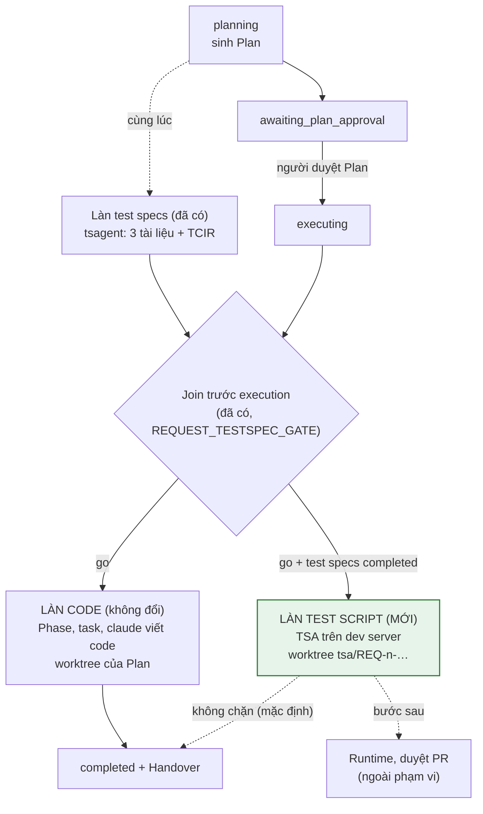
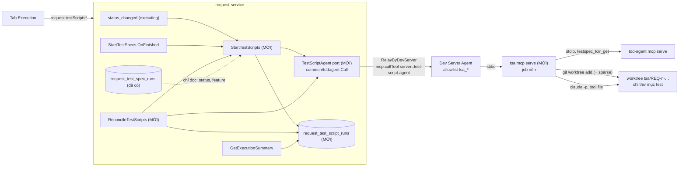
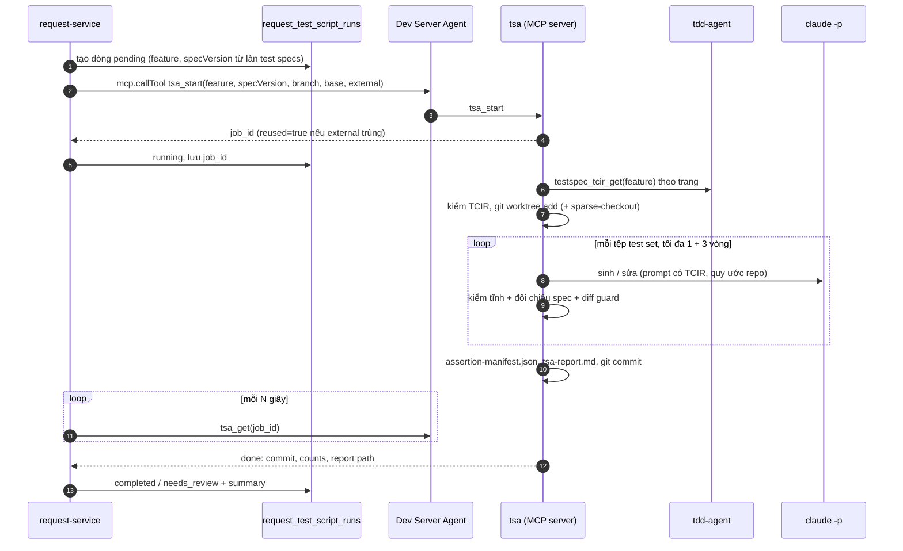

# TDD-REQ-TESTSCRIPT-001 — Sinh test script trong pha Execution của luồng Request

| Trường | Giá trị |
|---|---|
| **Mã tài liệu** | TDD-REQ-TESTSCRIPT-001 |
| **Loại** | Technical Design Document (tích hợp) |
| **Phiên bản** | v0.1 |
| **Ngày** | 2026-10-23 |
| **Trạng thái** | 🔧 Đã hiện thực phần lõi (2026-10-23, tắt mặc định bằng `REQUEST_TESTSCRIPT_ENABLED`): ORC-TSC-T1, T2, T3, T4 (không có cột cài đặt theo project), T5, T6 (không có cổng `wait` tại Handover), T7 (proto, gRPC, kênh WS; chưa có REST, OPA, `ExecutionSummary.test_scripts`, nhật ký hoạt động), T8 (khu Test scripts; chưa có chip Overview, nhóm Related), T10 (compose, `.env.example`, README agent). Chưa làm: T9 (CLI), T11 (E2E). Xem mục 15 |
| **Phạm vi** | `backend-go/services/request-service` (chính), `api-gateway`, `orca-cli`, `frontend` (tab Execution), `agent` (allowlist cầu MCP), `agent/test-script-agent` (MCP server), `deploy/` |
| **Thiết kế agent** | [TDD-TEST-SCRIPT-AGENT](../test-script-agent/TDD-TEST-SCRIPT-AGENT.md) (phương án C), [README của tsa](../../agent/test-script-agent/README.md) |
| **Liên quan** | [TDD-REQ-TESTSPEC-001](./TDD-REQ-TESTSPEC-001-testspec-in-request-execution.md) (làn test specs, join trước execution, cầu `mcp.callTool`), [TDD-WF-AGENT-001](./TDD-WF-AGENT-001-workflow-agent-pipeline.md) |

> "Test specs" là ba tài liệu ISO/IEC/IEEE 29119-3 do tsagent sinh; `03-test-cases.md` kèm TCIR (`tcir/v1`) cho mỗi test case. "Test script" là mã kiểm thử tự động (pytest) do Test Script Agent (TSA) sinh từ TCIR. Tài liệu này chỉ nói về việc **sinh** script; chạy script (runtime) và duyệt PR là các bước sau.

---

## 1. Bối cảnh và mục tiêu

### 1.1 Bối cảnh

Luồng `change_request` chạy `Classification → Analysis → Plan → Execution → Handover`. Từ commit `9dc3f0a20`, làn test specs khởi chạy cùng lúc với việc sinh Plan (Request vào `planning`). Hai làn gặp nhau ở **join trước execution**: task code đầu tiên chỉ được dispatch khi làn test specs đã xong (`TestSpecJoin`, cổng `REQUEST_TESTSPEC_GATE`).

Như vậy khi Request bắt đầu thực thi, test specs (kèm TCIR) đã có sẵn trên dev server. TSA đọc TCIR đó và sinh test script. Bước này **nằm trong pha Execution, sau Plan**, chạy song song với việc viết code.

### 1.2 Mục tiêu

1. Khi execution bắt đầu và test specs dùng được, Orca **tự khởi chạy TSA** trên dev server của project.
2. TSA sinh script vào **worktree riêng**, trên nhánh riêng, không đụng worktree code của Plan.
3. Script bám test spec, không bám code. TSA không đọc source ứng dụng và không chạy test (TDD-TEST-SCRIPT-AGENT mục 1.2, 5.1).
4. Tab **Execution** có thêm khu **Test scripts**: trạng thái, số case đã sinh / cần xem lại / bỏ qua, nhánh, commit, báo cáo.
5. Bật tắt theo project, mặc định tắt. Tắt thì luồng Request y như hiện tại.
6. Không thêm `RequestStatus`, không thêm tab. Mặc định không chặn Request.

### 1.3 Ngoài phạm vi

- Chạy script (runtime), phân loại lỗi khi chạy, tự sửa theo kết quả chạy.
- Mở PR, chọn người duyệt, merge nhánh `tsa/*`.
- Agent viết code đọc test script. Hai làn độc lập, như ORC-TS-ADR-08.
- Khung test khác pytest (TSA bản hiện tại chỉ hỗ trợ pytest).
- Tích hợp KG thiết kế của tdd-agent.

---

## 2. Hiện trạng đã kiểm chứng

| Hạng mục | Thực tế | Bằng chứng |
|---|---|---|
| Làn test specs | Khởi chạy khi Request vào `planning`, `awaiting_plan_approval` hoặc `executing` (idempotent); reconcile bù sự kiện mất | `usecase/test_spec_start.go`, commit `9dc3f0a20` |
| Join trước execution | `AdvanceExecution.run` gọi `Join.Decide` trước lần dispatch đầu tiên; `StartPhase` trả `REQUEST_TESTSPEC_NOT_READY`; cổng `wait` (mặc định), `require`, `warn`, `off` | `domain/test_spec_join.go`, `usecase/test_spec_join.go`, `usecase/advance_execution.go:115` |
| Hook khi làn xong | `StartTestSpecs.OnFinished(ctx, requestID)` gọi khi làn tới trạng thái cuối, bọc `recover` | `usecase/test_spec_start.go:26, 264` |
| Kết quả làn | Bảng `request_test_spec_runs`; có `Feature` (ví dụ `TDD-NOTES`) và `Summary` | `domain/test_spec.go`, migration `0110` |
| Worktree code | Một worktree cho cả Plan: task đầu tạo, các task sau dùng lại (`sharedWorktree`); nhánh tạo từ `req.BaseRef` | `usecase/advance_execution.go:229`, CR-REQ-013, CR-REQ-039 |
| Cầu MCP của agent | `mcp.callTool` với allowlist theo server. Hiện chỉ có server `tdd-agent`; `ORCA_MCP_BRIDGE_CONFIG` thay danh sách server | `agent/src/relay/agent-rpc-dispatch-mcp.ts:24-60` |
| Client MCP dùng chung | `backend-go/common/tddagent` (`Call`, `ToolError`, `BridgeError`, `ErrTransport`) | TDD-REQ-TESTSPEC-001 mục 4.3 |
| TCIR | `03-test-cases.md` có khối TCIR mỗi test case; tool chỉ đọc `testspec_tcir_get` (tdd-agent), `get_tcir` (gateway tsagent) | `agent/tetspec-agent/src/tsagent/render/tcir.py`, commit `36d081bef` |
| TSA | CLI `tsa generate`: đọc TCIR qua MCP, tạo worktree `tsa/<feature>-v<n>`, sinh bằng `claude -p` (chỉ tool file), kiểm tĩnh, đối chiếu spec, sửa ≤ 3 vòng có diff guard, commit; 20 test, đã chạy thật qua `tsagent serve --stdio` và Claude CLI | `agent/test-script-agent/` |
| Migration mới nhất | `0110_request_test_spec_runs` | `request-service/migrations/{postgres,mysql}/` |

**Chưa có**: MCP server của TSA; server `test-script-agent` trong allowlist; bảng, consumer, job, kênh, UI cho test script trong Orca; sparse-checkout trong TSA khi repo test cũng là repo ứng dụng.

---

## 3. Quyết định

| Mã | Quyết định | Lý do |
|---|---|---|
| ORC-TSC-ADR-01 | Sinh test script là **làn thứ ba trong pha Execution**. Không thêm `RequestStatus`, tab hay cổng duyệt | Như ORC-TS-ADR-01; máy trạng thái và timeline gắn chặt chín trạng thái |
| ORC-TSC-ADR-02 | **Điểm khởi chạy = lúc execution bắt đầu**: Request ở `executing` **và** làn test specs `completed`. Hai đường vào, cùng một use case idempotent: (a) `status_changed → executing` khi làn đã xong; (b) `StartTestSpecs.OnFinished` khi Request đã ở `executing` | Trước `executing`, Plan chưa duyệt và test specs có thể còn đổi. Sau join, TCIR đã đủ. Không chờ task code nào |
| ORC-TSC-ADR-03 | Làn test specs không `completed` (skipped, blocked, failed) → làn test script `skipped` với `REQUEST_TESTSCRIPT_NO_TESTSPECS` | Không có TCIR thì không có gì để sinh; TSA không đoán |
| ORC-TSC-ADR-04 | **Không chặn** mặc định: Request `completed` không chờ test script. Cổng tuỳ chọn `REQUEST_TESTSCRIPT_GATE` (`warn` mặc định, `wait` tại Handover) | Script là đầu vào của runtime (bước sau), không phải của code; chủ dự án đã chốt TSA chỉ sinh script |
| ORC-TSC-ADR-05 | **Gọi TSA qua cầu MCP sẵn có**: server mới `test-script-agent` (`tsa mcp serve --transport stdio`) trong allowlist của agent, tool `tsa_start`, `tsa_get`, `tsa_cancel`, `tsa_report`. `request-service` gọi bằng `common/tddagent.Call` | Dùng lại `RelayByDevServer`, phân loại lỗi, allowlist, giới hạn `projectDir`; không mở kênh RPC mới trên agent |
| ORC-TSC-ADR-06 | **TSA tự đọc TCIR trên dev server** (`tdd-agent -C <projectDir> mcp serve`, tool `testspec_tcir_get`). Orca chỉ gửi `feature`, `specVersion` mong đợi và `external` | TCIR có thể lớn; đọc tại chỗ tránh chuyển qua Orca; một nguồn sự thật |
| ORC-TSC-ADR-07 | **Worktree riêng của TSA**, nhánh `tsa/REQ-<n>-<feature>-v<specVersion>`, tạo từ `req.BaseRef` (rỗng = nhánh mặc định). Không dùng worktree code của Plan | Code đang viết song song; script không được bám code (TDD-TEST-SCRIPT-AGENT 5.1). Có `REQ-<n>` để hai Request cùng feature không đụng nhánh |
| ORC-TSC-ADR-08 | **Repo test** theo cài đặt project: mặc định cùng repo với ứng dụng, khi đó TSA tạo worktree **sparse-checkout chỉ gồm thư mục test** (`git sparse-checkout init --cone` + `set <paths>`, Git 2.25); hoặc một repo test riêng (`test_scripts_repo`) | Worktree của TSA không chứa source ứng dụng, mà Claude CLI chỉ có tool file (không Bash) nên không đọc được qua git |
| ORC-TSC-ADR-09 | **Trạng thái ở bảng riêng** `request_test_script_runs`; `ExecutionSummary` đọc thêm khối `test_scripts` | Như ORC-TS-ADR-06 |
| ORC-TSC-ADR-10 | **Idempotent theo `external`** `{system: "orca", executionId: <requestId>, stepId: "testscript", specVersion}` | Hai đường khởi chạy + reconcile có thể gọi trùng |
| ORC-TSC-ADR-11 | **Độc lập với làn code và làn test specs**: không chung khóa, bảng, vòng lặp, lần thử lại. Chỉ chung dev server, quota `claude` và danh tính thực thi | Như ORC-TS-ADR-11 |
| ORC-TSC-ADR-12 | **Mặc định tắt**: cờ project `test_scripts`, cờ triển khai `REQUEST_DEFAULT_TEST_SCRIPTS`, cờ tổng `REQUEST_TESTSCRIPT_ENABLED`. Bật test script mà test specs đang tắt → `skipped` `REQUEST_TESTSCRIPT_NO_TESTSPECS` | Tốn quota `claude`; cần cài TSA trên dev server |

---

## 4. Luồng chạy

### 4.1 Vị trí trong luồng Request



Làn test script rẽ ra ở **cùng thời điểm** làn code được phép chạy, và không có mũi tên nào nối trở lại làn code.

### 4.2 Hai đường khởi chạy

| Tình huống | Sự kiện đến trước | Ai gọi `StartTestScripts` |
|---|---|---|
| Test specs xong trước khi Plan được duyệt (thường gặp: Plan chờ người) | `executing` | consumer `status_changed` (to = `executing`) thấy làn test specs `completed` |
| Plan được duyệt khi test specs còn chạy (join đang giữ execution) | test specs xong | `StartTestSpecs.OnFinished` thấy Request ở `executing` |
| Mất sự kiện | — | `ReconcileTestScripts` quét Request `executing` có test specs `completed` mà chưa có dòng test script |

`OnFinished` hiện chỉ có một hàm. Đổi sang danh sách hook (hoặc một hàm gọi lần lượt join rồi test script), mỗi hook bọc `recover` riêng, để lỗi ở làn test script không làm hỏng việc mở lại execution.

### 4.3 Kiến trúc thành phần



### 4.4 Trình tự



---

## 5. Dữ liệu và hợp đồng

### 5.1 Bảng `request_test_script_runs`

Migration `0111_request_test_script_runs` (Postgres, MySQL), cùng quy ước với `0110`.

| Cột | Kiểu | Ghi chú |
|---|---|---|
| `id`, `tenant_id`, `request_id` | uuid | một dòng hiện tại mỗi Request: chỉ mục duy nhất `(tenant_id, request_id) WHERE superseded_at IS NULL` |
| `attempt` | int | tăng khi Re-run hoặc test specs đổi phiên bản |
| `status` | text | mục 5.3 |
| `reason_code`, `reason_message` | text | mục 9 |
| `test_spec_run_id` | uuid | dòng test specs đã dùng (chỉ đọc, không khóa ngoại cứng) |
| `feature`, `spec_version` | text, int | TCIR đã đọc |
| `tsa_job_id` | text | job của TSA trên dev server |
| `branch`, `base_ref`, `worktree_path`, `commit_sha` | text | kết quả git |
| `summary` | jsonb / json | `counts` (generated, needs_review, failed, skipped), `files`, `report_path`, `manifest_path`, `cost_usd`, `generator`, `model` |
| `started_by` | uuid | danh tính thực thi (`ActorFor`) |
| `started_at`, `finished_at`, `updated_at`, `superseded_at` | timestamptz | |

Không lưu nội dung script hay báo cáo trong Orca; đọc lại qua `tsa_report`.

### 5.2 Cài đặt

| Mức | Khóa | Mặc định |
|---|---|---|
| Project | `project_engine_settings.test_scripts BOOLEAN NOT NULL DEFAULT false` (migration `0111`); proto `EngineSettings.test_scripts`; CLI `orca engine set --test-scripts=true` | `false` |
| Project | `test_scripts_repo` (text, rỗng = repo của project), `test_scripts_paths` (danh sách, mặc định `["tests"]`) | rỗng, `["tests"]` |
| Triển khai | `REQUEST_DEFAULT_TEST_SCRIPTS` | `false` |
| Cờ tổng | `REQUEST_TESTSCRIPT_ENABLED`: `false` thì không đăng ký consumer, hook, job | `false` |
| Cổng | `REQUEST_TESTSCRIPT_GATE`: `warn` (chỉ hiển thị) hoặc `wait` (Handover chờ làn xong, tối đa `REQUEST_TESTSCRIPT_GATE_TIMEOUT`) | `warn` |

Trên dev server: `.tsa/config.toml` của dự án (`generator`, `model`, `max_fix`, `tests_paths`, `test_repo`). Cấu hình của Orca gửi trong `tsa_start` thắng giá trị của tệp.

### 5.3 Trạng thái

| `status` | Nghĩa | Chuyển sang |
|---|---|---|
| `pending` | Đã tạo dòng, chưa gọi dev server | `running`, `skipped` |
| `running` | TSA đang chạy | `completed`, `needs_review`, `blocked`, `failed`, `cancelled` |
| `completed` | Mọi tệp `generated`, đã commit | `pending` (Re-run, dòng mới) |
| `needs_review` | Đã commit, có tệp `needs-review` hoặc `failed`; người đọc báo cáo | `pending` |
| `blocked` | Thiếu cấu hình trên dev server (TSA chưa cài, `claude` chưa đăng nhập, repo không phải pytest) | `pending` |
| `failed` | Lỗi khi chạy, quá hạn, mất job | `pending` |
| `skipped` | Không áp dụng; không phải lỗi | — |
| `cancelled` | Stop run, hủy Request | — |

Ánh xạ từ `tsa_get`: `done` + mọi tệp `generated` → `completed`; `done` có tệp khác `generated` → `needs_review`; `error` với mã `FRAMEWORK_UNSUPPORTED`, `GENERATOR` (không tìm thấy `claude`), `TCIR_SOURCE` (tdd-agent không có tool) → `blocked`; mã khác → `failed`.

### 5.4 Port và hợp đồng với TSA

```go
type TestScriptAgent interface {
    Start(ctx, conn AnalysisConnection, in TestScriptStartInput) (TestScriptStarted, error) // tsa_start
    Job(ctx, conn AnalysisConnection, jobID string) (TestScriptJob, error)                  // tsa_get
    Report(ctx, conn AnalysisConnection, jobID string, offset int) (TestScriptText, error)  // tsa_report
    Cancel(ctx, conn AnalysisConnection, jobID, reason string) error                        // tsa_cancel
}
```

Adapter `grpcclient/test_script_agent_mcp.go`: `RelayByDevServer`, method `mcp.callTool`, `server: "test-script-agent"`, `projectDir = AnalysisConnection.RepoPath`, phân loại lỗi như `tdd_agent_mcp.go`.

| Tool | Tham số | Trả về |
|---|---|---|
| `tsa_start` (ghi) | `feature`, `spec_version`, `branch`, `base`, `test_repo?`, `tests_paths?`, `generator?`, `model?`, `max_fix?`, `external {system, executionId, stepId}` | `{job_id, reused, branch, worktree}` |
| `tsa_get` | `job_id` | `{state: queued\|running\|done\|error\|cancelled, step, files[{path,status,attempts}], counts, commit, report, manifest, cost_usd, error?{code,message}}` |
| `tsa_report` | `job_id`, `offset` | nội dung `tsa-report.md` phân trang (`next`) |
| `tsa_file` | `job_id`, `path`, `offset` | một output của job (script đã sinh, `assertion-manifest.json`, `tsa-report.md`) phân trang; đường dẫn khác bị từ chối `TSA_FILE_NOT_ALLOWED` |
| `tsa_cancel` (ghi) | `job_id`, `reason` | `{state}` |

Phía TSA: `tsa_start` ghi job vào `<projectDir>/.tsa/jobs/<job_id>.json`, chạy `tsa generate` trong tiến trình riêng (giống `run_dispatch` của tdd-agent) và trả về ngay. Khóa idempotent là `sha256(external + feature + spec_version)`; gọi lại trả job cũ (`reused: true`). Đã có `branch` mà khác job thì dùng `--reuse`.

Thêm vào agent:

```ts
const TSA_TOOLS = ['tsa_start', 'tsa_get', 'tsa_report', 'tsa_file', 'tsa_cancel']
// defaultBridgeConfig: servers['test-script-agent'] = { command: 'tsa', args: ['mcp', 'serve', '--transport', 'stdio'], tools: TSA_TOOLS }
```

### 5.5 Dữ liệu gửi đi

| Tham số | Nguồn |
|---|---|
| `feature` | `request_test_spec_runs.feature` của dòng hiện tại |
| `spec_version` | `summary.version` của dòng test specs (TSA từ chối nếu TCIR khác phiên bản: `REQUEST_TESTSCRIPT_SPEC_VERSION_CHANGED`) |
| `branch` | `tsa/REQ-<number>-<feature>-v<specVersion>` |
| `base` | `req.BaseRef`, rỗng thì nhánh mặc định của repo |
| `test_repo`, `tests_paths` | cài đặt project (5.2) |
| `external` | `{system: "orca", executionId: <requestId>, stepId: "testscript"}` |

Không gửi Solution, Plan hay code. TSA không cần chúng.

---

## 6. Luồng xử lý

### 6.1 `StartTestScripts`

| # | Bước | Không đạt thì |
|---|---|---|
| 1 | Cờ tổng, cờ project | không làm gì, không tạo dòng |
| 2 | Đã có dòng hiện tại `pending`, `running`, `completed`, `needs_review` cùng `spec_version` | dừng (idempotent) |
| 3 | Request ở `executing` | dừng; đường vào kia sẽ gọi lại |
| 4 | Làn test specs `completed`, có `feature` | `skipped` `REQUEST_TESTSCRIPT_NO_TESTSPECS` |
| 5 | Danh tính thực thi còn quyền | `blocked` `REQUEST_EXECUTION_ACTOR_NOT_ALLOWED` |
| 6 | Dev server và repo path (`AnalysisConnectionResolver`) | `skipped` `REQUEST_TESTSCRIPT_NO_DEV_SERVER` |
| 7 | `Start()` | `blocked`/`failed` theo mã; lỗi vận chuyển thử lại 3 lần, hết thì `failed` `REQUEST_TESTSCRIPT_UNREACHABLE`; tool không có trong allowlist → `blocked` `REQUEST_TESTSCRIPT_TOOL_MISSING` |

### 6.2 `ReconcileTestScripts`

Như `ReconcileTestSpecs`: quét dòng `pending`/`running` yên lặng quá `REQUEST_TESTSCRIPT_RECONCILE_QUIET`, lấy lease theo dòng, gọi `Job()`, ánh xạ trạng thái (5.3). Quá `REQUEST_TESTSCRIPT_DEADLINE` (mặc định 60 phút) → `Cancel()` rồi `failed` `REQUEST_TESTSCRIPT_DEADLINE`; job không còn → `failed` `REQUEST_TESTSCRIPT_JOB_LOST`. Quét thêm Request `executing` có test specs `completed` mà chưa có dòng (bù sự kiện mất).

### 6.3 Chạy lại

| Nguyên nhân | Hành vi |
|---|---|
| Người bấm **Re-run** | dòng hiện tại `superseded_at`, dòng mới `attempt+1`; đang `running` thì `Cancel()` trước. TSA dùng `--reuse` trên cùng nhánh và commit thêm |
| Test specs chạy lại, ra `spec_version` mới | dòng mới, nhánh mới `…-v<mới>`; nhánh cũ giữ nguyên |
| Request reopen rồi vào `executing` lại | như đường vào (a); cùng `spec_version` thì TSA trả job cũ |

### 6.4 Hủy và hoàn thành

- **Stop run**, **Cancel request**: `Cancel()` best-effort, dòng `cancelled`. Worktree và nhánh giữ lại để người xem.
- Request `completed` không chờ làn này khi cổng là `warn`. Cổng `wait` giữ Handover tới khi làn xong hoặc hết `REQUEST_TESTSCRIPT_GATE_TIMEOUT`, giống join test specs.
- Handover liệt kê: nhánh `tsa/…`, commit, số case theo trạng thái, đường dẫn `tsa-report.md`.

### 6.5 Tài nguyên

Ba làn cùng dùng `claude` trên một dev server: code (theo `MaxParallelTasks`), tsagent (đã xong trước execution), TSA (một tệp mỗi lần). Số liệu thử: 1 case, 12 giây, 0,04 USD. Bộ PAY 35 case ở chế độ template xong trong vài giây. Nếu đụng quota, thêm tuỳ chọn `start_after: code_done` (14.2).

---

## 7. Giao diện

### 7.1 Tab Execution

```
┌ Execution ─────────────────────────────────────────────────────────────────┐
│ Summary strip: Phase 1/2 · Tasks 3/6 · 1 running                (như cũ)   │
├──────────────────────────────────────┬─────────────────────────────────────┤
│ Implementation (như cũ)              │ Test specs (đã có)                   │
│  ▸ PH-1 …  running                   │  ✓ Completed · 35 TC · 8 gaps        │
│                                      ├─────────────────────────────────────┤
│                                      │ Test scripts (MỚI)                   │
│                                      │  ● Running · PAY v1 · 2/9 files      │
│                                      │  branch tsa/REQ-12-PAY-v1            │
│                                      │  ───────────────────────────────    │
│                                      │  33 generated · 2 needs review       │
│                                      │  0 skipped · commit 20d7eb4          │
│                                      │  [Report] [Coverage]  [Re-run]       │
└──────────────────────────────────────┴─────────────────────────────────────┘
```

| Trạng thái | Hiển thị |
|---|---|
| `skipped` | dòng mờ với lý do; ẩn khi cờ project tắt |
| `pending`, `running` | chip đang chạy, `feature vN`, số tệp đã xong / tổng |
| `completed`, `needs_review` | số case theo trạng thái, nhánh, commit; **Report** mở `tsa-report.md` (sheet, phân trang); **Coverage** mở bảng expected → `file:line` từ manifest |
| `blocked` | mục **Needs you** (mức `attention`) kèm cách sửa (mục 9) và **Re-run** |
| `failed` | thẻ đỏ với `reason_code`, **Re-run** |

Khu Test scripts ẩn khi runtime thiếu kênh `request.testScripts`. Khóa dịch `auto.components.request.execution.TestScriptsPanel.*`; hook `useTestScripts(requestId)`, làm mới theo `request.activity` `testscript.*` hoặc poll 5 giây khi đang chạy.

### 7.2 Tab khác

| Tab | Thay đổi |
|---|---|
| Overview | chip "Test scripts: running / 33 ok, 2 review / blocked" |
| History | `testscript.started`, `testscript.completed`, `testscript.needs_review`, `testscript.blocked`, `testscript.failed`, `testscript.cancelled` |
| Related | nhánh `tsa/…`, đường dẫn worktree trên dev server, `tests/tsa/<feature>/` |

---

## 8. API

### 8.1 Proto

```proto
rpc GetTestScripts(GetTestScriptsRequest) returns (GetTestScriptsResponse);              // dòng hiện tại + lịch sử
rpc StartTestScripts(StartTestScriptsRequest) returns (StartTestScriptsResponse);        // Re-run
rpc GetTestScriptReport(GetTestScriptReportRequest) returns (GetTestScriptReportResponse); // tsa-report.md, offset
// EngineSettings.test_scripts, test_scripts_repo, test_scripts_paths
```

`ExecutionSummary` thêm khối `test_scripts { status, reason_code, feature, spec_version, branch, commit, counts }`.

### 8.2 Gateway và CLI

| Kênh WS | RPC | Quyền |
|---|---|---|
| `request.testScripts` | `GetTestScripts` | xem Request |
| `request.testScriptsStart` | `StartTestScripts` | quyền thực thi (`execution_access.go`) |
| `request.testScriptReport` | `GetTestScriptReport` | xem Request |

REST `GET/POST /v1/requests/{id}/test-scripts`, `GET /v1/requests/{id}/test-scripts/report?offset=`. Cập nhật `testdata/channel_inventory.json`, OPA, kiểm hợp đồng `backend-go-request-contracts`.

```bash
orca testscript show   <request-id>
orca testscript report <request-id>
orca testscript start  <request-id>
orca engine set --project <id> --test-scripts=true
```

---

## 9. Mã lỗi

| Mã | Trạng thái | Cách sửa |
|---|---|---|
| `REQUEST_TESTSCRIPT_NO_TESTSPECS` | `skipped` | Bật và chạy test specs; xem lý do của làn test specs |
| `REQUEST_TESTSCRIPT_NO_DEV_SERVER` | `skipped` | Kết nối dev server cho project |
| `REQUEST_TESTSCRIPT_TOOL_MISSING` | `blocked` | Cài `test-script-agent` trên dev server, build lại agent để allowlist có `tsa_*` |
| `REQUEST_TESTSCRIPT_FRAMEWORK_UNSUPPORTED` | `blocked` | Repo test không phải pytest |
| `REQUEST_TESTSCRIPT_GENERATOR` | `blocked` | `claude` không có trên PATH hoặc chưa đăng nhập |
| `REQUEST_TESTSCRIPT_TCIR_SOURCE` | `blocked` | tdd-agent thiếu `testspec_tcir_get` (cần bản có commit `36d081bef`) |
| `REQUEST_TESTSCRIPT_SPEC_VERSION_CHANGED` | `failed` | Test specs đã đổi giữa chừng: Re-run |
| `REQUEST_TESTSCRIPT_WORKTREE` | `failed` | Nhánh/worktree đã có hoặc base không tồn tại; xem `reason_message` |
| `REQUEST_TESTSCRIPT_UNREACHABLE`, `…_DEADLINE`, `…_JOB_LOST` | `failed` | Re-run |
| `REQUEST_EXECUTION_ACTOR_NOT_ALLOWED` | `blocked` | Người duyệt Plan mất quyền thực thi |

Số liệu: `request_test_script_runs_total{status,reason}`, `request_test_script_duration_seconds`, `request_test_script_cases_total{status}`. Nhật ký có `request_id`, `tsa_job_id`, `attempt`.

---

## 10. Bảo mật

| Điểm | Quy tắc |
|---|---|
| Cách ly với code ứng dụng | Worktree TSA sparse-checkout chỉ thư mục test (hoặc repo test riêng); Claude CLI chỉ có `Read,Write,Edit,Glob,Grep`, `--strict-mcp-config`, không Bash; prompt chỉ chứa TCIR và quy ước repo test |
| Phạm vi ghi | Chỉ worktree TSA, chỉ nhánh `tsa/*`. Không push, không mở PR, không merge |
| `projectDir` | Giới hạn bởi `roots` của cầu MCP như tdd-agent |
| Dữ liệu rời Orca | Chỉ tham số ở 5.5; không gửi Solution, Plan, code |
| Bí mật | TSA chặn secret hard-code (kiểm tĩnh); trường `sensitive` đọc từ biến môi trường lúc chạy |
| Phân quyền | Xem = quyền xem Request; Re-run = quyền thực thi |
| Kiểm toán | `request_activity` mỗi chuyển trạng thái; nhật ký `mcp.callTool` ở agent; `.tsa/jobs/*.json` trên dev server |

---

## 11. Kế hoạch triển khai

| ID | Task | Phụ thuộc | Cỡ |
|---|---|---|---|
| ORC-TSC-T0 | Chốt câu hỏi mở 14.2, nâng tài liệu lên v0.2 | — | S |
| ORC-TSC-T1 | TSA: `tsa mcp serve` (stdio) với `tsa_start/get/report/cancel`, job nền trong `.tsa/jobs`, idempotent theo `external`; `.tsa/config.toml`; test | — | M |
| ORC-TSC-T2 | TSA: sparse-checkout (`--tests-path`, Git 2.25), `--test-repo`, kiểm `spec_version` của TCIR | — | S |
| ORC-TSC-T3 | Agent: server `test-script-agent` + `TSA_TOOLS` trong `defaultBridgeConfig`, test allowlist, `deploy/agent/README.md` | T1 | S |
| ORC-TSC-T4 | request-service: domain `TestScriptRun`, migration `0111` (bảng + cột cài đặt), repository Postgres/MySQL, contract test | T0 | M |
| ORC-TSC-T5 | Port `TestScriptAgent` + adapter `grpcclient/test_script_agent_mcp.go` trên `common/tddagent`, fake | T4 | M |
| ORC-TSC-T6 | `StartTestScripts`, consumer `status_changed`, `OnFinished` thành danh sách hook, `ReconcileTestScripts` + lease; cổng `REQUEST_TESTSCRIPT_GATE` tại Handover | T5 | L |
| ORC-TSC-T7 | Proto, gRPC, kênh WS, REST, OPA, `ExecutionSummary.test_scripts`, nhật ký hoạt động | T6 | L |
| ORC-TSC-T8 | Frontend: `TestScriptsPanel`, sheet báo cáo, bảng coverage, chip Overview, nhóm Related, i18n | T7 | L |
| ORC-TSC-T9 | CLI `orca testscript …`, cài đặt engine | T7 | S |
| ORC-TSC-T10 | Triển khai: compose, `.env.example`, hướng dẫn chuẩn bị dev server (`uv tool install` TSA, `claude` đăng nhập) | T3 | S |
| ORC-TSC-T11 | E2E: repo `notes` (pytest), tdd-agent thật, TSA với `--generator template` (nhanh) và `claude` (một case) | T8, T10 | M |

Đường găng: T1 → T3 → T5 → T6 → T7 → T8 → T11 (T4 song song với T1–T3). Tiêu chí xong: Request `change_request` trên `notes` có test specs `completed`; trong vòng 5 giây sau khi execution bắt đầu có dòng test script `running`; khi xong, nhánh `tsa/REQ-n-…` có commit với script, manifest, báo cáo; tắt cờ hoặc lỗi cấu hình không làm đổi trạng thái Request hay task code.

---

## 12. Kiểm thử

| Mức | Ca | Cách |
|---|---|---|
| Unit | Máy trạng thái 5.3; ánh xạ `tsa_get`; `StartTestScripts` theo từng bước 6.1; hai đường vào gọi trùng → một `tsa_start` | fake `TestScriptAgent` |
| Thứ tự | Test specs xong trước `executing` → khởi chạy ở consumer; `executing` trước → khởi chạy ở `OnFinished`; test specs `failed` → `skipped`; hook test script panic không chặn join mở execution | fake + đồng hồ giả |
| Hợp đồng | Bảng Postgres/MySQL; mọi RPC có kênh; params `mcp.callTool` khớp schema; allowlist agent chứa `tsa_*` và không có tool khác | `contracttest`, vitest |
| Độc lập | Mọi mã lỗi ở mục 9: số task, trạng thái task, `ExecutionSummary` phần code, join, `completed` không đổi so với cờ tắt; không lấy `execution_request_lock` | so từng trường |
| TSA | `tsa_start` idempotent, job nền sống qua khởi động lại tiến trình MCP, sparse-checkout không có tệp ngoài `tests_paths`, `tsa_cancel` | pytest của `agent/test-script-agent` |
| E2E | 11 (T11) | `run_ui_flow.py --real testscript` |

---

## 13. Cấu hình dev server

| Điều kiện | Cách đặt | Mã nếu thiếu |
|---|---|---|
| tdd-agent có `testspec_tcir_get` | cài lại tdd-agent từ `agent/tetspec-agent` (≥ `36d081bef`) | `REQUEST_TESTSCRIPT_TCIR_SOURCE` |
| `tsa` trên PATH | `uv tool install ./agent/test-script-agent` | `REQUEST_TESTSCRIPT_TOOL_MISSING` |
| Agent đủ mới (allowlist `tsa_*`) | `node agent/build.mjs`, chạy lại agent | `REQUEST_TESTSCRIPT_TOOL_MISSING` |
| `claude` đã đăng nhập | `claude` trên dev server | `REQUEST_TESTSCRIPT_GENERATOR` |
| Repo test dùng pytest | `pytest.ini`, `conftest.py` hoặc `[tool.pytest]` | `REQUEST_TESTSCRIPT_FRAMEWORK_UNSUPPORTED` |
| Git ≥ 2.25 (sparse-checkout) | gói hệ thống | `REQUEST_TESTSCRIPT_WORKTREE` |

Quay lại: tắt cờ project hoặc `REQUEST_TESTSCRIPT_ENABLED=false`. Job đang chạy vẫn xong trên dev server; worktree và nhánh giữ nguyên. Không cần chạy `.down` của `0111` để về binary cũ.

---

## 14. Rủi ro và câu hỏi mở

### 14.1 Rủi ro

| Rủi ro | Mức | Giảm thiểu |
|---|---|---|
| Repo test cũng là repo ứng dụng, cách ly chỉ dựa vào sparse-checkout + tool của Claude | Trung bình | Không cấp Bash; kiểm trong TSA rằng worktree không có tệp ngoài `tests_paths`; khuyến nghị repo test riêng cho dự án nhạy cảm |
| Ba làn tranh quota `claude` trên một dev server | Trung bình | TSA sinh từng tệp; tuỳ chọn `start_after: code_done` |
| Test specs chạy lại sau khi TSA đã sinh (spec_version mới) | Thấp | Dòng mới, nhánh mới; nhánh cũ giữ để so sánh |
| Nhánh `tsa/*` tích tụ trên dev server | Thấp | Dọn khi Request đóng (bước sau) hoặc `tsa gc` |
| Nhiều expected dạng văn xuôi chỉ kiểm được toán tử | Trung bình | Báo cáo liệt kê để QA đọc; cân nhắc thêm `target` vào `Assertion` của ontology `tso` |

### 14.2 Câu hỏi mở (chốt ở ORC-TSC-T0)

1. Repo test mặc định: cùng repo ứng dụng (sparse-checkout `tests/`) hay bắt buộc repo test riêng?
2. Cổng mặc định `warn` hay `wait` tại Handover?
3. Bắt đầu TSA ngay khi execution bắt đầu, hay sau khi task code cuối xong (`start_after: code_done`) để giảm tranh quota?
4. Chỉ sinh case `approved` ở tsagent (`--only-approved`) hay mọi case?
5. Worktree `tsa/*` có cần hiện trong danh sách worktree của Orca (đăng ký qua git-gateway) để mở diff ngay trong ứng dụng không?
6. Ai dọn nhánh và worktree `tsa/*`: Handover, khi Request đóng, hay thủ công?

---

## Phụ lục A: lời gọi mẫu

```json
{"method": "mcp.callTool", "params": {"server": "test-script-agent", "projectDir": "/home/dev/notes", "tool": "tsa_start",
 "arguments": {"feature": "TDD-NOTES", "spec_version": 1, "branch": "tsa/REQ-12-TDD-NOTES-v1", "base": "main",
               "tests_paths": ["tests"],
               "external": {"system": "orca", "executionId": "4f1c…", "stepId": "testscript"}}, "timeoutMs": 30000}}
```

```json
{"job_id": "tsa-20261023-0f3a", "state": "done", "branch": "tsa/REQ-12-TDD-NOTES-v1", "commit": "20d7eb4",
 "counts": {"files": 3, "generated": 9, "needs-review": 1, "skipped": 0},
 "report": "tests/tsa/tdd_notes/tsa-report.md", "manifest": "tests/tsa/tdd_notes/assertion-manifest.json", "cost_usd": 0.41}
```

## Phụ lục B: kết quả tham chiếu

| Lần chạy | Nguồn TCIR | Generator | Kết quả |
|---|---|---|---|
| PAY, 35 case | `tsagent serve --stdio`, `get_tcir` | template | 35 `generated`, 9 tệp, commit trên `tsa/PAY-v1` |
| PAY, 1 case `…-errorHandling-fail-INT-01-c` | tệp TCIR | claude | `generated` lần đầu, 12 s, 0,0415 USD; `assert error_code == "FB-01"  # @exp …E1` |

---

## 15. Đã hiện thực (2026-10-23)

| Phần | Tệp | Kiểm |
|---|---|---|
| TSA: MCP server, job nền, worktree sparse | `agent/test-script-agent/src/tsa/{mcp_server,jobs,runner,worktree}.py`; job lưu ở `<repo>/.git/tsa/jobs` (không hiện là tệp chưa theo dõi) | 28 test pytest, có một lần gọi thật qua stdio |
| Agent: allowlist | `agent/src/relay/agent-rpc-dispatch-mcp.ts`: server `test-script-agent`; thêm `testspec_tcir_get` cho `tdd-agent` | vitest |
| Client MCP dùng chung | `backend-go/common/tddagent`: `WithServer(name)` | go test |
| Domain, port, use case | `request-service/internal/domain/test_script.go`; `usecase/{ports_testscript,test_script_start,test_script_reconcile,test_script_queries}.go` | `test_script_test.go` (11 ca) |
| Lưu trữ | migration `0111_request_test_script_runs` (Postgres, MySQL); `adapter/{postgres,mysql}/test_script_runs.go` | tenant scope contract |
| Gọi dev server | `adapter/grpcclient/test_script_agent_mcp.go` | 3 ca |
| Khởi chạy | consumer `adapter/eventbus/test_script_consumer.go` (Request vào `executing`); hook `OnFinished` của làn test specs (mỗi hook bọc `recover` riêng, `cmd/server/wire_testspec.go`); job reconcile | |
| API | `proto/orca/request/v1/test_scripts.proto`, 3 RPC; `adapter/grpc/server_test_scripts.go`; `rpc_catalog`, `flow_gate`; api-gateway `channels_request_testscripts.go`, danh mục kênh, `excluded_channels.yaml` | test của wscompat |
| Giao diện | `TestScriptsPanel.tsx`, `useTestScripts.ts`, `request-testscript-{types,parsers}.ts` | vitest |
| Xem output | Nút **Open output** của khu Test scripts mở `TestScriptOutputSheet`: tab **Files** (danh sách file, nội dung có số dòng, dòng `# @exp` được tô), tab **Coverage** (bảng expected → assertion đọc từ `assertion-manifest.json`, bấm vị trí mở file đúng dòng), tab **Report** (`tsa-report.md` dạng markdown). Dữ liệu qua RPC `GetTestScriptFile` / kênh `request.testScriptFile` → tool `tsa_file`; Orca chỉ cho đọc đường dẫn có trong `summary` của job, TSA kiểm lại lần nữa | vitest, go test, pytest |
| Cấu hình | `REQUEST_TESTSCRIPT_{ENABLED,DEADLINE,RECONCILE_INTERVAL,RECONCILE_QUIET,TESTS_PATHS,TEST_REPO,GENERATOR,MODEL}` | |

Khác với thiết kế ở trên:

- Bật tắt theo **triển khai**, chưa theo project (giống làn test specs hiện tại; `TestScriptSettings` là chỗ cắm cài đặt theo project sau này).
- Chỉ có cổng `warn`: Request `completed` không chờ test script. Cổng `wait` tại Handover chưa làm.
- Không có trạng thái `starting`: `tsa_start` trả về ngay, nên dòng đi thẳng `pending` → `running`.
- `spec_version` lấy từ `summary.version` của làn test specs; không có thì nhánh bỏ hậu tố `-v<n>` và TSA không kiểm phiên bản.
