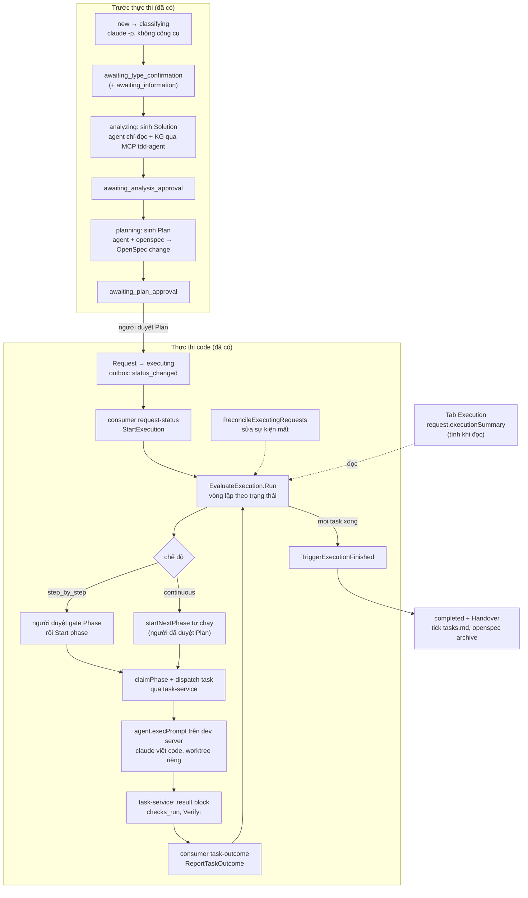
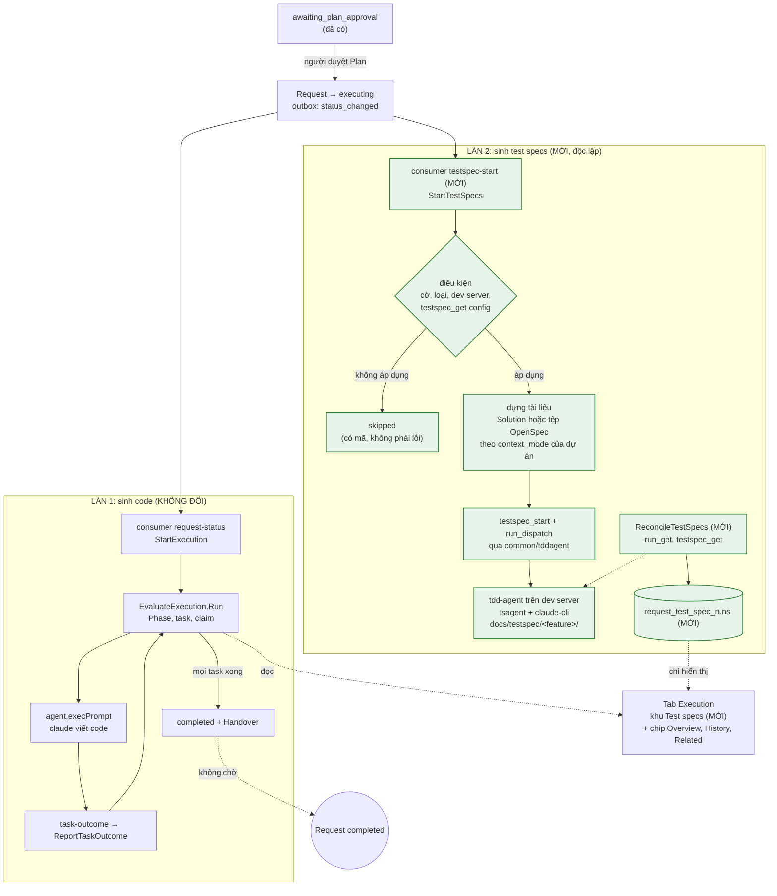
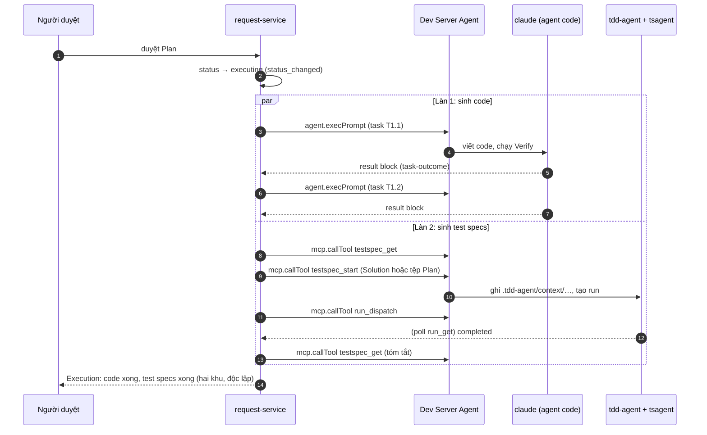
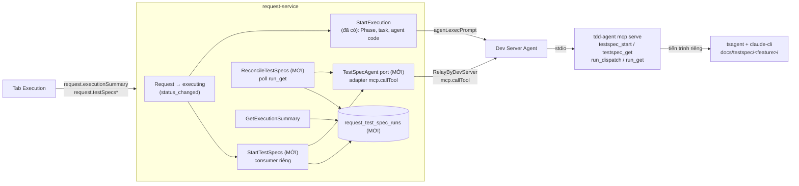
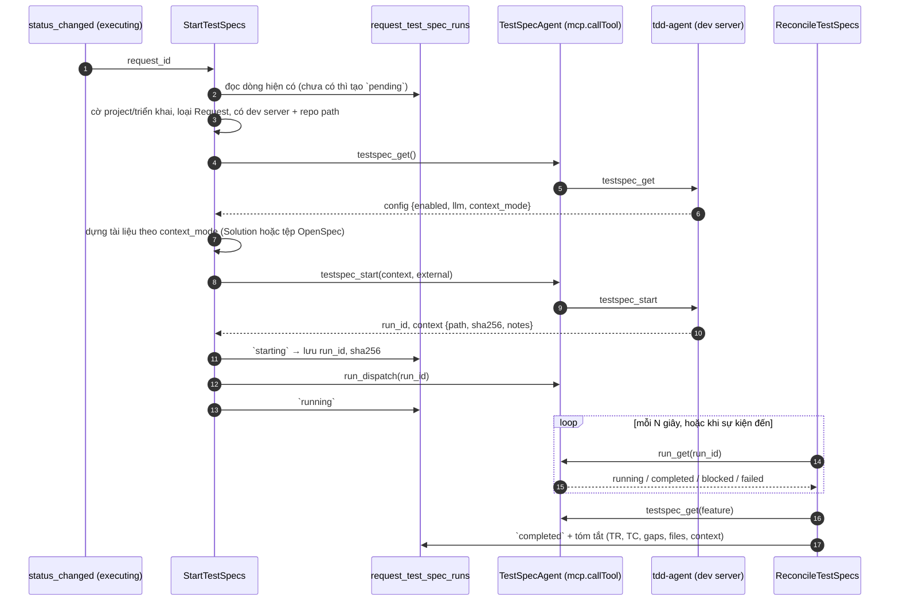

# TDD-REQ-TESTSPEC-001 — Sinh test specs song song với thực thi code trong luồng Request của Orca

| Trường | Giá trị |
|---|---|
| **Mã tài liệu** | TDD-REQ-TESTSPEC-001 |
| **Loại** | Technical Design Document (tích hợp) |
| **Phiên bản** | v0.1 |
| **Ngày** | 2026-10-19 |
| **Trạng thái** | 📝 Đề xuất. Đã xong: phía `tdd-agentic-ai`, allowlist cầu MCP của agent, và **ORC-TS-T2a** (gói dùng chung `backend-go/common/tddagent`, mục 4.3). **ORC-TS-T1, T2, T3, T4, T6 (kênh WS) và T8 (khu Test specs trong tab Execution)** đã có mã (2026-10-19, tắt mặc định bằng `REQUEST_TESTSPEC_ENABLED`). Còn lại: T5 (cài đặt theo dự án), T7 (CLI), REST/OPA/nhật ký hoạt động, chip Overview, nhóm Related |
| **Phạm vi** | `backend-go/services/request-service` (chính), `api-gateway`, `orca-cli`, `frontend` (tab Execution), `agent` (đã đủ), `deploy/` (cấu hình) |
| **Phía tdd-agent** | `tdd-agentic-ai/docs/tsagent/integrate/` : TDD 0.7 (INT-ADR-12..17, INT-FR-15..24), SOLUTION mục 14, `PERF.md` (TC-66) |
| **Liên quan** | [TDD-WF-AGENT-001](./TDD-WF-AGENT-001-workflow-agent-pipeline.md) (cầu `mcp.callTool`, hợp đồng JSON), [knowledge-hub-setup](../guides/request/knowledge-hub-setup.md), [cli-end-to-end](../guides/request/cli-end-to-end.md) |

> "TDD" trong tài liệu này là *Technical Design Document* (tài liệu thiết kế kỹ thuật) của dự án được quản lý, cũng là tài liệu mà `tdd-agent` sinh ra. "Test specs" là ba tài liệu test (Test Requirements, Test Design, Test Cases theo ISO/IEC/IEEE 29119-3) do `tsagent` sinh. Không liên quan đến Test-Driven Development.

---

## 1. Bối cảnh và mục tiêu

### 1.1 Bối cảnh

Màn hình chi tiết một Request có sáu tab: **Overview, Analysis, Plan, Execution, History, Related**. Luồng của một `change_request` chạy `Classification → Analysis (Solution) → Plan → Execution → Handover`. Ở bước Execution, `request-service` điều khiển các Phase và task: agent trên dev server viết code trong worktree, Orca theo dõi và duyệt.

Phía `tdd-agent` đã có khả năng sinh test specs từ knowledge graph (KG) của dự án **kèm ngữ cảnh của chính Request** (Solution hoặc Plan), qua hai tool MCP `testspec_start` và `testspec_get`. Thử trên repo `notes` với Request #2 (`GET /healthz`): test case dẫn nguồn từ Solution (`ADR-REQ-2-opt-1`, `CON-REQ-2-A-3`), gap hỏi lại điều Solution đã trả lời biến mất, chạy 94 giây với `claude-cli` (`PERF.md`, TC-66). Hiện **Orca chưa gọi chúng ở đâu**.

### 1.2 Mục tiêu

1. Khi Request bước vào `executing`, Orca **tự khởi chạy việc sinh test specs song song** với việc implement code, không làm chậm và không chặn việc implement.
2. Người dùng thấy ở tab **Execution** hai luồng cạnh nhau: tiến độ code (Phase, task như hiện nay) và tiến độ test specs; xem được ba tài liệu, danh sách khoảng trống (TestGap) và chạy lại khi cần.
3. Dùng đúng chế độ ngữ cảnh mà dự án đã cấu hình ở tdd-agent (`solution` hoặc `plan`, một chế độ mỗi run); Orca chỉ **gửi đúng loại tài liệu** chứ không tự chọn chế độ.
4. Bật tắt theo project; mặc định tắt; tắt thì luồng Request y như hiện tại.
5. Không thêm trạng thái Request, không thêm tab, không đổi cổng duyệt.

### 1.3 Ngoài phạm vi

- Agent viết code **đọc** test specs để viết code (task sau khi có test specs). Hai luồng song song nên chưa có thứ tự; xem 3 (ORC-TS-ADR-08) và 13.
- Duyệt hay baseline test specs (tdd-agent chỉ sinh bản `Draft`, INT-ADR-03).
- Ghi ngược test specs vào KG thiết kế (Orca không ghi KG, quyết định T1.7).
- Request không dùng engine OpenSpec và không có Solution (loại `bug`, `task` native): được `skipped` có lý do (mục 6.1).

---

## 2. Hiện trạng đã kiểm chứng

| Hạng mục | Thực tế | Bằng chứng |
|---|---|---|
| Tab chi tiết Request | `overview`, `analysis`, `plan`, `execution`, `history`, `related` | `frontend/src/renderer/src/components/request/RequestDetailPane.tsx:259-282` |
| Máy trạng thái | `…awaiting_plan_approval → executing → completed`; `executing` có `StartExecution` chạy theo sự kiện | `domain/request_status.go`, `usecase/start_execution.go`, `cmd/server/wire_execution.go:233` (`NewRequestStatusConsumer(bus, startExecution)`) |
| Vòng lặp thực thi | `EvaluateExecution.Run` theo trạng thái, lặp lại an toàn; job `ReconcileExecutingRequests` sửa sự kiện bị mất | `usecase/start_execution.go`, `usecase/reconcile_executing_requests.go` |
| Chế độ thực thi | `step_by_step` hay `continuous` ghim vào Request khi vào `executing` | `domain/execution_mode.go` |
| Tóm tắt thực thi | **Tính khi đọc**, không lưu: tiến độ, đang chạy, lỗi, cần bạn, bàn giao | `domain/execution_summary.go` |
| Nhật ký hoạt động | Tập `kind` đóng (`task.started`, `phase.done`, …) | `domain/request_activity.go` |
| Plan đã sinh | Cả OpenSpec change nằm **trong DB** (`change.Bundle`: đường dẫn → nội dung), đọc được cả khi worktree đã gỡ | `usecase/get_plan_bundle_file.go`, `usecase.OpenSpecChangeRepository` |
| Solution | Bản ghi có `OptionsJSON`, `ChosenOption *int`, `Status`; tiêu chí chấp nhận ở nội dung Request | `domain/solution.go`, `domain.ContentFromRequest` |
| Gọi dev server | `request-service` đã relay tới agent: `RelayByDevServer` / `Relay` với `AnalysisConnection{ConnectionID, DevServerID, RepoPath}` | `adapter/grpcclient/dev_server_executor.go`, `usecase/ports_solution.go:72` |
| Cầu MCP của agent | RPC `mcp.callTool` (server `tdd-agent`, `projectDir`, `tool`, `arguments`, `timeoutMs`); allowlist **đã có** `testspec_start`, `testspec_get` | `agent/src/relay/agent-rpc-dispatch-mcp.ts`, `deploy/agent/README.md` |
| Client `mcp.callTool` | (Đã tách sang `common/tddagent`, ORC-TS-T2a.) Trước đó chỉ có ở `workflow-service` (`tddagentclient`: `client.go` gửi và phân loại lỗi, `run_view.go` đọc `run_get`, `poll.go` chờ chặn trong một step); đều nằm trong `internal/` của workflow-service nên `request-service` **không import được**. Hai service cùng dùng module `backend-go/common` | `workflow-service/internal/adapter/tddagentclient/{client,run_view,poll}.go`, `backend-go/common/go.mod` |
| Tool phía tdd-agent | `testspec_start` (ghi), `testspec_get` (đọc), cùng `run_dispatch`, `run_get`, `run_list`, `run_cancel` | `tdd-agentic-ai` SOLUTION 14.13; 82 ca kiểm thử xanh |
| Migration | Tới `0098_execution_mode` (Postgres và MySQL) | `request-service/migrations/{postgres,mysql}/` |
| Cài đặt theo project | `project_engine_settings` (`engine`, `solution_agent`, `execution_mode`) | `domain/engine_settings.go`, migration 0095, 0098 |

**Chưa có**: bảng lưu việc sinh test specs; client MCP trong `request-service`; consumer khởi chạy song song; kênh/REST/CLI; UI.

---

## 3. Quyết định

| Mã | Quyết định | Lý do |
|---|---|---|
| ORC-TS-ADR-01 | Sinh test specs là **một nhánh song song trong trạng thái `executing`**. **Không** thêm `RequestStatus`, tab, hay cổng duyệt | Máy trạng thái, `FlowDefinition`, timeline và các test hợp đồng gắn chặt vào chín trạng thái; một nhánh phụ không cần đổi chúng |
| ORC-TS-ADR-02 | **Khởi chạy khi Request vào `executing`**, cùng sự kiện `orca.request.request.status_changed` mà `StartExecution` đang nghe, bằng một consumer riêng. Không phụ thuộc `step_by_step` hay `continuous`, không chờ người bấm Start phase | Solution và Plan đều đã có tại thời điểm này (cả hai chế độ ngữ cảnh đều có dữ liệu); test specs không cần chờ Phase nào |
| ORC-TS-ADR-03 | **Không chặn**: kết quả test specs không làm Request `blocked`, không giữ Request ở `executing`, không đổi `completed`. Lỗi hiện ở "cần bạn" mức `attention` | Chủ dự án muốn chạy song song; test specs là tài liệu để đọc (Draft). Cờ `required` để ngỏ (mục 13) |
| ORC-TS-ADR-04 | **Chế độ ngữ cảnh do `.tdd-agent/config.toml` của dự án quyết định** (INT-ADR-17). Mỗi lần khởi chạy Orca gọi `testspec_get()` đọc `config.context_mode` rồi gửi đúng loại tài liệu: `solution` → Solution; `plan` → các tệp OpenSpec change; `none` → `skipped`. Orca **không** có cài đặt chế độ riêng | Một nguồn chính sách; tránh hai nơi lệch nhau |
| ORC-TS-ADR-05 | **`request-service` sở hữu việc gọi** (không chạy qua `workflow-service`), nhưng **tái sử dụng phần kết nối và đọc kết quả** của luồng tdd-agent sẵn có: tách phần không phụ thuộc service (gửi `mcp.callTool`, phân loại lỗi `ToolError`/`BridgeError`/vận chuyển, giải mã `run_get`) từ `workflow-service/internal/adapter/tddagentclient` sang gói dùng chung `backend-go/common/tddagent`; hai service chỉ viết phần nối (adapter) của mình. Phần chờ chặn (`poll.go`) **không** dùng chung (mục 4.3) | Hai service cùng một hợp đồng `mcp.callTool` (`docs/integrate/contracts/`); tránh hai bản sao lệch nhau khi tdd-agent đổi; `internal/` không cho import chéo nhưng `common` thì được |
| ORC-TS-ADR-06 | **Trạng thái lưu ở bảng riêng** `request_test_spec_runs`; `ExecutionSummary` (tính khi đọc) được mở rộng để kèm khối `testSpecs` | Giống cách `analysis_runs` tách khỏi `requests`; không biến `ExecutionSummary` thành dữ liệu lưu |
| ORC-TS-ADR-07 | **Idempotent theo `external`**: `{system: "orca", executionId: <requestId>, stepId: "testspec"}` và `sha256` của tài liệu; gọi lại cùng nội dung trả run cũ | Consumer có thể nhận sự kiện hai lần; reconcile gọi lại an toàn |
| ORC-TS-ADR-08 | **Hai luồng độc lập, không trao đổi dữ liệu** ở bản này: agent viết code không đọc test specs; test specs không đọc code mới | "Song song" nghĩa là không có thứ tự; muốn code theo test specs thì phải tuần tự hoặc chạy lại (mục 13) |
| ORC-TS-ADR-09 | **Orca không ghi tệp vào repo** của dự án; mọi tài liệu gửi qua MCP trong lời gọi (tdd-agent tự ghi `.tdd-agent/context/…`) | Orca không có quyền ghi trực tiếp; một chỗ kiểm tên tệp, dung lượng |
| ORC-TS-ADR-10 | **Mặc định tắt**, bật theo project (`test_specs` trong cài đặt engine) và theo triển khai (`REQUEST_DEFAULT_TEST_SPECS`) | Tốn quota `claude` của dev server; cần chuẩn bị tdd-agent |
| ORC-TS-ADR-11 | **Hai nhánh không liên quan nhau**: nhánh sinh code và nhánh sinh test specs chỉ chung **sự kiện khởi chạy** (Request vào `executing`) và **dev server**; không chung bảng, khóa, vòng lặp, lần thử lại, hay kết quả. Sự cố ở nhánh này không đổi trạng thái hay làm chậm nhánh kia (bảo đảm cụ thể ở mục 4.2) | Yêu cầu của chủ dự án; giảm rủi ro hồi quy cho luồng thực thi đang chạy ổn |

---

## 4. Luồng chạy hiện tại và luồng mới

### 4.1 Luồng hiện tại (chưa có test specs)

Từ đầu đến `executing` là luồng Request sẵn có (tab Overview, Analysis, Plan). Ở `executing`, `request-service` điều khiển Phase và task; agent trên dev server viết code. Mọi bước dưới đây đã có trong mã (tệp được ghi ở mục 2).



### 4.2 Luồng mới (thêm nhánh test specs)

Phần thêm là **làn thứ hai**, màu xanh trong sơ đồ. Nó rẽ ra từ cùng sự kiện `status_changed` và **không có mũi tên nào nối trở lại** làn code.



**Điều kiện của mọi mũi tên dưới LÀN 2: chúng không đi ngược vào LÀN 1.** Cụ thể:

| Bảo đảm độc lập | Cách thực hiện |
|---|---|
| Không chung vòng lặp | `StartTestSpecs` và `ReconcileTestSpecs` là consumer và job riêng; không gọi `EvaluateExecution`, `AdvanceExecution`, `ReportTaskOutcome` |
| Không chung khóa | không lấy `execution_request_lock` của làn code; có lease riêng theo dòng `request_test_spec_runs` |
| Không chung dữ liệu | bảng riêng; không đọc hay ghi `tasks`, `approvals`, bảng bắt đầu Phase, `analysis_runs`; `ExecutionSummary` chỉ **đọc** thêm khối `test_specs` |
| Không chung trạng thái Request | không gọi `transition.Execute`; không thêm `RequestStatus`, trigger hay `request_backlog` |
| Không chung lần thử lại | lỗi test specs có `attempt` riêng; thử lại không đụng `MaxAttempts` của task |
| Không chung kết quả | agent viết code không đọc test specs; tsagent không đọc code đang viết (ORC-TS-ADR-08) |
| Lỗi cô lập | mọi lỗi của làn 2 bị bắt, ghi `blocked`/`failed` + hoạt động `testspec.*`, không lan ra làn 1 (kể cả panic: consumer bọc recover) |
| Hủy riêng | Stop run hủy cả hai; nhưng test specs hủy không làm hủy hay đổi task code |
| Chỉ chung | sự kiện khởi chạy, dev server (kênh relay), quota `claude` của máy đó, danh tính thực thi (`ActorFor`) |

Theo thời gian (trường hợp một Request `change_request` cỡ M):



### 4.3 Tái sử dụng kết nối và nhận kết quả của tdd-agent

Luồng tdd-agent sẵn có là `workflow-service/internal/adapter/tddagentclient`. Nó đã giải quyết: đi qua `Relay` tới agent bằng `mcp.callTool`, phân loại lỗi, đọc `run_get`. Vì nằm trong `internal/`, `request-service` không import được; nhưng hai service cùng module `backend-go/common`. **Đã tách (ORC-TS-T2a, 2026-10-19)** sang `backend-go/common/tddagent`; bảng dưới ghi cái đã nằm ở đâu.

| Phần của `tddagentclient` | Tái dùng? | Cách (đã làm cho các dòng "Có") |
|---|---|---|
| `callToolParams`, `callToolResult`, gửi `mcp.callTool`, giải mã `{ok, isError, result, error}` | **Có** | chuyển sang `backend-go/common/tddagent` (`Call(ctx, relay, projectDir, tool, args, out)`); `relay` là hàm `func(ctx, method, paramsJSON string) (resultJSON string, err error)` nên gói không import proto hay `usecase` của service nào |
| Phân loại lỗi: `ToolError`, `BridgeError`, `ErrTransport` (và quy tắc `MCP_SERVER_FAILED`, `MCP_TIMEOUT` là tạm thời) | **Có** | cùng gói `common/tddagent` |
| Giải mã `run_get` (`runView`: `status`, `result.blockers`, `process`, `children`) | **Có** | cùng gói, thêm `TestSpecRun` đọc `status`, `blockers` |
| Phân giải đích gọi: `ServerResolver` + `RepoLister` ("project:<id>" → connection) | **Không** | mỗi service tự nối: `workflow-service` giữ như cũ; `request-service` dùng `AnalysisConnectionResolver` và `RelayByDevServer` sẵn có (đã có `RepoPath`) |
| `poll.go` (chờ chặn trong một step có deadline) | **Không** | `request-service` theo mô hình sự kiện + job (`ReconcileTestSpecs`), như `ReconcileExecutingRequests`; không giữ goroutine chờ |
| `actions.go`, `approval.go` (`tdd_agent.start/advance/approval/wait_*`, gate, `step_approvals`) | **Không** | riêng của workflow; test specs không có duyệt (INT-ADR-03) |
| `metrics.go` | **Không** | số liệu riêng `request_test_spec_*` |

**Kết quả tách (ORC-TS-T2a, đã làm):**

| Mục | Nội dung |
|---|---|
| Gói mới | `backend-go/common/tddagent/call.go`: `Call(ctx, relay, projectDir, tool, args, out, opts...)`, kiểu `Relay`, `ToolError`, `BridgeError`, `ErrTransport`, `WithTimeoutMs`; `run.go`: `RunView`, `TaskView`, `ChildView`, `ProcessView` và các hàm `Status`, `Terminal`, `ProcessAlive`, `HeartbeatStale`, `GateStatuses`, `NewestChild`. Chỉ dùng thư viện chuẩn (không import proto hay `usecase` của service nào) |
| `workflow-service` | `tddagentclient/client.go` còn phần nối (phân giải đích `project:<id>`, tenant metadata, `ResolveProjectDir`) và gọi `tddagent.Call`; `run_view.go` nhúng `tddagent.RunView` và giữ `output()` theo schema của step. Kiểu lỗi và hằng số giữ nguyên tên bằng alias (`ToolError = tddagent.ToolError`, …) nên mã gọi và **test sẵn có không phải sửa** |
| Test | `common/tddagent`: 9 hàm test, 17 ca kể cả ca con (hình dạng `mcp.callTool`, `arguments` luôn là `{}` không phải `null`, `timeoutMs` chỉ gửi khi yêu cầu, tám dạng lỗi, kết quả không giải mã được, đọc `run_get`, `Terminal` không tính `blocked`, `NewestChild`, `HeartbeatStale`). `workflow-service` và `common` chạy toàn bộ xanh, test của `tddagentclient` không đổi dòng nào |
| Khác biệt hành vi | Chỉ chữ của lỗi vận chuyển: `tddagentclient: dev server unreachable` thành `tdd-agent: dev server unreachable`. Không test nào kiểm chữ này; `errors.Is(err, ErrTransport)` vẫn đúng |
| Chưa làm | `request-service` chưa dùng gói này (ORC-TS-T2: adapter `grpcclient/tdd_agent_mcp.go` nối `RelayByDevServer` với `tddagent.Call`) |

### 4.4 Kiến trúc thành phần



Hai nhánh cùng chạy trên **một dev server** và cùng dùng phiên `claude` của máy đó. Chúng không chia sẻ trạng thái ngoài `request_id`.

### 4.5 Trình tự khởi chạy



---

## 5. Dữ liệu và hợp đồng

### 5.1 Bảng `request_test_spec_runs`

Migration `0110_request_test_spec_runs` cho cả hai dialect (Postgres, MySQL), theo cùng quy ước các bảng `request-service` (có `tenant_id`, khóa ngoại tới `requests`).

| Cột | Kiểu | Ghi chú |
|---|---|---|
| `id` | uuid | khóa chính |
| `tenant_id` | uuid | bắt buộc |
| `request_id` | uuid | khóa ngoại; **một dòng "hiện tại" cho mỗi Request**: chỉ mục duy nhất `(tenant_id, request_id) WHERE superseded_at IS NULL` |
| `attempt` | int | tăng mỗi lần chạy lại (bấm Re-run, hay tài liệu đổi) |
| `status` | text | `pending`, `starting`, `running`, `completed`, `blocked`, `failed`, `skipped`, `cancelled` (mục 5.3) |
| `reason_code` | text | mã khi `blocked`, `failed`, `skipped` (mục 11) |
| `reason_message` | text | cắt 500 ký tự |
| `context_mode` | text | `solution` hoặc `plan` (giá trị tdd-agent báo lúc chạy) |
| `context_ref` | text | `REQ-<number>` |
| `context_sha256` | text | để biết có cần chạy lại |
| `tdd_run_id` | text | `run-…` của tdd-agent |
| `feature` | text | ví dụ `TDD-NOTES` |
| `summary` | jsonb / json | ảnh chụp `testspec_get(feature)` lúc xong: số TR, TC, TestGap, danh sách tệp, khối `context`, `notes` |
| `started_by` | uuid | người đã duyệt Plan (cùng người thực thi, xem 10) |
| `started_at`, `finished_at`, `updated_at` | timestamptz | |
| `superseded_at` | timestamptz null | dòng cũ khi chạy lại |

Dòng cũ giữ lại làm lịch sử (tab History). Không lưu nội dung ba tài liệu: đọc lại qua `testspec_get(feature, document)`.

### 5.2 Cài đặt

| Mức | Khóa | Mặc định |
|---|---|---|
| Project | `project_engine_settings.test_specs BOOLEAN NOT NULL DEFAULT false` (migration `0099`); proto `EngineSettings.test_specs`; kênh `request.engineSettings` / `request.engineSettingsSet`; CLI `orca engine set --test-specs=true` | `false` |
| Triển khai | `REQUEST_DEFAULT_TEST_SPECS` (`true` hoặc `false`) cho project **chưa lưu cài đặt**; giống `REQUEST_DEFAULT_SOLUTION_AGENT` | `false` |
| Cờ tổng | `REQUEST_TESTSPEC_ENABLED` (service): `false` thì không đăng ký consumer và job | `false` |

Cài đặt đã lưu của project luôn thắng giá trị mặc định (quy tắc hiện có).

### 5.3 Trạng thái

| `status` | Nghĩa | Chuyển sang |
|---|---|---|
| `pending` | Đã tạo dòng, chưa gọi dev server | `starting`, `skipped` |
| `starting` | Đã gọi `testspec_start`, chưa `run_dispatch` | `running`, `blocked`, `failed` |
| `running` | tdd-agent đang sinh | `completed`, `failed`, `blocked`, `cancelled` |
| `completed` | `run_get` báo `completed`; có `summary` | `pending` (chạy lại, dòng mới) |
| `blocked` | tdd-agent dừng vì cấu hình (`LLM_NOT_CONFIGURED`, `TESTSPEC_CONTEXT_MISSING`, …) hoặc dev server thiếu khả năng; người sửa rồi bấm Re-run | `pending` |
| `failed` | Lỗi sinh (`TESTSPEC_FAILED:*`), quá hạn, hoặc dev server không tới được sau khi thử lại | `pending` |
| `skipped` | Không áp dụng; **không** phải lỗi (mục 6.1) | — |
| `cancelled` | Người bấm Stop run hay hủy Request | — |

Ánh xạ từ `run_get`: `completed` → `completed`; `failed` → `failed`; `blocked` có `blockers` bắt đầu bằng `LLM_`, `TESTSPEC_CONTEXT_`, `TESTSPEC_DISABLED`, `TESTSPEC_KG_MCP` → `blocked`; các `blocked` khác (`TESTSPEC_FAILED:*`) → `failed`.

### 5.4 Cổng (port) và hợp đồng với tdd-agent

Port mới trong `usecase` (adapter `grpcclient/tdd_agent_mcp.go`, dùng `RelayByDevServer`, method `mcp.callTool`, `projectDir = AnalysisConnection.RepoPath`):

```go
type TestSpecAgent interface {
    Config(ctx, conn AnalysisConnection) (TestSpecConfig, error)             // testspec_get()
    Start(ctx, conn AnalysisConnection, in TestSpecStartInput) (TestSpecStarted, error) // testspec_start
    Dispatch(ctx, conn AnalysisConnection, runID string) error                // run_dispatch
    Run(ctx, conn AnalysisConnection, runID string) (TestSpecRun, error)      // run_get
    Summary(ctx, conn AnalysisConnection, feature string) (TestSpecSummary, error)  // testspec_get(feature)
    Document(ctx, conn AnalysisConnection, feature, doc string, offset int) (TestSpecText, error) // testspec_get(feature, document)
    Cancel(ctx, conn AnalysisConnection, runID, reason string) error          // run_cancel
}
```

Mọi lời gọi qua `mcp.callTool` với `server: "tdd-agent"`; lỗi phân loại như `tddagentclient`: `ToolError` (tool từ chối), `BridgeError` (allowlist, `MCP_*`, không thử lại), lỗi vận chuyển (thử lại).

| Tool tdd-agent | Tham số Orca gửi | Dùng khi |
|---|---|---|
| `testspec_get` | không | đọc `config.{enabled, llm, context_mode}` trước khi gửi |
| `testspec_start` | `context = {kind, ref, document\|files}`, `external` (không gửi `tdd`: mặc định `[project] tdd_id`) | khởi chạy |
| `run_dispatch` | `run_id` | chạy nền |
| `run_get` | `run_id` | theo dõi |
| `testspec_get` | `feature` | khi `completed`, lưu `summary` |
| `testspec_get` | `feature`, `document` (`requirements`\|`design`\|`cases`), `offset` | người xem tài liệu |
| `run_cancel` | `run_id`, `reason` | Stop run, hủy Request |

### 5.5 Dựng tài liệu gửi đi

**`context_mode = solution`**: một JSON object (SOLUTION 14.3 của tdd-agent):

```jsonc
{ "id": "<solution.id>", "status": "<solution.status>",          // chưa approved cũng gửi
  "chosenOption": <solution.ChosenOption>,                         // chỉ số; nil thì bỏ, tdd-agent dùng phương án khuyến nghị
  "options": <solution.OptionsJSON>,                               // nguyên văn tài liệu Solution (options, assumptions, open_questions, …)
  "acceptance_criteria": [ {"id": "AC-1", "text": "…"} ],          // tiêu chí đang hoạt động của Request (ContentFromRequest)
  "request": { "ref": "REQ-<number>", "title": "<title>" } }
```

Lấy Solution `kind = solution` mới nhất của Request. Request không có Solution (loại `bug`, `task`, hoặc chưa sinh) → `skipped` (`REQUEST_TESTSPEC_NO_SOLUTION`).

**`context_mode = plan`**: `files` lấy từ `change.Bundle` (bản sao trong DB):

| Tên tệp gửi | Nguồn |
|---|---|
| `tasks.md` | tệp cùng tên trong bundle (bắt buộc) |
| `proposal.md`, `design.md` | tệp cùng tên (thiếu thì bỏ, tdd-agent cảnh báo) |
| `specs/<tên>/spec.md` | mỗi spec của change |

Quy tắc chung: bỏ tiền tố `openspec/changes/<id>/`; áp giới hạn của tdd-agent (**tối đa 40 tệp, 256 KiB mỗi tệp, 2 MiB tổng**, tên theo danh sách cho phép); vượt thì `skipped` (`REQUEST_TESTSPEC_TOO_LARGE`) chứ không cắt. Request không có OpenSpec change → `skipped` (`REQUEST_TESTSPEC_NO_PLAN_BUNDLE`). Mọi văn bản qua bộ che bí mật có sẵn (`usecase/prompt_redaction.go`) trước khi gửi.

`ref` = `REQ-<Request.Number>`.

### 5.6 Ngữ cảnh khi hai tài liệu cùng có

Chỉ một chế độ mỗi dự án (INT-ADR-17 của tdd-agent). Dự án muốn thử chế độ kia sửa `[testspec] context_mode` trong `.tdd-agent/config.toml` rồi bấm **Re-run**; không có công tắc trong Orca.

---

## 6. Luồng xử lý

### 6.1 `StartTestSpecs` (consumer của `status_changed`)

Chạy khi `to = executing`; lặp lại an toàn (đọc dòng hiện tại trước).

| # | Bước | Kết quả nếu không đạt |
|---|---|---|
| 1 | Cờ tổng `REQUEST_TESTSPEC_ENABLED`; cờ project (hoặc mặc định triển khai) | không làm gì, **không tạo dòng** |
| 2 | Đã có dòng hiện tại ở `starting`, `running`, `completed` | dừng (idempotent) |
| 3 | Loại Request có luồng thực thi (`change_request`, `refactor`; các loại khác nếu có Solution) | `skipped` `REQUEST_TESTSPEC_NOT_APPLICABLE` |
| 4 | Có dev server connected và đường dẫn repo (`AnalysisConnectionResolver.ResolveForProject`) | `skipped` `REQUEST_TESTSPEC_NO_DEV_SERVER` |
| 5 | `Config()`: `enabled` và `context_mode ≠ none` | `skipped` `REQUEST_TESTSPEC_DISABLED_ON_DEV_SERVER` hoặc `REQUEST_TESTSPEC_MODE_NONE`; agent cũ chưa có tool → `blocked` `REQUEST_TESTSPEC_TOOL_MISSING` |
| 6 | Dựng tài liệu (5.5) | `skipped` theo mã ở 5.5 |
| 7 | `Start()` rồi `Dispatch()` | `blocked`/`failed` theo mã tdd-agent; lỗi vận chuyển thử lại 3 lần có giãn cách, hết thì `failed` `REQUEST_TESTSPEC_UNREACHABLE` |

Mỗi chuyển trạng thái ghi một dòng nhật ký hoạt động (mục 8.4).

### 6.2 `ReconcileTestSpecs` (job định kỳ)

Giống `ReconcileExecutingRequests`: quét các dòng `starting`/`running` đã yên lặng `> reconcileQuiet`, mượn khóa (lease) theo dòng, gọi `Run()`; khi `completed` gọi `Summary()` và lưu `summary`. Quá `REQUEST_TESTSPEC_DEADLINE` (mặc định 60 phút) → `failed` `REQUEST_TESTSPEC_DEADLINE` và gọi `Cancel()`. Run của tdd-agent mà dev server không còn thấy (`run_get` báo không tìm thấy) → `failed` `REQUEST_TESTSPEC_RUN_LOST`.

### 6.3 Chạy lại

| Nguyên nhân | Hành vi |
|---|---|
| Người bấm **Re-run** (`request.testSpecsStart`) | dòng hiện tại đánh `superseded_at`, tạo dòng mới `attempt+1`; nếu `status` đang `running`, gọi `Cancel()` trước |
| Request mở lại (reopen) rồi vào `executing` lần nữa | consumer chạy lại; nội dung tài liệu giống thì tdd-agent trả run cũ (`reused`), khác thì run mới |
| Plan sinh lại và duyệt lại | như trên |

### 6.4 Hủy và hoàn thành

- **Stop run** hay **Cancel request**: `Cancel()` best-effort, dòng thành `cancelled`; lỗi hủy không chặn việc hủy Request.
- Request `completed` khi mọi task xong, **không chờ** test specs (ORC-TS-ADR-03). Test specs còn `running` thì tiếp tục và vẫn cập nhật; Bàn giao (Handover) liệt kê "Test specs: đang sinh / xong / lỗi".

### 6.5 Tài nguyên

Cả agent viết code và tsagent dùng `claude` trên cùng dev server. Số liệu thử (repo nhỏ): 15 lượt gọi, 94 giây, `parallel = 4`. Giảm đụng nhau: `[testspec] parallel` ở tdd-agent; không đặt thêm giới hạn trong Orca ở bản này. Nếu thấy hết quota thường xuyên, thêm tùy chọn `start_after: first_task` (mục 13).

---

## 7. Giao diện (tab Execution)

Sáu tab giữ nguyên. Chỉ **Execution** thêm một khu, **Overview**, **History**, **Related** thêm lượng nhỏ.

### 7.1 Tab Execution

```
┌ Execution ───────────────────────────────────────────────────────────────┐
│ Summary strip: Phase 1/2 · Tasks 3/6 · 1 running            (như hiện nay) │
│ Needs you: ⚠ Test specs: LLM not configured on the dev server  [Re-run]    │
├───────────────────────────────────────┬────────────────────────────────────┤
│ Implementation (như hiện nay)         │ Test specs                          │
│  ▸ PH-1 Health endpoint   running     │  ● Running · solution · REQ-2       │
│    ✓ T1.1 handleHealthz               │  started 04:08 · 1m 12s              │
│    ● T1.2 TestHealthz                 │  ─────────────────────────────────  │
│  ▸ PH-2 …                  later      │  3 test requirements · 10 test cases │
│                                       │  8 open gaps                         │
│ Handover (OpenSpec)                   │  [Requirements] [Design] [Cases]     │
│                                       │  [Gaps]            [Re-run]          │
└───────────────────────────────────────┴────────────────────────────────────┘
```

| Trạng thái | Hiển thị |
|---|---|
| `skipped` | thẻ mờ một dòng, lý do ngắn ("Not applicable to this request type"); ẩn nếu cờ project tắt |
| `pending`, `starting`, `running` | chip đang chạy, thời gian đã chạy, chế độ ngữ cảnh và `REQ-n`; không có số liệu |
| `completed` | số TR, TC, TestGap; ba nút mở tài liệu; nút **Gaps** mở danh sách (mã, câu hỏi, chủ, số mục bị chặn); nhãn `Draft`; dòng `context: solution REQ-2 · 6 nodes` và các `notes` (ví dụ "solution is not approved") |
| `blocked` | mục **Needs you** (mức `attention`) kèm hướng dẫn sửa theo mã (mục 11) và nút **Re-run** |
| `failed` | thẻ đỏ với `reason_code`, nút **Re-run**; không đẩy Request sang `request_backlog` |
| `cancelled` | thẻ mờ |

Tài liệu mở trong một sheet (tái dùng cách `ExecutionTaskSheet`), nội dung là markdown phân trang từ `request.testSpecDocument` (có `next`). Không cho sửa.

### 7.2 Các tab khác

| Tab | Thay đổi |
|---|---|
| **Overview** | thêm một chip "Test specs: running / done (10 TC, 8 gaps) / blocked" cạnh chip engine; bấm mở tab Execution |
| **Analysis**, **Plan** | không đổi |
| **History** | dòng hoạt động mới: `testspec.started`, `testspec.completed`, `testspec.blocked`, `testspec.failed`, `testspec.cancelled` (mục 8.4) |
| **Related** | nhóm "Test specs" liệt kê đường dẫn tài liệu trong repo (`docs/testspec/<feature>/…`) và thư mục ngữ cảnh đã gửi (`.tdd-agent/context/<loại>-REQ-n/`); chỉ là văn bản, không mở được trên máy khác |

### 7.3 i18n và hook

Khóa dịch theo quy ước `auto.components.request.execution.TestSpecsPanel.*`; hook `useTestSpecs(requestId)` đọc `request.testSpecs` và làm mới khi sự kiện `request.activity` mang `testspec.*` hoặc khi trạng thái đang chạy (poll 5 giây). Tab Execution không đổi điều kiện hiển thị hiện có (ẩn khi runtime thiếu kênh `request.executionSummary`); khu Test specs ẩn khi thiếu kênh `request.testSpecs`.

---

## 8. API

### 8.1 Proto (`orca/request/v1/request.proto`)

```proto
rpc GetTestSpecs(GetTestSpecsRequest) returns (GetTestSpecsResponse);               // trạng thái + summary của lần chạy hiện tại và lịch sử
rpc StartTestSpecs(StartTestSpecsRequest) returns (StartTestSpecsResponse);         // Re-run (idempotent theo request + attempt)
rpc GetTestSpecDocument(GetTestSpecDocumentRequest) returns (GetTestSpecDocumentResponse); // requirements | design | cases, offset
// EngineSettings.test_specs (bool) và EffectiveEngineSettings.test_specs
```

`ExecutionSummary` thêm khối `test_specs { status, reason_code, context_mode, context_ref, started_at, finished_at, counts, gaps }` (chỉ đọc từ bảng, nhẹ) để Execution tab không phải gọi hai lần.

### 8.2 Gateway

| Kênh WS | RPC | Quyền |
|---|---|---|
| `request.testSpecs` | `GetTestSpecs` | xem Request |
| `request.testSpecsStart` | `StartTestSpecs` | người có quyền chạy thực thi của Request (`execution_access.go`) |
| `request.testSpecDocument` | `GetTestSpecDocument` | xem Request |

REST: `GET /v1/requests/{id}/test-specs`, `POST /v1/requests/{id}/test-specs`, `GET /v1/requests/{id}/test-specs/{document}?offset=`. Thêm vào danh mục kênh (tệp vàng `testdata/channel_inventory.json` của `wscompat`), chính sách OPA của api-gateway (tên tập RPC cần xác minh khi làm) và, nếu cần, `excluded_channels.yaml` của MCP của Orca. Cần chạy kiểm hợp đồng `backend-go-request-contracts` (mọi RPC phải có kênh).

### 8.3 CLI

```bash
orca testspec show  <request-id>                 # trạng thái, số liệu, gap
orca testspec doc   <request-id> cases           # in tài liệu (phân trang)
orca testspec start <request-id>                 # Re-run
orca engine set --project <id> --test-specs=true # bật theo project (cần admin)
```

### 8.4 Nhật ký hoạt động

Thêm vào `AllActivityKinds` (tập đóng) và `BuildActivityEntry`: `testspec.started` (info), `testspec.completed` (info), `testspec.blocked` (attention), `testspec.failed` (error), `testspec.cancelled` (info). `Details`: `status`, `reason_code`, `attempt`, `context_mode`, `counts`.

---

## 9. Cấu hình và triển khai

### 9.1 Orca

| Biến | Dịch vụ | Ý nghĩa |
|---|---|---|
| `REQUEST_TESTSPEC_ENABLED` | request-service | đăng ký consumer và job |
| `REQUEST_DEFAULT_TEST_SPECS` | request-service | mặc định cho project chưa lưu cài đặt |
| `REQUEST_TESTSPEC_DEADLINE` | request-service | quá hạn một lần sinh (mặc định `60m`) |
| `REQUEST_TESTSPEC_RECONCILE_QUIET` | request-service | giãn cách job (mặc định `30s`) |

Thêm vào `deploy/dev/docker-compose.yml` và `.env.example`. Migration `0099` áp bằng `redeploy-local.sh request-service` (áp migration trước khi khởi động lại). Thứ tự redeploy: `infra-fleet → git-gateway → task → request → api-gateway`, rồi frontend.

### 9.2 Dev server (từng dự án dùng)

Danh sách kiểm; mở rộng `orca engine show --check` để báo từng mục:

| Điều kiện | Cách đặt | Mã báo nếu thiếu |
|---|---|---|
| `tdd-agent` có `testspec_start`, `testspec_get` (bản có SOLUTION 0.4) | cài lại từ `tdd-agentic-ai` | `REQUEST_TESTSPEC_TOOL_MISSING` |
| Dev Server Agent đủ mới để allowlist có hai tool | `node agent/build.mjs` rồi chạy lại agent | `REQUEST_TESTSPEC_TOOL_MISSING` |
| `[mcp] write = true` trong `.tdd-agent/config.toml` | cấu hình dự án | `REQUEST_TESTSPEC_WRITE_DISABLED` |
| `[testspec] enabled = true`, `llm = "claude-cli"` (hoặc provider có khóa) | cấu hình dự án | `REQUEST_TESTSPEC_LLM_NOT_CONFIGURED` |
| `[testspec] context_mode = "solution"` hoặc `"plan"` | cấu hình dự án | `REQUEST_TESTSPEC_MODE_NONE` |
| KG đã dựng (`tdd-agent generate` hoặc `init`) | như hướng dẫn knowledge hub | `REQUEST_TESTSPEC_KG_MISSING` |
| Cấu hình nằm trong **tệp**, không phải cờ `--set` | `run_dispatch` chạy tiến trình riêng đọc `config.toml` | (lỗi `LLM_NOT_CONFIGURED` ở run) |

### 9.3 Quay lại

Tắt cờ project hoặc `REQUEST_TESTSPEC_ENABLED=false`: không còn run mới; run đang chạy vẫn tiếp tục trên dev server và hiển thị ở lần đọc tiếp theo. Không cần chạy `.down` của migration 0110 để quay về binary cũ (mã cũ bỏ qua cột/bảng mới); chỉ chạy `.down` khi chắc không còn dòng cần giữ.

---

## 10. Bảo mật và phân quyền

| Điểm | Quy tắc |
|---|---|
| Ai khởi chạy | Cùng danh tính thực thi của Request (`ActorFor`, người duyệt Plan). Mất quyền thực thi thì `StartTestSpecs` bỏ qua và ghi `blocked` `REQUEST_EXECUTION_ACTOR_NOT_ALLOWED`, giống Phase |
| Dữ liệu rời Orca | Chỉ tới dev server đã được duyệt của chính project; Solution/Plan là dữ liệu của Request đó; qua bộ che bí mật trước khi gửi |
| Quyền ghi của tdd-agent | `[mcp] write = true` phải bật ở dev server; `testspec_start` là tool ghi; chỉ ghi dưới `.tdd-agent/context/`, danh sách tên tệp cố định, giới hạn dung lượng, không theo symlink |
| Văn bản AI trong prompt | Solution/Plan do AI viết, vào prompt của tsagent như **dữ liệu** (gói ngữ cảnh bọc `wrap_data`, chỉ trích mã trong `allowedCodes`); rủi ro `INT-RISK-10` của tdd-agent |
| Phân quyền xem | Xem trạng thái và tài liệu = quyền xem Request; Re-run = quyền thực thi |
| Kiểm toán | Mỗi chuyển trạng thái ghi `request_activity`; mỗi lời gọi tool ghi nhật ký ở agent (`mcp.callTool … ok in N ms`) và nhật ký kiểm toán của tdd-agent |

---

## 11. Mã lỗi, quan sát

| Mã | Trạng thái | Cách sửa (hiển thị trên UI) |
|---|---|---|
| `REQUEST_TESTSPEC_NOT_APPLICABLE` | `skipped` | Loại Request không có tài liệu để gửi |
| `REQUEST_TESTSPEC_NO_SOLUTION` | `skipped` | Chế độ `solution` mà Request chưa có Solution |
| `REQUEST_TESTSPEC_NO_PLAN_BUNDLE` | `skipped` | Chế độ `plan` mà Request không dùng engine OpenSpec |
| `REQUEST_TESTSPEC_TOO_LARGE` | `skipped` | Tài liệu vượt giới hạn 40 tệp / 256 KiB / 2 MiB |
| `REQUEST_TESTSPEC_NO_DEV_SERVER` | `skipped` | Project chưa có dev server hoặc repo path |
| `REQUEST_TESTSPEC_MODE_NONE`, `…_DISABLED_ON_DEV_SERVER` | `skipped` | Đặt `[testspec] context_mode`/`enabled` ở dev server |
| `REQUEST_TESTSPEC_TOOL_MISSING` | `blocked` | Cài lại tdd-agent hoặc build lại agent |
| `REQUEST_TESTSPEC_WRITE_DISABLED` | `blocked` | `[mcp] write = true` |
| `REQUEST_TESTSPEC_LLM_NOT_CONFIGURED` | `blocked` | `[testspec] llm` trong `config.toml` |
| `TESTSPEC_CONTEXT_*` (từ tdd-agent) | `blocked` | tài liệu sai hoặc thiếu: Re-run |
| `REQUEST_TESTSPEC_UNREACHABLE` | `failed` | dev server không tới được |
| `REQUEST_TESTSPEC_DEADLINE`, `…_RUN_LOST` | `failed` | Re-run |
| `TESTSPEC_FAILED:*` (từ tdd-agent) | `failed` | xem `tdd-agent run show <run>` |

Số liệu (Prometheus, cùng quy ước `request_*`): `request_test_spec_runs_total{status,reason}`, `request_test_spec_duration_seconds`, `request_test_spec_start_failures_total{stage}`; nhật ký có `request_id`, `tdd_run_id`, `attempt`.

---

## 12. Kế hoạch triển khai

Thứ tự làm, mỗi task có test; tdd-agent đã xong nên có thể làm ngay.

| ID | Task | Phụ thuộc | Cỡ |
|---|---|---|---|
| ORC-TS-T0 | Chốt các câu hỏi mở (mục 14.2), cập nhật tài liệu này lên v0.2 | — | S |
| ORC-TS-T1 | ✅ **Xong 2026-10-19.** Domain + migration `0099` (bảng, cột `test_specs`), repository Postgres/MySQL, contract test | T0 | M |
| ORC-TS-T2a | ✅ **Xong 2026-10-19.** Tách `common/tddagent` từ `workflow-service/internal/adapter/tddagentclient` (gửi `mcp.callTool`, lỗi `ToolError`/`BridgeError`/vận chuyển, `run_get`); `workflow-service` đổi sang dùng, test sẵn có của nó xanh không sửa. Còn nợ nhỏ: test đối chiếu `mcp-call-tool.*.schema.json` bằng bộ kiểm lược đồ (hiện chỉ kiểm hình dạng bằng tay) | — | M |
| ORC-TS-T2 | ✅ **Xong 2026-10-19.** Adapter `request-service/internal/adapter/grpcclient/tdd_agent_mcp.go` + port `TestSpecAgent` (nối `RelayByDevServer` với `common/tddagent`, thử lại) và fake cho test | T1, T2a | M |
| ORC-TS-T3 | ✅ **Xong 2026-10-19.** Dựng tài liệu: `BuildTestSpecContext` (Solution, Plan bundle; che bí mật; giới hạn; `skipped` theo mã) | T1 | M |
| ORC-TS-T4 | ✅ **Xong 2026-10-19.** `StartTestSpecs` + consumer của `status_changed` + hồ sơ idempotent; `ReconcileTestSpecs` + lease | T2, T3 | L |
| ORC-TS-T5 | Cài đặt: `test_specs` trong engine settings (domain, proto, CLI, kênh), env mặc định, mở rộng `engine show --check` | T1 | M |
| ORC-TS-T6 | ✅ **Xong 2026-10-19.** Phần đã làm: proto, gRPC, 3 kênh WS `request.testSpecs`/`testSpecsStart`/`testSpecDocument`; chưa làm: REST, OPA cho agent, `ExecutionSummary.test_specs`, nhật ký hoạt động. Proto + gRPC server + gateway (WS, REST, OPA, danh mục kênh) + `ExecutionSummary.test_specs` + nhật ký hoạt động | T4 | L |
| ORC-TS-T7 | CLI `orca testspec …` | T6 | S |
| ORC-TS-T8 | ✅ **Xong 2026-10-19.** Phần đã làm: `TestSpecsPanel`, hook, parser, test; chưa làm: chip Overview, nhóm Related. Frontend: `TestSpecsPanel`, sheet tài liệu, chip Overview, nhóm Related, dịch, hook, test | T6 | L |
| ORC-TS-T9 | Triển khai: compose, `.env.example`, hướng dẫn `docs/guides/request/`, danh sách chuẩn bị dev server | T4 | S |
| ORC-TS-T10 | E2E: suite mới `request_testspec` trong `tests/stages/e2e/orca-flows` (tdd-agent thật trên repo `notes` + một biến thể `claude` giả), UI spec Playwright | T8, T9 | M |

Đường găng: T1 → T2a → T2/T3 → T4 → T6 → T8 → T10. Tiêu chí xong: Request `change_request` cỡ M trên repo `notes` vào `executing` thì **trong vòng 5 giây** có dòng `running` cho test specs; khi task code xong hoặc trước đó test specs `completed`, hiện số liệu và mở được ba tài liệu; thiết lập sai không làm Request đổi trạng thái.

---

## 13. Kiểm thử

| Mức | Ca | Cách |
|---|---|---|
| Unit | Máy trạng thái 5.3, ánh xạ `run_get` → trạng thái, dựng tài liệu (đủ, thiếu `proposal.md`, vượt giới hạn, không có Solution), `skipped` theo từng mã | fake `TestSpecAgent` |
| Hợp đồng | Bảng Postgres và MySQL cùng hành vi; mọi RPC có kênh; danh mục kênh; `mcp.callTool` params khớp schema `mcp-call-tool.request.schema.json` | `contracttest` |
| Idempotent | Hai sự kiện `executing` liên tiếp → một dòng, một `testspec_start`; `reused: true` được xử lý; Re-run tạo `attempt+1` | fake có đếm lời gọi |
| Hồi phục | Khởi động lại giữa `running`: reconcile nối lại; `run_get` không thấy → `RUN_LOST` | |
| Độc lập | làn 2 lỗi (mọi mã ở mục 11), panic trong consumer, dev server không tới được: số task, trạng thái task, `ExecutionSummary` phần code và `completed` **không đổi** so với chạy khi cờ tắt (so sánh từng trường); không lấy `execution_request_lock`; `go vet`/kiểm import: `StartTestSpecs` không import `EvaluateExecution` | 
| Không chặn | `blocked`/`failed` không đổi trạng thái Request, không thêm vào `request_backlog`; Request vẫn `completed` | |
| E2E thật | Tdd-agent thật trên `~/orca-playground/notes` (`context_mode = solution`, `llm = claude-cli`): thấy dòng nhật ký, số liệu, nội dung `03-test-cases.md` có mã `ADR-REQ-n-…` | `run_ui_flow.py --real testspec` (mới) |
| E2E giả | `claude` giả, `llm = none`: chạy nhanh, kiểm số TestGap có `ASM-REQ-n-…` | `--ai-stub` |
| UI | Bốn trạng thái của thẻ, mở tài liệu phân trang, Re-run, ẩn khi cờ tắt | Vitest + Playwright |

---

## 14. Rủi ro và câu hỏi mở

### 14.1 Rủi ro

| Mã | Rủi ro | Giảm thiểu |
|---|---|---|
| ORC-TS-RISK-01 | Hai nhánh tranh quota `claude` trên cùng dev server, làm task code chậm hoặc lỗi giới hạn | `[testspec] parallel` nhỏ; số đo ở T10; tùy chọn `start_after: first_task` |
| ORC-TS-RISK-02 | Chất lượng test specs không như kỳ vọng, người dùng coi là "tài liệu chuẩn" | nhãn `Draft` và `notes` luôn hiện; không nối vào cổng duyệt |
| ORC-TS-RISK-03 | Cấu hình dev server khác nhau giữa dự án: nhiều lỗi `blocked` | mở rộng `engine show --check` (9.2), hướng dẫn rõ trên thẻ |
| ORC-TS-RISK-04 | `context_mode` đổi giữa hai lần chạy làm dòng cũ và mới khó so | lưu `context_mode`, `context_sha256` mỗi dòng; History hiển thị |
| ORC-TS-RISK-05 | `run_dispatch` chạy tiến trình riêng đọc `config.toml`: cờ `--set` ở server không truyền sang | ghi rõ ở 9.2; mã `LLM_NOT_CONFIGURED` đã hướng dẫn |
| ORC-TS-RISK-06 | Plan nhiều tệp lớn vượt giới hạn gửi | `skipped` có mã, không cắt; cân nhắc tăng giới hạn ở tdd-agent |
| ORC-TS-RISK-07 | Dùng chung bundle trong DB với việc dọn worktree: bundle bị đổi sau khi gửi | chỉ gửi bản bundle tại lúc khởi chạy; `sha256` ghi lại; đổi thì Re-run |

### 14.2 Câu hỏi mở (cần chủ dự án chốt trước ORC-TS-T1)

| Câu hỏi | Đề xuất |
|---|---|
| Test specs lỗi có được chặn `completed` không (`required`)? | Mặc định **không** (ORC-TS-ADR-03); thêm `test_specs_required` sau nếu cần |
| Có cho code đọc test specs (pha sau) không? | Chưa. Phương án: skill `tdd-orca-task` trích `TC-…` vào task nếu test specs xong **trước** khi task bắt đầu, và/hoặc chạy test specs trước Phase 1 trong chế độ `plan`. Cần đo thời gian trước |
| Request không có Solution (`bug`, `task`) có sinh test specs không? | Không ở v0.1 (`skipped`) |
| Chọn chế độ ngữ cảnh theo từng Request? | Không: theo cấu hình dự án (INT-ADR-17) |
| Mỗi project nhiều repo/`tdd_id`? | v0.1 dùng `[project] tdd_id` mặc định của repo gắn với project; chưa hỗ trợ nhiều TDD |
| Mở tài liệu trong UI hay mở thẳng file? | Sheet markdown chỉ đọc (7.1) |

---

## Phụ lục A: lời gọi mẫu

`testspec_get()` qua cầu agent:

```json
{ "server": "tdd-agent", "projectDir": "/home/dev/work/notes", "tool": "testspec_get", "arguments": {} }
```
Trả về (rút gọn): `{"config": {"enabled": true, "llm": "claude-cli", "context_mode": "solution", "context_path": "", "specs_dir": "docs/testspec"}, "features": []}`.

`testspec_start` chế độ `solution`:

```json
{ "server": "tdd-agent", "projectDir": "/home/dev/work/notes", "tool": "testspec_start", "timeoutMs": 60000,
  "arguments": {
    "context": { "kind": "solution", "ref": "REQ-2",
                 "document": { "id": "sol-…", "status": "approved", "chosenOption": 0, "options": { "options": [ … ], "assumptions": [ … ] },
                               "acceptance_criteria": [ { "id": "AC-1", "text": "GIVEN … WHEN … THEN …" } ],
                               "request": { "ref": "REQ-2", "title": "Thêm api" } } },
    "external": { "system": "orca", "executionId": "<requestId>", "stepId": "testspec", "userId": "<userId>" } } }
```
Trả về (rút gọn): `{"run_id": "run-…", "reused": false, "context": {"mode": "solution", "path": ".tdd-agent/context/solution-REQ-2", "ref": "REQ-2", "sha256": "…", "files": ["solution.json"], "notes": []}}`.

Chế độ `plan`: thay `document` bằng `"files": {"tasks.md": "…", "proposal.md": "…", "design.md": "…", "specs/healthz/spec.md": "…"}`.

Rồi `run_dispatch` `{"run_id": "run-…"}`, và poll `run_get` `{"run_id": "run-…"}` tới `status` là `completed`, `failed` hoặc `blocked` (có `result.blockers`).

## Phụ lục B: ánh xạ `Solution` của Orca sang JSON gửi đi

| Trường JSON | Nguồn trong `request-service` |
|---|---|
| `id` | `Solution.ID` |
| `status` | `Solution.Status` (`approved`, `draft`, …) |
| `chosenOption` | `Solution.ChosenOption` (chỉ số `*int`; nil thì bỏ trường) |
| `options` | `Solution.OptionsJSON` (nguyên văn) |
| `acceptance_criteria` | `ContentFromRequest(request).AcceptanceCriteria.Items` có `Status == active` (`id`, `text`) |
| `request.ref` | `"REQ-" + Request.Number` |
| `request.title` | `Request.Title` |

## Phụ lục C: kết quả tham chiếu (repo `notes`, Request #2)

| Cấu hình tdd-agent | TR | TC | TestGap |
|---|---|---|---|
| Không ngữ cảnh, `claude-cli` | 6 | 10 | 8 |
| `solution`, `claude-cli` (94 s) | 7 | 16 | 9 |

Test case sinh ra dẫn nguồn `ADR-REQ-2-opt-1`, `CON-REQ-2-A-3`, `AC-REQ-2-AC-1`; số liệu đầy đủ ở `tdd-agentic-ai/docs/tsagent/implementation/PERF.md`.
