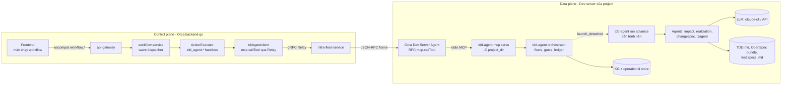
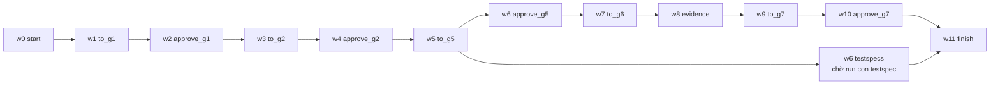
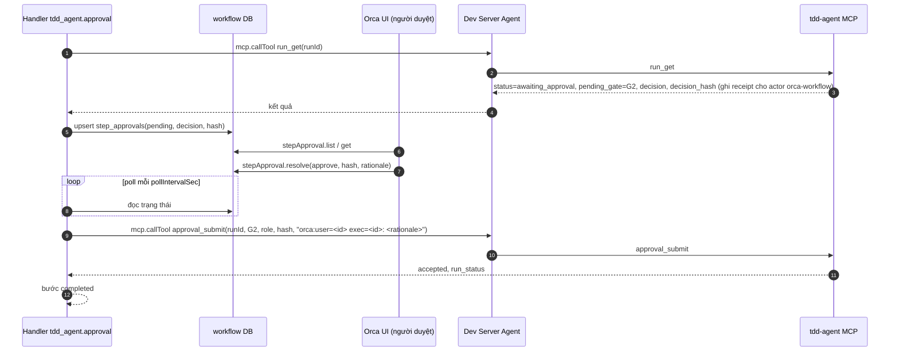
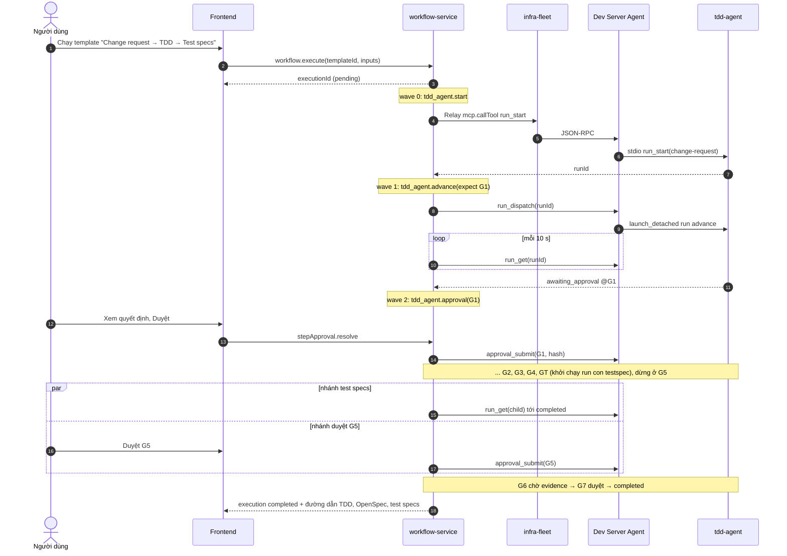
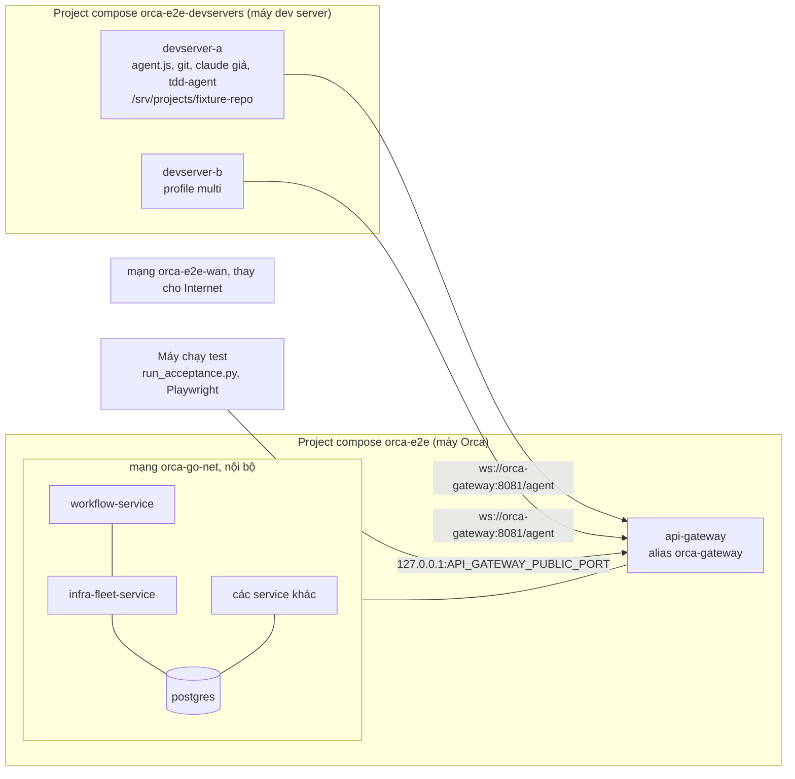

# TDD-WF-AGENT-001 — Tích hợp luồng gọi agent kiểu tdd-agent vào Workflow Orca

| Trường | Giá trị |
|---|---|
| **Mã tài liệu** | TDD-WF-AGENT-001 |
| **Loại** | Technical Design Document |
| **Phiên bản** | v0.2 (cập nhật theo code đã viết, xem §14) |
| **Ngày** | 2026-10-14 |
| **Trạng thái** | 🚧 Đang triển khai — tiến độ ở [TASKS.md](./TASKS.md) |
| **Nhánh khảo sát** | `feat/e2e-acceptance-fixes` (`1773fe7c7`), repo `tdd-agentic-ai` nhánh `tasks/integrate-tetspec-agent` (`6ab2d0c`) |
| **Phạm vi** | `backend-go/services/workflow-service`, `backend-go/services/infra-fleet-service`, `agent` (Dev Server Agent), `frontend` (màn chạy workflow), repo `tdd-agentic-ai` (MCP server) |
| **Liên quan** | [CR v7 workflow-engine](../crs/v7/workflow-engine/README.md) (CR-WFD-001..011), BACKLOG-021, BACKLOG-027, `tdd-agentic-ai/docs/tsagent/integrate/` |

> "TDD" trong tài liệu này là *Technical Design Document* (tài liệu thiết kế kỹ thuật), cũng là sản phẩm mà tdd-agent sinh ra. Không liên quan đến Test-Driven Development.

---

## 1. Bối cảnh và mục tiêu

### 1.1 Bối cảnh

`tdd-agentic-ai` có một bộ điều phối riêng (orchestrator) chạy các agent theo **luồng có cổng (gate)**:

- Mỗi **flow** là một dãy gate có phụ thuộc (`depends_on`), mỗi gate gọi một agent (impact, realization, changespec, testspec, ...).
- Gate trả `ok` / `blocked` / `pending_evidence`; gate có `approval` thì dừng ở `awaiting_approval` cho người duyệt (BA, SA/Dev, ...), duyệt gắn với **hash của quyết định** (`decision_hash`).
- Đầu vào mỗi gate được băm (`input_hash`); đầu vào đổi thì gate và các gate phụ thuộc thành `stale` và chạy lại.
- Gate có thể khởi chạy **run con** (GT sau G4 khởi chạy flow `testspec` → TS1 sinh test specs bằng tsagent, chạy tách tiến trình).
- Toàn bộ điều khiển được lộ qua **MCP** (`tdd-agent mcp serve`): `run_start`, `run_resume`, `run_get`, `approval_submit`, `kg_*`, ...

Orca có **workflow-service** (Go) chạy template DAG theo wave trên Dev Server qua infra-fleet Relay. Hiện Orca **chưa gọi tdd-agent ở bất kỳ đâu**, chưa có template nào sinh TDD hay test specs.

### 1.2 Mục tiêu

1. Người dùng Orca chạy được luồng **TDD → Change Request → Test specs** của tdd-agent từ một **workflow Orca**, trên dev server của project.
2. Orca thấy được tiến độ theo từng gate, các điểm chặn (blockers), và **duyệt gate ngay trên Orca** (thay vì gõ CLI trên dev server).
3. Cách tích hợp là **tất định** (không phụ thuộc vào việc một LLM "hiểu" prompt để gọi đúng tool), chịu được restart của workflow-service, không bị cắt bởi timeout relay.
4. Thiết kế đủ chung để sau này gắn các "agent pipeline" khác có cùng mô hình gate/approval, không chỉ tdd-agent.

### 1.3 Ngoài phạm vi

- Viết lại orchestrator của tdd-agent trong Go. tdd-agent vẫn là nơi giữ trạng thái run, ledger gate, KG.
- Bộ schema workflow v2, rẽ nhánh `when`, workflow con tổng quát (CR-WFD-001/002). Thiết kế này chạy được trên engine hiện tại, và chỉ ra chỗ sẽ gọn hơn khi các CR đó xong.
- Sinh code từ OpenSpec bundle (phần G5→task code thuộc request-service/task-service).

---

## 2. Hiện trạng đã kiểm chứng

### 2.1 Orca workflow-service (Go)

| Hạng mục | Thực tế | Bằng chứng |
|---|---|---|
| Loại bước | `agent, shell, notification, webhook, condition, cleanup_worktrees, action, parallel, commit_push` | `workflow-service/internal/domain/step.go:19-55` |
| Lập lịch | Kahn → wave, trong wave chạy song song; một bước lỗi → cả execution lỗi | `usecase/execute.go`, `usecase/wave_dispatcher.go` |
| Truyền dữ liệu giữa bước | **Có** `{{inputs.x}}` và `{{outputs.<stepId>.<path>}}` | `domain/interpolation.go:33-60` |
| Bước `action` | Executor có, **chưa đăng ký handler nào** → mọi `action` lỗi `ErrNoActionHandlerRegistered` | `adapter/stepexecutors/action.go:13-49`, `cmd/server/main.go:241` |
| Bước `agent` | `agent.execPrompt` (one-shot CLI AI), không truyền `timeoutMs` → agent cắt ở 5 phút | `adapter/infrafleetclient/agent_step_executor.go:62-148`, `agent/src/relay/agent-print-mode-exec.ts:74-77` |
| Bước `shell` | `shell.exec`, phía Go dùng `RequestTimeout` mặc định **30 s**, không có cwd | `infra-fleet-service/internal/adapter/devserveragent/exec_timeouts.go`, `config.go:57` |
| Timeout `agent.execPrompt` phía Go | 15 phút | `exec_timeouts.go:11,19` |
| Danh tính người chạy | Nhánh này lưu `started_by`, khôi phục khi restart (`RecoverExecutions`) | `usecase/execute.go:151`, `recover_executions.go:172-181`, migration `0013` |
| Chọn dev server | `target: "project:<id>"` → `serverresolver` → `connectionId` | `adapter/serverresolver/resolver.go` |
| Cổng người duyệt trong execution | **Không có**. `approval` hiện chỉ là duyệt *publish template* | `domain/approval.go`, BACKLOG-027, CR-WFD-004 |
| Huỷ execution | Có `CancelExecution`; không có cơ chế huỷ tiến trình trên dev server | `usecase/cancel_execution.go` |
| Stream tiến trình | Chưa có kênh `workflow.activity`, frontend poll | BACKLOG-021 |

### 2.2 tdd-agent

| Hạng mục | Thực tế | Bằng chứng (`tdd-agentic-ai/src/tdd_agent/`) |
|---|---|---|
| Flow `change-request` | G0 intake → G1 srs_ready (BA) → G2 impact_approved (SA/Dev) → G3 tdd_realized → G4 spec_eligible → **GT testspec_dispatched** → G5 spec_authored (SA) → G6 verified (evidence) → G7 accepted (BA/owner) | `agents/flows.py:29-47` |
| Flow `tdd-generation` | G3 duy nhất (URD/SRS/SAD → KG + TDD) | `agents/flows.py:48-50` |
| Flow `testspec` | TS1 (tsagent sinh 3 tài liệu test specs) | `agents/flows.py:56` |
| Trạng thái run | `running`, `awaiting_approval`, `awaiting_evidence`, `blocked`, `completed`, `failed` | `orchestrator/engine.py` |
| `run_resume` | Đồng bộ: chạy tới khi chờ duyệt / chờ evidence / blocked / failed / completed. Có thể mất nhiều phút (TS1 trên MiniPay ≈ 3 phút; G3 lâu hơn) | `mcp/tools.py:489-495` |
| Run con | GT gọi `launch_detached` chạy `tdd-agent run advance <child>` ở session riêng | `agents/testspec/gate.py:27-36` |
| Duyệt qua MCP | `approval_submit(run_id, gate, role, decision_hash, rationale)`; actor là **danh tính client MCP đã cấu hình**, không cho caller tự chọn; cần **biên nhận đã đọc** (receipt) — `run_get` ghi receipt khi run đang `awaiting_approval` | `mcp/tools.py:365-374, 549-560`, `orchestrator/approvals.py:25,60` |
| Tool ghi | `run_start`, `run_resume`, `changeset_propose`, `proposals_list` (+ `approval_submit` nếu bật) | `mcp/tools.py:31` |
| Transport | stdio (`tdd-agent -C <proj> mcp serve --transport stdio`) hoặc HTTP + bearer token | `cli.py:128-135` |

### 2.3 Khoảng trống cần lấp

1. Không có đường **tất định** từ workflow-service tới tdd-agent: `shell` bị cắt 30 s; `agent` phụ thuộc LLM tự gọi tool và bị cắt 5 phút.
2. `run_resume` chạy lâu, không hợp với một lời gọi relay đồng bộ.
3. Orca không có bước "chờ người duyệt" trong execution.
4. Không có cách huỷ run tdd-agent từ ngoài.

---

## 3. Yêu cầu

### 3.1 Chức năng

| ID | Yêu cầu |
|---|---|
| FR-01 | Tạo workflow từ template có sẵn: "TDD generation", "Change request (TDD + test specs)", "Test specs từ TDD có sẵn". |
| FR-02 | Mỗi gate của tdd-agent hiện thành trạng thái thấy được trên màn chạy workflow (gate đang chạy, đang chờ duyệt, blockers). |
| FR-03 | Người dùng có quyền trên project duyệt gate từ Orca; Orca hiển thị nội dung quyết định (`decision`) trước khi duyệt và gửi đúng `decision_hash` đã hiển thị. |
| FR-04 | Nhánh test specs (GT → run con `testspec`) chạy song song với nhánh duyệt G5; workflow chỉ hoàn tất khi cả hai xong. |
| FR-05 | Gate `blocked` làm bước lỗi, output chứa danh sách blockers dạng máy đọc được; người dùng bổ sung đầu vào rồi chạy lại từ bước đó. |
| FR-06 | Đầu ra (đường dẫn TDD, OpenSpec bundle, 3 tài liệu test specs) có trong output bước, mở được từ Orca. |
| FR-07 | Huỷ execution dừng việc theo dõi và (giai đoạn 2) dừng run tdd-agent. |

### 3.2 Phi chức năng

| ID | Yêu cầu |
|---|---|
| NFR-01 | Không lời gọi relay nào kéo dài quá 2 phút; việc dài chạy nền trên dev server và được **poll**. |
| NFR-02 | Bước có thể chạy lại an toàn (idempotent) sau khi workflow-service restart (`RecoverExecutions` gọi lại bước đang chạy). |
| NFR-03 | Agent trên dev server chỉ chạy MCP server có trong allowlist; không mở đường chạy lệnh tuỳ ý mới. |
| NFR-04 | Mọi duyệt có hai vết audit: bên Orca (user Orca, thời điểm, hash) và bên tdd-agent (actor client, rationale chứa user Orca). |
| NFR-05 | Bí mật (khóa LLM, token MCP HTTP) không đi qua workflow-service; nằm trên dev server. |
| NFR-06 | Chạy được trên mọi kiểu kết nối dev server (relay-ssh, relay-ws, direct-ws) vì chỉ dùng infra-fleet Relay. |

---

## 4. Các phương án và quyết định

| | A. Bước `agent` + prompt gọi MCP | B. Bước `shell` gọi CLI `tdd-agent` | **C. Bước `action` + RPC `mcp.callTool` (chọn)** |
|---|---|---|---|
| Cách làm | Claude CLI trên dev server đọc `.mcp.json`, prompt bảo nó gọi `run_start`/`run_resume` | `shell.exec "tdd-agent -C … run advance …"` | workflow-service gọi trực tiếp tool MCP của tdd-agent qua RPC mới của agent; việc dài chạy tách tiến trình, Orca poll `run_get` |
| Tất định | ✗ LLM có thể gọi sai/thiếu tool | ✓ | ✓ |
| Timeout | 5 phút (15 nếu truyền `timeoutMs`) | **30 s** phía Go, không cwd | Mỗi lời gọi ngắn; poll không giới hạn tổng |
| Đọc kết quả | Phải parse văn bản tự do | Parse stdout | JSON có cấu trúc từ MCP |
| Duyệt từ Orca | Không | Có thể (CLI `approve`) nhưng phải tự lo receipt | ✓ `run_get` ghi receipt + `approval_submit` |
| An toàn | Trust preset của agent; LLM có quyền ghi | Mở thêm đường lệnh shell | Allowlist server + tool |
| Công sức | Thấp (chỉ template) | Thấp, nhưng phải sửa timeout và cwd | Trung bình |
| Dùng cho | **PoC/demo** (giai đoạn 0) | Không chọn | **Bản chính** |

**Quyết định (WFA-ADR-01):** chọn **C**. A giữ làm PoC giai đoạn 0 để có kết quả sớm. B bị loại vì phải nới giới hạn `shell.exec` (rộng hơn nhu cầu) và tự xử lý receipt duyệt.

**WFA-ADR-02:** dùng loại bước **`action`** có sẵn với các handler tên `tdd_agent.*`, không thêm `StepType` mới. Lý do: `action` đã có trong domain, proto và registry, chỉ thiếu handler; tránh sửa enum proto. Khi CR-WFD-005 có `mcp_call`, các handler này chuyển thành lớp mỏng trên `mcp_call`.

**WFA-ADR-03:** **tdd-agent giữ trạng thái**, Orca chỉ lưu `runId` trong output bước và poll. Không đồng bộ ledger gate sang DB của Orca.

**WFA-ADR-04:** việc dài (`advance`) chạy **tách tiến trình trên dev server** (cùng cơ chế `launch_detached` của GT), không giữ lời gọi relay mở.

---

## 5. Kiến trúc tổng thể



Nguyên tắc:

- workflow-service **không** biết gì về gate cụ thể; chỉ biết các thao tác chung: *start*, *advance tới điểm dừng*, *đọc quyết định*, *duyệt*, *chờ run con*.
- Agent của Orca chỉ là **cầu nối MCP stdio**; không hiểu nghiệp vụ tdd-agent.
- tdd-agent không biết Orca; Orca là một client MCP như Claude Code.

---

## 6. Ánh xạ khái niệm

| tdd-agent | Orca workflow | Ghi chú |
|---|---|---|
| Flow (`change-request`, `testspec`, ...) | Workflow template | Một template cho mỗi flow cần dùng |
| Run (`run_id`) | Execution | `runId` lưu trong output bước `start`, các bước sau lấy qua `{{outputs.start.runId}}` |
| Đoạn gate chạy tự động liền nhau | Một bước `tdd_agent.advance` | Bước kết thúc khi run tới điểm dừng mong đợi |
| Gate có `approval` | Một bước `tdd_agent.approval` | Giai đoạn 1: bước chờ (poll) quyết định từ Orca UI. Giai đoạn 2: bước `gate` của CR-WFD-004 |
| `pending_evidence` (G6) | Bước `tdd_agent.advance` với `stopAt: awaiting_evidence` + bước chờ evidence | Evidence (test receipt) ghi bằng tool tdd-agent hoặc từ CI |
| Run con (GT → `testspec`) | Nhánh song song trong DAG, bước `tdd_agent.wait_child` | Fan-out sau bước advance đi qua GT |
| `blocked` + blockers | Bước `failed`, output `blockers[]` | Người dùng bổ sung rồi "Retry from step" |
| `stale` (đầu vào đổi) | tdd-agent tự xử lý khi `advance` | Orca không cần biết |
| `decision` + `decision_hash` | Nội dung hiển thị ở màn duyệt + hash gửi lại khi duyệt | Hash ràng buộc "đã duyệt đúng cái đã xem" |

---

## 7. Thiết kế chi tiết

### 7.1 RPC mới trên Dev Server Agent: `mcp.callTool`

Vị trí: `agent/src/relay/mcp-tool-call.ts` (mới), đăng ký trong `agent/src/relay/agent-rpc-dispatch-misc.ts`. Agent quảng bá feature `mcp.callTool` (giống `agent.execPrompt.readonly`) để backend kiểm tra khả năng trước khi gọi.

**Request**

```json
{
  "server": "tdd-agent",
  "projectDir": "/home/dev/minipay",
  "tool": "run_get",
  "arguments": { "run_id": "r-20261014-01" },
  "timeoutMs": 60000
}
```

**Response**

```json
{ "ok": true, "result": { "...": "structuredContent của tool" }, "isError": false, "durationMs": 812 }
```

Lỗi tool MCP (`isError: true`) trả `ok: true, isError: true, error: {code, message, details}` để phía Go phân biệt *lỗi nghiệp vụ* với *lỗi vận chuyển*.

**Quy tắc**

| Quy tắc | Chi tiết |
|---|---|
| Allowlist server | Cấu hình agent `mcpBridge.servers`: `{ "tdd-agent": { "command": "tdd-agent", "args": ["-C", "${projectDir}", "mcp", "serve", "--transport", "stdio"], "env": [...] } }`. Không nhận lệnh từ request. |
| `projectDir` | Phải nằm trong workspace đã đăng ký của project (cùng kiểm tra `wsValidation` mà `agent.execPrompt` dùng). |
| Allowlist tool | Theo server: tdd-agent cho phép `run_start, run_get, run_list, run_dispatch, run_cancel, approval_submit, trace_get, kg_snapshots`. |
| Vòng đời tiến trình | Giữ **một** tiến trình MCP stdio cho mỗi `(server, projectDir)`, tái dùng, đóng sau 10 phút rảnh. Tiến trình chết → khởi lại ở lời gọi kế. |
| Timeout | Mặc định 60 s, tối đa 120 s. Không tool nào trong allowlist được chạy lâu (việc dài dùng `run_dispatch`). |
| Log | Span `mcp.callTool` (server, tool, duration, isError); không log `arguments` của `approval_submit.rationale` quá 200 ký tự. |

infra-fleet: thêm `"mcp.callTool": 150 * time.Second` vào `execTimeoutOverrides` (`exec_timeouts.go`), lớn hơn trần 120 s của agent, cùng nguyên tắc với `ai.complete`.

### 7.2 Thay đổi ở tdd-agent (repo `tdd-agentic-ai`)

| Thay đổi | Lý do |
|---|---|
| Tool MCP **`run_dispatch(run_id)`** (ghi): nếu run không `running` thì gọi `launch_detached` chạy `run advance <id>` rồi trả ngay `{run_id, dispatched: true, pid}`; nếu đang `running` thì trả `{dispatched: false, reason: "RUN_ALREADY_RUNNING"}` | `run_resume` đồng bộ, không hợp với relay. Tái dùng đúng cơ chế GT đang dùng. Idempotent nhờ khoá run. |
| Tool MCP **`run_cancel(run_id, reason)`** (ghi): đánh dấu run `failed` với blocker `CANCELLED_BY_CLIENT`, gửi SIGTERM tới pid tiến trình nền đã ghi | FR-07. |
| `run_start` nhận `sources[].path` (tương đối với thư mục project, phải nằm trong đó) thay cho `text`; tdd-agent tự đọc file | Hiện `_source_doc` bắt buộc `{id, revision, role, text}` (`mcp/tools.py:479-487`); workflow-service không đọc được file trên dev server. |
| `run_start` nhận thêm `request.origin.external = {system: "orca", executionId, stepId, userId}` (đã có `origin`, chỉ mở rộng) | Truy vết ngược từ run sang execution Orca. |
| Ghi `pid` + `heartbeat_at` của tiến trình advance vào run | Phát hiện tiến trình chết khi run kẹt ở `running` (xem §7.6). |
| `mcp enable --client orca --approvals` tạo actor `orca-workflow` trong allowlist approver, với các role được phép | Duyệt qua MCP cần actor cấu hình sẵn. |

> Các tool này nằm trong `WRITE_TOOLS` và chịu `McpPolicy` hiện có (audit `_audit_write`, actor cấu hình).

### 7.3 Handler `tdd_agent.*` trong workflow-service

Gói mới `workflow-service/internal/adapter/tddagentclient/`:

- `client.go`: `CallTool(ctx, projectTarget, projectDir, tool, args) (json.RawMessage, error)` — resolve `project:<id>` bằng `serverresolver` rồi gọi `infrafleetv1.Relay(method="mcp.callTool")`, tái dùng `relay()` và `withTenantMetadata` trong `infrafleetclient`.
- `actions.go`: các `ActionHandler`, đăng ký trong `cmd/server/main.go` (đổi `stepexecutors.NewActionExecutor()` ở dòng 241 thành biến rồi `Register`).

**Tham số chung** (trong `params` của bước `action`):

| Trường | Kiểu | Bắt buộc | Mô tả |
|---|---|---|---|
| `target` | string | ✓ | `project:{{inputs.projectId}}` |
| `projectDir` | string | ✓ | Thư mục project tdd-agent trên dev server |
| `pollIntervalSec` | int | | Mặc định 10 |
| `deadlineMin` | int | | Tổng thời gian tối đa của bước; mặc định 60 (advance), 4320 = 3 ngày (approval) |

**Danh sách handler**

| Action | Tham số riêng | Làm gì | Output |
|---|---|---|---|
| `tdd_agent.start` | `flow`, `request` (JSON), `sources[]` | `run_list` tìm run có `origin.external.executionId+stepId` trùng (idempotent); không có thì `run_start` | `{runId, flow, status}` |
| `tdd_agent.advance` | `runId`, `stopAt[]` (mặc định `["awaiting_approval","awaiting_evidence","completed"]`), `expectGate` (tùy chọn) | `run_get`; nếu chưa ở trạng thái dừng và không `running` → `run_dispatch`; poll `run_get` tới khi status ∈ `stopAt ∪ {blocked, failed}` | `{runId, status, pendingGate, blockedGate, blockers[], gates{G*: status}, children[]}` |
| `tdd_agent.approval` | `runId`, `gate`, `role` | Poll tới khi run `awaiting_approval` tại `gate`; ghi `decision` + `decision_hash` vào bảng chờ duyệt của Orca (§7.5); chờ người dùng duyệt/từ chối; khi duyệt → `approval_submit` | `{runId, gate, approvedBy, decisionHash, approvedAt}` |
| `tdd_agent.wait_child` | `runId`, `childFlow` (mặc định `testspec`) | Lấy run con từ `run_get.children` (hoặc `run_list(flow, parent)`), poll tới `completed/blocked/failed` | `{childRunId, status, outputs: {specsDir, files[]}}` |
| `tdd_agent.wait_evidence` | `runId`, `gate` (mặc định `G6`) | Poll tới khi run rời `awaiting_evidence` tại `gate` | `{runId, gate, status}` |

**Quy tắc kết quả**

| tdd-agent sau khi poll | Kết quả bước Orca |
|---|---|
| status ∈ `stopAt` và (không có `expectGate` hoặc `pendingGate == expectGate`) | `completed` |
| `pendingGate` khác `expectGate` | `failed`, `error: TDD_AGENT_UNEXPECTED_GATE` (template không khớp flow) |
| `blocked` | `failed`, output có `blockers[]`, `blockedGate` |
| `failed` | `failed`, `error` lấy từ blockers (`GATE_ERROR:*`, `CANCELLED_BY_CLIENT`) |
| Quá `deadlineMin` | `failed`, `error: TDD_AGENT_DEADLINE` (run tdd-agent **không** bị huỷ) |
| ctx bị huỷ (CancelExecution) | Dừng poll; giai đoạn 2 gọi `run_cancel` |
| Lỗi vận chuyển (dev server offline) | Thử lại lời gọi kế tiếp trong vòng poll; quá 5 lần liên tiếp → `failed`, `error: TDD_AGENT_UNREACHABLE` |

Poll chạy trong goroutine của wave dispatcher, ctx của bước không có deadline riêng (đã kiểm tra `usecase/*` không đặt `WithTimeout`), nên handler tự áp `deadlineMin`.

### 7.4 Template workflow

Template "Change request → TDD → Test specs" (DAG JSON lưu bằng `workflow.template.create`):

```json
{
  "inputs": ["projectId", "projectDir", "crPath", "crRevision"],
  "steps": [
    { "id": "start", "type": "action", "config": { "actionName": "tdd_agent.start", "params": {
        "target": "project:{{inputs.projectId}}", "projectDir": "{{inputs.projectDir}}",
        "flow": "change-request",
        "request": { "params": { "cr_path": "{{inputs.crPath}}" } },
        "sources": [{ "id": "CR", "revision": "{{inputs.crRevision}}", "role": "CR", "path": "{{inputs.crPath}}" }] } } },

    { "id": "to_g1", "type": "action", "dependsOn": ["start"], "config": { "actionName": "tdd_agent.advance", "params": {
        "target": "project:{{inputs.projectId}}", "projectDir": "{{inputs.projectDir}}",
        "runId": "{{outputs.start.runId}}", "expectGate": "G1" } } },
    { "id": "approve_g1", "type": "action", "dependsOn": ["to_g1"], "config": { "actionName": "tdd_agent.approval", "params": {
        "target": "project:{{inputs.projectId}}", "projectDir": "{{inputs.projectDir}}",
        "runId": "{{outputs.start.runId}}", "gate": "G1", "role": "BA" } } },

    { "id": "to_g2", "type": "action", "dependsOn": ["approve_g1"], "config": { "actionName": "tdd_agent.advance", "params": {
        "...": "...", "runId": "{{outputs.start.runId}}", "expectGate": "G2" } } },
    { "id": "approve_g2", "type": "action", "dependsOn": ["to_g2"], "config": { "actionName": "tdd_agent.approval", "params": {
        "...": "...", "runId": "{{outputs.start.runId}}", "gate": "G2", "role": "SA/Dev" } } },

    { "id": "to_g5", "type": "action", "dependsOn": ["approve_g2"], "config": { "actionName": "tdd_agent.advance", "params": {
        "...": "...", "runId": "{{outputs.start.runId}}", "expectGate": "G5", "deadlineMin": 120 } } },

    { "id": "testspecs", "type": "action", "dependsOn": ["to_g5"], "config": { "actionName": "tdd_agent.wait_child", "params": {
        "...": "...", "runId": "{{outputs.start.runId}}", "childFlow": "testspec", "deadlineMin": 60 } } },
    { "id": "approve_g5", "type": "action", "dependsOn": ["to_g5"], "config": { "actionName": "tdd_agent.approval", "params": {
        "...": "...", "runId": "{{outputs.start.runId}}", "gate": "G5", "role": "SA" } } },

    { "id": "to_g6", "type": "action", "dependsOn": ["approve_g5"], "config": { "actionName": "tdd_agent.advance", "params": {
        "...": "...", "runId": "{{outputs.start.runId}}", "stopAt": ["awaiting_evidence", "awaiting_approval"] } } },
    { "id": "evidence", "type": "action", "dependsOn": ["to_g6"], "config": { "actionName": "tdd_agent.wait_evidence", "params": {
        "...": "...", "runId": "{{outputs.start.runId}}", "gate": "G6", "deadlineMin": 10080 } } },
    { "id": "to_g7", "type": "action", "dependsOn": ["evidence"], "config": { "actionName": "tdd_agent.advance", "params": {
        "...": "...", "runId": "{{outputs.start.runId}}", "expectGate": "G7" } } },
    { "id": "approve_g7", "type": "action", "dependsOn": ["to_g7"], "config": { "actionName": "tdd_agent.approval", "params": {
        "...": "...", "runId": "{{outputs.start.runId}}", "gate": "G7", "role": "BA/owner" } } },
    { "id": "finish", "type": "action", "dependsOn": ["approve_g7", "testspecs"], "config": { "actionName": "tdd_agent.advance", "params": {
        "...": "...", "runId": "{{outputs.start.runId}}", "stopAt": ["completed"] } } }
  ]
}
```

`"...": "..."` là chỗ lặp lại `target` và `projectDir`; khi CR-WFD-003 có biến chạy cấp execution thì bỏ được phần lặp.

Wave tính ra:



Hạn chế của engine hiện tại: wave là barrier, nên `to_g6` (w7) phải chờ cả `testspecs` (w6) xong. Chấp nhận được (test specs ≈ vài phút, G5 là duyệt người, thường lâu hơn). Khi có CR-WFD-002 thì bỏ barrier.

Hai template khác:

| Template | Bước |
|---|---|
| TDD generation | `start(flow=tdd-generation)` → `advance(stopAt=[completed])` |
| Test specs từ TDD có sẵn | `start(flow=testspec, request.params={tdd, scope})` → `advance(stopAt=[completed])` |

### 7.5 Duyệt gate từ Orca (giai đoạn 1, chưa có CR-WFD-004)

Bảng mới `workflow.step_approvals` (Postgres + MySQL, migration `0014`):

| Cột | Kiểu | Ghi chú |
|---|---|---|
| `id` | uuid | |
| `tenant_id`, `execution_id`, `step_id` | | Khoá duy nhất `(execution_id, step_id)` |
| `kind` | text | `tdd_agent` (để sau dùng chung) |
| `subject` | jsonb | `{runId, gate, role}` |
| `decision` | jsonb | Nội dung quyết định đọc từ `run_get` |
| `decision_hash` | text | |
| `status` | text | `pending`, `approved`, `rejected`, `superseded` |
| `resolved_by`, `resolved_at`, `rationale` | | |

RPC mới (proto `workflow.v1`, kênh wscompat):

| Kênh | Request | Ghi chú |
|---|---|---|
| `workflow.stepApproval.list` | `{projectId?, executionId?}` | Danh sách chờ duyệt cho user |
| `workflow.stepApproval.get` | `{id}` | Trả `decision` để hiển thị |
| `workflow.stepApproval.resolve` | `{id, decision: approve\|reject, decisionHash, rationale}` | Kiểm `decisionHash` == hash đang lưu; kiểm quyền (§7.8) |



Các trường hợp:

- **Từ chối:** bước `failed` với `error: TDD_AGENT_APPROVAL_REJECTED`; tdd-agent không nhận gì (gate vẫn chờ). Người dùng sửa đầu vào ở tdd-agent rồi "Retry from step" ở bước `advance` trước đó.
- **Hash đổi** (run bị chạy lại, quyết định mới): handler thấy `decision_hash` khác bản ghi → đánh dấu bản cũ `superseded`, tạo bản mới; `resolve` với hash cũ bị từ chối `STEP_APPROVAL_STALE`.
- **Duyệt ngoài Orca** (CLI trên dev server): handler thấy run đã rời `awaiting_approval` ở gate đó → bước `completed`, `approvedBy: "external"`.
- `approval_submit` bị tdd-agent từ chối (`ApprovalRejected`: sai role, thiếu receipt, ...) → bước `failed`, mang `code` của tdd-agent.

Khi CR-WFD-004 xong, `tdd_agent.approval` tách thành: bước `gate` chung (trạng thái `waiting`, phân quyền, hết hạn) + bước `action tdd_agent.submit_approval`. Bảng `step_approvals` gộp vào mô hình của CR-WFD-004.

### 7.6 Khôi phục, idempotency, huỷ

| Tình huống | Xử lý |
|---|---|
| workflow-service restart giữa `advance` | `RecoverExecutions` gọi lại handler. `advance` bắt đầu bằng `run_get`: run đang `running` → chỉ poll; đã tới điểm dừng → `completed` ngay. Không dispatch lần hai. |
| Restart giữa `start` | `start` tìm run theo `origin.external.(executionId, stepId)` trước khi tạo. |
| Restart giữa `approval` | Bản ghi `step_approvals` còn trong DB; handler đọc lại. Nếu đã `approved` mà chưa `approval_submit` (crash giữa hai việc) → gửi lại; tdd-agent trả `ALREADY_APPROVED` thì coi là thành công. |
| Tiến trình advance trên dev server chết | Run kẹt `running`. Handler thấy `heartbeat_at` cũ hơn 3 × chu kỳ heartbeat → gọi `run_dispatch` lại (tdd-agent chạy lại gate dở nhờ ledger, gate `running` không `completed` sẽ chạy lại). |
| Dev server offline | Lỗi relay → đếm lỗi liên tiếp (§7.3). |
| Người dùng huỷ execution | Giai đoạn 1: dừng poll, run tdd-agent tiếp tục chạy (hiển thị cảnh báo "run trên dev server vẫn chạy"). Giai đoạn 2: handler gọi `run_cancel` trong `defer` khi ctx bị huỷ, kèm run con. |
| Người dùng chạy lại từ một bước | Bước `advance` idempotent; tdd-agent tự quyết gate nào stale. |

### 7.7 Quan sát

- Output mỗi bước giữ `gates{}` (bảng trạng thái gate) và `traceId` của tdd-agent; màn chạy workflow hiển thị bảng gate gắn trong bước.
- Handler `advance` ghi log mỗi lần trạng thái gate đổi (`slog` với `execution_id`, `run_id`, `gate`, `from`, `to`).
- Khi có kênh `workflow.activity` (BACKLOG-021, CR-WFD-008), handler phát sự kiện `step.progress {gate, status}`; trước đó frontend poll `workflow.getExecution` như hiện tại.
- Metrics: `workflow_tdd_agent_calls_total{tool,result}`, `workflow_tdd_agent_poll_duration_seconds{action}`, `workflow_tdd_agent_approval_wait_seconds{gate}`.

### 7.8 An toàn và phân quyền

| Vấn đề | Thiết kế |
|---|---|
| Ai được duyệt | User có quyền ghi trên project **và** role Orca ánh xạ sang role tdd-agent của gate (cấu hình project: `tddAgent.roleMap = {"BA": ["project-ba"], "SA": [...], ...}`). Mặc định chỉ owner. |
| Danh tính trong tdd-agent | Actor là `orca-workflow` (client MCP cấu hình), `rationale` bắt buộc chứa `orca:user=<id>`. Đề xuất mở về sau: tham số `on_behalf_of` được tdd-agent chấp nhận từ client tin cậy. |
| Bí mật | Khoá LLM, token MCP HTTP ở trên dev server (env của `mcpBridge.servers`), không qua workflow-service hay DB. |
| Bề mặt lệnh | `mcp.callTool` không nhận command; chỉ server + tool trong allowlist. `projectDir` phải nằm trong workspace của project. |
| Tenant | Handler chạy với ctx có `tenant` + `started_by` (đã sửa ở nhánh này), Relay đi qua `withTenantMetadata`. |
| Audit | Orca: bảng `step_approvals` + log. tdd-agent: `_audit_write` cho mọi tool ghi. |

### 7.9 Frontend

- Danh mục template: thêm 3 template ở §7.4 (seed bằng migration dữ liệu hoặc `workflow.template.create` khi bật feature).
- Màn chạy execution: với bước `action` có `actionName` bắt đầu `tdd_agent.`, hiển thị bảng gate (từ output), blockers, và nút **Xem quyết định / Duyệt / Từ chối** khi có `step_approvals` pending.
- Màn "Chờ tôi duyệt" dùng `workflow.stepApproval.list`.
- Đường dẫn tài liệu sinh ra (TDD, test specs) mở qua RPC `fs.*` sẵn có của dev server.

---

## 8. Luồng end-to-end



---

## 9. Thay đổi theo thành phần

| Thành phần | File | Thay đổi |
|---|---|---|
| agent | `agent/src/relay/mcp-tool-call.ts` (mới), `agent-rpc-dispatch-misc.ts`, cấu hình agent | RPC `mcp.callTool`, pool tiến trình MCP stdio, allowlist, feature flag `mcp.callTool` |
| infra-fleet-service | `internal/adapter/devserveragent/exec_timeouts.go` | Override timeout `mcp.callTool` 150 s |
| workflow-service | `internal/adapter/tddagentclient/{client,actions}.go` (mới) | Client + 5 handler |
| workflow-service | `cmd/server/main.go:241` | Giữ `ActionExecutor` vào biến, `Register("tdd_agent.*", ...)` |
| workflow-service | `migrations/{postgres,mysql}/0014_step_approvals.*` (mới), `internal/domain/step_approval.go` (mới), repository | Bảng + domain chờ duyệt |
| workflow-service | `usecase/{list,get,resolve}_step_approval.go` (mới), proto `workflow.v1` | RPC duyệt |
| api-gateway | `internal/adapter/wscompat/` | Kênh `workflow.stepApproval.*` |
| frontend | màn chạy workflow, màn chờ duyệt | Bảng gate, nút duyệt, template |
| tdd-agentic-ai | `src/tdd_agent/mcp/tools.py`, `server.py`, `orchestrator/engine.py`, `project.py` | `run_dispatch`, `run_cancel`, `origin.external`, pid/heartbeat, client `orca-workflow` |

---

## 10. Kế hoạch triển khai

| Giai đoạn | Nội dung | Điều kiện xong |
|---|---|---|
| **0 — PoC** (phương án A) | Template một bước `agent` (`trustPreset: full`, `timeoutMs` khi CR-WFD-005 có, tạm thời giữ dưới 5 phút) với prompt gọi MCP tdd-agent chạy flow `testspec` trên MiniPay. Cần `.mcp.json` trong worktree. | Một execution sinh ra 3 tài liệu test specs trên dev server. Chỉ để demo, không đưa vào template chính thức. |
| **1 — Nền** | `mcp.callTool` (agent + infra-fleet), `run_dispatch` (tdd-agent), handler `start`, `advance`, `wait_child`; template "TDD generation" và "Test specs từ TDD có sẵn" | E2E: chạy cả hai template trên MiniPay qua UI, restart workflow-service giữa chừng vẫn hoàn tất |
| **2 — Duyệt** | `step_approvals`, RPC duyệt, handler `approval`, `wait_evidence`, frontend duyệt; template Change request đầy đủ | E2E: chạy CR qua G1..G7, duyệt trên Orca, nhánh test specs song song |
| **3 — Huỷ và vận hành** | `run_cancel`, heartbeat, metrics, sự kiện `step.progress` khi có BACKLOG-021 | Huỷ execution dừng run tdd-agent và run con |
| **4 — Hợp nhất với CR v7** | Chuyển `approval` sang bước `gate` (CR-WFD-004), handler thành lớp mỏng trên `mcp_call` (CR-WFD-005), bỏ barrier wave (CR-WFD-002) | Không còn bảng `step_approvals` riêng |

---

## 11. Kiểm thử

| Mức | Nội dung |
|---|---|
| Unit Go | Handler với fake `CallTool`: bảng trạng thái §7.3, idempotency `start`, `advance` khi run đang `running`, deadline, lỗi vận chuyển liên tiếp, hash đổi khi duyệt |
| Unit agent (TS) | `mcp.callTool`: allowlist server/tool, `projectDir` ngoài workspace bị từ chối, tái dùng tiến trình, timeout, `isError` |
| Contract | Schema JSON request/response `mcp.callTool`; output các handler (frontend đọc) |
| Tích hợp tdd-agent | `run_dispatch` idempotent, `run_cancel` dừng tiến trình nền và run con (pytest trong `tdd-agentic-ai`) |
| E2E | Mở rộng `tests/stages/e2e/orca-flows/`: suite `suite_workflow_tdd_agent.py` (gọi qua WS RPC như `suite_workflow_dag.py`) với tdd-agent `llm=fake`; một ca real-UI với claude-cli trên MiniPay (`ui-live`) |
| Khôi phục | Kill workflow-service trong `advance` và trong `approval`; kill tiến trình advance trên dev server |

### 11.1 Môi trường e2e tách máy bằng Docker (Orca một nơi, dev server một nơi)

Bộ `orca-flows` hiện chạy agent ngay trên máy chạy stack (`deploy/dev/scripts/start-local-agent.sh`). Như vậy không chứng minh được điều quan trọng nhất của thiết kế: workflow-service **không chạm được** dev server, mọi thứ phải đi qua kết nối agent. E2E của tích hợp này chạy trên một topology tách:



**Thành phần**

| Thành phần | Thiết kế |
|---|---|
| Máy Orca | Đúng stack `deploy/dev` (`docker-compose.yml` + `docker-compose.local.yml` với Vault dev-mode), chạy dưới **project compose riêng `orca-e2e`** để không dùng chung volume với stack `orca-go` thật. Một overlay chỉ thêm `api-gateway` vào mạng `orca-e2e-wan` (alias `orca-gateway`); mọi service khác chỉ ở `orca-go-net`. Cổng công khai bind `127.0.0.1`. Không sửa `deploy/dev/.env`; các giá trị khác của môi trường test (`VAULT_ADDR=http://vault:8200`, `SERVER_BIND_IP`) truyền qua biến môi trường của shell. |
| Máy dev server | Project compose **riêng** `orca-e2e-devservers`, chỉ nối vào `orca-e2e-wan` (khai báo `external`). Image `node:22-bookworm-slim` + git, python3, ripgrep; chạy dưới user không phải root. `agent/out/agent.js`, `claude` giả (`orca-flows/fake_claude_cli/claude`) và repo mẫu (`ui-live/fixture-repo/template`) được bind-mount chỉ đọc, nên build lại agent chỉ cần khởi động lại container. Repo mẫu được `git init` + commit vào volume `/srv/projects` ở lần chạy đầu. |
| tdd-agent trên dev server | Tuỳ chọn khi build image: wheel của `tdd-agentic-ai` (build trên máy host, không copy cả repo) cài vào venv `/opt/tdd-agent`; `tdd-agent`, `tsagent` có trên `PATH`. Đây là điều kiện để chạy `mcp.callTool` → `tdd-agent mcp serve`. |
| Nguồn AI | `AI_MODE=stub` (mặc định, CI): `claude` giả, ghi mọi lần gọi để kiểm. `AI_MODE=real`: image có Claude Code, mount `~/.claude` đã đăng nhập. Không dùng khoá API, giống `start-local-agent.sh`. tdd-agent dùng `llm=fake` ở CI, `claude-cli` khi chạy thật. |
| Token agent | Script dựng môi trường (phía "người vận hành", trên máy host) gọi `POST /api/agent-token` bằng `ORCA_AGENT_API_SECRET` qua cổng công khai rồi truyền token vào container. Secret phía server **không bao giờ** vào dev server, giống `deploy/agent/scripts/connect-agent.sh`. |
| Duyệt dev server | Sau khi agent kết nối, script đăng nhập admin và gọi `devServer.approve` (dùng lại `wait_until_connected` của `orca-flows/ai_stub_agent_switch.py`). |
| Hai dev server | `devserver-b` (profile `multi`) để kiểm bước của project nào chạy đúng trên dev server của project đó. |

**Kiểm topology (chạy trước mọi suite, mã `TOP-*`)**

| ID | Kiểm | Cách kiểm |
|---|---|---|
| TOP-01 | Dev server đã đăng ký, `approved`, `connected` | `devServer.list` |
| TOP-02 | Dev server không phân giải được tên service nội bộ | `docker exec` trong dev server: `getent hosts infra-fleet-service`, `postgres` phải lỗi |
| TOP-03 | Dev server không mở được TCP tới IP nội bộ của control plane | Lấy IP `infra-fleet-service` bằng `docker inspect`, thử kết nối từ dev server có timeout: phải thất bại |
| TOP-04 | Control plane không chạm được dev server ngoài kết nối agent | Container tạm trên `orca-go-net` không phân giải/kết nối được `devserver-a` |
| TOP-05 | Dev server tới được gateway qua WAN | `getent hosts orca-gateway` trong dev server thành công |
| TOP-06 | Bước workflow chạy **trên dev server**, không phải trên máy Orca | Tạo project gắn `devserver-a`, `repoPath=/srv/projects/fixture-repo`; template một bước `shell` (`target: project:<id>`, `script: hostname`); output bước phải là `devserver-a` |
| TOP-07 | Định tuyến đúng dev server (profile `multi`) | Như TOP-06 cho project gắn `devserver-b`, output phải là `devserver-b` |

**Chạy các suite trên topology này**

- Suite hiện có: `ORCA_E2E_DEV_SERVER_NAME=e2e-devserver-a`, `ORCA_E2E_REPO_PATH=/srv/projects/fixture-repo`. Không dùng cờ `--ai-stub` của `run_acceptance.py`, vì cờ đó khởi động lại agent cục bộ bằng `start-local-agent.sh`; ở topology này stub nằm sẵn trong container (`AI_MODE=stub`), và báo cáo phải ghi rõ là chế độ AI stub.
- Suite của tích hợp (`suite_workflow_tdd_agent.py`): chạy các template ở §7.4 trên `devserver-a` có tdd-agent; kiểm thêm:
  - file TDD và test specs nằm trong volume của dev server (`docker exec`), **không** có trên máy Orca;
  - gọi `mcp.callTool` với `projectDir` ngoài `/srv/projects` bị từ chối;
  - dừng container `devserver-a` giữa bước `advance`: bước báo `TDD_AGENT_UNREACHABLE` sau 5 lần lỗi liên tiếp. Khởi động lại trước ngưỡng đó thì bước chạy tiếp, run tdd-agent không bị dispatch lần hai.
- Khôi phục: `docker restart orca-go-workflow` trong lúc `advance` và lúc `approval` chờ; execution phải hoàn tất (NFR-02).

**Giới hạn của môi trường này**

- `deploy/dev` cố định `container_name` (`orca-go-*`), nên không chạy song song được với stack `orca-go` khác trên cùng máy; script dựng môi trường phải từ chối khi thấy container của project khác.
- Hai mạng bridge trên cùng một Docker host chỉ mô phỏng việc cách ly mạng, không mô phỏng độ trễ hay mất gói. Muốn kiểm kết nối chập chờn thì thêm `tc netem` trên interface của dev server (để sau).
- Token agent dùng một lần, TTL 1 giờ: container dev server bị tạo lại thì phải cấp token mới.
- Bản build agent cũ thoát hẳn khi mất kết nối (xem `deploy/dev/README.md`), nên container dev server **không** đặt chế độ tự khởi động lại: agent chết phải hiện thành lỗi test.

---

## 12. Rủi ro và câu hỏi mở

| # | Rủi ro / câu hỏi | Hướng xử lý |
|---|---|---|
| Q1 | ~~`projectDir` lấy ở đâu~~ **Đã chốt (T0.2):** repo của project lưu đường dẫn trên dev server ở `Repo.url` (`project-service/internal/usecase/create_project.go:125`). Mặc định là repo đầu tiên (`ListRepos`); inputs được ghi đè nhưng phải nằm trong một repo của project (`tddagentclient.ResolveProjectDir`). | Xong |
| Q2 | tdd-agent có được cài sẵn trên dev server không, ai cài? | Giai đoạn 1: điều kiện tiên quyết, `mcp.callTool` trả `MCP_SERVER_NOT_INSTALLED` rõ ràng. Sau: bước `shell` cài đặt hoặc image dev server có sẵn. |
| Q3 | Duyệt bằng actor chung `orca-workflow` làm mờ danh tính người duyệt ở phía tdd-agent | Ghi user Orca trong rationale (giai đoạn 2); đề xuất `on_behalf_of` cho tdd-agent. |
| Q4 | Wave barrier khiến nhánh G6 chờ test specs | Chấp nhận tới khi có CR-WFD-002. |
| Q5 | Một execution giữ goroutine poll nhiều ngày (chờ duyệt, chờ evidence) | Poll nhẹ (một bản ghi DB / một `run_get` mỗi chu kỳ). Nếu số execution chờ lớn, chuyển sang trạng thái `waiting` không chiếm goroutine (CR-WFD-004/006). |
| Q6 | Run tdd-agent sinh file với quyền 600 (mkstemp) | Sửa ở tsagent trước khi cho Orca mở file qua `fs.*` dưới user khác. |
| Q7 | Engine TS cũ (`backend/src/main/workflow`) vẫn còn | Thiết kế chỉ cho engine Go; engine TS không được hỗ trợ (ADR-024). |
| Q8 | Nhiều execution cùng nhắm một run tdd-agent | `start` gắn run với `(executionId, stepId)`; `advance` chỉ nhận run có `origin.external.executionId` khớp, khác thì `TDD_AGENT_RUN_OWNED_ELSEWHERE`. |
| Q9 | ~~`run_list` lọc run con, `approval_submit` khi đã duyệt~~ **Đã trả lời (T0.1):** `run_list` không lọc theo run cha và `run_get` không trả run con → đã thêm cả hai (T1.3). Gate đã duyệt thì `approval_submit` bị từ chối `NOT_AWAITING_APPROVAL` (`orchestrator/approvals.py`) → handler đọc lại `run_get` và coi gate `approved` là xong. Phát hiện thêm: `submit_approval` tự `advance` đồng bộ → thêm `advance=false`. | Xong |

---

## 13. Bảng thuật ngữ

| Thuật ngữ | Nghĩa |
|---|---|
| Gate | Một bước kiểm/sinh trong flow tdd-agent, có trạng thái và có thể cần duyệt |
| Run | Một lần chạy flow tdd-agent, có `run_id` |
| Run con | Run do một gate khởi chạy (GT → `testspec`), có `parent_run_id` |
| Wave | Lớp các bước Orca không phụ thuộc nhau, chạy song song; wave sau chờ wave trước |
| Execution | Một lần chạy template workflow Orca |
| Decision hash | Hash nội dung quyết định của gate; duyệt phải gửi đúng hash đã xem |
| Receipt | Bản ghi "actor đã đọc quyết định", tdd-agent yêu cầu trước khi nhận duyệt |

---

## 14. Điều chỉnh khi triển khai (v0.2)

Những chỗ code khác bản thiết kế v0.1, và lý do:

| Mục | v0.1 | Đã làm | Lý do |
|---|---|---|---|
| §7.1 nơi định tuyến | `agent-rpc-dispatch-misc.ts` | Case `mcp.callTool` trong `agent-rpc-dispatch-agent-exec.ts`, xử lý ở `agent-rpc-dispatch-mcp.ts` + `mcp-stdio-bridge.ts` | `agent-rpc-dispatch.ts` đã vượt ngân sách `max-lines` (311/300) từ trước; không làm nó dài thêm |
| §7.1 lỗi của cầu nối | JSON-RPC error | Luôn trả `result`: `{ok:false, error:{code}}` cho lỗi cầu nối, `{ok:true, isError}` cho lỗi tool | Relay đổi JSON-RPC error thành gRPC error mất cấu trúc; workflow cần mã để quyết định thử lại hay dừng |
| §7.2 khởi chạy flow dự án | `run_start` + `sources[].path` | Thêm tool `generate_start` và `change_start` (chuẩn bị như CLI `generate` / `change start`, không advance) | `run_start` thô không ghi file TDD và không dựng được request change-request (baseline SRS/SAD, CR, OpenSpec). Ghi TDD làm sau khi run nền xong (`project.after_background_advance`) |
| §7.2 duyệt | `approval_submit` | `approval_submit(..., advance=false)` | `submit_approval` chạy tiếp các gate đồng bộ; qua relay phải trả ngay |
| §7.3 tham số | `{{inputs.x}}` | Token input là `{{x}}`; `request`/`sources` nhận object hoặc chuỗi JSON; token chưa có giá trị coi như rỗng; thêm `mode` (`run`/`generate`/`change`), `allowNoRun` | Cú pháp thật của `domain.Interpolate`; template phải là JSON hợp lệ nên object đi qua token dạng chuỗi |
| §7.3 huỷ | ctx bị huỷ | Mỗi vòng poll đọc trạng thái execution; thấy `cancelled` thì `run_cancel` | `CancelExecution` chỉ đổi DB, không huỷ bước đang chạy |
| §7.3 danh tính bước | — | `usecase.WithStepIdentity` (execution + step) gắn vào ctx trong `waveDispatcher.dispatchStep` | `StepExecutor` chỉ nhận config JSON; cần định danh để tìm lại run sau restart |
| §7.5 proto | `GetStepApprovalResponse` cho resolve | `ResolveStepApprovalResponse` riêng | `buf lint` |
| §7.7 metrics | — | `/metrics` mới của workflow-service (registry riêng, `prometheus/client_golang`) | Service chưa có endpoint metrics nào |
| §7.9 frontend | Bảng gate từ output bước | Chỉ có panel duyệt (`StepApprovalPanel` trong `ExecutionMonitor`) | Frontend không đọc được output từng bước: chưa có RPC trả step executions (CR-WFD-008). Bảng gate để lại (Q10) |
| §11.1 Vault | dùng `.env` | `SPLIT_VAULT_TOKEN` (mặc định `dev-root-token`) | Token Vault dùng chung trong `.env` không hợp lệ làm root token dev-mode |
| §11.1 tenant | — | `split-up.sh` đặt `ORCA_AGENT_DEFAULT_TENANT_ID` = tenant bootstrap (qua env shell) | Agent direct-websocket đăng ký dưới tenant này; khác tenant admin thì admin không thấy dev server |
| §11.1 fixture | — | `fixtures/tdd-project` chạy không cần mô hình ngôn ngữ (`--no-prose`, `[testspec] llm = "none"`) | E2E tất định; các ca change request cần LLM bật bằng `ORCA_E2E_REAL_AI=1` |

| # | Câu hỏi mới | Hướng |
|---|---|---|
| Q10 | Bảng gate trên UI cần output từng bước | Thêm RPC `workflow.listStepExecutions` (thuộc CR-WFD-008) rồi hiển thị `gates`/`blockers` của output `tdd_agent.*` |
