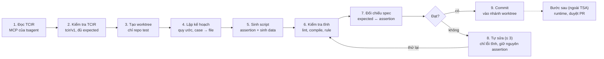

# TDD – Test Script Agent (TSA): sinh test script từ test spec

| Trường | Giá trị |
| --- | --- |
| Phương án | C – Pipeline neo theo spec |
| Trạng thái | Draft |
| Ngày | 2026-10-23 |
| Liên quan | [tsagent (agent sinh test spec)](../../agent/tetspec-agent/docs/tsagent/README.md) |
| Tích hợp Orca | [TDD-REQ-TESTSCRIPT-001](../integrate/TDD-REQ-TESTSCRIPT-001-test-scripts-in-request-execution.md): bước sinh script trong pha Execution, sau join test specs |

Test Script Agent (TSA) đọc TCIR của từng test case qua MCP của tsagent và sinh test script bám sát test spec vào một git worktree riêng. Một bước đối chiếu tất định (không dùng LLM) kiểm tra mỗi kết quả mong đợi trong spec có đúng một assertion. Chạy script (runtime) và duyệt PR là các bước sau, không thuộc TSA.

## 1. Tổng quan

### 1.1 Bối cảnh

Chuỗi agent:

```text
TDD → tsagent (3 tài liệu test spec; 03-test-cases.md kèm TCIR cho mỗi test case)
    → TSA (sinh test script vào worktree riêng)
    → runtime (chạy script, bước sau)
    → duyệt PR (bước sau)
```

tsagent đã chuẩn hoá TCIR (mục 3.1). TSA không diễn giải lại spec; nó chỉ chuyển TCIR thành code.

### 1.2 Nguyên tắc cốt lõi

**Test spec là nguồn sự thật duy nhất.** Script kiểm tra hệ thống *phải* làm gì theo spec, không phản ánh code *đang* làm gì. TSA không được đọc source của ứng dụng đang test, và không bao giờ sửa assertion để script "đạt".

### 1.3 Mục tiêu

- 100% expected trong TCIR có đúng một assertion tương ứng, kiểm chứng tự động.
- ≥ 90% script đạt lint/compile ngay khi sinh ra.
- Script chạy được trọn vẹn: tự sinh dữ liệu test, tự chuẩn bị và dọn trạng thái, không cần dữ liệu nạp tay.
- Mỗi assertion truy vết được về test case và expected trong spec.

### 1.4 Phạm vi

Trong phạm vi:

- Đọc TCIR (`tcir/v1`) qua MCP của tsagent.
- Sinh script cho test API, UI web (E2E), integration theo khung test của repo test, kèm bộ sinh dữ liệu.
- Kiểm tra tĩnh và đối chiếu script–spec; commit vào nhánh của worktree riêng.

Ngoài phạm vi:

- Chuẩn hoá TCIR (tsagent đã làm).
- Chạy script, tự sửa theo kết quả chạy (bước runtime sau).
- Mở và duyệt Pull Request, chọn người duyệt (bước sau).
- Tích hợp knowledge graph thiết kế của tdd-agent.
- Test hiệu năng, bảo mật chuyên sâu, mobile native.

### 1.5 Thuật ngữ

| Thuật ngữ | Ý nghĩa |
| --- | --- |
| tsagent | Agent sinh test spec (`agent/tetspec-agent`), xuất 3 tài liệu theo ISO/IEC/IEEE 29119-3 |
| TCIR | Test Case Intermediate Representation (`tcir/v1`): dạng máy đọc của mỗi test case, do tsagent sinh |
| Test script | Mã kiểm thử tự động (pytest, JUnit, Playwright, Karate…) |
| Neo theo spec | Assertion chỉ lấy từ TCIR, không suy ra từ code ứng dụng |
| Mã expected | Mã duy nhất của một expected: `<TC>.E<n>` |
| Assertion manifest | Ánh xạ mã expected → assertion trong script |
| Conformance check | Bước tất định đối chiếu manifest với TCIR |
| Worktree TSA | Git worktree riêng của repo test, nhánh `tsa/<feature>-v<specVersion>`, nơi TSA ghi script |

## 2. Yêu cầu

### 2.1 Yêu cầu chức năng

| ID | Yêu cầu | Ưu tiên |
| --- | --- | --- |
| FR-01 | Đọc TCIR qua MCP: `testspec_tcir_get` (tdd-agent) hoặc `get_tcir` (gateway tsagent) | Must |
| FR-02 | Kiểm tra TCIR: `schemaVersion = tcir/v1`, mỗi case có ít nhất một expected; case lỗi → bỏ qua và báo, không tự đoán | Must |
| FR-03 | Tạo worktree riêng của repo test (nhánh `tsa/<feature>-v<specVersion>`) trước khi sinh; mọi file chỉ ghi trong worktree này | Must |
| FR-04 | Phát hiện khung test và quy ước của repo test | Must |
| FR-05 | Sinh script tái dùng helper, fixture, page object có sẵn trong repo test | Must |
| FR-06 | Script tự sinh dữ liệu theo `data.items[].fields[].valueClass`, tự setup/teardown theo `fixtures`, dựng stub theo `stubs` | Must |
| FR-07 | Mỗi expected → đúng một assertion mang mã expected (`@exp <TC>.E<n>`) | Must |
| FR-08 | Không đọc source ứng dụng; giá trị mong đợi chỉ lấy từ `expected[].value`/`oracle` | Must |
| FR-09 | Spec mâu thuẫn hợp đồng giao tiếp (OpenAPI, locator) → giữ theo spec, ghi `spec-conflict` | Must |
| FR-10 | Kiểm tra tĩnh + đối chiếu script–spec; tự sửa tối đa 3 vòng, chỉ lỗi tĩnh, không đụng assertion | Must |
| FR-11 | Commit kết quả vào nhánh worktree kèm `assertion-manifest.json` và báo cáo | Must |
| FR-12 | Sinh lại tăng dần khi `specVersion` tăng (chỉ case bị ảnh hưởng) | Should |

### 2.2 Yêu cầu phi chức năng

| ID | Yêu cầu | Chỉ tiêu |
| --- | --- | --- |
| NFR-01 | Bám spec | 100% expected có assertion khớp toán tử và giá trị; 0 assertion không có mã expected |
| NFR-02 | Chất lượng code | ≥ 90% script đạt lint/compile |
| NFR-03 | Độc lập dữ liệu | Script không phụ thuộc dữ liệu có sẵn; chạy lặp lại và song song không đụng nhau (dữ liệu có hậu tố ngẫu nhiên, dọn sau khi chạy) |
| NFR-04 | Thời gian | ≤ 1 phút/test case trung bình |
| NFR-05 | Chi phí | Trần token theo mỗi job; báo cáo chi phí mỗi lần chạy |
| NFR-06 | Cách ly | Worktree chỉ có repo test; không có tool đọc source ứng dụng |
| NFR-07 | Bảo mật | Không hard-code secret; trường `sensitive` lấy từ biến môi trường/secret store lúc chạy |
| NFR-08 | Truy vết | 100% assertion có mã expected; log prompt/output để audit |
| NFR-09 | Tái lập | Cùng TCIR + cùng phiên bản prompt/model cho kết quả tương đương |

## 3. Đầu vào và đầu ra

### 3.1 TCIR trong tsagent (đã làm)

| Phần | Thay đổi |
| --- | --- |
| [`src/tsagent/render/tcir.py`](../../agent/tetspec-agent/src/tsagent/render/tcir.py) (mới) | Dựng TCIR `tcir/v1` cho từng TestCase từ KG test: bước, assertion + oracle, dữ liệu, fixture, stub, tiêm lỗi, truy vết |
| [`src/tsagent/render/docs.py`](../../agent/tetspec-agent/src/tsagent/render/docs.py) | `03-test-cases.md`: mỗi test case thêm khối `TCIR:` (JSON); mục Quy ước giải thích mã `<TC>.S<n>`, `<TC>.E<n>` |
| [`src/tsagent/gateway/tools.py`](../../agent/tetspec-agent/src/tsagent/gateway/tools.py) | Tool MCP `get_tcir` (feature, code?, level?, version?, limit, offset) |
| [`src/tdd_agent/mcp/tools.py`](../../agent/tetspec-agent/src/tdd_agent/mcp/tools.py), `server.py` | Tool MCP chỉ đọc `testspec_tcir_get` (feature, code?, level?, offset) trên server của tdd-agent |

### 3.2 Đầu vào của một job TSA

| Thành phần | Bắt buộc | Nguồn | Dùng để |
| --- | --- | --- | --- |
| TCIR | Có | MCP `testspec_tcir_get` / `get_tcir` | Nguồn duy nhất cho bước, expected, lớp giá trị dữ liệu |
| Repo test + nhánh gốc | Có | GitLab/GitHub | Tạo worktree TSA; đọc quy ước, helper, fixture |
| Hợp đồng giao tiếp | Nên có | OpenAPI, locator map | Chỉ để biết *cách gọi*, không để suy ra expected |
| Source ứng dụng | **Không được dùng** | – | Không có trong worktree TSA |

### 3.3 TCIR `tcir/v1`: một test case thật từ bộ PAY (rút gọn)

```json
{
 "schemaVersion": "tcir/v1",
 "id": "TC-L1-PAY-SCN-01-errorHandling-fail-INT-01-c",
 "feature": "PAY", "specVersion": 1,
 "objective": "Chứng minh: Cổng thanh toán lỗi trong luồng Thanh toán đơn hàng",
 "level": "L1", "priority": "P1", "testTypes": ["reliability"], "automatable": true,
 "review": {"derivation": "rule", "status": "proposed"},
 "preconditions": [], "fixtures": [], "stubs": [], "faultInjections": [],
 "data": {"policy": "generate", "items": []},
 "steps": [
  {"id": "…-c.S1", "kind": "given", "action": "Hệ thống ở trạng thái sẵn sàng, dữ liệu nền đã nạp"},
  {"id": "…-c.S2", "kind": "when", "action": "Cổng thanh toán lỗi trong luồng Thanh toán đơn hàng", "target": "SCN-01"},
  {"id": "…-c.S3", "kind": "then", "action": "Quan sát kết quả: FB-01"}
 ],
 "expected": [
  {"id": "…-c.E1", "assertion": "TAS-L1-PAY-…-c-1", "kind": "errorCode", "op": "==", "value": "FB-01",
   "oracle": {"code": "TORC-PAY-FB-01-fail-SCN-01", "kind": "errorContract", "expected": "FB-01"}}
 ],
 "trace": {"coverageItems": ["TCOV-…"], "conditions": ["TCND-…"], "requirements": ["TR-PAY-L1-SCN-01-reliability"],
           "basis": ["SCN-01"], "testSet": ["TSET-PAY-L1-SCN-01"]}
}
```

- `data.policy = "generate"`: TCIR chỉ cho tên trường, lớp giá trị và ví dụ; script tự sinh giá trị khi chạy. Trường `sensitive` không có ví dụ.
- Conformance Checker so `expected[].op`/`value` với assertion; `kind` (status, errorCode, state, record, event…) cho biết quan sát cái gì.
- TCIR chưa có trường `target` cho từng expected (đường dẫn trong response); TSA suy ra từ `kind` + bước `then`, checker chỉ so `op` và `value`.

### 3.4 Đầu ra (trong worktree TSA)

- Test script theo cấu trúc repo test; mỗi case một hàm test có tag case ID; mỗi assertion có `@exp`.
- Bộ sinh dữ liệu (factory) theo lớp giá trị, dùng chung trong module.
- `assertion-manifest.json`: mã expected → file, hàm, dòng, toán tử, giá trị.
- `tsa-report.md`: case đã sinh / bỏ qua / `spec-conflict`, kết quả đối chiếu, chi phí token.
- Một commit trên nhánh `tsa/<feature>-v<specVersion>`. Chưa chạy script, chưa mở PR.

## 4. Kiến trúc

TSA là pipeline 9 bước chạy trong worktree riêng. LLM chỉ được tự do ở bước 5 và 8; bước 7 (đối chiếu spec) là code tất định và có quyền chặn commit.



Script chỉ được commit khi đạt đối chiếu spec, hoặc được đánh dấu needs-review sau 3 vòng sửa.

## 5. Thiết kế chi tiết

### 5.1 Nguyên tắc neo theo spec

1. **TCIR là nguồn sự thật duy nhất.** Bước, giá trị mong đợi, lớp giá trị dữ liệu chỉ lấy từ TCIR.
2. **Cách ly khỏi code ứng dụng.** Worktree chỉ là repo test; không có tool đọc source ứng dụng.
3. **Hợp đồng giao tiếp chỉ để biết cách gọi.** OpenAPI/locator cho path, tên field, selector; không dùng để suy ra expected.
4. **Mâu thuẫn thì giữ spec**, ghi `spec-conflict`; không tự "sửa cho khớp".
5. **Một expected ↔ một assertion**, mang mã `@exp <TC>.E<n>`.
6. **Thiếu expected thì không đoán**: case bị bỏ qua và báo về tsagent.
7. **Vòng sửa không được đụng assertion.**
8. **Dữ liệu do script tự sinh.** Không dùng dữ liệu có sẵn trong môi trường; mỗi lần chạy tạo dữ liệu riêng (hậu tố ngẫu nhiên) và dọn sau khi chạy. Giá trị biên mà spec nêu trong `steps[].input` vẫn giữ nguyên.

### 5.2 Thành phần

| Thành phần | Trách nhiệm | Công nghệ gợi ý |
| --- | --- | --- |
| TCIR Client | Gọi `testspec_tcir_get`/`get_tcir`, kiểm `schemaVersion`, so `specVersion` để sinh tăng dần | MCP client |
| Worktree Manager | `git worktree add` nhánh `tsa/<feature>-v<specVersion>` từ nhánh gốc của repo test; dọn worktree cũ | Git ≥ 2.25 |
| Convention Analyzer | Phát hiện khung test, lập chỉ mục helper/fixture/factory/page object | tree-sitter, ripgrep |
| Planner | Gom case theo module, quyết định file/hàm đích | Code tất định |
| Script Generator | Sinh script + data factory; template cho bước API chuẩn, LLM cho phần còn lại | Claude Agent SDK + Jinja2 |
| Static Checker | Lint, type-check, compile, rule riêng (tag case, không hard-code secret, không dữ liệu cố định dùng chung) | ruff/mypy, eslint/tsc, mvn compile |
| Conformance Checker | Parse AST, so assertion có `@exp` với `expected[]` của TCIR | Code tất định theo khung test |
| Fixer | Sửa lỗi tĩnh; diff guard từ chối thay đổi dòng assertion | LLM + diff guard |
| Committer | Commit script, manifest, báo cáo vào nhánh worktree | Git |

### 5.3 Tool cung cấp cho agent

| Tool | Mục đích | Giới hạn |
| --- | --- | --- |
| `testspec_tcir_get` / `get_tcir` (MCP tsagent) | Lấy TCIR của feature hoặc một case | Chỉ đọc |
| `testspec_get` (MCP tsagent) | Đọc `03-test-cases.md` khi cần ngữ cảnh văn bản | Chỉ đọc |
| `read_test_repo`, `search_test_repo` | Xem helper, fixture, test mẫu | Chỉ trong worktree |
| `get_api_contract`, `get_ui_locator` | Path, method, tên field, selector | Chỉ đọc; bỏ example response |
| `write_test_file` | Ghi file test | Chỉ trong worktree, thư mục test |
| `run_static_check` | Lint/compile + conformance check | Không thực thi test |
| `report_issue` | Ghi `spec-conflict`, thiếu expected | Không chặn luồng |

Không có: tool đọc source ứng dụng, tool chạy test, tool đọc KG thiết kế của tdd-agent.

### 5.4 Ví dụ script và cách đối chiếu

```python
@pytest.fixture
def order(api_client):
    o = OrderFactory.create(api_client, amount=Money.random_valid())   # data tự sinh theo valueClass
    yield o
    OrderFactory.delete(api_client, o.id)                              # dọn sau khi chạy

@pytest.mark.tc("TC-L1-PAY-SCN-01-errorHandling-fail-INT-01-c", spec_version=1)
def test_cong_thanh_toan_loi(api_client, order, payment_gateway_stub):
    payment_gateway_stub.fail()                                         # S2: cổng thanh toán lỗi
    resp = api_client.post(f"/orders/{order.id}/pay")
    assert resp.json()["errorCode"] == "FB-01"   # @exp TC-L1-PAY-SCN-01-errorHandling-fail-INT-01-c.E1
```

| Kiểm tra | Ví dụ lỗi | Kết quả |
| --- | --- | --- |
| Thiếu | `….E1` không có assertion | Chặn |
| Thừa | `assert` không có `@exp` hoặc mã không có trong TCIR | Chặn |
| Sai toán tử | TCIR `==`, script dùng `in` | Chặn |
| Sai giá trị | TCIR `FB-01`, script `FB-02` | Chặn |
| Assertion vô hiệu | `assert True`, `try/except` bọc assertion, `@skip` tự thêm | Chặn |
| Dữ liệu cố định | ID/tài khoản hard-code thay vì factory | Cảnh báo |

### 5.5 Chiến lược prompt

- System prompt theo khung test: quy ước đặt tên, cách gắn tag và `@exp`, cách viết data factory, 8 nguyên tắc ở 5.1.
- Ngữ cảnh động: TCIR của nhóm 5–10 case + danh sách mã expected bắt buộc + 2–3 test mẫu + chữ ký helper/factory liên quan.
- Prompt và model được version hoá; prompt caching cho phần system + test mẫu.

### 5.6 Mô hình dữ liệu

| Bảng | Trường chính |
| --- | --- |
| `job` | id, feature, spec_version, repo, base_branch, worktree_path, branch, framework, status, prompt_version, model, cost_tokens |
| `test_case` | job_id, case_id, tcir (JSON), status, issues |
| `assertion` | job_id, exp_code, file_path, line, op, value, conformance_result |
| `attempt` | job_id, case_id, attempt_no, static_result, diff_uri |

### 5.7 Giao diện kích hoạt

- Orca gọi TSA sau khi run `testspec` của tsagent hoàn tất: `POST /jobs` (feature, repo, base_branch) → TSA tự lấy TCIR qua MCP.
- CLI `tsa generate --feature <F> --repo <path>` cho QA chạy cục bộ.

### 5.8 Lựa chọn nền tảng hiện thực

| Nền tảng | Ưu | Nhược |
| --- | --- | --- |
| Claude Agent SDK (Python/TS) – khuyến nghị | Agent loop, MCP client có sẵn, hook chặn ghi ngoài worktree | Gắn với một nhà cung cấp model |
| Claude Code headless + Skill | Nhanh nhất để PoC: `--mcp-config` trỏ MCP tsagent, `cwd` là worktree | Khó quản lý job, báo cáo |
| LangGraph / tự dựng | Đổi model linh hoạt | Tự viết nhiều hạ tầng hơn |

## 6. Kiểm soát chất lượng

Rủi ro lớn nhất là test bị viết (hoặc sửa) theo hành vi của code thay vì theo spec. TSA chặn việc này bằng sáu lớp độc lập.

| Lớp | Cơ chế | Chặn được gì |
| --- | --- | --- |
| 1. Quyền truy cập | Worktree chỉ có repo test; không tool đọc source ứng dụng, không tool chạy test | Agent không thể biết code đang trả gì |
| 2. Lọc ngữ cảnh | `get_api_contract` bỏ example response | Expected "rò" từ tài liệu ngoài spec |
| 3. Prompt | 8 nguyên tắc ở 5.1 + danh sách mã expected bắt buộc | Sinh thiếu hoặc tự bịa assertion |
| 4. Conformance Checker | So AST với TCIR (bảng ở 5.4), tất định, có quyền chặn commit | Assertion thiếu, thừa, sai giá trị, vô hiệu |
| 5. Diff guard | So manifest trước/sau mỗi vòng sửa; thay đổi dòng `@exp` bị từ chối | Fixer nới lỏng assertion |
| 6. Phạm vi ghi | TSA chỉ ghi vào nhánh worktree riêng; duyệt PR là bước sau, ngoài TSA | Thay đổi lọt vào nhánh chính |

Quy tắc cho bước runtime (sau này):

- Test fail không bao giờ dẫn tới tự động sửa assertion. Lỗi chỉ được phân loại: `script` (selector, import, setup), `env` (timeout, 5xx), `possible-bug` (kết quả khác spec).
- Chỉ loại `script` được tự sửa, và vẫn qua Conformance Checker + diff guard.
- `possible-bug` được báo cho QA/dev; nếu spec sai thì sửa ở spec → TCIR mới → TSA sinh lại, không sửa thẳng script.

Truy vết:

- Case ID → hàm test (tag), mã expected → dòng assertion (`@exp`), TCIR → TR/condition/basis (`trace` của TCIR).
- `assertion-manifest.json` nằm cùng script trong nhánh worktree; bước duyệt PR sau này dùng nó để đối chiếu.

Đánh giá (eval):

- Golden set 50–100 case đã có script viết tay được QA xác nhận đúng spec, chia API/UI.
- Chỉ số: độ phủ expected (mục tiêu 100%), tỷ lệ lint/compile, số dòng QA phải sửa, số `spec-conflict` đúng/sai, chi phí và thời gian/case.
- Kiểm tra checker bằng "đột biến": cố ý xóa/đổi assertion trong script mẫu, checker phải bắt 100%.
- Chạy lại eval mỗi khi đổi prompt hoặc model; không merge thay đổi làm giảm chỉ số > 5%.

## 7. Bảo mật, vận hành, rủi ro

TSA chỉ đọc TCIR qua MCP và repo test, chỉ ghi vào worktree riêng của nó; mở PR, duyệt và merge là bước sau.

### 7.1 Bảo mật

- Worktree không chứa source ứng dụng; token Git chỉ có quyền đọc repo test và push nhánh `tsa/*`, không mở PR, không merge.
- Dữ liệu nhạy cảm (số thẻ, số tài khoản, CCCD, số điện thoại) phải được thay bằng biến `${TEST_ACCOUNT}` từ khâu TCIR; TSA từ chối TCIR còn dữ liệu thật (rule phát hiện mẫu số).
- Code sinh ra không chứa secret; tài khoản test lấy từ secret store khi chạy.
- Dùng LLM qua kênh doanh nghiệp (không dùng dữ liệu để huấn luyện) hoặc cloud nội bộ nếu chính sách yêu cầu.
- Lưu log prompt/output để audit theo thời hạn quy định nội bộ.

### 7.2 Vận hành

- Dashboard: số job, độ phủ expected, tỷ lệ lint/compile, số case bị skip, chi phí token theo dự án.
- Cảnh báo khi chi phí job vượt trần hoặc tỷ lệ case bị skip do TCIR lỗi > 10% (dấu hiệu khâu trước có vấn đề).
- Job chạy bất đồng bộ qua hàng đợi; mỗi nhóm case là một task retry độc lập.

### 7.3 Rủi ro

| Rủi ro | Mức | Giảm thiểu |
| --- | --- | --- |
| Test bị viết/sửa theo code thay vì spec | Cao | 6 lớp ở mục 6 |
| TCIR của tsagent chưa có `target` cho từng expected; nhiều expected sinh bằng luật còn chung chung | Trung bình | Checker so `op`/`value`; cân nhắc thêm `target` vào `Assertion` của ontology `tso` |
| Case còn `review.status = proposed` (chưa duyệt ở tsagent) | Trung bình | Ghi rõ trong báo cáo; tuỳ cấu hình chỉ sinh case `approved` |
| Script tự sinh dữ liệu làm bẩn môi trường test | Trung bình | Hậu tố ngẫu nhiên, teardown bắt buộc trong fixture, rule tĩnh kiểm teardown |
| Script đạt lint nhưng sai khi chạy (chưa có runtime) | Trung bình | Bước runtime sau sẽ phát hiện; không tự sửa assertion |
| Chi phí token vượt dự kiến | Trung bình | Template cho bước chuẩn, prompt caching, trần token/job |

## 8. Lộ trình

| Giai đoạn | Thời lượng | Nội dung | Cổng ra |
| --- | --- | --- | --- |
| GD0 – TCIR trong tsagent | Đã xong | TCIR trong `03-test-cases.md`; MCP `testspec_tcir_get`, `get_tcir` | – |
| GD1 – PoC TSA | 4 tuần | Claude Code + skill, MCP tsagent; chỉ API, pytest, worktree riêng; conformance checker bản đầu | 100% expected có assertion trên golden set |
| GD2 – MVP TSA | 6 tuần | Pipeline C đủ 9 bước; API + UI Playwright, data factory; Orca gọi sau run testspec | ≥ 90% script đạt lint/compile |
| Bước sau (ngoài TSA) | – | Runtime: chạy script, phân loại lỗi, không sửa assertion; mở và duyệt PR | – |

## 9. Các phương án đã cân nhắc

| Phương án | Mô tả | Lý do không chọn làm chính |
| --- | --- | --- |
| A – Prompt một lượt | Mỗi nhóm TCIR một prompt, LLM trả code | Không kiểm chứng được độ bám spec; hay bịa helper; compile thấp (ước lượng 50–70%) |
| B – Template + keyword | Sinh tất định từ TCIR bằng template/DSL | Bám spec tuyệt đối nhưng cứng với UI; vẫn dùng làm template cho bước API chuẩn trong C |
| D – Đa agent | Nhiều Writer song song + Spec Reviewer độc lập | Phức tạp, chi phí 4–6 lần A; hướng nâng cấp khi quy mô lớn |

Các con số tỷ lệ và chi phí là ước lượng định hướng, cần đo lại bằng golden set.

## 10. Câu hỏi mở

- [ ] Có bổ sung trường `target` (đường dẫn quan sát) cho `Assertion` trong ontology `tso` để checker so cả đích quan sát không?
- [ ] TSA sinh cho mọi case hay chỉ case đã `approved` ở tsagent?
- [ ] Khung test ưu tiên cho GD1 là gì (pytest, Karate, Playwright, JUnit)?
- [ ] Repo test và nhánh gốc để tạo worktree TSA là repo nào?
- [ ] Chính sách cho phép dùng LLM nào (cloud doanh nghiệp hay on-prem)?
